# Capítulo IV: Solution Software Design

Este capítulo presenta las decisiones de diseño de la solución ICHU, tomadas a partir de los requisitos especificados en el capítulo anterior. El diseño se aborda en dos niveles. El nivel estratégico delimita el dominio en contextos acotados y define cómo se relacionan entre sí y con los sistemas externos. El nivel táctico detalla, para cada contexto, las clases que conforman sus cuatro capas y la estructura de datos que las respalda.

## 4.1. Strategic-Level Domain-Driven Design

El punto de partida es el modelo de dominio construido durante la investigación. El Big Picture EventStorming del capítulo anterior dejó identificados los hechos relevantes del negocio ganadero y el Ubiquitous Language fijó los términos con los que el equipo y los usuarios se refieren a ellos. Sobre esa base, esta sección profundiza el modelado hasta identificar los límites naturales del sistema.

### 4.1.1. Design-Level EventStorming

El Design-Level EventStorming retoma el modelo general y lo lleva al nivel de detalle necesario para diseñar. Mientras el Big Picture buscaba entender el negocio, esta sesión busca entender qué debe hacer el software: qué comandos originan cada hecho, quién los ejecuta, qué reglas se disparan como consecuencia y qué información necesita consultarse para decidir.

**Desarrollo de la sesión**

La sesión se organizó en una única jornada de dos horas, con la participación de los seis integrantes del equipo y el material del Big Picture como punto de partida. Se trabajó sobre el mismo lienzo, respetando el código de colores habitual de la técnica.

En la primera fase se tomaron los hechos del negocio actual identificados en el Big Picture como referencia para proponer los **Commands**, en azul, y los **Actors** que los ejecutan, en amarillo pequeño. En este nivel de diseño se incorporaron además eventos de la solución futura, como las lecturas sincronizadas y las alertas por evaluación de umbrales. Estos eventos técnicos no forman parte del Big Picture de la sección 2.4 ni describen automatizaciones existentes en las unidades productivas.

En la segunda fase se incorporaron las **Policies**, en lila, que representan precisamente esas reacciones automáticas. Cada una responde al patrón "cuando ocurre este hecho, entonces se dispara esta consecuencia", y son el mecanismo que conecta la telemetría con la respuesta sanitaria.

En la tercera fase se añadieron los **Read Models**, en verde, es decir la información que un actor necesita tener a la vista para poder decidir antes de emitir un comando.

En la cuarta fase se agruparon los elementos alrededor de los **Aggregates**, en rojo claro, identificando qué objeto del dominio es responsable de garantizar la consistencia de cada conjunto de reglas.

**Modelo resultante**

| Command | Actor | Domain Event | Triggered Policy | Consulted Read Model | Responsible Aggregate |
|---|---|---|---|---|---|
| Register animal | Livestock administrator | Animal registered | None | Current herd, ear tags in use | Cattle |
| Assign collar to animal | Livestock administrator | Collar linked to animal | Check plan limit | Collar inventory, plan limit | IoTDevice |
| Transmit reading | Cattle Band | Biometric reading captured | Evaluate thresholds for the production stage | Current thresholds | TelemetryReading |
| Synchronize reading batch | Edge Gateway | Readings synchronized | Re-evaluate rules not applied at the edge | Synchronization status | TelemetryReading |
| None (automatic) | System | Temperature threshold exceeded | Generate an alert if no alert of the same type is open | Open alerts for the animal | MonitoringAlert |
| None (automatic) | System | Animal outside grazing zone | Generate a security alert with distance to the boundary | Lot geofence | MonitoringAlert |
| None (automatic) | System | Reproductive pattern detected | Record a possible estrus indicator | Animal baseline | MonitoringAlert |
| Respond to alert | Livestock administrator | Alert addressed | Record response time and add the finding to the history | Alert details and associated telemetry | MonitoringAlert |
| Record field event | Field operator | Health event recorded | Queue for synchronization when coverage is unavailable | Downloaded animal record | LivestockOperation |
| Record clinical intervention | Veterinarian | Intervention recorded | Start the withdrawal period for the administered product | Clinical history and active withdrawal periods | LivestockOperation |
| None (automatic) | System | Treatment response deadline reached | Alert the veterinarian if vital signs do not return to range | Post-intervention progress | MonitoringAlert |
| Schedule health campaign | Livestock administrator | Campaign scheduled | Detect overlap with withdrawal periods | Farm calendar, active withdrawal periods | HealthCampaign |
| None (automatic) | System | Reminder time reached | Issue campaign reminder | Scheduled campaigns and application progress | HealthCampaign |
| Record application | Field operator | Application recorded | Close campaign when all animals have received the application | Campaign progress | HealthCampaign |
| Subscribe to plan | Livestock administrator | Subscription activated | Enable plan features and device limit | Available plans and coverage | Subscription |
| Request access to a herd | Veterinarian | Advisory access requested | Notify the administrator for a decision | Applicant professional profile | HerdAdvisory |
| Grant access | Livestock administrator | Advisory access granted | Enable access restricted to the authorized herd | Pending requests | HerdAdvisory |
| Deregister animal | Livestock administrator | Animal deregistered | Release the assigned collar and exclude the animal from indicators | Animal record, assigned collar | Cattle |

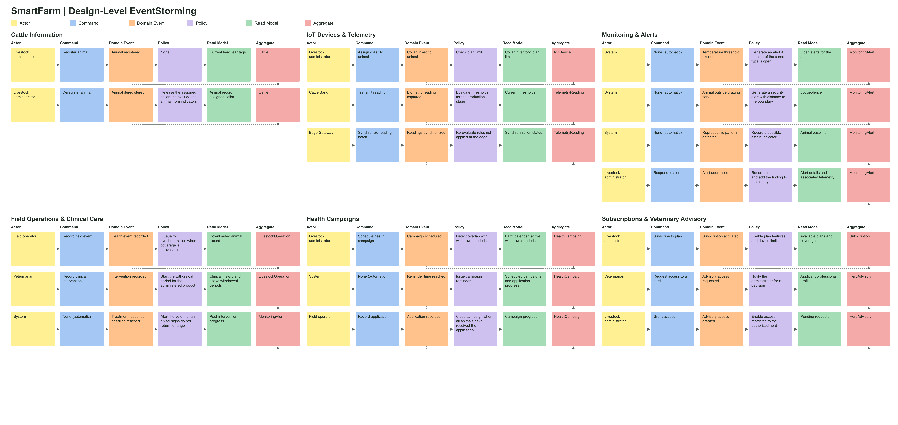

*Figura 4.1.1. Design-Level EventStorming de SmartFarm en inglés: Commands, Actors, Domain Events, Policies, Aggregates y Read Models. Elaboración propia.*

Abrir tablero Miro del Design-Level EventStorming ([https://tinyurl.com/25yajtgr](https://tinyurl.com/25yajtgr))

**Reglas propuestas para validación**

Al diseñar la solución se proponen tres reglas adicionales: **configurar los umbrales por etapa productiva**, representados mediante `Threshold`; **distinguir las observaciones del operario de los diagnósticos del médico veterinario**, con operaciones y permisos diferentes; y **conservar para revisión los registros pendientes de sincronización sobre animales dados de baja**, sin aplicarlos al estado central. Son decisiones del diseño propuesto que requieren validación; no se presentan como respuestas confirmadas a las cuatro preguntas abiertas del Big Picture de la sección 2.4.

#### 4.1.1.1. Candidate Context Discovery

Para identificar los contextos acotados se aplicó la técnica **look-for-pivotal-events**, que consiste en buscar los hechos del negocio que marcan un cambio de estado entre fases distintas del proceso. Se eligió esta técnica sobre las alternativas porque el Big Picture ya había dejado ordenados los eventos sobre una línea de tiempo, y porque el dominio ganadero presenta transiciones nítidas: un animal pasa de ser un registro administrativo a ser un sujeto vigilado, y de ahí a ser un paciente en tratamiento.

*Estado 1. Identificación de eventos pivote sobre la línea temporal del dominio. Elaboración propia.*

Abrir tablero Miro de Candidate Context Discovery ([https://tinyurl.com/25yajtgr](https://tinyurl.com/25yajtgr))

*Estado 2. Trazado inicial de fronteras emergentes a partir de cambios de responsabilidad y reglas. Elaboración propia.*

Abrir tablero Miro de Candidate Context Discovery ([https://tinyurl.com/25yajtgr](https://tinyurl.com/25yajtgr))

*Estado 3. Primera partición en contextos candidatos, todavía exploratoria. Elaboración propia.*

Abrir tablero Miro de Candidate Context Discovery ([https://tinyurl.com/25yajtgr](https://tinyurl.com/25yajtgr))

**Eventos pivote y fronteras que revelan**

| Evento pivote | Antes del evento | Después del evento | Frontera que sugiere |
|---|---|---|---|
| Collar vinculado al animal | La telemetría pertenece a un aparato del inventario | La telemetría pertenece a un ser vivo con historia | Separa IoT Assets de Operations & Monitoring |
| Umbral de temperatura superado | El sistema observa y almacena | El sistema interviene y exige respuesta | Separa la captura de la respuesta sanitaria |
| Diagnóstico registrado | Existe una sospecha sustentada en datos | Existe una certeza clínica con trazabilidad | Separa el monitoreo del historial clínico |
| Suscripción activada | El predio es un prospecto comercial | El predio es un cliente con límites y capacidades | Separa Subscription Plans del resto de la operación |
| Animal dado de baja | El animal alimenta los indicadores | El animal cierra su historia y sale del conteo | Delimita qué información alimenta la analítica |

**Contextos candidatos identificados**

El recorrido de los eventos pivote del diseño produjo ocho contextos candidatos. Su delimitación se propone en este capítulo a partir de responsabilidades y reglas de la solución; el lenguaje ubicuo de la sección 2.5 aporta el vocabulario compartido del negocio, sin dividirlo por contextos de software:

| Contexto candidato | Responsabilidad | Tipo de subdominio |
|---|---|---|
| Identity & Access Management | Cuentas, autenticación, roles y autorización de acceso de terceros sobre un hato | Genérico |
| Profiles | Datos personales y profesionales de los actores | Soporte |
| Cattle Information | Identidad y datos productivos de cada animal | Core |
| IoT Assets | Inventario de collares y su asignación a animales | Soporte |
| Operations & Monitoring | Captura de telemetría, evaluación de reglas, alertas y eventos de campo | **Core** |
| Planning | Calendario ganadero, campañas sanitarias y recordatorios | Soporte |
| Dashboard & Analytics | Indicadores, tendencias y reportes derivados | Soporte |
| Subscription Plans | Planes, límites, facturación y renovación | Genérico |

**Operations & Monitoring es el core domain** de la solución. Es el contexto que concentra la propuesta de valor, el que resuelve el problema central identificado en las entrevistas, la detección tardía, y el único que no puede sustituirse por una alternativa comercial sin perder la razón de ser del producto. Cattle Information lo acompaña como core secundario, porque sin la ficha individual del animal la telemetría carece de sujeto.

#### 4.1.1.2. Domain Message Flows Modeling

Para visualizar cómo colaboran los contextos en los casos reales del negocio se aplicó **Domain Storytelling**. Cada historia se narra con actores, actividades numeradas y objetos de trabajo, siguiendo la secuencia en que ocurren. Se modelaron tres historias que atraviesan la mayor cantidad de contextos y que representan los flujos de mayor valor.

**Historia 1. Incorporación de un animal al hato monitoreado**

| # | Actor | Actividad | Objeto de trabajo | Destinatario | Contexto |
|---|---|---|---|---|---|
| 1 | Administrador ganadero | registra | el animal con su arete y datos productivos | Cattle Information | Cattle Information |
| 2 | Cattle Information | publica | el hecho "animal registrado" | IoT Assets | Cattle Information |
| 3 | Administrador ganadero | solicita | la asignación de un collar disponible | IoT Assets | IoT Assets |
| 4 | IoT Assets | consulta | el límite de dispositivos del plan vigente | Subscription Plans | IoT Assets |
| 5 | Subscription Plans | responde | el límite y los dispositivos ya asignados | IoT Assets | Subscription Plans |
| 6 | IoT Assets | confirma | la asignación del collar al animal | Administrador ganadero | IoT Assets |
| 7 | IoT Assets | publica | el hecho "collar vinculado al animal" | Operations & Monitoring | IoT Assets |
| 8 | Cattle Band | transmite | la primera lectura biométrica | Operations & Monitoring | Operations & Monitoring |
| 9 | Operations & Monitoring | atribuye | la lectura al animal correspondiente | Cattle Information | Operations & Monitoring |

*Figura 10. Elaboración de creación propia por datos recolectados, startup SmartFarm.*

Abrir tablero Figma de Domain Message Flows ([https://tinyurl.com/BigPictureEventStorming](https://tinyurl.com/BigPictureEventStorming))

**Historia 2. Detección de fiebre durante el pastoreo sin cobertura**

| # | Actor | Actividad | Objeto de trabajo | Destinatario | Contexto |
|---|---|---|---|---|---|
| 1 | Cattle Band | transmite por Wi-Fi local | la lectura de temperatura y posición | Portable Edge Gateway | Borde |
| 2 | Portable Edge Gateway | almacena | la lectura con su estado de sincronización | base local | Borde |
| 3 | Portable Edge Gateway | evalúa | la lectura contra los umbrales en caché | regla local | Borde |
| 4 | Portable Edge Gateway | genera | la alerta local de severidad crítica | Mobile Application | Borde |
| 5 | Operario de campo | recibe | la alerta en el potrero sin Internet | alerta | Borde |
| 6 | Operario de campo | registra | el evento de salud observado | Mobile Application | Operations & Monitoring |
| 7 | Portable Edge Gateway | sincroniza al recuperar señal | el lote de lecturas y alertas pendientes | Operations & Monitoring | Operations & Monitoring |
| 8 | Operations & Monitoring | valida y persiste | la telemetría y el evento del operario | base central | Operations & Monitoring |
| 9 | Mobile Application | muestra | la notificación local de la alerta sincronizada | Administrador ganadero | Operations & Monitoring |
| 10 | Médico veterinario | consulta | la telemetría y los antecedentes del animal | Operations & Monitoring | Operations & Monitoring |
| 11 | Operations & Monitoring | verifica | la autorización vigente del profesional | Identity & Access Management | Identity & Access Management |
| 12 | Médico veterinario | registra | la intervención con producto y dosis | Operations & Monitoring | Operations & Monitoring |
| 13 | Operations & Monitoring | inicia | el periodo de retiro del producto aplicado | Planning | Planning |

*Figura 11. Elaboración de creación propia por datos recolectados, startup SmartFarm.*

Abrir tablero Figma de Domain Message Flows ([https://tinyurl.com/BigPictureEventStorming](https://tinyurl.com/BigPictureEventStorming))

**Historia 3. Contratación de un plan y habilitación de capacidades**

| # | Actor | Actividad | Objeto de trabajo | Destinatario | Contexto |
|---|---|---|---|---|---|
| 1 | Visitante | compara | los planes y estima el costo de su hato | Landing Page | Subscription Plans |
| 2 | Visitante | inicia | la contratación con el plan y la cantidad de cabezas seleccionados | Landing Page → Web Application | Subscription Plans |
| 3 | Administrador ganadero | contrata | el plan para su unidad productiva | Subscription Plans | Subscription Plans |
| 4 | Subscription Plans | solicita | la sesión de pago del periodo | Stripe | Subscription Plans |
| 5 | Stripe | confirma | el pago con un evento firmado | Subscription Plans | Subscription Plans |
| 6 | Subscription Plans | publica | el hecho "suscripción activada" | IoT Assets, Dashboard & Analytics | Subscription Plans |
| 7 | IoT Assets | habilita | el límite de dispositivos del plan | Administrador ganadero | IoT Assets |
| 8 | Dashboard & Analytics | habilita | los reportes incluidos en el plan | Administrador ganadero | Dashboard & Analytics |

*Figura 12. Elaboración de creación propia por datos recolectados, startup SmartFarm.*

Abrir tablero Figma de Domain Message Flows ([https://tinyurl.com/BigPictureEventStorming](https://tinyurl.com/BigPictureEventStorming))

**Lectura de los flujos**

Las tres historias confirman que **Operations & Monitoring es el punto de convergencia** del sistema: participa en las tres y es el único contexto que recibe información tanto de los dispositivos como de las personas. También muestran que **Subscription Plans actúa como habilitador transversal**: no interviene en la operación diaria, pero condiciona lo que los demás contextos pueden hacer. Finalmente, la historia 2 evidencia que el borde debe poder **decidir por sí mismo** cuando no hay cobertura, lo que obliga a replicar en el Edge una porción de las reglas que pertenecen al contexto de monitoreo.

#### 4.1.1.3. Bounded Context Canvases

Cada contexto candidato se diseñó mediante un Bounded Context Canvas, siguiendo el proceso iterativo de definición del panorama, destilación de reglas de negocio y captura del lenguaje ubicuo, análisis de capacidades, estratificación, captura de dependencias y crítica del diseño. Se presentan ordenados por importancia para el negocio, empezando por el core domain.

**Canvas 1. Operations & Monitoring**

| Bloque | Contenido |
|---|---|
| **Propósito** | Convertir la telemetría capturada por los dispositivos en decisiones oportunas sobre la salud, la reproducción y la seguridad del ganado. |
| **Clasificación estratégica** | Core domain. Diferenciador del producto y razón de compra declarada por los seis entrevistados. |
| **Modelo de negocio** | Centro de valor. Su rendimiento determina la reducción de mortalidad que sostiene la propuesta comercial. |
| **Evolución** | En desarrollo activo. Se espera que sus reglas se refinen con cada ciclo de validación. |
| **Reglas de negocio destiladas** | El umbral depende de la etapa productiva del animal. No se genera una segunda alerta del mismo tipo para el mismo animal dentro de la ventana de 6 horas. Una lectura cuya precisión de posición excede la tolerancia no es concluyente. Un animal inactivo no genera alertas. El tiempo de respuesta se mide entre la generación y la atención de la alerta. |
| **Lenguaje ubicuo** | Telemetry, Rumination, Red Alert, Clinical Threshold, Geofence, Last Known Location, Estrus Detection, Insemination Event |
| **Capacidades entrantes** | Recibir telemetría del dispositivo y del borde. Recibir eventos de campo del operario. Recibir intervenciones clínicas del veterinario. Entregar configuración de umbrales y geocercas al borde. |
| **Capacidades salientes** | Publicar alertas generadas. Solicitar notificaciones. Exponer telemetría e historial a las aplicaciones y a Analytics. |
| **Dependencias** | Consume identidad de IAM, ficha del animal de Cattle Information y asignación de dispositivo de IoT Assets. Las aplicaciones móviles consultan sus alertas para mostrar notificaciones locales. |
| **Crítica del diseño** | Es el contexto con mayor superficie. Se evaluó dividirlo en Telemetry y Alerting, y se descartó porque la regla de deduplicación exige que ambos compartan la misma transacción. |

*Canvas 1. Bounded Context Canvas de Operations & Monitoring. Elaboración propia.*

Abrir tablero Figma de los Bounded Context Canvases ([https://tinyurl.com/BigPictureEventStorming](https://tinyurl.com/BigPictureEventStorming))

**Canvas 2. Cattle Information**

| Bloque | Contenido |
|---|---|
| **Propósito** | Mantener la identidad y los datos productivos de cada animal del hato, y ser la fuente única de verdad sobre qué animales existen y en qué estado. |
| **Clasificación estratégica** | Core secundario. Sin ficha individual la telemetría carece de sujeto. |
| **Modelo de negocio** | Habilitador. Su calidad determina la confiabilidad de todo lo demás. |
| **Evolución** | Estable. El modelo del animal cambia poco una vez definido. |
| **Reglas de negocio destiladas** | El arete es único dentro de la unidad productiva, no globalmente. La etapa productiva se historia con periodos de vigencia. La fecha de vigencia de un cambio de etapa no puede ser futura. Un animal dado de baja conserva su historia pero sale del conteo del hato. |
| **Lenguaje ubicuo** | Cattle, Herd, Ear Tag, Breed, Life Stage, Lot, Paddock, Genealogy, Individual Record |
| **Capacidades entrantes** | Registrar animal. Actualizar etapa productiva. Registrar baja con motivo. Agrupar en lotes. |
| **Capacidades salientes** | Exponer la ficha y el estado del animal. Publicar el alta y la baja de animales. |
| **Dependencias** | Consume la identidad del predio de IAM. Es consumido por IoT Assets, Operations & Monitoring, Planning y Analytics. |
| **Crítica del diseño** | Se evaluó incorporar aquí el historial clínico y se descartó: la intervención clínica pertenece al flujo de monitoreo y atención, no a la identidad del animal. |

*Canvas 2. Bounded Context Canvas de Cattle Information. Elaboración propia.*

Abrir tablero Figma de los Bounded Context Canvases ([https://tinyurl.com/BigPictureEventStorming](https://tinyurl.com/BigPictureEventStorming))

**Canvas 3. IoT Assets**

| Bloque | Contenido |
|---|---|
| **Propósito** | Administrar el inventario de collares inteligentes y controlar a qué animal está asignado cada uno en cada momento. |
| **Clasificación estratégica** | Soporte. Necesario pero no diferenciador. |
| **Modelo de negocio** | Control de activos. Vincula la capacidad contratada con la capacidad efectivamente usada. |
| **Evolución** | Estable, con crecimiento asociado a nuevos tipos de dispositivo. |
| **Reglas de negocio destiladas** | Un dispositivo solo puede tener una asignación abierta a la vez. No se puede asignar más allá del límite del plan contratado. Al dar de baja el animal, su collar queda liberado. La telemetría del periodo de asignación se conserva vinculada al animal aunque el collar se reasigne. Un dispositivo sin comunicación durante más de 48 horas cambia de estado. |
| **Lenguaje ubicuo** | Smart Collar, Device Band, Device Assignment, Battery Level, Device Status, Blind Zone |
| **Capacidades entrantes** | Registrar dispositivo. Asignar y liberar. Consultar inventario y estado. |
| **Capacidades salientes** | Exponer la asignación vigente. Publicar el vínculo y la liberación del dispositivo. |
| **Dependencias** | Consulta el límite del plan a Subscription Plans y la existencia del animal a Cattle Information, ambas mediante Anti-corruption Layer. |
| **Crítica del diseño** | Se evaluó fusionarlo con Cattle Information y se descartó: el dispositivo tiene un ciclo de vida propio, se compra, se asigna, se libera y se da de baja con independencia del animal. |

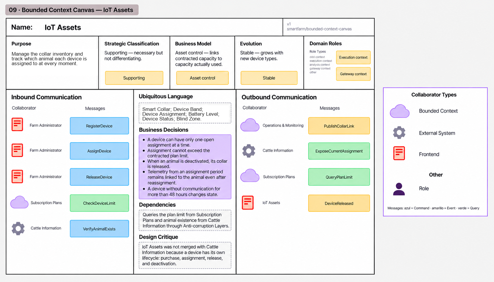

*Canvas 3. Bounded Context Canvas de IoT Assets. Elaboración propia.*

Abrir tablero Figma de los Bounded Context Canvases ([https://tinyurl.com/BigPictureEventStorming](https://tinyurl.com/BigPictureEventStorming))

**Canvas 4. Planning**

| Bloque | Contenido |
|---|---|
| **Propósito** | Programar las faenas sanitarias y reproductivas del hato y dar seguimiento a su ejecución, sustituyendo la dependencia de la memoria. |
| **Clasificación estratégica** | Soporte con alto valor percibido. Fue solicitado de forma independiente por Próspero, Meikoll y Grober. |
| **Modelo de negocio** | Retención. Es la funcionalidad que convierte la plataforma en parte de la rutina. |
| **Evolución** | En desarrollo. El calendario regional varía por zona. |
| **Reglas de negocio destiladas** | Una campaña programada se superpone con un periodo de retiro si su fecha cae dentro de él. El recordatorio se emite una sola vez, al alcanzar el plazo de aviso. La campaña se cierra automáticamente cuando todos los animales del lote figuran aplicados. Una revisión de seguimiento sobre un animal dado de baja pasa a no aplicable. |
| **Lenguaje ubicuo** | Livestock Calendar, Livestock Task, Health Campaign, Reminder, Quarantine, Gestation Window, Fattening Cycle |
| **Capacidades entrantes** | Programar campaña. Registrar aplicación por animal. Programar revisión de seguimiento. Configurar el plazo de aviso. |
| **Capacidades salientes** | Emitir recordatorios. Exponer campañas vencidas. Exponer periodos de retiro vigentes. |
| **Dependencias** | Consume el lote y el animal de Cattle Information, y las intervenciones de Operations & Monitoring para calcular los periodos de retiro. |
| **Crítica del diseño** | Se evaluó modelar el periodo de retiro dentro de Operations & Monitoring, donde se origina, y se decidió ubicarlo aquí porque su consulta principal es de planificación y no de vigilancia. |

*Canvas 4. Bounded Context Canvas de Planning. Elaboración propia.*

Abrir tablero Figma de los Bounded Context Canvases ([https://tinyurl.com/BigPictureEventStorming](https://tinyurl.com/BigPictureEventStorming))

**Canvas 5. Dashboard & Analytics**

| Bloque | Contenido |
|---|---|
| **Propósito** | Transformar los datos acumulados en indicadores y tendencias que sustenten decisiones productivas y sanitarias. |
| **Clasificación estratégica** | Soporte. Consume información de otros contextos sin producir hechos propios del negocio. |
| **Modelo de negocio** | Diferenciador comercial por plan. Los reportes avanzados son la funcionalidad exclusiva del plan superior. |
| **Evolución** | En crecimiento. Cada ciclo agrega indicadores. |
| **Reglas de negocio destiladas** | Todo indicador declara el periodo y la cantidad de animales excluidos del cálculo. Una curva epidemiológica requiere al menos dos casos del mismo cuadro. La comparación de un animal contra su lote requiere un mínimo de cinco animales con telemetría. Un reporte sin datos en el periodo no se genera. |
| **Lenguaje ubicuo** | Key Performance Indicator, Epidemiological Curve, Executive Report, Fattening Balance, Trend |
| **Capacidades entrantes** | Solicitar indicadores del hato. Solicitar tendencias por lote. Solicitar curva epidemiológica. Exportar reporte. |
| **Capacidades salientes** | Entregar series, promedios y valores atípicos. Entregar el archivo del reporte. |
| **Dependencias** | Lee de Operations & Monitoring, Cattle Information y Planning bajo relación Conformist. |
| **Crítica del diseño** | Es un contexto de solo lectura. Se decidió no permitirle escribir en los contextos de origen, de modo que un error en la analítica nunca corrompa el dato operativo. |

*Canvas 5. Bounded Context Canvas de Dashboard & Analytics. Elaboración propia.*

Abrir tablero Figma de los Bounded Context Canvases ([https://tinyurl.com/BigPictureEventStorming](https://tinyurl.com/BigPictureEventStorming))

**Canvas 6. Identity & Access Management**

| Bloque | Contenido |
|---|---|
| **Propósito** | Establecer quién es cada usuario, a qué unidades productivas puede acceder y con qué alcance, incluida la relación de asesoría entre un profesional y un hato ajeno. |
| **Clasificación estratégica** | Genérico en lo técnico, con una porción de dominio propia. La asesoría del hato es una relación del negocio ganadero, no un concepto de infraestructura. |
| **Modelo de negocio** | Habilitador y canal. La asesoría convierte al veterinario en promotor de la plataforma. |
| **Evolución** | Estable. |
| **Reglas de negocio destiladas** | Un profesional accede únicamente a los hatos sobre los que tiene una asesoría vigente. La asesoría puede tener fecha de vencimiento y expira sola. Al revocarla, los registros clínicos previos conservan su autoría. Cinco intentos fallidos consecutivos bloquean la cuenta 15 minutos. El número de colegiatura es único entre perfiles verificados. |
| **Lenguaje ubicuo** | Herd Advisory, Advisory Scope, Colegiatura, Cattle Rancher, Farm Administrator, Veterinarian, Ranch |
| **Capacidades entrantes** | Registrar unidad productiva. Autenticar. Completar perfil profesional. Solicitar, conceder y revocar asesoría. |
| **Capacidades salientes** | Resolver la identidad y el alcance de acceso de cada solicitud. |
| **Dependencias** | Delega la verificación de credenciales en Firebase Authentication mediante Anti-corruption Layer. |
| **Crítica del diseño** | Aquí se tomó la decisión de **absorber el contexto candidato Profiles**, que se detalla en la sección de Context Mapping. |

*Canvas 6. Bounded Context Canvas de Identity & Access Management. Elaboración propia.*

Abrir tablero Figma de los Bounded Context Canvases ([https://tinyurl.com/BigPictureEventStorming](https://tinyurl.com/BigPictureEventStorming))

**Canvas 7. Subscription Plans**

| Bloque | Contenido |
|---|---|
| **Propósito** | Administrar los planes contratados, sus límites y su facturación, y determinar qué capacidades tiene habilitada cada unidad productiva. |
| **Clasificación estratégica** | Genérico. Su mecánica es común a cualquier plataforma bajo suscripción. |
| **Modelo de negocio** | Fuente de ingresos. Sostiene los Business Goals de captación y renovación. |
| **Evolución** | Estable, con cambios asociados a la política comercial. |
| **Reglas de negocio destiladas** | El plan define el límite de dispositivos y el conjunto de funcionalidades habilitadas. Una solicitud dirigida a una funcionalidad no incluida se rechaza indicando el plan requerido. La modalidad preferida por el segmento es el pago anual con tarifa fija. Una suscripción cancelada conserva su historial de pagos. |
| **Lenguaje ubicuo** | Plan, Annual Subscription, Device Limit, Plan Coverage, Renewal |
| **Capacidades entrantes** | Contratar plan. Renovar. Cancelar. Consultar cobertura y límites. |
| **Capacidades salientes** | Exponer el límite de dispositivos y las funcionalidades habilitadas. Publicar la activación y la cancelación. |
| **Dependencias** | Delega el cobro en Stripe mediante el puerto `IPaymentGateway`, implementado por `StripePaymentGateway`. |
| **Crítica del diseño** | Se evaluó adoptar una plataforma de suscripciones de terceros. Se descartó para esta fase por la necesidad de vincular el límite de dispositivos con el inventario propio, que es una regla específica del producto. |

*Canvas 7. Bounded Context Canvas de Subscription Plans. Elaboración propia.*

Abrir tablero Figma de los Bounded Context Canvases ([https://tinyurl.com/BigPictureEventStorming](https://tinyurl.com/BigPictureEventStorming))

**Canvas 8. Profiles, contexto candidato descartado**

| Bloque | Contenido |
|---|---|
| **Propósito original** | Mantener los datos demográficos y profesionales de los actores del sistema. |
| **Resultado del análisis** | El análisis de capacidades mostró que todas sus reglas dependen de la identidad del usuario y que ninguna capacidad podía ejercerse sin consultar Identity & Access Management en la misma transacción. |
| **Decisión** | Absorbido por Identity & Access Management como el agregado `ProfessionalProfile`. La justificación completa se desarrolla en la sección siguiente. |

*Canvas 8. Bounded Context Canvas de Profiles, contexto candidato descartado. Elaboración propia.*

Abrir tablero Figma de los Bounded Context Canvases ([https://tinyurl.com/BigPictureEventStorming](https://tinyurl.com/BigPictureEventStorming))

### 4.1.2. Context Mapping

El Context Mapping documenta las relaciones estructurales entre los contextos acotados y deja constancia de las alternativas que el equipo evaluó antes de llegar al diseño final.

El mapa se presenta en dos vistas. La primera muestra las relaciones entre los contextos acotados del backend, ordenadas de arriba hacia abajo desde el contexto upstream hacia el downstream. La segunda muestra las integraciones con el borde, los dispositivos y los servicios externos. Separarlas evita el cruce de relaciones que hacía ilegible una única vista con todos los elementos.

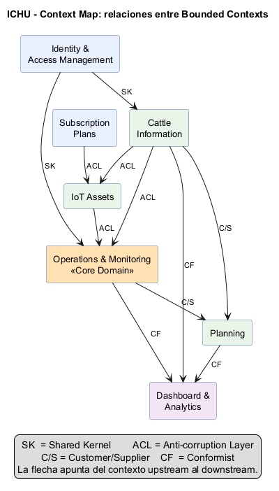

*Figura 4.2. Context Map de los Bounded Contexts. Elaboración propia con PlantUML.*

Abrir código fuente PlantUML del Context Map ([https://tinyurl.com/249fhr4v](https://tinyurl.com/249fhr4v))

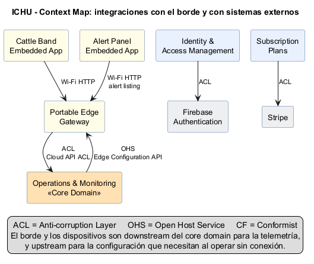

*Figura 4.3. Integraciones con el borde y con sistemas externos. Elaboración propia con PlantUML.*

Abrir código fuente PlantUML de integraciones externas ([https://tinyurl.com/25ogx3j8](https://tinyurl.com/25ogx3j8))

**Patrones aplicados**

| Relación | Patrón | Justificación |
|---|---|---|
| Identity & Access Management con Cattle, Monitoring, Planning y Analytics | Shared Kernel | Los identificadores de unidad productiva y de usuario son compartidos por todos los contextos. Se trata de un núcleo mínimo y deliberadamente pequeño: solo identificadores, nunca comportamiento. |
| Cattle Information hacia Operations & Monitoring | Customer/Supplier con Anti-corruption Layer | Monitoring necesita saber si el animal existe y en qué etapa productiva está para elegir el umbral. El ACL `Cattle Lookup` traduce la ficha completa a lo mínimo que la regla necesita. |
| Cattle Information hacia IoT Assets | Customer/Supplier con Anti-corruption Layer | El ACL `Cattle Assignment` valida la existencia del animal sin acoplar el inventario de dispositivos al modelo del ganado. |
| IoT Assets hacia Operations & Monitoring | Customer/Supplier con Anti-corruption Layer | El ACL `IoT Assets Lookup` resuelve a qué animal pertenece cada lectura sin exponer el ciclo de vida del dispositivo. |
| Subscription Plans hacia IoT Assets | Customer/Supplier con Anti-corruption Layer | El ACL `Subscription Entitlement` traduce el plan comercial a un número de dispositivos permitidos, que es lo único que la regla de asignación necesita. |
| Monitoring, Cattle y Planning hacia Dashboard & Analytics | Conformist | Analytics consume los modelos tal como los publican los contextos de origen, sin negociar cambios ni traducir. Es aceptable porque su relación es de solo lectura y un cambio aguas arriba solo obliga a recalcular. |
| Operations & Monitoring hacia Portable Edge Gateway | Open Host Service | El `Edge Configuration API` publica un contrato estable de umbrales, geocercas y asignaciones que cualquier dispositivo de borde puede consumir. |
| Portable Edge Gateway hacia Operations & Monitoring | Anti-corruption Layer | El `ICHU Cloud API ACL` traduce el modelo local del borde, orientado a la supervivencia sin conexión, al contrato de la nube. |
| Identity con Firebase Authentication y Subscription Plans con Stripe | Anti-corruption Layer | Dos servicios externos sobre los que el equipo no tiene control. El ACL aísla el dominio de cualquier cambio en sus contratos. |
| Aplicación web con OpenStreetMap | Conformist | La visualización cartográfica se adapta al contrato de las teselas de OpenStreetMap, porque no hay reglas de negocio propias que proteger. |

**Alternativas evaluadas y descartadas**

El equipo discutió cinco alternativas de organización antes de fijar el mapa anterior.

**¿Qué pasaría si dividimos Operations & Monitoring en Telemetry y Alerting?** La separación resultaba atractiva porque la ingesta de datos y la generación de alertas tienen ritmos distintos. Se descartó porque la regla que impide duplicar alertas dentro de una ventana de seis horas exige leer las alertas abiertas en el mismo instante en que se evalúa la lectura entrante. Separarlos obligaría a una consulta entre contextos en el camino crítico de cada lectura recibida.

**¿Qué pasaría si movemos el periodo de retiro de Planning a Operations & Monitoring?** El periodo de retiro nace de una intervención clínica, que pertenece a Monitoring. Sin embargo, sus dos consultas principales son de planificación: verificar si una campaña se superpone con un retiro vigente, y saber si la producción de un animal tiene restricción. Se decidió ubicarlo en Planning y que Monitoring publique el hecho que lo origina.

**¿Qué pasaría si duplicamos la ficha del animal en Operations & Monitoring para romper la dependencia?** La duplicación eliminaría el ACL y aceleraría la evaluación de reglas. Se descartó porque introduciría dos fuentes de verdad sobre la etapa productiva, que es justamente el dato del que depende la elección del umbral. Un desfase entre ambas copias produciría alertas incorrectas.

**¿Qué pasaría si creamos un contexto compartido de Notificaciones?** Tres contextos necesitan notificar: Monitoring por alertas, Planning por recordatorios y Subscription por vencimientos. Se evaluó extraer esa capacidad a un contexto propio. Se descartó para esta fase porque el contenido de cada notificación pertenece al dominio que la origina, y un contexto compartido terminaría conociendo las reglas de los tres. La duplicación del adaptador de mensajería resultó preferible al acoplamiento.

**¿Qué pasaría si mantenemos Profiles como contexto independiente?** Esta es la alternativa que sí cambió el diseño, y se resuelve a continuación.

**Decisión sobre el contexto Profiles**

El análisis de capacidades de Profiles mostró que ninguna de sus operaciones podía completarse sin consultar Identity & Access Management dentro de la misma transacción. Completar un perfil profesional requiere validar que el usuario existe y tiene rol de veterinario. Consultar un perfil requiere resolver antes si el solicitante tiene derecho a verlo. La única regla propia, la unicidad del número de colegiatura entre perfiles verificados, depende del estado de verificación que gestiona Identity.

En consecuencia, **Profiles se absorbe dentro de Identity & Access Management** como el agregado `ProfessionalProfile`, y la solución implementa **siete contextos acotados** en lugar de los ocho candidatos. Esta decisión es la que explica que el componente de interfaz del contexto se denomine `Identity & Profile API` en el modelo de arquitectura.

El Ubiquitous Language del capítulo anterior conserva ambos bloques separados porque documenta el vocabulario del negocio, donde el perfil profesional y la cuenta de acceso son conceptos distintos para los usuarios. La fusión es una decisión de diseño de la solución, no una fusión conceptual del dominio.

### 4.1.3. Software Architecture

La arquitectura de la solución se representa aplicando el C4 Model, elaborado como Diagram-as-Code en Structurizr DSL. El modelo reúne cuatro personas, cinco sistemas externos, diez containers, 156 componentes clasificados por capa y dieciséis vistas: System Landscape, System Context, Containers, Deployment, una vista de componentes por cada bounded context del backend, las vistas de componentes del collar y del Edge, y tres flujos dinámicos. Los 137 componentes del backend se generan desde el código de `ichu-web-service` en `backend-components.dsl`. La separación entre el alojamiento de archivos web y su ejecución en el navegador se hace explícita en las vistas de containers y despliegue.

El código fuente de todos los diagramas de este capítulo forma parte del repositorio. El modelo C4 se encuentra en `report/assets/diagram-sources/structurizr/workspace-ichu-c4.dsl` ([https://tinyurl.com/2bw8zfnw](https://tinyurl.com/2bw8zfnw)) y las vistas se exportaron desde esa fuente. Los diagramas UML y de base de datos se encuentran en la carpeta assets/diagram-sources/puml ([https://tinyurl.com/246ycxz2](https://tinyurl.com/246ycxz2)).

La solución se organiza como un **monolito modular** en la nube, en el que cada contexto acotado es un módulo interno con su propio esquema de base de datos, acompañado de un servicio de borde y dos aplicaciones embebidas. Se eligió el monolito modular sobre una arquitectura de microservicios porque el equipo tiene cinco integrantes y un ciclo de quince semanas: el aislamiento por módulos preserva los límites de los contextos sin pagar el costo operativo de desplegar y coordinar siete servicios independientes. La modularidad interna deja abierta la extracción posterior de cualquier módulo que lo justifique.

#### 4.1.3.1. Software Architecture System Landscape Diagram

El System Landscape presenta el panorama completo en el que se inserta la solución: las cuatro personas que interactúan con ella, los dos dispositivos físicos del predio (el collar y el panel de alertas) y los tres servicios externos de los que depende. Esta vista muestra el entorno general, mientras que el diagrama de contexto se centra en el alcance y las relaciones de ICHU. En el modelo actual ambas vistas comparten estos participantes; ninguna expone los detalles internos de los containers.

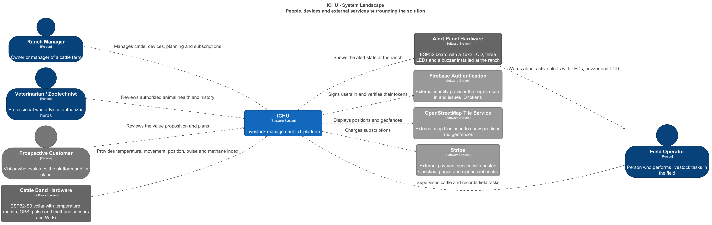

*Figura 4.4. System Landscape. Elaboración propia con Structurizr.*

#### 4.1.3.2. Software Architecture Context Level Diagram

El Context Diagram sitúa a ICHU como una caja única en el centro, rodeada por sus usuarios y por los sistemas con los que intercambia información. Permite discutir el alcance de la solución sin entrar en decisiones de implementación.

Los actores representados son el **administrador ganadero**, que gestiona el ganado, los dispositivos, la planificación y la suscripción; el **operario de campo**, que supervisa el ganado durante las faenas y opera con o sin cobertura; el **médico veterinario**, que revisa la información autorizada de los hatos que asesora; y el **visitante**, que consulta la propuesta y los planes en el sitio público.

Los sistemas externos son el **hardware del collar inteligente**, que aporta temperatura, actividad, posición, pulso e índice de metano; el **hardware del panel de alertas**, que muestra el estado de las alertas en el predio con LEDs, zumbador y pantalla LCD; **Firebase Authentication**, que identifica a los usuarios; **Stripe**, que cobra las suscripciones con su página de pago y confirma cada pago con un webhook firmado; y **OpenStreetMap**, que entrega las teselas del mapa de posiciones y geocercas.

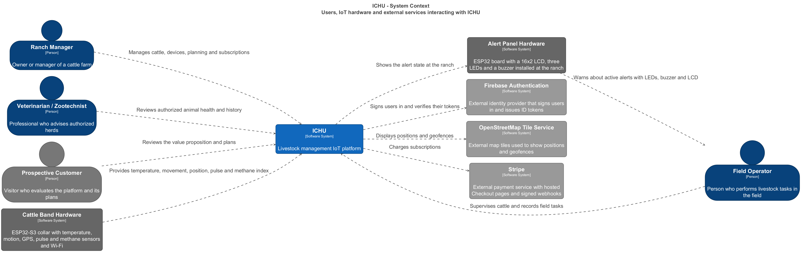

*Figura 4.5. System Context. Elaboración propia con Structurizr.*

#### 4.1.3.3. Software Architecture Container Level Diagram

El Container Diagram descompone la solución en aplicaciones, servicios y almacenes de datos, y muestra sus responsabilidades, tecnologías y protocolos de comunicación. Distingue los archivos alojados en un servidor web de los clientes que se ejecutan en el navegador: alojar una SPA no significa que Angular se ejecute en ese servidor.

| Container | Tecnología | Responsabilidad |
|---|---|---|
| Website | HTML, CSS y JavaScript | Landing Page estática con la propuesta de valor y los planes, publicada en GitHub Pages |
| Web Application | Alojamiento web estático | Archivos compilados de la SPA, publicados en Firebase Hosting |
| Single Page Application | Angular con TypeScript | SPA ejecutada en el navegador para gestionar ganado, dispositivos, planificación, analítica y suscripciones |
| Mobile Application | Flutter con Dart | Consulta de ganado, telemetría y alertas en el campo, con notificaciones locales de las alertas nuevas |
| Cattle Band Embedded Application | C++ sobre ESP32-S3 con Modest IoT Nano Framework | Lectura de temperatura, movimiento, posición, pulso, índice de metano y batería; envío HTTP por Wi-Fi al Edge cada 10 s, con cola de 60 lecturas |
| Alert Panel Embedded Application | C++ sobre ESP32 con Modest IoT Nano Framework | Consulta de las alertas activas del Edge cada 3 s y aviso con LEDs, zumbador y pantalla LCD |
| Portable Edge Service | Flask con Peewee ORM sobre Python | Recepción HTTP de los collares por la red local, almacenamiento local, evaluación de umbrales y geocercas, y sincronización periódica |
| Edge Database | SQLite | Lecturas, alertas, estado de sincronización, umbrales y geocercas en caché |
| ICHU Web Service | ASP.NET Core Web API | API REST en la nube implementada como un monolito modular, con los siete contextos como módulos internos |
| ICHU Cloud Database | PostgreSQL | Persistencia relacional con un esquema por contexto acotado |

El navegador descarga los archivos de la landing page desde su alojamiento web y el paquete compilado de Angular desde el alojamiento de la aplicación. El acceso desde la landing page a la aplicación corresponde a una navegación hacia la URL de la SPA, no a una llamada al backend que ejecute Angular. Una vez cargadas, las aplicaciones cliente consumen la API REST sobre HTTPS con JSON para las operaciones y consultas que lo requieren.

El icono de navegador se utiliza únicamente para la Single Page Application, donde se ejecuta el código del cliente. Website y Web Application se representan como carpetas de archivos estáticos; las bases de datos conservan la forma de cilindro y la aplicación móvil su forma de dispositivo móvil. La forma del elemento expresa su función, no el lugar desde el cual una persona lo visualiza.

El backend se denomina ICHU Web Service para expresar su responsabilidad funcional. «Monolito modular» describe la decisión arquitectónica y no forma parte de su nombre. Sigue siendo un único container de backend; los contextos acotados son módulos internos, no microservicios desplegados por separado.

El Cattle Band transmite por Wi-Fi al Portable Edge Service con `POST /api/v1/monitoring/telemetry-readings`, autenticado con la clave del collar (`Authorization: ApiKey` o `X-API-Key`) y con un `event_id` estable que hace idempotentes los reintentos. El Edge persiste las lecturas en SQLite, las evalúa con los umbrales por etapa productiva y severidad (`Warning` y `Critical`), las geocercas y las asignaciones descargadas de la API central, y un proceso aparte (`flask --app app synchronize`) envía cada 15 s los registros pendientes a `POST /api/v1/telemetry/batch`; tras un fallo, la espera se duplica hasta un máximo de 5 min. El collar nunca invoca directamente la nube. Sin Internet, el Alert Panel consulta `GET /api/v1/monitoring/alerts` del Edge cada 3 s y avisa al personal del predio. Con Internet, la Mobile Application consulta las alertas sincronizadas cada 30 s y muestra una notificación local por cada alerta nueva. El backend accede a PostgreSQL mediante Entity Framework Core con el proveedor Npgsql.

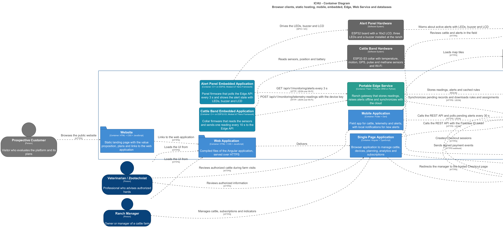

*Figura 4.6. Container Diagram. Elaboración propia con Structurizr.*

#### 4.1.3.4. Software Architecture Deployment Diagrams

El Deployment Diagram describe dónde se alojan y dónde se ejecutan las instancias de los containers en producción. Separa los dos alojamientos web del navegador que descarga y ejecuta sus archivos, así como el servicio de backend de su base de datos y de los proveedores externos.

| Nodo de despliegue | Contiene | Observación |
|---|---|---|
| Entorno del predio y zona de pastoreo | Cattle Band Device (ESP32-S3), Alert Panel Device (ESP32), Portable Edge Gateway Device y dispositivo móvil | Operan en la red Wi-Fi local; el Edge mantiene la operación sin Internet |
| Computadora del usuario / navegador | Single Page Application | Ejecuta el código descargado; no aloja los archivos para otros usuarios |
| GitHub Pages | Website | Sirve la Landing Page por HTTPS |
| Firebase Hosting | Web Application | Sirve el paquete compilado de la SPA; su ejecución ocurre en el navegador |
| Render / Web Service | ICHU Web Service | Ejecuta la API REST en un contenedor Docker, como un único monolito modular |
| Render / PostgreSQL | ICHU Cloud Database | Aloja la base relacional del backend |
| Proveedores externos | Firebase Authentication, Stripe y OpenStreetMap | Ofrecen identidad, pagos y teselas de mapa; no ejecutan el backend de ICHU |

El reparto responde directamente al hallazgo de conectividad del capítulo anterior: el 100% de los encuestados calificó la cobertura en las zonas de pastoreo como regular. Por eso el Edge Gateway, su base local y el panel de alertas se despliegan en el predio y no en la nube, y por eso las reglas de alerta se evalúan en el borde.

La Landing Page y la SPA se publican en servicios distintos: GitHub Pages y Firebase Hosting. Las consultas al backend y las llamadas a proveedores externos requieren conectividad; no se presupone que el acceso desde el predio a esos servicios esté garantizado. La operación local del Edge Gateway y su sincronización posterior se mantienen.

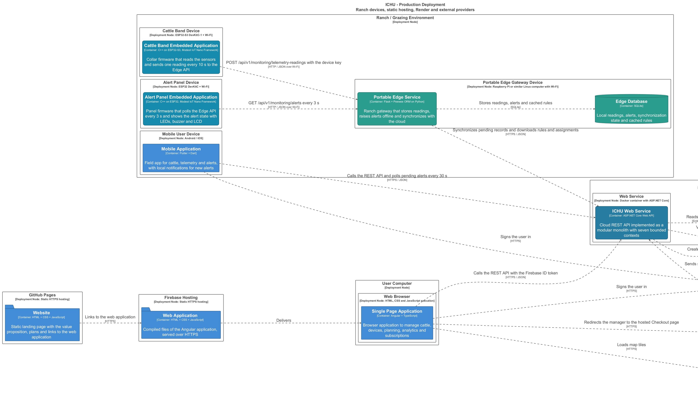

*Figura 4.7. Deployment Diagram del entorno de producción. Elaboración propia con Structurizr.*

## 4.2. Tactical-Level Domain-Driven Design

Esta sección detalla el diseño interno de cada contexto acotado. Los siete contextos se implementan como módulos del monolito modular y comparten la misma organización en cuatro capas, de modo que un integrante del equipo que conoce un módulo puede orientarse en cualquier otro.

La **Domain Layer** contiene las reglas del negocio: Aggregates, Entities, Value Objects, Domain Services y las interfaces de los Repositories. No depende de ninguna otra capa. La **Interface Layer** expone las capacidades del contexto mediante Controllers, y es la única que conoce el protocolo HTTP. La **Application Layer** orquesta los casos de uso mediante Command Services, Query Services y Event Handlers, sin contener reglas de negocio propias; sus Outbound Services son los Anti-corruption Layers que consultan a otros contextos a través de su Context Facade. La **Infrastructure Layer** implementa los Repositories definidos en el dominio con Entity Framework Core y contiene los adaptadores hacia servicios externos, como Firebase y Stripe.

Los contextos se presentan en orden de importancia para el negocio, empezando por el core domain. Las clases de cada tabla corresponden al código de `ichu-web-service`, y los diagramas de componentes, de clases y de base de datos se generan desde ese mismo código.

### 4.2.1. Bounded Context: Operations & Monitoring

Es el core domain de la solución. Recibe la telemetría de los dispositivos y del borde, evalúa las reglas que determinan cuándo una lectura representa un problema, genera las alertas, registra los eventos de campo y las intervenciones clínicas, y entrega al borde la configuración que necesita para operar sin conexión.

#### 4.2.1.1. Domain Layer

| Clase | Categoría | Propósito |
|---|---|---|
| `TelemetryReading` | Aggregate Root | Lectura de un collar retransmitida por el Edge. Su identidad es el dispositivo más el identificador que genera el firmware, de modo que un reintento no la duplica. Guarda temperatura, actividad, frecuencia cardiaca, índice de metano, batería y posición como `Measurement`. |
| `MonitoringAlert` | Aggregate Root | Alerta evaluada por el Edge. Se emite con la hora de captura de la lectura que la origina, la sustentan lecturas válidas (`AlertEvidence`) y registra cada atención como `AlertChange`. |
| `MonitoringThreshold` | Aggregate Root | Rango normal que la unidad productiva define para una métrica, una etapa productiva y una severidad (`Warning` o `Critical`). ICHU no impone rangos clínicos por defecto. |
| `Geofence` | Aggregate Root | Zona de pastoreo permitida de un lote: un polígono cerrado y simple, con una tolerancia de precisión para no concluir con posiciones imprecisas. |
| `MonitoringRuleSet` | Aggregate Root | Contador de revisión de los umbrales y geocercas de la unidad productiva; cada cambio lo avanza para que el Edge detecte la configuración nueva. |
| `LivestockOperation` | Aggregate Root | Evento de campo o intervención clínica, identificado por el identificador de operación que genera el cliente; con él la sincronización desde el móvil es idempotente. |
| `WaterTroughReading` | Aggregate Root | Lectura de temperatura de un bebedero y estado de su calentador, enviada por el controlador del bebedero. |
| `AlertChange`, `AlertEvidence`, `GeofenceVertex` | Entity | Operación aplicada a una alerta, lectura que la sustenta y vértice ordenado de una geocerca. |
| `Measurement`, `PositionMeasurement` | Value Object | Métrica capturada: un valor finito, una captura inválida con su motivo o una ausencia. Nunca se sustituye un dato faltante por cero. |
| `ThresholdRange`, `GeoCoordinate`, `TimePeriod`, `ReproductiveDetails`, `ReproductiveHistory` | Value Object | Rango normal, coordenada, periodo semiabierto y datos reproductivos de una hembra. |
| `AlertType`, `AlertSeverity`, `AlertStatus`, `MonitoredMetric`, `OperationType` y otras | Enumeraciones | Fijan los valores admitidos de cada clasificación del contexto. |
| `MonitoringRuleRevisionService` | Domain Service | Avanza la revisión de reglas cada vez que cambia un umbral o una geocerca. |
| `ReproductiveHistoryCalculator` | Domain Service | Calcula el historial reproductivo de una hembra: servicios, partos, preñeces confirmadas y días abiertos. |
| `ITelemetryReadingRepository`, `IMonitoringAlertRepository`, `IMonitoringThresholdRepository`, `IGeofenceRepository`, `IMonitoringRuleSetRepository`, `ILivestockOperationRepository`, `IOperationsMonitoringUnitOfWork` | Repository (interfaz) | Abstraen la persistencia de cada agregado y guardan los cambios como una sola unidad. |

#### 4.2.1.2. Interface Layer

| Clase | Categoría | Propósito |
|---|---|---|
| `TelemetryController` | Controller | Recibe los lotes que sincroniza el Edge (`POST /api/v1/telemetry/batch`) y devuelve las lecturas y los últimos indicadores de un animal. |
| `AlertsController` | Controller | Lista las alertas de la unidad productiva y registra su atención. |
| `EdgeGatewaysController` | Controller | Publica al Edge las reglas por revisión y las asignaciones de collares; la credencial del gateway reemplaza al usuario. |
| `MonitoringThresholdsController`, `GeofencesController` | Controller | Configuran y listan los umbrales y las geocercas. |
| `LivestockOperationsController` | Controller | Registra eventos de campo e intervenciones clínicas, sincroniza los lotes del móvil y expone el historial reproductivo. |
| `WaterTroughMonitoringController`, `WaterControllersController` | Controller | Reciben y consultan las lecturas de los bebederos. |
| `IOperationsMonitoringContextFacade` | Context Facade | Contrato de lectura para otros contextos: lecturas, alertas y operaciones como proyecciones inmutables. |

#### 4.2.1.3. Application Layer

| Clase | Categoría | Propósito |
|---|---|---|
| `EdgeSynchronizationCommandService` | Command Service | Procesa un lote del Edge: primero las lecturas y luego las alertas, de modo que una alerta del mismo lote puede citar sus lecturas. Devuelve un resultado por entrada. |
| `TelemetryReadingCommandService`, `MonitoringAlertCommandService` | Command Service | Guardan lecturas y alertas sincronizadas sin duplicarlas y registran la atención de una alerta. |
| `MonitoringThresholdCommandService`, `GeofenceCommandService` | Command Service | Configuran umbrales y geocercas y avanzan la revisión de reglas en la misma unidad de trabajo. |
| `LivestockOperationCommandService`, `WaterTroughReadingCommandService` | Command Service | Registran operaciones de campo y lecturas de bebederos. |
| `TelemetryReadingQueryService`, `MonitoringAlertQueryService`, `MonitoringThresholdQueryService`, `GeofenceQueryService`, `LivestockOperationQueryService`, `ReproductiveHistoryQueryService`, `WaterTroughMonitoringQueryService` | Query Service | Responden las consultas de las aplicaciones después de comprobar el permiso de lectura sobre la unidad productiva. |
| `MonitoringRuleSetQueryService`, `EdgeDeviceAssignmentQueryService` | Query Service | Entregan al Edge las reglas vigentes y las asignaciones de collares. |
| `OperationsMonitoringContextFacade` | Context Facade | Implementa el contrato de lectura para otros contextos sobre los repositorios del módulo. |
| `CattleInformationCattleLookup`, `IoTAssetsDeviceAttributionLookup`, `IoTAssetsEdgeDeviceAssignmentLookup`, `IamOperationsMonitoringAccessControl` | Outbound Service (ACL) | Consultan Cattle Information, IoT Assets e IAM a través de sus Context Facades para atribuir cada lectura a un animal y autorizar cada operación. |

#### 4.2.1.4. Infrastructure Layer

| Clase | Categoría | Propósito |
|---|---|---|
| `TelemetryReadingRepository`, `MonitoringAlertRepository`, `MonitoringThresholdRepository`, `GeofenceRepository`, `MonitoringRuleSetRepository`, `LivestockOperationRepository`, `WaterTroughReadingRepository` | Repository | Implementan los repositorios con Entity Framework Core sobre el esquema `monitoring`. |
| `OperationsMonitoringUnitOfWork` | Unit of Work | Guarda los cambios del módulo y reporta un conflicto de concurrencia como resultado, no como excepción. |
| `IoTAssetsEdgeGatewayAuthenticator` | Adapter | Verifica la clave del gateway de cada solicitud a través de IoT Assets, que custodia las claves. |

#### 4.2.1.5. Bounded Context Software Architecture Component Level Diagrams

La vista `OperationsMonitoringComponents` del workspace muestra los controllers, servicios, Outbound Services y repositorios del módulo, con las dependencias que declaran sus constructores, además de los Context Facades de los contextos que consulta.

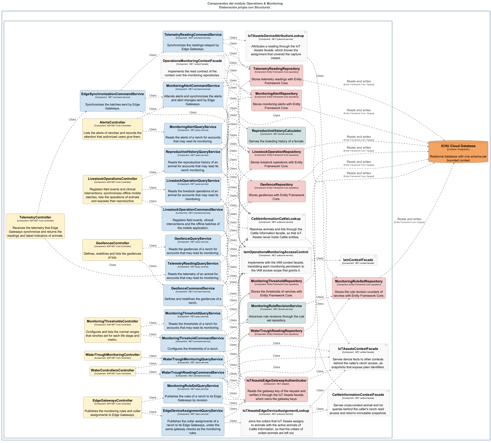

*Figura 4.8. Componentes del módulo Operations & Monitoring. Elaboración propia con Structurizr.*

Abrir fuente Structurizr ([https://tinyurl.com/2bw8zfnw](https://tinyurl.com/2bw8zfnw))

Este contexto se realiza además en dos containers fuera del backend: la aplicación embebida del collar y la pasarela de borde que recibe y evalúa la telemetría sin conexión. Sus diagramas de componentes se presentan a continuación.

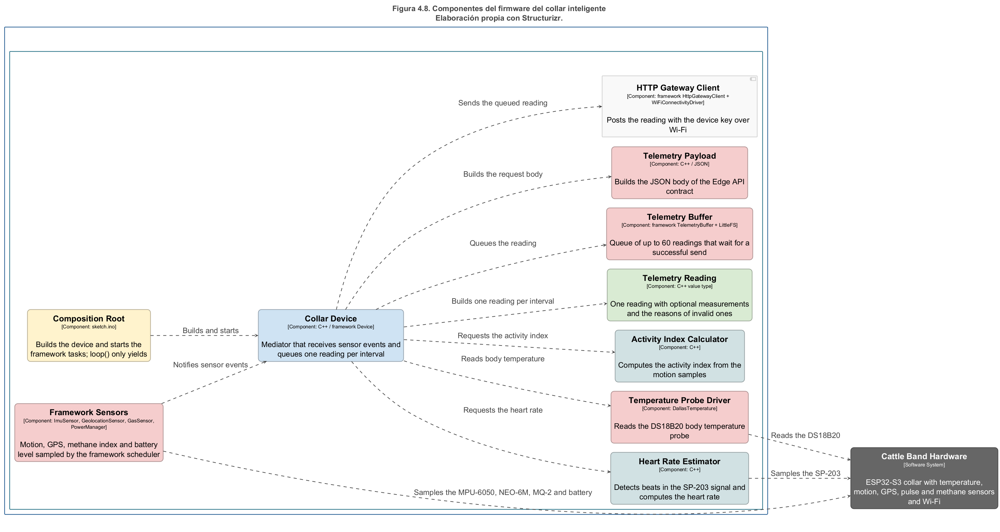

*Figura 4.9. Componentes del firmware del collar inteligente. Elaboración propia con Structurizr.*

Abrir fuente Structurizr ([https://tinyurl.com/2bw8zfnw](https://tinyurl.com/2bw8zfnw))

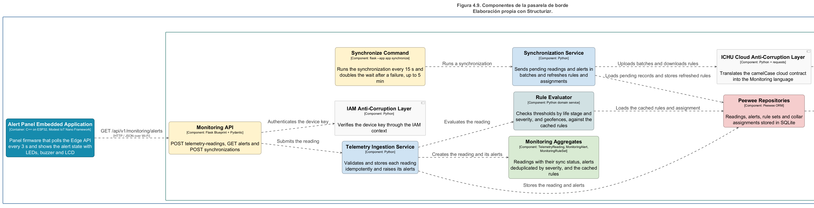

*Figura 4.10. Componentes de la pasarela de borde. Elaboración propia con Structurizr.*

Abrir fuente Structurizr ([https://tinyurl.com/2bw8zfnw](https://tinyurl.com/2bw8zfnw))

**Flujos dinámicos del contexto**

Los diagramas dinámicos ilustran la secuencia de colaboración entre componentes en los tres escenarios de conectividad que la solución debe cubrir.

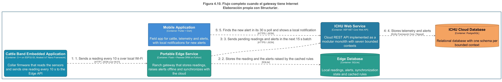

*Figura 4.11. Flujo completo cuando el gateway tiene Internet. Elaboración propia con Structurizr.*

Abrir fuente Structurizr ([https://tinyurl.com/2bw8zfnw](https://tinyurl.com/2bw8zfnw))

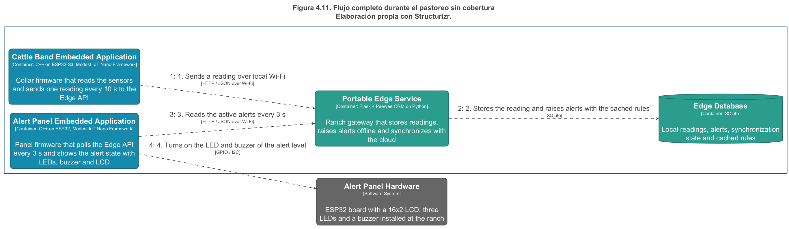

*Figura 4.12. Flujo completo durante el pastoreo sin cobertura. Elaboración propia con Structurizr.*

Abrir fuente Structurizr ([https://tinyurl.com/2bw8zfnw](https://tinyurl.com/2bw8zfnw))

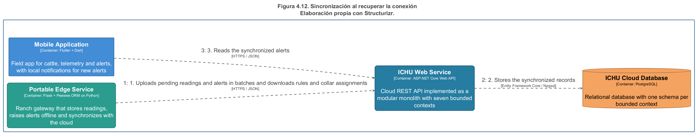

*Figura 4.13. Sincronización al recuperar la conexión. Elaboración propia con Structurizr.*

Abrir fuente Structurizr ([https://tinyurl.com/2bw8zfnw](https://tinyurl.com/2bw8zfnw))

#### 4.2.1.6. Bounded Context Software Architecture Code Level Diagrams

##### 4.2.1.6.1. Bounded Context Domain Layer Class Diagrams

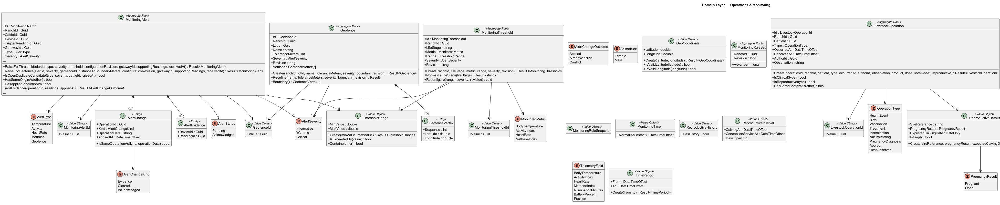

*Figura 4.14. Domain Layer de Operations & Monitoring. Elaboración propia con PlantUML.*

Abrir fuente PlantUML ([https://tinyurl.com/28ov3gyo](https://tinyurl.com/28ov3gyo))

`TelemetryReading` compone sus mediciones como Value Objects, de modo que cada valor viaja con su estado de validez. `MonitoringAlert` compone sus evidencias y sus cambios, y `Geofence` compone sus vértices en orden. Los demás agregados se relacionan con animales, collares y lotes solo por identificador.

##### 4.2.1.6.2. Bounded Context Database Design Diagram

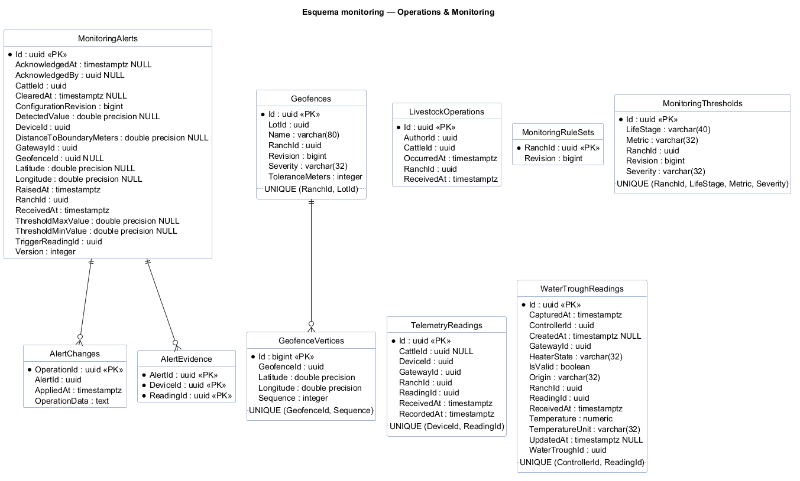

*Figura 4.15. Esquema `monitoring`. Elaboración propia con PlantUML.*

Abrir fuente PlantUML ([https://tinyurl.com/2bdd3ydl](https://tinyurl.com/2bdd3ydl))

Las mediciones de `TelemetryReadings` se guardan como columnas complejas (valor y motivo de invalidez por métrica), y la restricción `UNIQUE (DeviceId, ReadingId)` impide duplicar una lectura reenviada. `MonitoringThresholds` admite un solo rango por etapa, métrica y severidad.

### 4.2.2. Bounded Context: Cattle Information

Mantiene la identidad y los datos productivos de cada animal. Es la fuente única de verdad sobre qué animales existen, en qué etapa están y cuáles siguen activos en el hato.

#### 4.2.2.1. Domain Layer

| Clase | Categoría | Propósito |
|---|---|---|
| `Cattle` | Aggregate Root | Identidad, historial de etapas productivas y ciclo de vida del animal dentro de una unidad productiva. Un cambio de etapa o una baja cierran el periodo vigente en lugar de borrarlo. |
| `Lot` | Aggregate Root | Agrupa animales para su manejo sin que la identidad del animal dependa del lote. |
| `StagePeriod` | Entity | Etapa productiva con fecha de inicio incluida y fecha de fin excluida. |
| `LotMembership` | Entity | Pertenencia de un animal a un lote de la misma unidad productiva, con su fecha de asignación. |
| `EarTag` | Value Object | Arete del animal; su unicidad se evalúa dentro de la unidad productiva. |
| `CattleId`, `LotId` | Value Object | Identificadores tipados del animal y del lote. |
| `Breed`, `Sex`, `LifeStage`, `CattleStatus`, `ExitReason` | Enumeraciones | Clasificaciones admitidas del animal; `ExitReason` distingue muerte, venta, robo y descarte. |
| `ICattleRepository`, `ILotRepository` | Repository (interfaz) | Persistencia del animal y del lote, siempre filtrada por unidad productiva. |

#### 4.2.2.2. Interface Layer

| Clase | Categoría | Propósito |
|---|---|---|
| `CattleController` | Controller | Expone el registro, la ficha, el cambio de etapa y la baja del animal. |
| `LotsController` | Controller | Expone los lotes y la incorporación o retiro de animales. |
| `ICattleInformationContextFacade` | Context Facade | Entrega a otros contextos instantáneas inmutables del animal, del lote y de la población del hato. |

#### 4.2.2.3. Application Layer

| Clase | Categoría | Propósito |
|---|---|---|
| `CattleCommandService`, `LotCommandService` | Command Service | Comprueban el permiso y la unicidad del arete y delegan las reglas del ciclo de vida en los agregados. |
| `CattleQueryService`, `LotQueryService` | Query Service | Componen la ficha del animal con su collar y su última lectura sin copiar datos de otros contextos. |
| `CattleInformationContextFacade` | Context Facade | Atiende las consultas de otros contextos con el permiso de lectura de la unidad productiva. |
| `IamCattleAccessService`, `IoTAssetsCattleProfileIntegrationService` | Outbound Service (ACL) | Consultan IAM para el permiso, e IoT Assets y Operations & Monitoring para el collar y la última lectura. |

#### 4.2.2.4. Infrastructure Layer

| Clase | Categoría | Propósito |
|---|---|---|
| `CattleRepository`, `LotRepository` | Repository | Implementan los repositorios con Entity Framework Core sobre el esquema `cattle`. |

#### 4.2.2.5. Bounded Context Software Architecture Component Level Diagrams

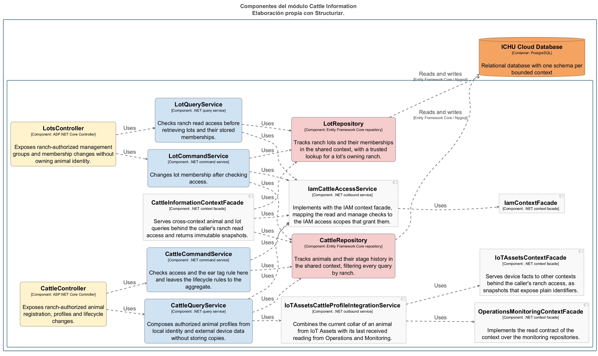

*Figura 4.16. Componentes del módulo Cattle Information. Elaboración propia con Structurizr.*

Abrir fuente Structurizr ([https://tinyurl.com/2bw8zfnw](https://tinyurl.com/2bw8zfnw))

#### 4.2.2.6. Bounded Context Software Architecture Code Level Diagrams

##### 4.2.2.6.1. Bounded Context Domain Layer Class Diagrams

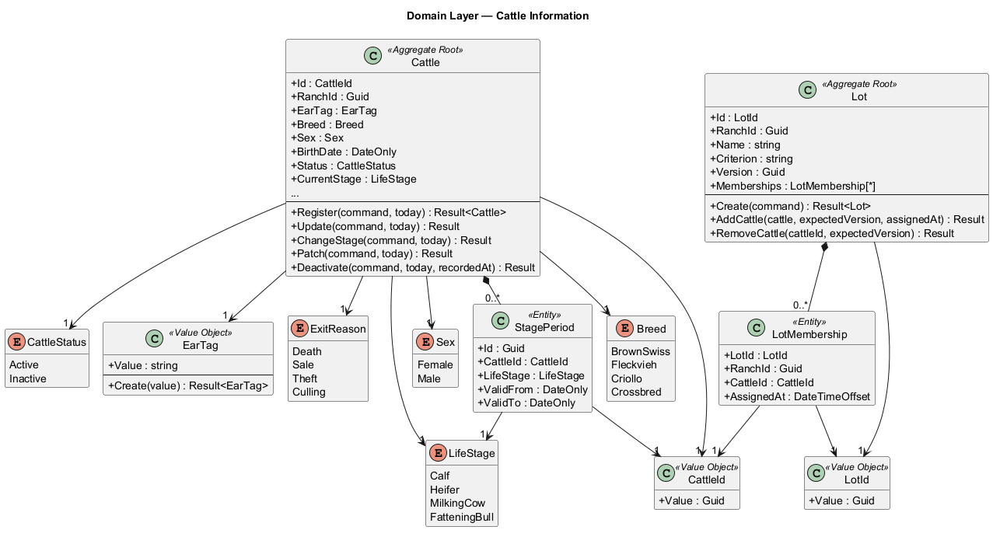

*Figura 4.17. Domain Layer de Cattle Information. Elaboración propia con PlantUML.*

Abrir fuente PlantUML ([https://tinyurl.com/255khm8u](https://tinyurl.com/255khm8u))

`Cattle` compone su historial de etapas y `Lot` compone las pertenencias de sus animales. Un lote no posee a los animales: los referencia por `CattleId`, porque un animal existe con independencia del lote al que pertenece.

##### 4.2.2.6.2. Bounded Context Database Design Diagram

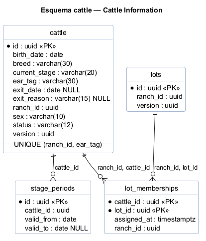

*Figura 4.18. Esquema `cattle`. Elaboración propia con PlantUML.*

Abrir fuente PlantUML ([https://tinyurl.com/26kkwvn7](https://tinyurl.com/26kkwvn7))

La restricción `UNIQUE (ranch_id, ear_tag)` implementa en la base la regla de unicidad del arete dentro de la unidad productiva. `lot_memberships` usa una clave primaria compuesta por animal y lote, y `stage_periods` conserva el historial de etapas.

### 4.2.3. Bounded Context: IoT Assets

Administra el inventario de collares inteligentes y controla a qué animal está asignado cada uno en cada momento, respetando el límite del plan contratado.

#### 4.2.3.1. Domain Layer

| Clase | Categoría | Propósito |
|---|---|---|
| `IoTDevice` | Aggregate Root | Collar o controlador de bebedero de la unidad productiva. Atiende a un solo destino a la vez y conserva cada asignación como historial. |
| `EdgeGateway` | Aggregate Root | Gateway de borde que se autentica con su secreto; el secreto se guarda solo como resumen SHA-256 y un gateway revocado no vuelve a autenticarse. |
| `WaterTrough` | Aggregate Root | Bebedero de la unidad productiva con su rango de temperatura deseado. |
| `DeviceAssignment` | Entity | Periodo en que un dispositivo atendió a un animal o a un bebedero, con el motivo de su liberación. |
| `DeviceSerial`, `BatteryLevel`, `GatewayKeyHash`, `TemperatureRange` | Value Object | Serie única del fabricante, carga de batería, resumen de la clave del gateway y rango de temperatura del agua. |
| `DeviceType`, `DeviceStatus`, `CommunicationStatus`, `EdgeGatewayStatus`, `AssignmentTargetType` | Enumeraciones | Clasificaciones admitidas de dispositivos, gateways y asignaciones. |
| `DeviceAssignmentDomainService` | Domain Service | Aplica el límite de collares del plan contratado antes de que un dispositivo empiece a atender a un animal. |
| `IIoTDeviceRepository`, `IEdgeGatewayRepository`, `IWaterTroughRepository` | Repository (interfaz) | Persistencia de dispositivos, gateways y bebederos. |

#### 4.2.3.2. Interface Layer

| Clase | Categoría | Propósito |
|---|---|---|
| `DevicesController` | Controller | Expone el registro y la consulta de collares y su estado de batería y comunicación. |
| `DeviceAssignmentsController` | Controller | Asigna y libera collares de los animales. |
| `RanchEdgeGatewaysController` | Controller | Registra y revoca los gateways de borde de la unidad productiva. |
| `WaterTroughsController` | Controller | Registra y configura los bebederos. |
| `IIoTAssetsContextFacade` | Context Facade | Entrega a otros contextos los datos de dispositivos y verifica las claves de los gateways. |

#### 4.2.3.3. Application Layer

| Clase | Categoría | Propósito |
|---|---|---|
| `DeviceCommandService`, `EdgeGatewayCommandService`, `WaterTroughCommandService` | Command Service | Ejecutan cada cambio en una transacción con su control de versión; los agregados deciden si el cambio está permitido. |
| `DeviceQueryService`, `EdgeGatewayQueryService`, `WaterTroughQueryService` | Query Service | Responden las consultas de dispositivos, gateways y bebederos. |
| `CattleDeactivatedEventHandler` | Event Handler | Libera el collar de un animal dado de baja para que pueda asignarse a otro. |
| `IoTAssetsContextFacade` | Context Facade | Atiende las consultas de otros contextos con el permiso de la unidad productiva. |
| `CattleInformationCattleLookup`, `SubscriptionPlansEntitlementAdapter`, `IamIoTAssetsAccessService` | Outbound Service (ACL) | Consultan Cattle Information para los animales, Subscription Plans para el límite de collares e IAM para el permiso. |

#### 4.2.3.4. Infrastructure Layer

| Clase | Categoría | Propósito |
|---|---|---|
| `IoTDeviceRepository`, `EdgeGatewayRepository`, `WaterTroughRepository` | Repository | Implementan los repositorios con Entity Framework Core sobre el esquema `iot`. |
| `IoTAssetsTransaction` | Unit of Work | Ejecuta y guarda una operación de forma atómica. |

#### 4.2.3.5. Bounded Context Software Architecture Component Level Diagrams

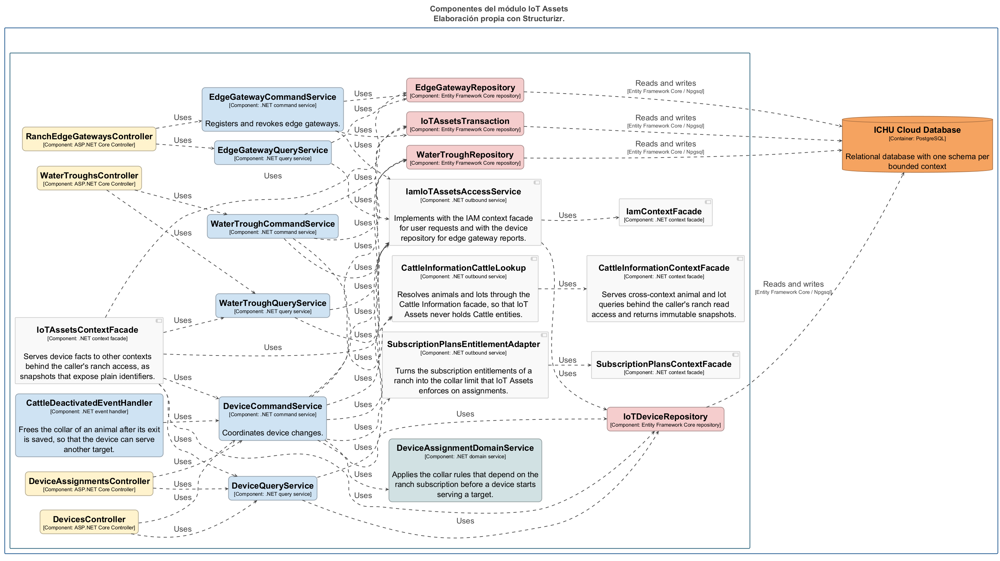

*Figura 4.19. Componentes del módulo IoT Assets. Elaboración propia con Structurizr.*

Abrir fuente Structurizr ([https://tinyurl.com/2bw8zfnw](https://tinyurl.com/2bw8zfnw))

#### 4.2.3.6. Bounded Context Software Architecture Code Level Diagrams

##### 4.2.3.6.1. Bounded Context Domain Layer Class Diagrams

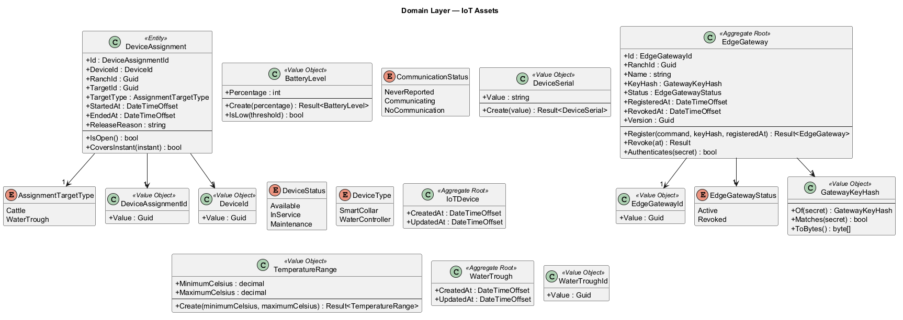

*Figura 4.20. Domain Layer de IoT Assets. Elaboración propia con PlantUML.*

Abrir fuente PlantUML ([https://tinyurl.com/27ybn63o](https://tinyurl.com/27ybn63o))

`IoTDevice` compone su historial de `DeviceAssignment`; cada asignación apunta a un animal o a un bebedero por identificador. `EdgeGateway` guarda solo el resumen de su clave en `GatewayKeyHash`.

##### 4.2.3.6.2. Bounded Context Database Design Diagram

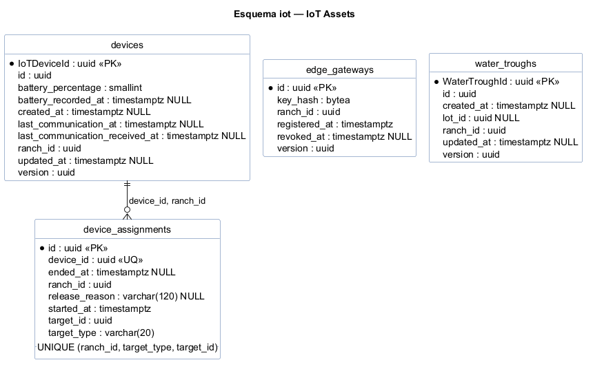

*Figura 4.21. Esquema `iot`. Elaboración propia con PlantUML.*

Abrir fuente PlantUML ([https://tinyurl.com/24ekayyp](https://tinyurl.com/24ekayyp))

`device_assignments` conserva cada periodo de asignación con su inicio, fin y motivo de liberación. `edge_gateways` guarda el resumen de la clave, nunca la clave presentada.

### 4.2.4. Bounded Context: Planning

Programa las faenas sanitarias y reproductivas del hato en campañas y en un calendario, registra su aplicación y sus seguimientos, administra los planes de nutrición de cada lote y custodia los periodos de retiro que condicionan el destino de la producción.

#### 4.2.4.1. Domain Layer

| Clase | Categoría | Propósito |
|---|---|---|
| `PlannedActivity` | Aggregate Root | Trabajo programado para la unidad productiva o para un animal; posee sus aplicaciones y seguimientos. |
| `PlanningCampaign` | Aggregate Root | Agrupa actividades bajo un propósito sanitario o reproductivo y un rango de fechas. |
| `NutritionPlan` | Aggregate Root | Ración que recibe un lote en un rango de fechas; un plan sin fecha de fin rige hasta que otro lo reemplaza. |
| `WithdrawalPeriod` | Aggregate Root | Periodo de retiro de un animal, con los límites que indica el profesional; Planning no los calcula. |
| `ApplicationRecord`, `FollowUp` | Entity | Aplicación de una actividad a un animal y seguimiento que vence después de ella. |
| `RationItem` | Value Object | Alimento de la ración con la cantidad diaria por cabeza. |
| `CampaignKind`, `RationKind` | Enumeraciones | Propósito de la campaña y papel del alimento en la dieta. |
| `NutritionPlanScheduler` | Domain Service | Decide si un plan nuevo puede incorporarse a los planes del lote sin superponerse. |
| `IPlannedActivityRepository`, `IPlanningCampaignRepository`, `INutritionPlanRepository`, `IWithdrawalPeriodRepository` | Repository (interfaz) | Persistencia de cada agregado. |

#### 4.2.4.2. Interface Layer

| Clase | Categoría | Propósito |
|---|---|---|
| `PlanningActivitiesController` | Controller | Expone las actividades programadas con sus aplicaciones y seguimientos. |
| `PlanningCalendarController` | Controller | Expone el calendario de actividades de la unidad productiva en un intervalo. |
| `PlanningCampaignsController` | Controller | Expone las campañas sanitarias y reproductivas. |
| `NutritionPlansController` | Controller | Expone los planes de nutrición de un lote y el plan vigente en una fecha. |
| `WithdrawalPeriodsController` | Controller | Expone los periodos de retiro. |

#### 4.2.4.3. Application Layer

| Clase | Categoría | Propósito |
|---|---|---|
| `PlannedActivityCommandService`, `PlanningCampaignCommandService`, `NutritionPlanCommandService`, `WithdrawalPeriodCommandService` | Command Service | Comprueban el permiso y las referencias a otros contextos y guardan cada cambio. |
| `PlannedActivityQueryService`, `PlanningCampaignQueryService`, `NutritionPlanQueryService`, `WithdrawalPeriodQueryService` | Query Service | Responden las consultas de las aplicaciones con el permiso de lectura de la unidad productiva. |
| `PlanningGuard` | Application Service | Reúne las comprobaciones que dependen de otros contextos para que todos los casos de uso rechacen las mismas entradas con el mismo error. |
| `CattleInformationPlanningCattleLookup`, `CattleInformationPlanningLotLookup`, `OperationsMonitoringClinicalInterventionLookup`, `IamPlanningAccessControl` | Outbound Service (ACL) | Consultan Cattle Information, Operations & Monitoring e IAM a través de sus Context Facades. |

#### 4.2.4.4. Infrastructure Layer

| Clase | Categoría | Propósito |
|---|---|---|
| `PlannedActivityRepository`, `PlanningCampaignRepository`, `NutritionPlanRepository`, `WithdrawalPeriodRepository` | Repository | Implementan los repositorios con Entity Framework Core sobre el esquema `planning`. |
| `PlanningTransaction` | Unit of Work | Ejecuta la comprobación y el guardado en una transacción serializable, para que un cambio concurrente no se cuele entre ambos. |

#### 4.2.4.5. Bounded Context Software Architecture Component Level Diagrams

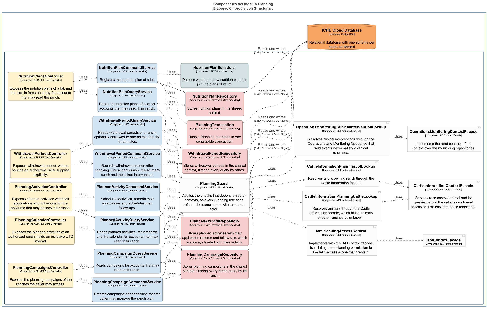

*Figura 4.22. Componentes del módulo Planning. Elaboración propia con Structurizr.*

Abrir fuente Structurizr ([https://tinyurl.com/2bw8zfnw](https://tinyurl.com/2bw8zfnw))

#### 4.2.4.6. Bounded Context Software Architecture Code Level Diagrams

##### 4.2.4.6.1. Bounded Context Domain Layer Class Diagrams

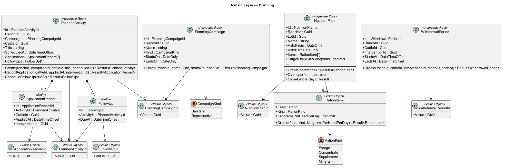

*Figura 4.23. Domain Layer de Planning. Elaboración propia con PlantUML.*

Abrir fuente PlantUML ([https://tinyurl.com/22zt4h6v](https://tinyurl.com/22zt4h6v))

`PlannedActivity` compone sus aplicaciones y seguimientos, y `NutritionPlan` compone los alimentos de su ración. Las actividades se relacionan con su campaña, con animales y con intervenciones clínicas solo por identificador.

##### 4.2.4.6.2. Bounded Context Database Design Diagram

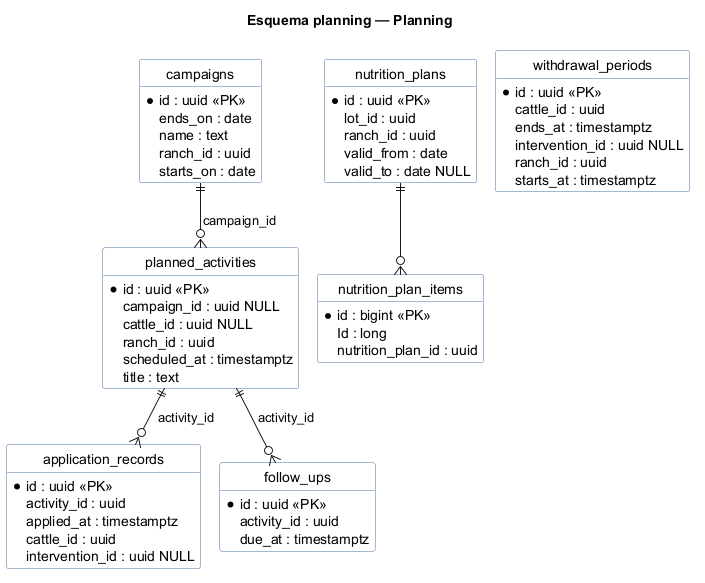

*Figura 4.24. Esquema `planning`. Elaboración propia con PlantUML.*

Abrir fuente PlantUML ([https://tinyurl.com/29l33b5n](https://tinyurl.com/29l33b5n))

`planned_activities` se relaciona con `campaigns`, `application_records` y `follow_ups` mediante claves foráneas. Los alimentos de cada ración se guardan en `nutrition_plan_items`.

### 4.2.5. Bounded Context: Dashboard & Analytics

Transforma la información acumulada por los demás contextos en indicadores, tendencias, curvas epidemiológicas y reportes. Es un contexto de solo lectura: no produce hechos del negocio, no escribe en los contextos de origen y no guarda resultados.

#### 4.2.5.1. Domain Layer

| Clase | Categoría | Propósito |
|---|---|---|
| `HerdIndicatorSet`, `IndicatorValue` | Value Object | Indicadores del hato en un periodo: animales monitoreados, alertas abiertas por tipo, animales fuera de su zona, mortalidad, nacimientos y preñeces confirmadas. |
| `TrendSeries`, `TrendPoint` | Value Object | Evolución de una métrica del hato en el tiempo. |
| `EpidemiologicalCurve` | Value Object | Casos de un mismo cuadro por día dentro del hato. |
| `AnimalComparison` | Value Object | Constantes de un animal frente al promedio de su lote en el mismo periodo. |
| `RanchPortfolioEntry` | Value Object | Resumen de una unidad productiva en la cartera de un veterinario. |
| `ExecutiveReport` | Value Object | Reporte ejecutivo exportable del periodo. |
| `DateRange` | Value Object | Periodo semiabierto, para que dos periodos consecutivos no cuenten dos veces el mismo instante. |
| `AnalyticsDomainService` | Domain Service | Calcula los indicadores, tendencias, curvas y comparaciones con fórmulas estadísticas sobre los datos de los otros contextos. |

#### 4.2.5.2. Interface Layer

| Clase | Categoría | Propósito |
|---|---|---|
| `DashboardController` | Controller | Expone los indicadores del hato. |
| `TrendsController` | Controller | Expone las tendencias de temperatura, actividad y alertas. |
| `EpidemiologicalCurveController` | Controller | Expone la curva epidemiológica de un evento sanitario. |
| `PortfolioController` | Controller | Expone el consolidado de las unidades productivas que asesora un veterinario. |
| `ReportsController` | Controller | Exporta el reporte ejecutivo del periodo. |

#### 4.2.5.3. Application Layer

| Clase | Categoría | Propósito |
|---|---|---|
| `AnalyticsQueryService` | Query Service | Comprueba el acceso y la coherencia de las fuentes antes de calcular cualquier indicador. |
| `ExecutiveReportQueryService` | Query Service | Genera el reporte después de comprobar el formato, el acceso y que el plan incluya la exportación. |
| `PlatformAnalyticsSource` | Outbound Service (ACL) | Arma las instantáneas de análisis con los Context Facades de los demás contextos y traduce su vocabulario al de este contexto. |
| `IamAnalyticsAccessControl`, `SubscriptionPlansAnalyticsEntitlements` | Outbound Service (ACL) | Consultan IAM para el permiso de lectura y Subscription Plans para la funcionalidad de exportación del plan. |

#### 4.2.5.4. Infrastructure Layer

| Clase | Categoría | Propósito |
|---|---|---|
| (sin clases propias) | — | El contexto no persiste datos: no tiene repositorios ni esquema propio, porque calcula sus resultados en cada consulta a partir de los otros contextos. |

#### 4.2.5.5. Bounded Context Software Architecture Component Level Diagrams

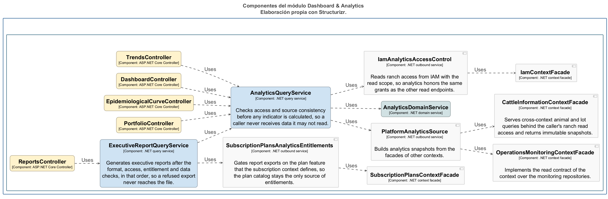

*Figura 4.25. Componentes del módulo Dashboard & Analytics. Elaboración propia con Structurizr.*

Abrir fuente Structurizr ([https://tinyurl.com/2bw8zfnw](https://tinyurl.com/2bw8zfnw))

#### 4.2.5.6. Bounded Context Software Architecture Code Level Diagrams

##### 4.2.5.6.1. Bounded Context Domain Layer Class Diagrams

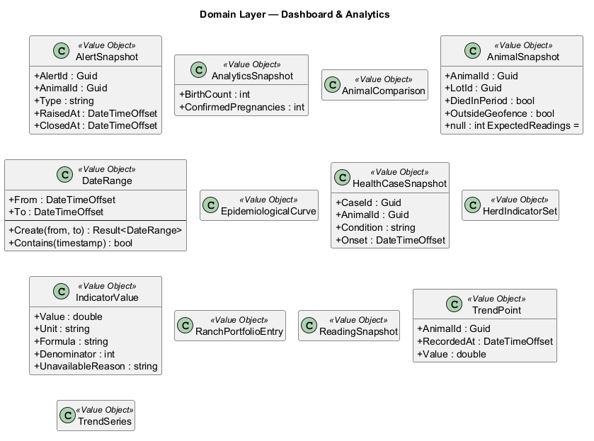

*Figura 4.26. Domain Layer de Dashboard & Analytics. Elaboración propia con PlantUML.*

Abrir fuente PlantUML ([https://tinyurl.com/2ycxfd6s](https://tinyurl.com/2ycxfd6s))

Todas las clases del dominio son Value Objects inmutables que se calculan en cada consulta; no hay agregados porque el contexto no guarda estado propio.

##### 4.2.5.6.2. Bounded Context Database Design Diagram

Dashboard & Analytics no tiene esquema propio. Lee los datos de los esquemas `cattle`, `iot`, `monitoring` y `subscription` a través de los Context Facades de esos contextos y calcula sus resultados en cada consulta, de modo que un cambio en la fórmula de un indicador se aplica de inmediato a todo el historial.

### 4.2.6. Bounded Context: Identity & Access Management

Resuelve quién es cada usuario, sobre qué unidades productivas puede operar y con qué alcance. Incorpora el agregado de perfil profesional y la relación de asesoría entre un veterinario y un hato ajeno.

#### 4.2.6.1. Domain Layer

| Clase | Categoría | Propósito |
|---|---|---|
| `UserAccount` | Aggregate Root | Cuenta de un usuario. Se activa solo con el correo verificado y se bloquea temporalmente tras intentos fallidos. |
| `RanchRegistration` | Aggregate Root | Unidad productiva registrada, con sus miembros y su código de acceso para veterinarios. |
| `HerdAdvisory` | Aggregate Root | Asesoría de un veterinario sobre un hato: se otorga, rechaza, revoca o vence, y nunca vuelve a pendiente. |
| `ProfessionalProfile`, `RanchMembership`, `AccessAttempt` | Entity | Perfil profesional del veterinario, pertenencia de una cuenta a una unidad productiva e intento de acceso sin credenciales. |
| `Email`, `RanchAccessCode` | Value Object | Correo validado en minúsculas y código de acceso sin caracteres ambiguos. |
| `UserRole`, `AccountStatus`, `AdvisoryStatus`, `AccessScope` | Enumeraciones | Roles, estados y alcances de acceso admitidos. |
| `AuthorizationDomainService` | Domain Service | El propietario administra la unidad productiva, todo miembro la lee y un veterinario solo la alcanza con una asesoría vigente. |
| `IUserAccountRepository`, `IRanchRegistrationRepository`, `IHerdAdvisoryRepository` | Repository (interfaz) | Persistencia de cuentas, unidades productivas y asesorías. |

#### 4.2.6.2. Interface Layer

| Clase | Categoría | Propósito |
|---|---|---|
| `AccountsController` | Controller | Registra cuentas y devuelve la cuenta autenticada con sus unidades productivas. |
| `ProfilesController` | Controller | Completa y consulta el perfil profesional del veterinario. |
| `RanchesController` | Controller | Resuelve una unidad productiva por su código de acceso. |
| `HerdAdvisoriesController`, `VeterinaryAccessRequestsController` | Controller | Solicitan, otorgan, rechazan y revocan asesorías. |
| `IIamContextFacade` | Context Facade | Responde a los demás contextos si la cuenta actual puede leer o administrar una unidad productiva. |

#### 4.2.6.3. Application Layer

| Clase | Categoría | Propósito |
|---|---|---|
| `AccountCommandService` | Command Service | Registra cuentas y autentica credenciales; un intento fallido se registra antes de responder. |
| `HerdAdvisoryCommandService`, `ProfessionalProfileCommandService` | Command Service | Gestionan asesorías y perfiles profesionales, comprobando que la colegiatura no esté repetida. |
| `AccountQueryService`, `AuthorizationQueryService`, `HerdAdvisoryQueryService`, `RanchQueryService` | Query Service | Responden las consultas de cuentas, permisos, asesorías y unidades productivas. |
| `IamContextFacade` | Context Facade | Implementa las comprobaciones de acceso que consumen los demás contextos. |

#### 4.2.6.4. Infrastructure Layer

| Clase | Categoría | Propósito |
|---|---|---|
| `UserAccountRepository`, `RanchRegistrationRepository`, `HerdAdvisoryRepository` | Repository | Implementan los repositorios con Entity Framework Core sobre el esquema `iam`. |
| `FirebaseAuthenticationHandler`, `FirebaseAuthenticationAcl` | Adapter (ACL) | Verifican el token de Firebase Authentication de cada solicitud y aíslan al contexto de los errores del proveedor. |
| `HttpCurrentAccount` | Adapter | Resuelve la cuenta de la solicitud sin confiar en identificadores enviados por el cliente. |
| `RandomRanchAccessCodeGenerator` | Adapter | Genera códigos de acceso con el generador criptográfico del sistema operativo. |

#### 4.2.6.5. Bounded Context Software Architecture Component Level Diagrams

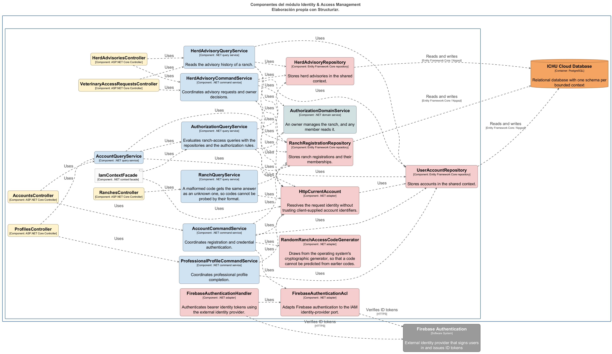

*Figura 4.27. Componentes del módulo Identity & Access Management. Elaboración propia con Structurizr.*

Abrir fuente Structurizr ([https://tinyurl.com/2bw8zfnw](https://tinyurl.com/2bw8zfnw))

#### 4.2.6.6. Bounded Context Software Architecture Code Level Diagrams

##### 4.2.6.6.1. Bounded Context Domain Layer Class Diagrams

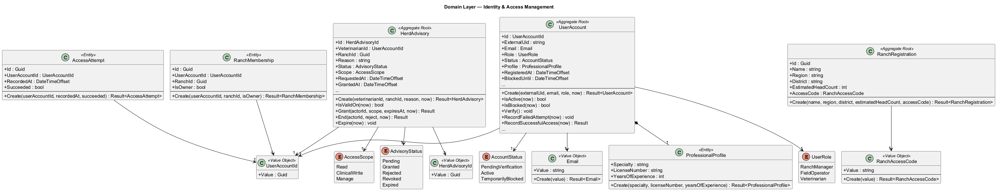

*Figura 4.28. Domain Layer de Identity & Access Management. Elaboración propia con PlantUML.*

Abrir fuente PlantUML ([https://tinyurl.com/279ggbhv](https://tinyurl.com/279ggbhv))

`UserAccount` compone su perfil profesional y `RanchRegistration` compone sus pertenencias. `HerdAdvisory` relaciona un veterinario con una unidad productiva solo por identificador, con su estado y su vigencia.

##### 4.2.6.6.2. Bounded Context Database Design Diagram

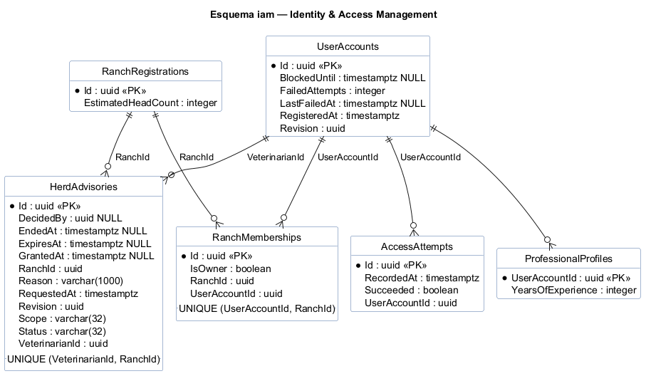

*Figura 4.29. Esquema `iam`. Elaboración propia con PlantUML.*

Abrir fuente PlantUML ([https://tinyurl.com/256tw7gc](https://tinyurl.com/256tw7gc))

`ProfessionalProfiles` comparte la clave de su cuenta y exige una colegiatura única. `HerdAdvisories` y `RanchMemberships` relacionan las cuentas con las unidades productivas mediante claves foráneas.

### 4.2.7. Bounded Context: Subscription Plans

Administra los planes contratados, sus límites y su facturación, y determina qué capacidades tiene habilitada cada unidad productiva.

#### 4.2.7.1. Domain Layer

| Clase | Categoría | Propósito |
|---|---|---|
| `Plan` | Aggregate Root | Plan del catálogo con la cuota anual, el precio por collar, el límite de dispositivos y las funcionalidades que otorga. |
| `Subscription` | Aggregate Root | Contrato anual de una unidad productiva. Copia la cotización al solicitarse; solo una suscripción pendiente se activa y solo una activa vence. |
| `Money`, `PlanQuote` | Value Object | Importe en una moneda redondeado a céntimos y cotización desglosada en cuota anual y costo de collares. |
| `PaymentConfirmation` | Value Object | Pago que reporta el proveedor; solo es confiable después de verificar su firma. |
| `PlanTier`, `SubscriptionStatus`, `FeatureCode` | Enumeraciones | Nivel del plan, estado de la suscripción y funcionalidades que otros contextos habilitan según el plan. |
| `IPlanRepository`, `ISubscriptionRepository` | Repository (interfaz) | Lectura del catálogo y persistencia de las suscripciones. |

#### 4.2.7.2. Interface Layer

| Clase | Categoría | Propósito |
|---|---|---|
| `PlansController`, `QuotesController` | Controller | Exponen el catálogo de planes y la cotización según el tamaño del hato. |
| `SubscriptionsController` | Controller | Solicita, consulta y cancela suscripciones e inicia el pago (`checkout-sessions`). |
| `StripeWebhooksController` | Controller | Recibe `POST /api/v1/payments/stripe/webhooks`; la firma de Stripe reemplaza al token de usuario. |
| `ISubscriptionPlansContextFacade` | Context Facade | Entrega a otros contextos las funcionalidades y el límite de collares de la unidad productiva. |

#### 4.2.7.3. Application Layer

| Clase | Categoría | Propósito |
|---|---|---|
| `SubscriptionCommandService` | Command Service | Solicita, cancela, paga y activa suscripciones; comprueba permisos y reglas comerciales y deja las transiciones al agregado. |
| `PlanQueryService`, `SubscriptionQueryService` | Query Service | Responden el catálogo, las cotizaciones y la suscripción vigente. |
| `SubscriptionPlansContextFacade` | Context Facade | Implementa la consulta de funcionalidades para otros contextos. |
| `IamSubscriptionAccessService` | Outbound Service (ACL) | Consulta a IAM si la cuenta puede leer o administrar la unidad productiva. |

#### 4.2.7.4. Infrastructure Layer

| Clase | Categoría | Propósito |
|---|---|---|
| `PlanRepository`, `SubscriptionRepository` | Repository | Implementan los repositorios con Entity Framework Core sobre el esquema `subscription`. |
| `StripePaymentGateway` | Adapter (ACL) | Implementa el puerto `IPaymentGateway`: crea la sesión de Stripe Checkout en soles y verifica la firma de los webhooks. Las excepciones de Stripe no salen de esta clase. |

#### 4.2.7.5. Bounded Context Software Architecture Component Level Diagrams

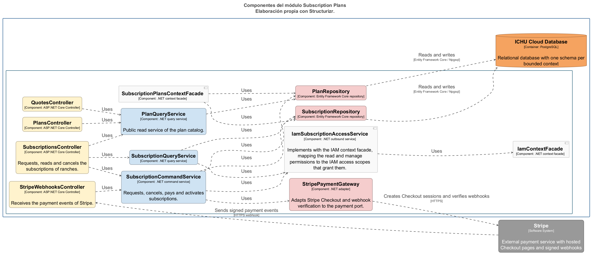

*Figura 4.30. Componentes del módulo Subscription Plans. Elaboración propia con Structurizr.*

Abrir fuente Structurizr ([https://tinyurl.com/2bw8zfnw](https://tinyurl.com/2bw8zfnw))

#### 4.2.7.6. Bounded Context Software Architecture Code Level Diagrams

##### 4.2.7.6.1. Bounded Context Domain Layer Class Diagrams

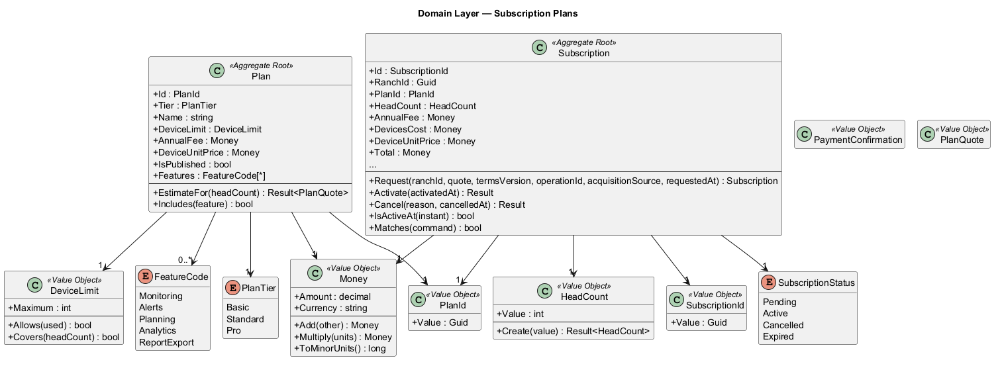

*Figura 4.31. Domain Layer de Subscription Plans. Elaboración propia con PlantUML.*

Abrir fuente PlantUML ([https://tinyurl.com/2c28je8c](https://tinyurl.com/2c28je8c))

`Subscription` copia la cotización del `Plan` al solicitarse, de modo que un cambio posterior de precios no altera lo acordado. `PaymentConfirmation` llega solo a través del puerto `IPaymentGateway`.

##### 4.2.7.6.2. Bounded Context Database Design Diagram

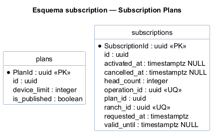

*Figura 4.32. Esquema `subscription`. Elaboración propia con PlantUML.*

Abrir fuente PlantUML ([https://tinyurl.com/29o349n3](https://tinyurl.com/29o349n3))

`plans` guarda la cuota anual y el precio por collar como columnas de importe y moneda, y sus funcionalidades en `plan_features`. `subscriptions` conserva la cotización acordada, el estado y la sesión de pago.

## 4.3. Síntesis del diseño

| Contexto acotado | Tipo | Agregados | Esquema de base de datos |
|---|---|---|---|
| Operations & Monitoring | Core | TelemetryReading, MonitoringAlert, Geofence, LivestockOperation | `monitoring` |
| Cattle Information | Core secundario | Cattle, Lot | `cattle` |
| IoT Assets | Soporte | IoTDevice | `iot` |
| Planning | Soporte | LivestockCalendar, HealthCampaign | `planning` |
| Dashboard & Analytics | Soporte | HerdIndicatorSet | `analytics` |
| Identity & Access Management | Genérico con dominio propio | UserAccount | `iam` |
| Subscription Plans | Genérico | Subscription | `subscription` |

Los siete contextos suman quince agregados y se despliegan como módulos internos de un único ejecutable, cada uno con su esquema aislado dentro de la misma instancia de PostgreSQL. La comunicación entre módulos ocurre siempre a través de un Anti-corruption Layer o de eventos de dominio publicados en el proceso, nunca por acceso directo a las tablas de otro esquema. Esa restricción es la que hace posible extraer cualquier módulo como servicio independiente si el crecimiento del producto llegara a justificarlo.
