# Capítulo VI: Product Implementation, Validation & Deployment

Este capítulo registra la configuración del software y las evidencias de implementación, validación y despliegue de ICHU. El Sprint 1 entregó la Landing Page y la primera versión del frontend web; el Sprint 2 integró la API central, el Edge, los dispositivos embebidos y las aplicaciones web y móvil.

## 6.1. Software Configuration Management

### 6.1.1. Software Development Environment Configuration

Cada producto de ICHU tiene su propio repositorio en la organización `five-smart-farm-creators` y su README documenta cómo prepararlo y ejecutarlo. El equipo usa Git y GitHub para el control de versiones, GitHub Actions para validar cada pull request y Wokwi para simular los dispositivos.

| Producto (repositorio) | Lenguajes y frameworks | Herramientas y comandos principales |
|---|---|---|
| Landing Page (`ichu-website`) | HTML5, CSS3 y JavaScript, sin framework ni compilación | Servidor estático local, por ejemplo Live Server de VS Code. Las traducciones se cargan desde `locales/en.json` y `locales/es.json`. |
| Web Application (`ichu-web-app`) | Angular 22 con TypeScript 6 y Angular Material 22; mapas con Leaflet | Node.js 22 y npm: `npm start`, `npm run build`, `npm test` (Vitest) y `npm run typecheck`. |
| API central (`ichu-web-service`) | C# 14 con ASP.NET Core 10 y Entity Framework Core 10 sobre PostgreSQL 17 | .NET 10 SDK: `dotnet build`, `dotnet run` y `dotnet test` (pruebas unitarias, de integración HTTP y BDD con Gherkin). Swagger UI documenta el contrato OpenAPI. |
| Aplicación móvil (`ichu-mobile-app`) | Dart 3.12 con Flutter 3.44 para Android e iOS | Flutter SDK: `flutter pub get`, `flutter gen-l10n`, `flutter test` y `flutter run` con la configuración de Firebase y de la API pasada como `--dart-define-from-file`. |
| Edge API (`ichu-edge-service`) | Python 3.13 con Flask 3.1, Peewee 4.5, Pydantic 2 y SQLite | Entorno virtual de Python: `pip install -r requirements.txt`, `python app.py`, `flask --app app synchronize` y `python -m unittest discover -s tests`. |
| Aplicaciones embebidas (`ichu-cattle-band-embedded-app` y `ichu-alert-panel-embedded-app`) | C++ (Arduino) para ESP32-S3 y ESP32 con el Modest IoT Nano Framework 1.3.0 | arduino-cli con el core `esp32:esp32` 3.3.4; Wokwi web, Wokwi para VS Code y Wokwi CI; Cirkit Designer para el circuito. |
| Informe (`ichu-report`) | Markdown, PlantUML y Structurizr DSL | Cualquier editor de Markdown; los diagramas se generan desde las fuentes de `report/assets/diagram-sources`. |

Las claves de Firebase, Stripe y de los dispositivos se entregan como variables de entorno o archivos excluidos de Git; ningún repositorio las contiene.

### 6.1.2. Source Code Management

El código de cada producto y el informe se mantienen en repositorios Git separados, de modo que cada uno conserva su propio historial, sus versiones y sus revisiones.

| Repositorio | Producto | URL |
|---|---|---|
| `ichu-website` | Landing Page | [https://github.com/five-smart-farm-creators/ichu-website](https://github.com/five-smart-farm-creators/ichu-website) |
| `ichu-web-app` | Aplicación web (Angular) | [https://github.com/five-smart-farm-creators/ichu-web-app](https://github.com/five-smart-farm-creators/ichu-web-app) |
| `ichu-web-service` | API central (ASP.NET Core) | [https://github.com/five-smart-farm-creators/ichu-web-service](https://github.com/five-smart-farm-creators/ichu-web-service) |
| `ichu-mobile-app` | Aplicación móvil (Flutter) | [https://github.com/five-smart-farm-creators/ichu-mobile-app](https://github.com/five-smart-farm-creators/ichu-mobile-app) |
| `ichu-edge-service` | Edge API (Flask) | [https://github.com/five-smart-farm-creators/ichu-edge-service](https://github.com/five-smart-farm-creators/ichu-edge-service) |
| `ichu-cattle-band-embedded-app` | Firmware del collar (ESP32-S3) | [https://github.com/five-smart-farm-creators/ichu-cattle-band-embedded-app](https://github.com/five-smart-farm-creators/ichu-cattle-band-embedded-app) |
| `ichu-alert-panel-embedded-app` | Firmware del panel de alertas (ESP32) | [https://github.com/five-smart-farm-creators/ichu-alert-panel-embedded-app](https://github.com/five-smart-farm-creators/ichu-alert-panel-embedded-app) |
| `ichu-report` | Informe del proyecto | [https://github.com/five-smart-farm-creators/ichu-report](https://github.com/five-smart-farm-creators/ichu-report) |

Los ocho repositorios aplican el modelo GitFlow de Vincent Driessen, Conventional Commits y Semantic Versioning 2.0.0. Un flujo de GitHub Actions valida en cada pull request el nombre de la rama y el formato de cada mensaje de commit.

| Rama | Origen y destino | Uso |
|---|---|---|
| `main` | Recibe solo `release/*` y `hotfix/*` | Versiones publicadas; cada merge lleva un tag `vX.Y.Z` |
| `develop` | Recibe `feature/*`, `bugfix/*` y el back-merge de cada release | Integración del trabajo del sprint |
| `feature/<scope>` | Nace de `develop` y vuelve a `develop` por pull request | Una funcionalidad o un bloque del informe, con un nombre en inglés y kebab-case, por ejemplo `feature/stripe-checkout` |
| `bugfix/<scope>` | Nace de `develop` y vuelve a `develop` | Corrección de un defecto encontrado durante el sprint |
| `release/vX.Y.Z` | Nace de `develop` y se integra en `main` y `develop` | Preparación de una entrega: versión, CHANGELOG y tag |
| `hotfix/vX.Y.Z` | Nace de `main` y se integra en `main` y `develop` | Corrección urgente de una versión publicada |

Los mensajes de commit siguen la forma `type(scope): subject`, en inglés, en minúsculas, en modo imperativo y sin punto final; por ejemplo, `feat(subscription-plans): pay subscriptions with stripe checkout`. El cuerpo explica el porqué del cambio. Las versiones siguen `MAJOR.MINOR.PATCH`: cada entrega del curso publica un MINOR y la entrega final publica `v1.0.0` del software.

### 6.1.3. Source Code Style Guide & Conventions

Todo el código, los nombres y los comentarios están en inglés y usan los términos del Ubiquitous Language de la sección 2.5. Cada producto adopta la guía de estilo estándar de su lenguaje:

| Producto | Guía adoptada | Convenciones aplicadas |
|---|---|---|
| Landing Page | Google HTML/CSS Style Guide | HTML semántico, estilos compartidos en `assets/styles/style.css`, tokens de color como variables CSS para los temas claro y oscuro, etiquetas ARIA y textos alternativos, imágenes WebP con dimensiones declaradas. |
| Web Application | Angular Style Guide y Google TypeScript Style Guide | Una carpeta por bounded context con capas `domain`, `application`, `infrastructure` y `presentation`; componentes standalone; textos traducidos en inglés y español. |
| API central | Convenciones de codificación de C# y .NET | Una carpeta por bounded context con capas `Domain`, `Application`, `Infrastructure` e `Interfaces`; errores de negocio con `Result<T>`; rutas `api/v1/<plural-kebab-case>`; mensajes en archivos `.resx` en inglés y español. |
| Aplicación móvil | Effective Dart y `flutter_lints` | Una carpeta por bounded context con capas `domain`, `application`, `infrastructure` y `presentation`; textos en archivos ARB en inglés y español. |
| Edge API | PEP 8 | Un paquete por bounded context (`iam` y `monitoring`) con capas `domain`, `application`, `infrastructure`, `integration` e `interfaces`. |
| Aplicaciones embebidas | C++ Core Guidelines | Una clase por responsabilidad (dispositivo, sensor, cliente del Edge); configuración en `CollarConfig.h` y `PanelConfig.h`; claves en un archivo excluido de Git. |
| Pruebas de aceptación | Gherkin Conventions for Readable Specifications | Escenarios `Given`/`When`/`Then` en presente y en tercera persona, sin detalles de interfaz. |

Los comentarios y docstrings tienen una o dos líneas y explican el porqué de una decisión, no lo que hace el código.

### 6.1.4. Software Deployment Configuration

Cada producto tiene su propio destino de despliegue.

| Producto | Despliegue | Dirección o comando |
|---|---|---|
| Landing Page (`ichu-website`) | GitHub Pages, publicada desde la rama `main`. | [https://five-smart-farm-creators.github.io/ichu-website/](https://five-smart-farm-creators.github.io/ichu-website/) |
| Web Application (`ichu-web-app`) | Firebase Hosting. El script compila Angular en modo de producción, escribe `config.json` con la URL de la API y publica el resultado. | [https://ichu-smartfarm.web.app](https://ichu-smartfarm.web.app) · `scripts/deploy-hosting.ps1` |
| API central (`ichu-web-service`) | Render, con la imagen Docker construida desde `main` y el Blueprint `render.yaml`. Swagger UI en `/swagger`. | [https://ichu-web-service.onrender.com](https://ichu-web-service.onrender.com) |
| Edge API (`ichu-edge-service`) | Gateway local con variables de entorno y base de datos SQLite. El sincronizador corre como proceso aparte. | `python app.py` y `flask --app app synchronize` |
| Aplicaciones embebidas (`ichu-cattle-band-embedded-app` y `ichu-alert-panel-embedded-app`) | Firmware compilado con arduino-cli (core `esp32:esp32` 3.3.4) y cargado en la placa o ejecutado en Wokwi. | `arduino-cli compile --fqbn esp32:esp32:esp32s3` (collar) y `--fqbn esp32:esp32:esp32` (panel) |
| Aplicación móvil (`ichu-mobile-app`) | El flujo `Test builds` de GitHub Actions compila un APK de release para Android y un IPA sin firmar para iOS, ambos configurados contra la API de producción, y los publica como artefactos del flujo. | Flujo `.github/workflows/test-builds.yml` |

El diagrama de despliegue C4 de la arquitectura de producción se presenta en la Figura 4.6, en la sección 4.1.3.4.

## 6.2. Landing Page, Services & Applications Implementation

### 6.2.1. Sprint 1

El Capítulo III asigna ocho historias al Sprint 1, con un total estimado de 33 puntos: siete para la Landing Page y una para la primera versión del frontend web. Los recorridos de acceso, perfil y ficha del animal de US-58 usan datos de ejemplo; la autenticación, los permisos y la persistencia se integran en el Sprint 2.

#### 6.2.1.1. Sprint Planning 1

El Sprint 1 se orienta a presentar la propuesta de ICHU y habilitar los primeros recorridos de la plataforma web para ganaderos y médicos veterinarios.

<table>
  <colgroup>
    <col style="width: 34%;"/>
    <col style="width: 66%;"/>
  </colgroup>
  <tbody>
    <tr>
      <th align="left" scope="row" width="34%">Sprint #</th>
      <td>Sprint 1</td>
    </tr>
    <tr>
      <th align="left" colspan="2">Sprint Planning Background</th>
    </tr>
    <tr>
      <td>Date</td>
      <td>2026-10-02</td>
    </tr>
    <tr>
      <td>Time</td>
      <td>08:00 PM (hora de Lima, UTC-5)</td>
    </tr>
    <tr>
      <td>Location</td>
      <td>Lima, Perú.</td>
    </tr>
    <tr>
      <td>Prepared By</td>
      <td>Avalos Cordova, Diego Andres</td>
    </tr>
    <tr>
      <td>Attendees (to planning meeting)</td>
      <td>Arrieta Quispe, Alison Jimena Sanchez Arenas, Manuel Angel Contreras Leon, Flor de María Awad Vargas, Giorgio Marzouk Avalos Cordova, Diego Andres</td>
    </tr>
    <tr>
      <td>Sprint 0 Review Summary</td>
      <td>No aplica: es el primer Sprint del proyecto y no existe una revisión de un Sprint anterior.</td>
    </tr>
    <tr>
      <td>Sprint 0 Retrospective Summary</td>
      <td>No aplica: es el primer Sprint del proyecto y no existe una retrospectiva de un Sprint anterior.</td>
    </tr>
    <tr>
      <th align="left" colspan="2">Sprint Goal &amp; User Stories</th>
    </tr>
    <tr>
      <td>Sprint 1 Goal</td>
      <td><em>Our focus is on</em> presenting ICHU to ranchers and veterinarians on a bilingual and accessible landing page, and on letting both segments walk through the first version of the web application with sample data. <em>We believe it delivers</em> a clear understanding of the value proposition, the plans and their estimated cost to visitors, and an early view of the herd and clinical workflows to ranchers and veterinarians. <em>This will be confirmed when</em> the landing page and the web application are published, visitors compare the plans and prepare a demonstration request in English or Spanish, and the eight selected stories meet their acceptance criteria.</td>
    </tr>
    <tr>
      <td>Sprint 1 Velocity</td>
      <td>33 Story Points planificados, primera estimación de la capacidad del equipo.</td>
    </tr>
    <tr>
      <td>Sum of Story Points</td>
      <td>33 Story Points distribuidos en ocho historias del Sprint Backlog 1.</td>
    </tr>
  </tbody>
</table>

#### 6.2.1.2. Aspect Leaders and Collaborators

La siguiente distribución asigna a cada integrante un aspecto del proyecto. Las 21 tareas se registraron en Jira como planificación transversal del ciclo; en el Sprint 1 el equipo trabajó sobre las ocho historias de 6.2.1.3.

Consulta del conjunto de tareas en Jira: [https://tinyurl.com/2xs98v8n](https://tinyurl.com/2xs98v8n)

| Responsable | Tareas en Jira |
|---|---|
| Contreras Leon, Flor de María | SF-96 — Capítulo V, diseño UI/UX y Landing Page; SF-106 — Dashboard & Analytics, indicadores e informes. |
| Avalos Cordova, Diego Andres | SF-97 — Capítulo VI, frontend, pruebas y despliegue; SF-102 — Operations & Monitoring; SF-109 — Portable Edge Gateway; SF-112 — integración del frontend web/móvil con las APIs. |
| Arrieta Quispe, Alison Jimena | SF-98 — correcciones editoriales; SF-103 — Cattle Information; SF-107 — Identity & Access Management; SF-116 — trazabilidad entre Bounded Contexts, APIs, Jira e informe. |
| Sanchez Arenas, Manuel Angel | SF-99 — correcciones de requisitos y trazabilidad; SF-105 — Planning; SF-113 — contratos OpenAPI/Swagger; SF-114 — pruebas de integración entre frontend, API y Edge. |
| Awad Vargas, Giorgio Marzouk | SF-100 — correcciones de pruebas y despliegue; SF-108 — Subscription Plans; SF-115 — verificación de entornos y despliegues. |

Cada uno de los siete Bounded Contexts tiene un responsable; el Portable Edge Gateway y los prototipos IoT se registran como tareas transversales que se implementan desde el Sprint 2.

#### 6.2.1.3. Sprint Backlog 1

La tabla contiene las ocho historias seleccionadas del Product Backlog del Capítulo III, con el mismo orden y estimación.

| Prioridad | Historia | Resultado esperado | Puntos | Sprint asignado |
|---:|---|---|---:|---|
| 1 | US-32 — Conocer la propuesta de ICHU | Presentar la propuesta, los beneficios por segmento y los productos digitales. | 3 | Sprint 1 |
| 2 | US-33 — Acceder al destino correspondiente a mi segmento | Dirigir al registro o acceso del segmento y conservar la selección de plan, sin crear una cuenta ni activar permisos. | 2 | Sprint 1 |
| 3 | US-35 — Comparar los planes y estimar el costo | Comparar planes y calcular una estimación informativa con valores publicados y validación local; sin cobro ni contratación. | 5 | Sprint 1 |
| 4 | US-36 — Consultar los términos y condiciones del servicio | Publicar condiciones de uso, tratamiento de datos y fecha de actualización. | 2 | Sprint 1 |
| 5 | US-59 — Solicitar una demostración desde la Landing Page | Validar los datos en el navegador y preparar la solicitud en el canal de contacto; el usuario decide enviarla. | 3 | Sprint 1 |
| 6 | US-37 — Consultar la experiencia en mi idioma | Presentar el contenido en inglés o español latinoamericano y conservar la preferencia. | 5 | Sprint 1 |
| 7 | US-38 — Acceder a la experiencia con tecnología de asistencia | Permitir el recorrido por teclado y lector de pantalla, con nombres y alternativas textuales accesibles. | 5 | Sprint 1 |
| 8 | US-58 — Explorar la primera versión del frontend web | Ofrecer los recorridos iniciales del frontend web con datos de ejemplo y validación local, sin API ni dispositivos conectados. | 8 | Sprint 1 |
|  | **Total planificado** |  | **33** |  |

Fuente: Product Backlog y alcance por iteración y roadmap, Capítulo III.

#### 6.2.1.4. Development Evidence for Sprint Review

Las capturas siguientes muestran la Landing Page en español e inglés, el tema oscuro y la vista en un viewport móvil. La tercera captura presenta la sección para ganaderos, que ilustra la ficha de un animal.

*Figura 6.1. Portada de la Landing Page en español vista en escritorio. Captura de navegador proporcionada por el equipo.*

*Figura 6.2. Sección «What is ICHU?» en inglés, abierta desde un archivo local en el navegador. Captura de navegador proporcionada por el equipo.*

*Figura 6.3. Vista en inglés con tema oscuro y contenido dirigido a ganaderos. La ficha del animal es una ilustración de la Landing Page.*

*Figura 6.4. Portada en inglés en un viewport móvil emulado de 360 × 800 píxeles.*

El dashboard del frontend web, con indicadores de muestra, se presenta en la Figura 6.8.

#### 6.2.1.5. Testing Suite Evidence for Sprint Review

En el Sprint 1 se realizó una prueba manual de renderizado con Chrome DevTools en el preset **iPad Mini**, viewport de 768 × 1024 píxeles, al 75 % y sin limitación de red. Las pruebas automatizadas comienzan en el Sprint 2 (6.2.2.5).

| Caso | Resultado observado | Estado |
|---|---|---|
| Renderizado del preview en viewport iPad Mini (768 × 1024) | La portada carga en Chrome incógnito; la URL del preview se ve en la barra y el contenido se adapta al viewport emulado. | Aprobado, comprobación visual |
| Consola en la primera inspección | Se vio `[Violation] Permissions policy violation: unload is not allowed in this document.`, con fuente `content.d0f3cf01.js`. | Observado una vez; origen no confirmado |
| Consola en la repetición de incógnito | No aparecen errores ni advertencias en la consola de la captura. El mensaje anterior no se reproduce; esto sugiere que pudo provenir de una extensión o estado del navegador, pero no confirma su origen. | Aprobado en esta repetición |
| Idioma y tema | Las capturas de desarrollo muestran los estados español, inglés y tema oscuro. | Estados visuales capturados |

*Figura 6.5. La página se renderiza en un viewport móvil emulado; DevTools muestra una violación de Permissions Policy procedente de `content.d0f3cf01.js`, cuyo origen debe confirmarse.*

*Figura 6.6. Repetición de la inspección en Chrome incógnito: la dirección del preview aparece en la barra, la portada se renderiza en el viewport iPad Mini y DevTools no muestra errores ni advertencias.*

#### 6.2.1.6. Execution Evidence for Sprint Review

Las Figuras 6.1 a 6.4 muestran la Landing Page en sus dos idiomas, en tema oscuro y en un viewport móvil. La Figura 6.8 muestra el dashboard del frontend web publicado en Vercel, que respondió con HTTP 200 en la fecha de la revisión.

#### 6.2.1.7. Services Documentation Evidence for Sprint Review

El incremento del Sprint 1 comprende interfaces frontend. La Landing Page es un sitio estático cuyo formulario prepara una solicitud de demostración y abre WhatsApp para enviarla. El frontend web publicado en Vercel presenta un dashboard y las vistas de gestión con datos de muestra. Los servicios web se documentan con OpenAPI desde el Sprint 2 (6.2.2.7).

| Interfaz o servicio | Documentación disponible | Alcance en el Sprint 1 |
|---|---|---|
| Landing Page | Páginas estáticas `index.html`, `media.html` y `como-funciona.html`; navegación, alternancia de idioma y tema, contenido informativo y formulario que abre WhatsApp. | Sitio estático sin servidor propio. |
| Frontend web de la plataforma | Dashboard con indicadores del hato y navegación a animales, ubicación, monitoreo, alertas e historial clínico. URL publicada: [https://web-frontend-smart-farm.vercel.app/](https://web-frontend-smart-farm.vercel.app/) | Datos de muestra, sin API. |
| Backend y contratos de servicios | La API central y su contrato OpenAPI se implementan en el Sprint 2. | Fuera del alcance del Sprint 1. |

El preview de la Landing Page está disponible en [https://smartfarm-ichu-preview.fpm.it.com/](https://smartfarm-ichu-preview.fpm.it.com/). La aplicación frontend de Vercel está disponible en [https://web-frontend-smart-farm.vercel.app/](https://web-frontend-smart-farm.vercel.app/). Las capturas de despliegue correspondientes se encuentran en las Figuras 6.1–6.4 y 6.11–6.12.

#### 6.2.1.8. Software Deployment Evidence for Sprint Review

Esta evidencia corresponde al Sprint 1. Desde el Sprint 2, la Landing Page se publica en GitHub Pages y la aplicación web en Firebase Hosting (ver 6.1.4 y 6.2.2.8).

La aplicación web de ICHU tiene un despliegue de producción separado de la Landing Page alojada en el preview de FPM Desk. La consola de Vercel muestra el deployment como **Ready**, asociado a `main` y al commit `1d6994c` (`Merge pull request #10 from SmartFarm-8733/feature/app-integration`). El dominio de producción mostrado es [https://web-frontend-smart-farm.vercel.app/](https://web-frontend-smart-farm.vercel.app/); durante la verificación de este informe respondió con HTTP 200. La ruta de dashboard capturada en el navegador es [https://tinyurl.com/26dp62g7](https://tinyurl.com/26dp62g7) y también respondió con HTTP 200.

*Figura 6.7. Panel de Vercel: deployment de producción en estado Ready, rama `main`, commit `1d6994c` y dominio `web-frontend-smart-farm.vercel.app`.*

*Figura 6.8. Dashboard del frontend cargado desde la URL de Vercel, con cifras de muestra.*

#### 6.2.1.9. Team Collaboration Insights during Sprint

El equipo coordinó el Sprint 1 mediante cambios versionados en el repositorio del informe, el despliegue del frontend y la distribución de tareas en Jira. Avalos Cordova, Diego Andres (`diegodev-22`) registró el diseño de la Landing Page y los flujos de la aplicación; Contreras Leon, Flor de María (`FlorDeMa`) incorporó el diseño de los dispositivos IoT y el avance de la documentación. El historial se consulta en [https://tinyurl.com/2d28emyf](https://tinyurl.com/2d28emyf). La integración del frontend a `main` se realizó con el Pull Request #10 de `feature/app-integration`.

| Evidencia | Aporte a la coordinación |
|---|---|
| Historial Git del informe | Cambios de Diego en wireframes, flujos y visuales de la Landing Page; cambios de Flor en el diseño IoT y en la documentación de los capítulos V y VI. |
| Deployment Vercel | Pull Request #10 de `feature/app-integration` integrado en `main`, commit `1d6994c`. |
| Distribución de tareas en Jira | Reparto de 21 tareas entre los cinco integrantes, con un responsable por aspecto. |

### 6.2.2. Sprint 2

#### 6.2.2.1. Sprint Planning 2

El Sprint 2 tiene como objetivo integrar los recorridos del frontend con los servicios de cuenta, acceso, gestión del hato y suscripción, y habilitar el flujo de telemetría y alertas entre el collar, el Portable Edge Gateway, la API central y las aplicaciones. El equipo confirmó como alcance de esta iteración las **30 historias** agrupadas para Sprint 2 en el Product Backlog del Capítulo III, con una estimación total de **164 Story Points**.

<table>
  <colgroup>
    <col style="width: 34%;"/>
    <col style="width: 66%;"/>
  </colgroup>
  <tbody>
    <tr>
      <th align="left" scope="row" width="34%">Sprint #</th>
      <td>Sprint 2</td>
    </tr>
    <tr>
      <th align="left" colspan="2">Sprint Planning Background</th>
    </tr>
    <tr>
      <td>Date</td>
      <td>2026-11-04</td>
    </tr>
    <tr>
      <td>Time</td>
      <td>10:00 PM (hora de Lima, UTC-5)</td>
    </tr>
    <tr>
      <td>Location</td>
      <td>Virtual.</td>
    </tr>
    <tr>
      <td>Prepared By</td>
      <td>Avalos Cordova, Diego Andres</td>
    </tr>
    <tr>
      <td>Attendees (to planning meeting)</td>
      <td>Awad Vargas, Giorgio Marzouk Sanchez Arenas, Manuel Angel Contreras Leon, Flor de María Arrieta Quispe, Alison Jimena Avalos Cordova, Diego Andres</td>
    </tr>
    <tr>
      <td>Sprint Period</td>
      <td>Del 4 al 14 de noviembre de 2026.</td>
    </tr>
    <tr>
      <td>Sprint 1 Review Summary</td>
      <td>La evidencia de 6.2.1 muestra la Landing Page y el frontend web con datos de ejemplo y sus despliegues. Las comprobaciones registradas son preliminares y no acreditan autenticación, persistencia ni integración con servicios. No se dispone de un acta de Sprint Review ni de una relación de historias aceptadas.</td>
    </tr>
    <tr>
      <td>Sprint 1 Retrospective Summary</td>
      <td>No se dispone de un acta de retrospectiva. A partir de las limitaciones documentadas, se propone confirmar responsables por entregable, realizar revisiones cruzadas y vincular cada historia seleccionada con sus criterios y evidencias de prueba. Estas acciones quedan sujetas al acuerdo del equipo.</td>
    </tr>
    <tr>
      <th align="left" colspan="2">Sprint Goal &amp; User Stories</th>
    </tr>
    <tr>
      <td>Sprint 2 Goal</td>
      <td>Habilitar un recorrido integrado y autorizado de gestión del hato, desde el registro y acceso hasta la consulta de telemetría y atención de alertas, con captura local y sincronización al recuperar conectividad. <strong>Métrica de cumplimiento propuesta:</strong> verificar los criterios de aceptación del Capítulo III para las 30 historias seleccionadas, con registros persistidos, control de acceso y evidencia del recorrido entre collar, Edge, API y clientes; comprobar los reintentos y la operación sin Internet de las historias correspondientes. La cantidad de historias y puntos aceptados se registrará al cierre.</td>
    </tr>
    <tr>
      <td>Sprint 2 Velocity</td>
      <td>Se calculará a partir de los puntos de las historias aceptadas al cierre. Los 164 SP corresponden al esfuerzo estimado del alcance confirmado; los 33 SP planificados del Sprint 1 no constituyen velocidad observada.</td>
    </tr>
    <tr>
      <td>Sum of Story Points</td>
      <td>164 Story Points estimados, distribuidos en las 30 historias seleccionadas del Sprint Backlog 2.</td>
    </tr>
  </tbody>
</table>

La selección debe respetar las dependencias del Capítulo III: registro, acceso y permisos antes de consumir datos del hato; solicitud y confirmación de suscripción antes de habilitar capacidades del plan; asignaciones y configuración antes de evaluar telemetría; persistencia y confirmación antes de retirar registros pendientes. El enlace del collar al Edge se plantea por Wi-Fi local; BLE permanece como alternativa prevista.

El periodo de la iteración, la distribución de líderes y colaboradores por entregable y el alcance de 30 historias están confirmados. Los 164 SP expresan la estimación del trabajo planificado. La ejecución y la aceptación de las historias se documentarán con sus evidencias de revisión.

Fuente: [Product Backlog del Capítulo III](30-requirements-specification.md#33-product-backlog) y [evidencias del Sprint 1](#621-sprint-1).

#### 6.2.2.2. Aspect Leaders and Collaborators

Para el Sprint 2, el equipo confirmó la siguiente distribución de líderes y colaboradores por entregable. Cada líder coordina el trabajo de su aspecto con el apoyo de los colaboradores indicados.

| Aspecto | Líder | Colaboradores |
|---|---|---|
| Mobile Application | Avalos Cordova, Diego Andres | Arrieta Quispe, Alison Jimena; Sanchez Arenas, Manuel Angel; Awad Vargas, Giorgio Marzouk |
| Project Report | Sanchez Arenas, Manuel Angel | Arrieta Quispe, Alison Jimena; Awad Vargas, Giorgio Marzouk |
| Website | Awad Vargas, Giorgio Marzouk | Arrieta Quispe, Alison Jimena; Sanchez Arenas, Manuel Angel |

El Sprint 1 registraba responsables propuestos por tareas y áreas técnicas; esta distribución organiza la colaboración del Sprint 2 por entregable. Las tareas simuladas SF-96 a SF-117 se conservan como antecedente. La confirmación de estos roles no acredita estados de Jira ni la aceptación de las historias del backlog.

#### 6.2.2.3. Sprint Backlog 2

La tabla reúne las 30 historias seleccionadas y confirmadas para Sprint 2 a partir del Product Backlog del Capítulo III, conservando sus identificadores, títulos, orden de prioridad y estimaciones. Los resultados esperados resumen el alcance; la aceptación debe comprobar todos los criterios de cada historia en 3.1. El reparto de líderes y colaboradores por entregable está confirmado en 6.2.2.2.

| Prioridad | Historia | Resultado esperado | Puntos | Sprint asignado |
|---:|---|---|---:|---|
| 9 | US-01 — Registrar una cuenta de unidad productiva | Crear la cuenta pendiente de verificación y vincular al administrador propietario; rechazar correos duplicados. | 3 | Sprint 2 |
| 10 | US-02 — Acceder a la plataforma | Iniciar sesión con rol y alcance autorizados y aplicar el bloqueo temporal ante intentos fallidos. | 3 | Sprint 2 |
| 11 | US-03 — Completar el perfil profesional | Conservar especialidad, colegiatura y experiencia, con validación de duplicidad de colegiatura. | 3 | Sprint 2 |
| 12 | US-04 — Autorizar a un médico veterinario sobre el hato | Registrar el alcance y la vigencia de la autorización y rechazar consultas tras su vencimiento. | 5 | Sprint 2 |
| 13 | US-06 — Registrar un animal en el hato | Incorporar el animal activo con identificador único y datos productivos, sin duplicar el arete dentro de la unidad. | 5 | Sprint 2 |
| 14 | US-07 — Consultar la ficha de un animal | Consultar identificación, etapa, estado y collar del animal autorizado; indicar cuando no existe dispositivo asociado. | 3 | Sprint 2 |
| 15 | TS-10 — Solicitar y consultar suscripciones desde la aplicación web | Exponer catálogo, estimación y solicitud persistida e idempotente; mantener la solicitud pendiente hasta una confirmación comercial verificada. | 8 | Sprint 2 |
| 16 | US-34 — Iniciar la contratación de un plan | Conservar el plan elegido durante el acceso y registrar la solicitud con estimación y términos vigentes, sin afirmar un cobro ni una activación. | 5 | Sprint 2 |
| 17 | US-10 — Asignar un collar inteligente a un animal | Registrar la asignación y su vigencia para atribuir lecturas, respetando el límite de collares del plan. | 3 | Sprint 2 |
| 18 | US-15 — Definir las zonas de pastoreo permitidas | Guardar la zona y el lote al que aplica, rechazando polígonos abiertos o con lados cruzados. | 5 | Sprint 2 |
| 19 | TS-15 — Actualizar la configuración local del nodo de borde portátil | Obtener y conservar revisiones de reglas y asignaciones para la evaluación local; completar los permisos locales de duración acotada requeridos. | 5 | Sprint 2 |
| 20 | TS-01 — Capturar biometría y ubicación en el collar | Generar lecturas identificables con tiempo de captura, unidades y validez por campo y transmitirlas al Edge por Wi-Fi local sin depender de Internet. | 8 | Sprint 2 |
| 21 | TS-04 — Recibir telemetría del collar en el nodo de borde portátil | Validar y persistir lecturas localmente antes de confirmarlas, reconociendo reintentos idénticos y rechazando conflictos. | 8 | Sprint 2 |
| 22 | TS-03 — Conservar las lecturas no transmitidas en el collar | Mantener la cola y los identificadores durante reintentos, completar su persistencia en memoria no volátil y registrar descartes por capacidad. | 5 | Sprint 2 |
| 23 | TS-05 — Evaluar umbrales y generar alertas en el nodo de borde portátil | Evaluar lecturas y geocercas con configuración vigente, conservar la identidad de las alertas y marcar datos insuficientes como no concluyentes. | 8 | Sprint 2 |
| 24 | TS-07 — Validar y persistir los registros sincronizados del nodo de borde | Validar los registros en la API central y conservar identidad y atribución temporal, con resultados individuales sin duplicados ni sustituciones por conflicto. | 8 | Sprint 2 |
| 25 | TS-06 — Sincronizar el nodo de borde portátil con la API central | Enviar los registros pendientes y confirmar cada resultado; conservar fallos y conflictos para reintento o revisión sin detener la operación local. | 8 | Sprint 2 |
| 26 | TS-08 — Consultar telemetría autorizada desde la aplicación web | Entregar lecturas autorizadas por periodo con unidades, validez y tiempos de captura y recepción, sin inventar mediciones ausentes. | 5 | Sprint 2 |
| 27 | TS-17 — Consultar telemetría local desde la aplicación móvil | Consultar lecturas por la API local del Edge con permisos vigentes y distinguir datos actuales, antiguos o descargados. | 5 | Sprint 2 |
| 28 | US-13 — Consultar la telemetría reciente de un animal | Presentar valores, origen, antigüedad y estado de sincronización; indicar mediciones inválidas o ausentes y la última ubicación conocida. | 3 | Sprint 2 |
| 29 | TS-16 — Consultar y atender alertas locales desde la aplicación móvil | Consultar y atender alertas sin Internet mediante el Edge, con autoría, persistencia, idempotencia y control de versiones y permisos. | 5 | Sprint 2 |
| 30 | TS-09 — Consultar y atender alertas en la nube desde la aplicación móvil | Consultar alertas autorizadas y registrar su atención en la API central sin duplicar operaciones ni sobrescribir versiones vigentes. | 8 | Sprint 2 |
| 31 | TS-11 — Solicitar notificaciones externas desde el servicio central de ICHU | Solicitar y seguir notificaciones con clave estable y reintentos, diferenciando aceptación del proveedor y entrega al destinatario. | 5 | Sprint 2 |
| 32 | US-16 — Recibir una alerta por anomalía de salud | Generar alertas locales sustentadas en lecturas y umbrales válidos, relacionar eventos repetidos y conservar identidad al sincronizar. | 8 | Sprint 2 |
| 33 | US-19 — Atender una alerta | Conservar hallazgo, acción, autor y hora de atención en Edge o nube, con sincronización pendiente y resolución explícita de conflictos. | 3 | Sprint 2 |
| 34 | US-17 — Recibir una alerta por salida del área permitida | Registrar salida y retorno respecto a la geocerca con ubicación, hora y duración; descartar conclusiones cuando la precisión es insuficiente. | 5 | Sprint 2 |
| 35 | US-20 — Localizar un animal extraviado | Consultar la última ubicación registrada, su hora y la distancia al operario, indicando cuando no hay posición disponible. | 5 | Sprint 2 |
| 36 | TS-18 — Sincronizar los registros sin conexión de la aplicación móvil | Descargar fichas autorizadas y sincronizar eventos persistidos con resultados individuales, sin duplicados y conservando rechazos y conflictos. | 8 | Sprint 2 |
| 37 | US-21 — Registrar un evento de salud durante la faena | Conservar animal, tipo de evento, observación, fecha, autor y estado de sincronización, validando los datos obligatorios. | 3 | Sprint 2 |
| 38 | US-22 — Operar sin cobertura y sincronizar al recuperarla | Consultar fichas descargadas y conservar eventos sin Internet con permisos vigentes; sincronizar al recuperar conectividad sin perder conflictos. | 8 | Sprint 2 |
|  | **Total planificado** | **30 historias confirmadas.** | **164** |  |

La persistencia de la cola del collar y las autorizaciones locales acotadas se incluyen como resultados por completar según TS-03 y TS-15; no se consideran resueltas por esta planificación. El alcance no incorpora las historias de Sprint 3 ni del roadmap, y la presencia de una historia en esta tabla no acredita su aceptación.

Fuente: [Product Backlog](30-requirements-specification.md#33-product-backlog) y [criterios de aceptación](30-requirements-specification.md#31-épicas-e-historias-de-usuario) del Capítulo III.

#### 6.2.2.4. Development Evidence for Sprint Review

La tabla reúne los commits de mayor impacto a nivel técnico:

- 40 commits de `ichu-web-service`
- 40 commits de `ichu-web-app`
- 40 commits de `ichu-mobile-app`
- 40 commits de `ichu-website`
- 40 commits de `ichu-edge-service`
- 21 commits de `ichu-cattle-band-embedded-app`
- 9 commits de `ichu-alert-panel-embedded-app`

| Repository | Branch | Commit Id | Commit Message | Commit Message Body | Committed on |
|---|---|---|---|---|---|
| ichu-web-service | `feature/methane-alerts` | [7052e84](https://github.com/five-smart-farm-creators/ichu-web-service/commit/7052e845fcdd5ac4c6cabbe4a6458a35a63e75a5) | feat(monitoring): add methane alerts and critical threshold levels | — | 2026-11-14 |
| ichu-web-service | `feature/heart-rate-and-methane` | [8ae5aa6](https://github.com/five-smart-farm-creators/ichu-web-service/commit/8ae5aa63c1af9c7573fee4bfbf48b016416dc687) | feat(monitoring): record heart rate and methane index readings | — | 2026-11-14 |
| ichu-web-service | `fix/rest-endpoint-paths` | [edd29fa](https://github.com/five-smart-farm-creators/ichu-web-service/commit/edd29fa18b3c5981c65d3abeb567e03f6f82e9d0) | feat: change water monitoring endpoints | — | 2026-11-14 |
| ichu-web-service | `fix/rest-endpoint-paths` | [bc3adcc](https://github.com/five-smart-farm-creators/ichu-web-service/commit/bc3adcce7e413cd04eeba0646a2e392638016698) | feat: change water monitoring query service | — | 2026-11-14 |
| ichu-web-service | `fix/rest-endpoint-paths` | [f94a225](https://github.com/five-smart-farm-creators/ichu-web-service/commit/f94a2251145f9c5f327cdd6375f652cc497f8888) | feat: change iot water monitoring facade | — | 2026-11-14 |
| ichu-web-service | `fix/rest-endpoint-paths` | [7964a99](https://github.com/five-smart-farm-creators/ichu-web-service/commit/7964a99532913144ef831d4f59b12b8b6ccd1d5e) | feat: change water reading repository implementation | — | 2026-11-14 |
| ichu-web-service | `fix/rest-endpoint-paths` | [8201f2b](https://github.com/five-smart-farm-creators/ichu-web-service/commit/8201f2b3a3b6f04e549b54ca25b3fae040321c01) | feat: change water reading database mapping | — | 2026-11-14 |
| ichu-web-service | `fix/rest-endpoint-paths` | [ccbabcb](https://github.com/five-smart-farm-creators/ichu-web-service/commit/ccbabcbbe3803a08a40a11b55fc5890bbb626e63) | feat: change water reading request validation | — | 2026-11-14 |
| ichu-web-service | `fix/rest-endpoint-paths` | [53660b3](https://github.com/five-smart-farm-creators/ichu-web-service/commit/53660b31601445da67728afc328a2fd6564ba079) | feat: change water reading domain validation | — | 2026-11-14 |
| ichu-web-service | `feature/subscription-plans` | [506b1c1](https://github.com/five-smart-farm-creators/ichu-web-service/commit/506b1c1bdde935fb38fa94181eaf9ba11da800cb) | feat(subscription-plans): expose plan catalog, quotes and subscriptions | — | 2026-11-07 |
| ichu-web-service | `feature/stripe-checkout` | [63000ce](https://github.com/five-smart-farm-creators/ichu-web-service/commit/63000ce3c45ce3e327e8d348607d8b1b7b973f4e) | feat(subscription-plans): pay subscriptions with stripe checkout | A ranch manager opens a Stripe Checkout session for a pending subscription, charged in PEN by card, and a signature-verified Stripe webhook activates the subscription once the payment completes. Stripe stays behind the payment gateway port. | 2026-11-10 |
| ichu-web-service | `fix/rest-endpoint-paths` | [079380c](https://github.com/five-smart-farm-creators/ichu-web-service/commit/079380c4fa95d7a8396c2eaace87fb63c5e4a029) | feat: add subscription plan quotes endpoint | — | 2026-11-12 |
| ichu-web-service | `feature/iam` | [3fe5a39](https://github.com/five-smart-farm-creators/ichu-web-service/commit/3fe5a39a14e8b58841a367fad8b908adfce7c6d9) | feat(iam): add persistence and Firebase identity adapters | — | 2026-11-05 |
| ichu-web-service | `feature/iam` | [6745002](https://github.com/five-smart-farm-creators/ichu-web-service/commit/674500244c550a73a78da840b895e57a8c734114) | feat(iam): expose REST resources and register module services | — | 2026-11-05 |
| ichu-web-service | `fix/rest-endpoint-paths` | [4da544b](https://github.com/five-smart-farm-creators/ichu-web-service/commit/4da544b3796cd49c566390d53a5c22bd7c27532c) | feat: add veterinary access request endpoints | — | 2026-11-12 |
| ichu-web-service | `feature/ranch-display-details` | [658a010](https://github.com/five-smart-farm-creators/ichu-web-service/commit/658a0103820eb6fcca792a1869565e4884b3fa64) | feat(iam): find a ranch by its access code | A veterinarian enters the code that the manager shares to find the ranch before requesting advisory access (US-39). Only veterinarians may search, and an unknown or malformed code gets the same 404 so codes cannot be probed by format. | 2026-11-11 |
| ichu-web-service | `feature/ranch-display-details` | [600d67d](https://github.com/five-smart-farm-creators/ichu-web-service/commit/600d67ded7dcf2347666bac811e3421bd74be73d) | feat(iam): issue a unique access code for each ranch | A veterinarian cannot know a ranch identifier, so each ranch now carries an 8-character code from an unambiguous alphabet that its manager can share. Registration draws the code through a domain port and checks it for uniqueness; the migration backfills existing ranches… | 2026-11-11 |
| ichu-web-service | `feature/cattle-information` | [2b74959](https://github.com/five-smart-farm-creators/ichu-web-service/commit/2b749597230c0545c6fc93f98606065bd6f4a1c4) | feat(cattle-information): add services API and persistence | — | 2026-11-05 |
| ichu-web-service | `feature/cattle-information` | [2a5d518](https://github.com/five-smart-farm-creators/ichu-web-service/commit/2a5d51819078b33286a8251ad6f44ff836f4402b) | feat(cattle-information): model cattle lifecycle and lot membership | — | 2026-11-05 |
| ichu-web-service | `feature/cattle-iot-wiring` | [9552620](https://github.com/five-smart-farm-creators/ichu-web-service/commit/9552620d0ad03c1a6e1662333f608ad5d07597ab) | feat(iot-assets): connect cattle, collar limits and collar release | Collar limits come from the subscription plan; deactivating an animal now frees its collar. | 2026-11-07 |
| ichu-web-service | `feature/edge-gateway-registry` | [d451ff9](https://github.com/five-smart-farm-creators/ichu-web-service/commit/d451ff9d96743a386e04a2ded8a2a4d555b18ba5) | feat(iot-assets): add edge gateway registry with one-time keys | — | 2026-11-08 |
| ichu-web-service | `fix/rest-endpoint-paths` | [2313f54](https://github.com/five-smart-farm-creators/ichu-web-service/commit/2313f5423242aca4d298e490b25e251f576557b5) | feat: add validated partial cattle update resource | — | 2026-11-13 |
| ichu-web-service | `fix/rest-endpoint-paths` | [bbf3545](https://github.com/five-smart-farm-creators/ichu-web-service/commit/bbf3545f3453c5c1caf302d0cba71566c2231890) | feat: support atomic partial cattle updates | — | 2026-11-13 |
| ichu-web-service | `fix/rest-endpoint-paths` | [0c7342e](https://github.com/five-smart-farm-creators/ichu-web-service/commit/0c7342e2da3cb1e166671862b8a22399273cc1fb) | feat: expose cattle patch endpoint by unique identifier | — | 2026-11-13 |
| ichu-web-service | `feature/edge-device-assignments` | [8251d9c](https://github.com/five-smart-farm-creators/ichu-web-service/commit/8251d9c7132e17e141f2f8c3cf0b7b480d3d0b60) | feat(cattle-information): expose animal placements to trusted code | An Edge Gateway is not a user, so the gateway query needs each active animal's lot and life stage without the ranch access check; the caller authorizes the gateway itself. | 2026-11-12 |
| ichu-web-service | `feature/edge-device-assignments` | [c67f662](https://github.com/five-smart-farm-creators/ichu-web-service/commit/c67f66214bf193e8101d16827709a94a990a99fb) | feat(iot-assets): list open collar assignments for trusted callers | — | 2026-11-12 |
| ichu-web-service | `feature/edge-device-assignments` | [ada0ae9](https://github.com/five-smart-farm-creators/ichu-web-service/commit/ada0ae963a0e5b4fead2d145d87bb12120d2105e) | feat(operations-monitoring): publish collar assignments to edge gateways | The edge evaluated no rule for a collar it did not know, and only the development seed told it which lot and life stage each collar serves. | 2026-11-12 |
| ichu-web-service | `feature/planning` | [4b5f8c7](https://github.com/five-smart-farm-creators/ichu-web-service/commit/4b5f8c7b19f35877cbd8bcfb0cd17fb4985292d2) | feat: base controller and planning controllers (activities, calendar, campaigns and periods) added | — | 2026-11-06 |
| ichu-web-service | `feature/reproduction-and-nutrition` | [6a24522](https://github.com/five-smart-farm-creators/ichu-web-service/commit/6a24522da6d0c3a94543f2aedbb48ac1767f5422) | feat(planning): plan lot nutrition with ration changes | Covers US-46: a new plan closes the lot's open plan the day before it starts, so the ration change date is kept; overlaps return 409 and the check runs in a serializable transaction. | 2026-11-12 |
| ichu-web-service | `feature/reproduction-and-nutrition` | [c4c884d](https://github.com/five-smart-farm-creators/ichu-web-service/commit/c4c884d0a635c8e2c268b196f1b6f47f7ef8746c) | feat(operations-monitoring): record reproductive events and history | Covers US-45 and confirms US-18: natural mating, pregnancy diagnosis, abortion and observed heat join insemination and calving, only for females. The history derives conception services, days open and services per pregnancy, counting rechecks once and closing a gestation on… | 2026-11-12 |
| ichu-web-service | `feature/analytics-wiring` | [4addf07](https://github.com/five-smart-farm-creators/ichu-web-service/commit/4addf07a0901618cf0c89a1a53ff2ff042fe8e4d) | feat: expose herd and ranch monitoring reads for analytics | — | 2026-11-08 |
| ichu-web-service | `feature/dashboard-analytics` | [d1018e6](https://github.com/five-smart-farm-creators/ichu-web-service/commit/d1018e6408015ef58dfad6726b6c373928b80de2) | feat(dashboard-analytics): expose analytics REST endpoints | — | 2026-11-06 |
| ichu-web-service | `feature/operations-monitoring` | [bbb0d8d](https://github.com/five-smart-farm-creators/ichu-web-service/commit/bbb0d8d824b9f8152154dcf5c1827588a89ed287) | feat(monitoring): authorize ranch operations through the IAM context facade | — | 2026-11-06 |
| ichu-web-service | `feature/operations-monitoring` | [d90693d](https://github.com/five-smart-farm-creators/ichu-web-service/commit/d90693d3eadb52a4321967736dcb064d8a6a464b) | feat(monitoring): add EF Core repositories and entity configurations | — | 2026-11-05 |
| ichu-web-service | `feature/operations-monitoring` | [4dd2bcb](https://github.com/five-smart-farm-creators/ichu-web-service/commit/4dd2bcb63725ff3ba8b0a661c1a360d8f29d0853) | feat(monitoring): add command services | — | 2026-11-05 |
| ichu-web-service | `feature/operations-monitoring` | [3b15a51](https://github.com/five-smart-farm-creators/ichu-web-service/commit/3b15a51929a2325d28ac571973a0984b8b835aa2) | feat(monitoring): add query services | — | 2026-11-05 |
| ichu-web-service | `feature/operations-monitoring` | [be74bfd](https://github.com/five-smart-farm-creators/ichu-web-service/commit/be74bfdd0a3b26778680b8255d0515f023a9ef54) | feat(monitoring): add REST controllers and service registration | — | 2026-11-05 |
| ichu-web-service | `feature/cattle-iot-wiring` | [86a95ee](https://github.com/five-smart-farm-creators/ichu-web-service/commit/86a95eee37637355937c02bfe371cf0b3f1baa99) | feat: add cattle and iot schemas and register both modules | — | 2026-11-07 |
| ichu-web-service | `feature/shared-kernel` | [885a8d6](https://github.com/five-smart-farm-creators/ichu-web-service/commit/885a8d607a797c0f47e083a84caeada47db46762) | feat(shared): add the application database context with audit timestamps | — | 2026-11-06 |
| ichu-web-service | `feature/api-integration-tests` | [de4aca4](https://github.com/five-smart-farm-creators/ichu-web-service/commit/de4aca4fec0a31e8d9aad703c4b50944da3099fd) | ci: run unit and integration tests against postgresql | — | 2026-11-09 |
| ichu-web-app | `feature/heart-rate-and-routes` | [9997c3f](https://github.com/five-smart-farm-creators/ichu-web-app/commit/9997c3f8ba0027e683c76486bb3d58d580e8e55c) | feat(operations-monitoring): add methane alerts and two-level ranges | The backend now keeps one Warning and one Critical range per stage and metric and raises methane alerts. The thresholds screen edits both levels, checks that Critical contains Warning, and the charts measure against the Warning range. | 2026-11-14 |
| ichu-web-app | `feature/heart-rate-and-routes` | [79da639](https://github.com/five-smart-farm-creators/ichu-web-app/commit/79da6392dee00ddc9666f6b3b29d467a5b838a1c) | feat(operations-monitoring): show heart rate and methane index readings | — | 2026-11-14 |
| ichu-web-app | `feature/heart-rate-and-routes` | [163d7c3](https://github.com/five-smart-farm-creators/ichu-web-app/commit/163d7c364a2afb36699a16047f25f17bc5448fdb) | revert(iot-assets): drop the water trough status and history | Flor decided to focus on the collar and the alert display, so this reverts 3a3cc2b. | 2026-11-14 |
| ichu-web-app | `feature/hide-water-troughs` | [7997479](https://github.com/five-smart-farm-creators/ichu-web-app/commit/79974798f0740b2572d49110c3207054f5c4d1b4) | feat(iot-assets): hide water troughs and water controllers from the web | ICHU now focuses on the collar and the alert display; the API types still parse water controllers so other device families do not break the inventory. | 2026-11-14 |
| ichu-web-app | `feature/heart-rate-and-routes` | [8fac6e7](https://github.com/five-smart-farm-creators/ichu-web-app/commit/8fac6e7dd9a1ecb81f2a59c8c7e7411f7f2b5bbc) | fix(planning): call the lot, activity and campaign routes now served | — | 2026-11-14 |
| ichu-web-app | `feature/visual-redesign` | [88c0cbc](https://github.com/five-smart-farm-creators/ichu-web-app/commit/88c0cbc78a3f05615b6b4eb9e56fe12147b1c232) | feat(dashboard): read recent alerts, collars and lot temperature | — | 2026-11-13 |
| ichu-web-app | `bugfix/register-head-count-min` | [f80be83](https://github.com/five-smart-farm-creators/ichu-web-app/commit/f80be83f4a61991a02deb80247d15aace7150fde) | fix(iam): drop the head-count min attribute that blocked vets | Angular turns min="1" on the input into a validator that stays on the control after the field is hidden, so the veterinarian form stayed invalid even without the class validator. The spec now renders the page, and fails with the attribute back. | 2026-11-12 |
| ichu-web-app | `bugfix/hosting-html-cache` | [7f5e4d7](https://github.com/five-smart-farm-creators/ichu-web-app/commit/7f5e4d73de9ed51d1fd78194c089197d6e20453a) | fix(iam): let veterinarians register without ranch details | The head count kept a min(1) validator although its field is hidden for veterinarians, so the form stayed invalid with no visible error and Review account did nothing. | 2026-11-12 |
| ichu-web-app | `bugfix/hosting-html-cache` | [52789bd](https://github.com/five-smart-farm-creators/ichu-web-app/commit/52789bde4fa61fe8780a839e7e3315912d396552) | fix(shared): revalidate the page served for every route | Only /index.html was marked no-cache, while routes such as /register are rewritten to it and kept the default one-hour cache, so visitors kept the previous release. | 2026-11-12 |
| ichu-web-app | `bugfix/leaflet-production-import` | [138f508](https://github.com/five-smart-farm-creators/ichu-web-app/commit/138f5081bfeb91c94287119e4dd9764853e4fb2a) | fix(shared): wait for a sleeping api to start | Render's free tier sleeps and needs about a minute to wake: the app pings it on load, waits up to 60 s per request and explains the delay instead of failing sign-up after 15 s. | 2026-11-12 |
| ichu-web-app | `bugfix/leaflet-production-import` | [225f0b7](https://github.com/five-smart-farm-creators/ichu-web-app/commit/225f0b7d202d32ff933aba2256f97e9bd31d0456) | fix(shared): unwrap leaflet from its production module | The production bundle exposes the UMD library only as default, so the map never initialized once deployed; the test stub now mirrors that shape. | 2026-11-12 |
| ichu-web-app | `feature/firebase-hosting` | [bf8b6ff](https://github.com/five-smart-farm-creators/ichu-web-app/commit/bf8b6ff837ffdcbef67b5ed22e9c07635be7a195) | build: deploy the web app to firebase hosting | The script swaps the local runtime configuration for the production one in the build output, so local keys and URLs never reach the hosted site. | 2026-11-12 |
| ichu-web-app | `feature/release-hardening` | [96312b0](https://github.com/five-smart-farm-creators/ichu-web-app/commit/96312b0cee90c4afc336adece09427a44363b6f8) | ci: build and test the web app on pull requests | — | 2026-11-12 |
| ichu-web-app | `feature/iam` | [0883f2b](https://github.com/five-smart-farm-creators/ichu-web-app/commit/0883f2bec69a677a281181714cfbf56168f25f44) | fix(iam): harden session lifecycle and request handling | — | 2026-11-06 |
| ichu-web-app | `feature/reproduction-and-nutrition` | [1e94738](https://github.com/five-smart-farm-creators/ichu-web-app/commit/1e947387cdee452e1d9772ee02579d72a770481d) | feat(planning): show each lot's nutrition plan and rumination | Covers US-46: the current ration with an estimated daily amount for the lot, the plan history with ration changes, and mean rumination before and after a change. | 2026-11-12 |
| ichu-web-app | `feature/reproduction-and-nutrition` | [119ac06](https://github.com/five-smart-farm-creators/ichu-web-app/commit/119ac067703f04c536cd637ef97d15c43369ab79) | feat(operations-monitoring): follow the reproductive history of females | Covers US-45 and the confirmation of US-18: services with sire, pregnancy diagnoses with expected calving, calvings, abortions and observed heat, with confirmed pregnancies, services per pregnancy and days open. | 2026-11-12 |
| ichu-web-app | `feature/reproduction-and-nutrition` | [a56e98c](https://github.com/five-smart-farm-creators/ichu-web-app/commit/a56e98c84b901a0e8b71c6c36eda5079a5a8bba3) | feat(shared): expose animal sex and lot trends through acl facades | Reproduction only lists females and nutrition reads the lot rumination trend without importing other contexts. | 2026-11-12 |
| ichu-web-app | `feature/reproduction-and-nutrition` | [f1ff78d](https://github.com/five-smart-farm-creators/ichu-web-app/commit/f1ff78df308297304c5e011fa37bbe2a15c2b911) | feat(shared): mark dated events on line charts | A ration change must be visible on the rumination curve it splits. | 2026-11-12 |
| ichu-web-app | `feature/subscription-plans` | [2c812d9](https://github.com/five-smart-farm-creators/ichu-web-app/commit/2c812d9c61ebad6e9c4d0ae1c355644132a96ab3) | feat(subscription-plans): contract plans per collar and pay with stripe | Covers US-34, US-35 and TS-10: collars times unit price plus the annual plan fee, terms acceptance, Stripe Checkout, activation after payment, a PDF receipt or quote, and cancellation. | 2026-11-12 |
| ichu-web-app | `feature/subscription-plans` | [8c7146e](https://github.com/five-smart-farm-creators/ichu-web-app/commit/8c7146e1e58b3760f43fa6794cd6e3a2e1f531c0) | feat(subscription-plans): add plan, quote and subscription adapters | Every amount comes from the API; the collar unit price falls back to devices cost over head count until the API sends it. | 2026-11-12 |
| ichu-web-app | `feature/dashboard-analytics` | [756db12](https://github.com/five-smart-farm-creators/ichu-web-app/commit/756db126acc0fae39152c8d2bbddc2f4554a4f8b) | feat(dashboard-analytics): show herd indicators, trends and reports | Covers US-29 to US-31, US-49, US-52 and US-53: My herd becomes the home page, every indicator shows its formula or why it is unavailable, and charts offer a data table. | 2026-11-11 |
| ichu-web-app | `feature/dashboard-analytics` | [72fc308](https://github.com/five-smart-farm-creators/ichu-web-app/commit/72fc308e5c7ca334afe4dfb3510ae279cd70d524) | feat(dashboard-analytics): add indicator, trend and report adapters | Lot statistics, moving averages and attack rates are pure domain functions; the API values stay authoritative when both exist. | 2026-11-11 |
| ichu-web-app | `feature/dashboard-analytics` | [da1aa21](https://github.com/five-smart-farm-creators/ichu-web-app/commit/da1aa215b1a07aa39fb27f2de0a0655113cbabdc) | feat(shared): expose lot members and upcoming work through acl facades | The dashboard and lot trends read them without importing another context's internals. | 2026-11-11 |
| ichu-web-app | `feature/health-and-planning` | [77a713e](https://github.com/five-smart-farm-creators/ichu-web-app/commit/77a713eaf7e96b6db7196470204206c3d1f10573) | feat(operations-monitoring): keep the clinical history of each animal | Covers US-23 and US-24: field events and clinical interventions with an idempotent operation id, a care summary with latest values, pending alerts and the current withdrawal, and a PDF clinical report. | 2026-11-11 |
| ichu-web-app | `feature/health-and-planning` | [b398a8c](https://github.com/five-smart-farm-creators/ichu-web-app/commit/b398a8c10596fa7264497177bce31687e78c8f00) | feat(planning): plan campaigns, calendar work and withdrawal periods | Covers US-26, US-27, US-41, US-50 and US-51: month calendar with reminders and overdue work, campaigns with their activities, applications, follow-ups and withdrawal periods. | 2026-11-11 |
| ichu-web-app | `feature/operations-monitoring` | [db961e2](https://github.com/five-smart-farm-creators/ichu-web-app/commit/db961e2bcabbe014db4afe60e54136aca731240c) | feat(operations-monitoring): monitor the herd, alerts and grazing zones | Covers US-13 to US-17, US-19 and US-20: herd overview, per-animal history with charts and statistics, alert queue with acknowledgement, thresholds, and geofences drawn on Google Maps. | 2026-11-11 |
| ichu-web-app | `feature/operations-monitoring` | [2eb3560](https://github.com/five-smart-farm-creators/ichu-web-app/commit/2eb356046f4287ba38a6099f95ceb741373d77b4) | feat(operations-monitoring): add telemetry, alert and geofence adapters | Statistics over the loaded readings (mean, deviation, share outside the threshold band) are pure domain functions. | 2026-11-11 |
| ichu-web-app | `feature/cattle-and-devices` | [0877476](https://github.com/five-smart-farm-creators/ichu-web-app/commit/08774764006186767d7eba804f85fcf778d3aa6c) | feat(iot-assets): manage devices, water troughs and edge gateways | Covers US-10 to US-12 and US-54: register collars and water controllers, assign and release them, track battery and communication, set trough temperature ranges, and register or revoke gateways whose key is shown once. | 2026-11-11 |
| ichu-web-app | `feature/cattle-and-devices` | [caf1cf1](https://github.com/five-smart-farm-creators/ichu-web-app/commit/caf1cf1eaf123a1a1c3f5747a26596668f4fab36) | feat(cattle-information): manage the herd inventory, profiles and lots | Covers US-06 to US-09 with real API data: register, search and page cattle, edit, change life stage, record exits, and group animals in lots. | 2026-11-11 |
| ichu-web-app | `feature/cattle-and-devices` | [bf8ab58](https://github.com/five-smart-farm-creators/ichu-web-app/commit/bf8ab58e38809234add9fa24d6fed132f30f06a1) | feat(cattle-information): add cattle and lot api adapters | — | 2026-11-11 |
| ichu-web-app | `feature/iam-workspace` | [3190a01](https://github.com/five-smart-farm-creators/ichu-web-app/commit/3190a0165f0f3b0a3214f3131ddcd730d47d65fc) | feat(iam): request and decide herd advisories by ranch | Veterinarians request access after confirming the ranch found by its code; managers review the current ranch's requests, grant with a scope and end date, reject or revoke (US-04, US-05, US-39). | 2026-11-11 |
| ichu-web-app | `feature/iam-workspace` | [dcad8bd](https://github.com/five-smart-farm-creators/ichu-web-app/commit/dcad8bd10af9758cb3aa61236b92b8ea9881a1bc) | feat(iam): show ranches, access codes and the professional profile | Ranches appear by name with the code a manager shares; veterinarians complete their profile with Material fields (US-03). | 2026-11-11 |
| ichu-web-app | `feature/iam-workspace` | [736ea75](https://github.com/five-smart-farm-creators/ichu-web-app/commit/736ea7567786a11193066aaa453e7e46e367c349) | feat(iam): find a ranch by its access code | Veterinarians identify a ranch with the code its manager shares (US-39); ranch access now carries the name, region, district and, for managers, the code. | 2026-11-11 |
| ichu-web-app | `feature/iam-workspace` | [d5e5025](https://github.com/five-smart-farm-creators/ichu-web-app/commit/d5e5025eb1ef03b0a7d676d6e8661435402697f9) | feat(i18n): translate the account and advisory pages | — | 2026-11-11 |
| ichu-web-app | `feature/iam-workspace` | [22ae075](https://github.com/five-smart-farm-creators/ichu-web-app/commit/22ae075588a0b2dbce1af3ea7587096fb44ec966) | feat(shared): add localized dates and a confirmation dialog | — | 2026-11-11 |
| ichu-web-app | `feature/app-foundation` | [5f7b8dc](https://github.com/five-smart-farm-creators/ichu-web-app/commit/5f7b8dc045a8974440dd0a1f923ef3a51b8ecca3) | feat(i18n): translate sign-in, registration and legal pages | The terms now describe what the app actually stores. | 2026-11-11 |
| ichu-web-app | `feature/app-foundation` | [0832831](https://github.com/five-smart-farm-creators/ichu-web-app/commit/083283104aa1416689aa42ab509556a661351077) | feat(shared): add the application shell and translated page titles | Authenticated pages share Material navigation, the ranch selector and a footer with the terms; titles and meta tags follow the report's SEO table. | 2026-11-11 |
| ichu-web-app | `feature/app-foundation` | [22af0b5](https://github.com/five-smart-farm-creators/ichu-web-app/commit/22af0b5834ac9265db579203a9f2fd8f7d631e42) | refactor(iam): sign in with firebase only and scope advisories by ranch | The agreed contract sends the Firebase ID token as a bearer token, so the password no longer reaches the API. Herd advisories follow the v0.4.0 routes under the ranch, and the direct grant is removed because it required a veterinarian identifier that a manager cannot know. | 2026-11-11 |
| ichu-web-app | `feature/app-foundation` | [b7e5041](https://github.com/five-smart-farm-creators/ichu-web-app/commit/b7e5041e3abbd9794399c1e1d7bd986fefa35d66) | feat(i18n): add english and spanish runtime translations | English stays the default; the choice persists in the browser and updates the document language and description. | 2026-11-11 |
| ichu-web-app | `feature/iam` | [757222b](https://github.com/five-smart-farm-creators/ichu-web-app/commit/757222b0c5cd89a168aa8da51ccbbcbc0d42857e) | feat(iam): add Firebase authentication and account API adapters | — | 2026-11-06 |
| ichu-mobile-app | `feature/ranch-administration-ready` | [4065dda](https://github.com/five-smart-farm-creators/ichu-mobile-app/commit/4065dda07162af0b56eb0f03df1d01a309ba4f1d) | feat: authentication for client | — | 2026-11-13 |
| ichu-mobile-app | `feature/operations-alert-actions` | [05d0abe](https://github.com/five-smart-farm-creators/ichu-mobile-app/commit/05d0abedc7ca3e30d7de2cc199c5180101ae7e8e) | feat(iam): expose session-bound authorized ranch context | — | 2026-11-12 |
| ichu-mobile-app | `feature/iam-ranch-selection` | [19533fb](https://github.com/five-smart-farm-creators/ichu-mobile-app/commit/19533fbbdf6291d5d2ef73cef52cbe596e18bb7b) | feat(iam): bind explicit ranch selection to validated sessions | — | 2026-11-12 |
| ichu-mobile-app | `feature/iam-ranch-selection` | [a2bed33](https://github.com/five-smart-farm-creators/ichu-mobile-app/commit/a2bed33a51e4e2be0719859dfa6e185412729d30) | feat(iam): add accessible authorized ranch selection screens | — | 2026-11-12 |
| ichu-mobile-app | `feature/iam-registration` | [fea6555](https://github.com/five-smart-farm-creators/ichu-mobile-app/commit/fea65559d6d3941d6c06d64c98bd7cabb3e4bcd7) | feat(iam): add secure account creation and reconciliation adapters | — | 2026-11-12 |
| ichu-mobile-app | `feature/iam-registration` | [8b80924](https://github.com/five-smart-farm-creators/ichu-mobile-app/commit/8b80924df6c49740e1289e0590dd9d951c1f308b) | feat(iam): add localized account registration and verification flows | — | 2026-11-12 |
| ichu-mobile-app | `feature/ranch-administration-ready` | [7641636](https://github.com/five-smart-farm-creators/ichu-mobile-app/commit/7641636c312fc9c9656f69ff2329d84a5b1a848e) | feat: herd advisory implemented | — | 2026-11-13 |
| ichu-mobile-app | `feature/ranch-administration-ready` | [aa5713a](https://github.com/five-smart-farm-creators/ichu-mobile-app/commit/aa5713aed30bd32721c55f11fdb73ef26dd83229) | feat: infrastructure herd advisory implemented | — | 2026-11-13 |
| ichu-mobile-app | `feature/ranch-administration-ready` | [cff299e](https://github.com/five-smart-farm-creators/ichu-mobile-app/commit/cff299ee2c080a515bad90fb80518117db714edc) | test: repository test updated with iam account authentication | — | 2026-11-13 |
| ichu-mobile-app | `feature/operations-alert-actions` | [884cae0](https://github.com/five-smart-farm-creators/ichu-mobile-app/commit/884cae0b16adcf1ec08332effb420f9e135cb3da) | feat(cattle-information): adapt ranch-scoped animal reads | — | 2026-11-12 |
| ichu-mobile-app | `feature/operations-alert-actions` | [ce92a29](https://github.com/five-smart-farm-creators/ichu-mobile-app/commit/ce92a294f82ec4d9d39f91293b508dfc6d6afbd3) | feat(cattle-information): add accessible animal read views | — | 2026-11-12 |
| ichu-mobile-app | `feature/cattle-management` | [2396358](https://github.com/five-smart-farm-creators/ichu-mobile-app/commit/2396358843efded6df5bce8d764685d698ac2c9b) | feat(cattle-information): add animal management screens | List and profile pages show write actions only with an optional management service and a manage grant, so current app composition is unchanged until integration. | 2026-11-13 |
| ichu-mobile-app | `feature/cattle-management` | [a7e7c41](https://github.com/five-smart-farm-creators/ichu-mobile-app/commit/a7e7c41f4c8b1296952f32df76177b05273a53bd) | feat(cattle-information): send version-checked animal writes | Writes reuse the guarded transport, are never retried because the API has no idempotency key, and report an unknown outcome once a request was sent. | 2026-11-13 |
| ichu-mobile-app | `feature/operations-alert-actions` | [1dd7522](https://github.com/five-smart-farm-creators/ichu-mobile-app/commit/1dd7522f0beb0d2530592fe1c06d307ebd36e018) | feat(operations-monitoring): adapt authorized latest telemetry reads | — | 2026-11-12 |
| ichu-mobile-app | `feature/operations-alert-actions` | [5277f17](https://github.com/five-smart-farm-creators/ichu-mobile-app/commit/5277f1757f2eeac428ab7e4ae458769b616bd01e) | feat(operations-monitoring): add accessible monitoring snapshots | — | 2026-11-12 |
| ichu-mobile-app | `feature/historical-telemetry` | [855409a](https://github.com/five-smart-farm-creators/ichu-mobile-app/commit/855409aeac228596ead8220044db70a475f8ed35) | feat(operations-monitoring): present paginated telemetry history | — | 2026-11-13 |
| ichu-mobile-app | `feature/operations-alert-actions` | [55ee6cc](https://github.com/five-smart-farm-creators/ichu-mobile-app/commit/55ee6ccb37a243616edb004c2e7ae1e2609b5586) | feat(operations-monitoring): define paginated ranch alert reads | — | 2026-11-12 |
| ichu-mobile-app | `feature/operations-alert-actions` | [276fd26](https://github.com/five-smart-farm-creators/ichu-mobile-app/commit/276fd26b9ee7d2c97b736c5a31827c2474dc576b) | feat(operations-monitoring): fetch authorized ranch alert pages | — | 2026-11-12 |
| ichu-mobile-app | `feature/operations-alert-actions` | [63c8b22](https://github.com/five-smart-farm-creators/ichu-mobile-app/commit/63c8b22565ae4ce18655ba3081beda04e1576abd) | feat(operations-monitoring): add accessible alert event views | — | 2026-11-12 |
| ichu-mobile-app | `feature/operations-alert-actions` | [f9a5278](https://github.com/five-smart-farm-creators/ichu-mobile-app/commit/f9a527844d71b176d5e534ccdbe672cb2e0f8519) | feat(operations-monitoring): add cloud alert acknowledgement | — | 2026-11-13 |
| ichu-mobile-app | `feature/edge-alerts-notifications` | [b37731e](https://github.com/five-smart-farm-creators/ichu-mobile-app/commit/b37731e26eabe8e489e5f4ea78c5e578cccc4c70) | feat(operations-monitoring): model synchronized edge alerts | — | 2026-11-14 |
| ichu-mobile-app | `feature/edge-alerts-notifications` | [1e35c12](https://github.com/five-smart-farm-creators/ichu-mobile-app/commit/1e35c125a3e287e44b17044ac4911210bfe999cd) | feat(operations-monitoring): adapt authorized edge alert reads | — | 2026-11-14 |
| ichu-mobile-app | `feature/edge-alerts-notifications` | [0dc89c6](https://github.com/five-smart-farm-creators/ichu-mobile-app/commit/0dc89c6653cf21f88c03db864ffcea63eeefa123) | feat(operations-monitoring): fence edge reads by ranch session | — | 2026-11-14 |
| ichu-mobile-app | `feature/edge-alerts-notifications` | [42a0dcc](https://github.com/five-smart-farm-creators/ichu-mobile-app/commit/42a0dcca294d7909b3e32983b26eb439086f60f3) | feat(operations-monitoring): show edge alert read states | — | 2026-11-14 |
| ichu-mobile-app | `feature/edge-alerts-notifications` | [3bb0914](https://github.com/five-smart-farm-creators/ichu-mobile-app/commit/3bb091451c759b3bbbca2a93498bef4e258d9d1b) | feat(operations-monitoring): add edge alert account route | — | 2026-11-14 |
| ichu-mobile-app | `feature/field-offline-records` | [771ba70](https://github.com/five-smart-farm-creators/ichu-mobile-app/commit/771ba704501a4a203492e7ac2b464c0254ae505d) | feat(operations-monitoring): add field record domain model | — | 2026-11-13 |
| ichu-mobile-app | `feature/field-offline-records` | [ade1a8e](https://github.com/five-smart-farm-creators/ichu-mobile-app/commit/ade1a8ece75739a9ed3fa4fd1e7700f807bf66e1) | feat(operations-monitoring): persist field records in preferences | — | 2026-11-13 |
| ichu-mobile-app | `feature/field-offline-records` | [ec02340](https://github.com/five-smart-farm-creators/ichu-mobile-app/commit/ec02340f8c9f45f9304c306bc41c88a6c36689e4) | feat(operations-monitoring): coordinate offline field record saves | — | 2026-11-13 |
| ichu-mobile-app | `feature/field-offline-records` | [d581019](https://github.com/five-smart-farm-creators/ichu-mobile-app/commit/d581019c11f2b2d7da607f75618e09013741c452) | feat(operations-monitoring): add localized field record page | — | 2026-11-13 |
| ichu-mobile-app | `feature/field-offline-records` | [8099bf7](https://github.com/five-smart-farm-creators/ichu-mobile-app/commit/8099bf7539bfcbf84e1190e139bdfccf4f11f41d) | feat(operations-monitoring): wire offline field records into app | — | 2026-11-13 |
| ichu-mobile-app | `feature/offline-field-record-sync` | [5d10b2d](https://github.com/five-smart-farm-creators/ichu-mobile-app/commit/5d10b2db70ead5184fb0d0f8bbc170d07a62e925) | feat(operations-monitoring): add authorized mobile sync transport | — | 2026-11-13 |
| ichu-mobile-app | `feature/offline-field-record-sync` | [2a58548](https://github.com/five-smart-farm-creators/ichu-mobile-app/commit/2a5854836a991e29d0d727d118f43b923da0a847) | feat(operations-monitoring): synchronize pending field records | — | 2026-11-13 |
| ichu-mobile-app | `feature/tasks-reminders-waterers` | [79c3440](https://github.com/five-smart-farm-creators/ichu-mobile-app/commit/79c34409715b1de3ccab4c75a5d2c355bbb7f70d) | feat(operations-monitoring): integrate waterer navigation | — | 2026-11-14 |
| ichu-mobile-app | `feature/tasks-reminders-waterers` | [cbfe03e](https://github.com/five-smart-farm-creators/ichu-mobile-app/commit/cbfe03e765fdb8ea8eb475d1d0f78362f28cf707) | feat(operations-monitoring): add waterer list and detail views | — | 2026-11-14 |
| ichu-mobile-app | `feature/tasks-reminders-waterers` | [b9cecf8](https://github.com/five-smart-farm-creators/ichu-mobile-app/commit/b9cecf8966544ec19d08e3e1b32e86c32c27ede4) | feat(operations-monitoring): add paginated waterer history panel | — | 2026-11-14 |
| ichu-mobile-app | `feature/tasks-reminders-waterers` | [584909c](https://github.com/five-smart-farm-creators/ichu-mobile-app/commit/584909ccb0e78f2adad6f15fa22a37575cbbd621) | feat(operations-monitoring): add waterer status widgets | — | 2026-11-14 |
| ichu-mobile-app | `feature/tasks-reminders-waterers` | [a43979a](https://github.com/five-smart-farm-creators/ichu-mobile-app/commit/a43979a8314dd2629c587e1672bdf1f4bd5f5450) | feat(operations-monitoring): add session-bound waterer reads | — | 2026-11-14 |
| ichu-mobile-app | `feature/tasks-reminders-waterers` | [53035d6](https://github.com/five-smart-farm-creators/ichu-mobile-app/commit/53035d65b36c64e88a2ccf03dfb16489168fc951) | test(operations-monitoring): add waterer api contract coverage | — | 2026-11-14 |
| ichu-mobile-app | `feature/edge-alerts-notifications` | [f195f2d](https://github.com/five-smart-farm-creators/ichu-mobile-app/commit/f195f2df12bb688ecfb7aeec254683806fd5f84a) | test(operations-monitoring): cover edge alert route integration | — | 2026-11-14 |
| ichu-mobile-app | `feature/backend-contract-alignment` | [4eed777](https://github.com/five-smart-farm-creators/ichu-mobile-app/commit/4eed77757a3e27312c727ff71801917e36b1cafa) | feat: align mobile clients with backend contracts | — | 2026-11-14 |
| ichu-website | `feature/website-foundation` | [be9e6bd](https://github.com/five-smart-farm-creators/ichu-website/commit/be9e6bd72af73f313f049315c718b377eb18ff5b) | chore: configura el repositorio | — | 2026-10-28 |
| ichu-website | `feature/website-foundation` | [fa6b2ab](https://github.com/five-smart-farm-creators/ichu-website/commit/fa6b2abb015cda3645704c85d739ffbcd80f0b15) | feat: agrega la portada y su estructura visual | — | 2026-10-28 |
| ichu-website | `feature/website-foundation` | [bbd08e1](https://github.com/five-smart-farm-creators/ichu-website/commit/bbd08e16a335f822f792e310794a35194ba2cede) | feat: habilita idioma e interacciones del sitio | — | 2026-10-28 |
| ichu-website | `feature/website-foundation` | [7f4de18](https://github.com/five-smart-farm-creators/ichu-website/commit/7f4de180837003deb938f5a8ab5470f9cccd3f76) | feat: añade páginas de funcionamiento y medios | — | 2026-10-28 |
| ichu-website | `feature/website-foundation` | [a210501](https://github.com/five-smart-farm-creators/ichu-website/commit/a210501cd0a2ca78d382cac8ad6bf5d7b7064776) | docs: documenta estructura y puesta en marcha | — | 2026-10-28 |
| ichu-website | `feature/website-foundation` | [a57bb22](https://github.com/five-smart-farm-creators/ichu-website/commit/a57bb22f6e5216f7dd253d81f4d35a793fce2b22) | refactor(paths): use English names for pages and assets | — | 2026-10-29 |
| ichu-website | `feature/website-foundation` | [c362812](https://github.com/five-smart-farm-creators/ichu-website/commit/c362812ff8f7deb7aacab415ab34a328fd91996d) | feat(i18n): add English and Spanish locale resources | — | 2026-10-29 |
| ichu-website | `feature/website-foundation` | [0fc640f](https://github.com/five-smart-farm-creators/ichu-website/commit/0fc640ffabd793e8be9fe02a00c34fdf6a8535f9) | fix(i18n): support standalone pages and nested routes | — | 2026-10-29 |
| ichu-website | `feature/website-foundation` | [30f5a4f](https://github.com/five-smart-farm-creators/ichu-website/commit/30f5a4f32e8efb2324a2eff5a6e06b3768bcd1b4) | feat(404): add a localized recovery page | — | 2026-10-29 |
| ichu-website | `feature/website-foundation` | [1c6cd4b](https://github.com/five-smart-farm-creators/ichu-website/commit/1c6cd4ba6a22ac7f710aafddd411f3d9566d5459) | refactor(i18n): use semantic translation keys | — | 2026-10-29 |
| ichu-website | `feature/website-foundation` | [0d5810d](https://github.com/five-smart-farm-creators/ichu-website/commit/0d5810d2ce2eb57ab39631eeb7f615ad8e86fcc1) | ci(i18n): validate locale resources and references | — | 2026-10-29 |
| ichu-website | `feature/website-foundation` | [4b47ca8](https://github.com/five-smart-farm-creators/ichu-website/commit/4b47ca89818f0ad09f4a86920954fffd6ee080b1) | docs(i18n): document locale conventions | — | 2026-10-29 |
| ichu-website | `feature/website-foundation` | [944c66b](https://github.com/five-smart-farm-creators/ichu-website/commit/944c66b711da3b0dd94ed9c1b20a1da4c86e92b4) | refactor(i18n): move locale catalogs to root directory | — | 2026-10-29 |
| ichu-website | `feature/website-foundation` | [af4b8fe](https://github.com/five-smart-farm-creators/ichu-website/commit/af4b8fead348813a8aa58cda49b1308dbfccad25) | docs(website): document locale layout and directory policy | — | 2026-10-29 |
| ichu-website | `feature/website-foundation` | [f81ac9a](https://github.com/five-smart-farm-creators/ichu-website/commit/f81ac9a436233a55d498fab7997325bb9700e865) | fix(navigation): close the drawer after contact actions | — | 2026-10-30 |
| ichu-website | `feature/website-foundation` | [47777e2](https://github.com/five-smart-farm-creators/ichu-website/commit/47777e29c903fe472d3413de6fd5ff3ca3e90c62) | fix(chat): prioritize selected and specific topics | — | 2026-10-30 |
| ichu-website | `feature/website-foundation` | [f7fbdf9](https://github.com/five-smart-farm-creators/ichu-website/commit/f7fbdf9d94b0b1be04e74b0fe9acb70b41ea54cb) | fix(forms): validate phone digits and formatting | — | 2026-10-30 |
| ichu-website | `feature/website-foundation` | [b19abff](https://github.com/five-smart-farm-creators/ichu-website/commit/b19abff56eecbea2276252badafaf7eae272f1cb) | fix(layout): prevent overflow on narrow screens | — | 2026-10-30 |
| ichu-website | `feature/website-foundation` | [55bbd40](https://github.com/five-smart-farm-creators/ichu-website/commit/55bbd402deb922a71bbe37e071da4bacbe81c553) | fix(a11y): add main headings to secondary pages | — | 2026-10-30 |
| ichu-website | `feature/website-foundation` | [27ab5dc](https://github.com/five-smart-farm-creators/ichu-website/commit/27ab5dc3dd535a660de61c879d585756f316ecb3) | fix(docs): clarify WhatsApp contact form behavior | — | 2026-10-30 |
| ichu-website | `feature/website-foundation` | [167fa6a](https://github.com/five-smart-farm-creators/ichu-website/commit/167fa6a67a5973ad94b0eaebb08289ac0feb428b) | refactor(i18n): simplify locale rendering and validation | — | 2026-10-30 |
| ichu-website | `feature/website-foundation` | [58faa92](https://github.com/five-smart-farm-creators/ichu-website/commit/58faa9207afda87e91ee351147c04e130dfe2fd6) | refactor(interactions): reuse page state and response handlers | — | 2026-10-30 |
| ichu-website | `feature/website-foundation` | [243d378](https://github.com/five-smart-farm-creators/ichu-website/commit/243d3788eb8fe8c1d199a342e8a58e47e0ace52e) | fix(partials): resolve shared links from the site root | — | 2026-10-30 |
| ichu-website | `feature/website-foundation` | [dc18d3b](https://github.com/five-smart-farm-creators/ichu-website/commit/dc18d3b153a7f82fb91a6826ec977e02c170a588) | refactor(ui): reuse shared layout and stylesheet | — | 2026-10-30 |
| ichu-website | `feature/website-foundation` | [6cccaad](https://github.com/five-smart-farm-creators/ichu-website/commit/6cccaad09961b2ba7c8b553b80b67247c74119cd) | refactor(dom): standardize element IDs in kebab-case | — | 2026-10-30 |
| ichu-website | `feature/website-foundation` | [c305a9b](https://github.com/five-smart-farm-creators/ichu-website/commit/c305a9bad25b261e7b45e494eff32907c9160bae) | fix(i18n): keep image alt fallback in English | — | 2026-10-30 |
| ichu-website | `fix/restore-website-content` | [fcb2b04](https://github.com/five-smart-farm-creators/ichu-website/commit/fcb2b048747d45eadca98f3c91f39abfc90ea44a) | fix(rendering): keep content visible when scripts fail | — | 2026-11-06 |
| ichu-website | `fix/load-shared-layout` | [d9f5b97](https://github.com/five-smart-farm-creators/ichu-website/commit/d9f5b977291810c6fca013de7f7bc5772023496e) | fix(partials): resolve shared components from page base | — | 2026-11-06 |
| ichu-website | `feature/contribution-standards` | [3a4db83](https://github.com/five-smart-farm-creators/ichu-website/commit/3a4db83261b3a31ab267337874b6322e6d40041d) | ci: enforce git flow branches and conventional commits | Add a commit-msg hook and a pull request workflow that validate branch names, pull request targets and commit messages. | 2026-11-07 |
| ichu-website | `feature/contribution-standards` | [e952fa8](https://github.com/five-smart-farm-creators/ichu-website/commit/e952fa88c5deb9833bfd8be51f5f0d7582df9917) | fix(seo): add keywords meta tag to every page | — | 2026-11-07 |
| ichu-website | `bugfix/release-commit-range` | [0b8a2ea](https://github.com/five-smart-farm-creators/ichu-website/commit/0b8a2ea6523d4fec8889fd8211bc6fd65aae6ade) | ci: validate only release branch commits on release pull requests | — | 2026-11-07 |
| ichu-website | `feature/commit-guidelines` | [b70cfc2](https://github.com/five-smart-farm-creators/ichu-website/commit/b70cfc20c07ab65449d2d05be76b8bf4e632c41a) | ci: enforce commit conventions from their adoption date | — | 2026-11-07 |
| ichu-website | `bugfix/deployed-assets` | [6c82be2](https://github.com/five-smart-farm-creators/ichu-website/commit/6c82be20cad7ac723e197562e01c25d926e8fc5b) | fix(assets): publish shared fragments on GitHub Pages | — | 2026-11-13 |
| ichu-website | `bugfix/deployed-assets` | [2a68500](https://github.com/five-smart-farm-creators/ichu-website/commit/2a685005eb30ab627ca7e6bf67d2cec5dd4ec0dd) | fix(layout): resolve recovery assets under the Pages project path | — | 2026-11-13 |
| ichu-website | `bugfix/deployed-assets` | [10513a6](https://github.com/five-smart-farm-creators/ichu-website/commit/10513a6351946a397770f3bad827c360299bc084) | refactor(layout): keep recovery navigation in shared scripts | — | 2026-11-14 |
| ichu-website | `feature/about-the-team` | [1329a2e](https://github.com/five-smart-farm-creators/ichu-website/commit/1329a2e6ce17bf9135caa19e99249d7fb8037e10) | fix: replace media video with team placeholder | — | 2026-11-14 |
| ichu-website | `feature/about-the-team` | [32be741](https://github.com/five-smart-farm-creators/ichu-website/commit/32be74173306895710fbe2ea0e413e701f7eaae8) | feat: update team video content in english | — | 2026-11-14 |
| ichu-website | `feature/about-the-team` | [3197ba1](https://github.com/five-smart-farm-creators/ichu-website/commit/3197ba128f9f393df601801e47ac3e8b58268bca) | feat: update video content in spanish | — | 2026-11-14 |
| ichu-website | `feature/about-the-team` | [f5b8b69](https://github.com/five-smart-farm-creators/ichu-website/commit/f5b8b69b59cfb6cb0862b16ff69e7cd47e8b2a73) | feat: style disabled media links | — | 2026-11-14 |
| ichu-website | `feature/website-foundation` | [de0ae91](https://github.com/five-smart-farm-creators/ichu-website/commit/de0ae916f5475bcbfaae0ebb2b98ae2b24fd459c) | docs(contributing): document the team Gitflow workflow | — | 2026-10-29 |
| ichu-edge-service | `feature/collar-and-panel-scope` | [2a585b3](https://github.com/five-smart-farm-creators/ichu-edge-service/commit/2a585b3bd7bcbbe8378e3693610e28d18ff35908) | Merge pull request #14 from five-smart-farm-creators/feature/collar-and-panel-scope | docs: limit the edge scope to the collar and the alert panel | 2026-11-14 |
| ichu-edge-service | `feature/collar-and-panel-scope` | [b7307a6](https://github.com/five-smart-farm-creators/ichu-edge-service/commit/b7307a66d7c8d3de8e4654e5a9f0c82de33b28b7) | docs: limit the edge scope to the collar and the alert panel | — | 2026-11-14 |
| ichu-edge-service | `feature/methane-alerts` | [ba444a8](https://github.com/five-smart-farm-creators/ichu-edge-service/commit/ba444a823c3cddc1e75e98df0090bab8a944ee4a) | Merge pull request #13 from five-smart-farm-creators/feature/methane-alerts | feat(monitoring): raise methane alerts and escalate to critical levels | 2026-11-14 |
| ichu-edge-service | `feature/methane-alerts` | [86cc9b0](https://github.com/five-smart-farm-creators/ichu-edge-service/commit/86cc9b0c4b24e79c4973d72bf3a7bff90ef11322) | feat(monitoring): raise methane alerts and escalate to critical levels | — | 2026-11-14 |
| ichu-edge-service | `feature/heart-rate-and-methane` | [4e4473d](https://github.com/five-smart-farm-creators/ichu-edge-service/commit/4e4473dbcd1f5494994f3c71f581ce4fa13e187a) | Merge pull request #12 from five-smart-farm-creators/feature/heart-rate-and-methane | feat(monitoring): accept heart rate and methane index readings | 2026-11-14 |
| ichu-edge-service | `feature/heart-rate-and-methane` | [112eaa9](https://github.com/five-smart-farm-creators/ichu-edge-service/commit/112eaa9df57e74875e558846a8904ff3464ab85d) | feat(monitoring): accept heart rate and methane index readings | — | 2026-11-14 |
| ichu-edge-service | `feature/local-e2e-guide` | [ab11b0a](https://github.com/five-smart-farm-creators/ichu-edge-service/commit/ab11b0a9ad8c29d809e5997fed5f21efe4d3ff88) | Merge pull request #11 from five-smart-farm-creators/feature/local-e2e-guide | docs: add a local end-to-end demo guide with troubleshooting | 2026-11-13 |
| ichu-edge-service | `feature/local-e2e-guide` | [c60215f](https://github.com/five-smart-farm-creators/ichu-edge-service/commit/c60215f62384d297a4e3067667fd1ce7c3003d26) | docs: add a local end-to-end demo guide with troubleshooting | — | 2026-11-13 |
| ichu-edge-service | `feature/collar-simulator` | [fb5ad72](https://github.com/five-smart-farm-creators/ichu-edge-service/commit/fb5ad7277b9f6076466b21ff681012f98f369594) | Merge pull request #10 from five-smart-farm-creators/feature/collar-simulator | feat(tools): add a collar simulator for local end-to-end tests | 2026-11-13 |
| ichu-edge-service | `feature/collar-simulator` | [fe94df5](https://github.com/five-smart-farm-creators/ichu-edge-service/commit/fe94df5ea4ff3a698b6429df36f7a8131a411e14) | docs: explain how to run the collar simulator | — | 2026-11-13 |
| ichu-edge-service | `feature/collar-simulator` | [ecb5cd0](https://github.com/five-smart-farm-creators/ichu-edge-service/commit/ecb5cd0d65e6a3e3caa01caf7e0e6ddfde3b89c6) | feat(tools): add a collar simulator for local end-to-end tests | — | 2026-11-13 |
| ichu-edge-service | `feature/measurement-validity` | [0322f28](https://github.com/five-smart-farm-creators/ichu-edge-service/commit/0322f28f1fba2e2591215b3274c638390c9d489c) | Merge pull request #9 from five-smart-farm-creators/feature/measurement-validity | feat(monitoring): accept per-field sensor failures and gps accuracy | 2026-11-12 |
| ichu-edge-service | `feature/measurement-validity` | [b86bbfe](https://github.com/five-smart-farm-creators/ichu-edge-service/commit/b86bbfedafa807d3735488d3dea8e78245ddfbae) | docs: document sensor failures and accuracy-aware geofences | — | 2026-11-12 |
| ichu-edge-service | `feature/measurement-validity` | [3576156](https://github.com/five-smart-farm-creators/ichu-edge-service/commit/35761564bac57973f7eb47bdff77f979b98dc798) | feat(monitoring): accept per-field sensor failures and gps accuracy | — | 2026-11-12 |
| ichu-edge-service | `feature/device-assignments` | [52e3517](https://github.com/five-smart-farm-creators/ichu-edge-service/commit/52e3517daae1aca7e1e850458cbad9a0e58ca110) | Merge pull request #8 from five-smart-farm-creators/feature/device-assignments | feat(monitoring): refresh collar assignments from the cloud | 2026-11-12 |
| ichu-edge-service | `feature/device-assignments` | [18bcaa2](https://github.com/five-smart-farm-creators/ichu-edge-service/commit/18bcaa2641444a78535250be90f8ab0679432d8d) | docs: document collar assignments and collar registration | — | 2026-11-12 |
| ichu-edge-service | `feature/device-assignments` | [4445f69](https://github.com/five-smart-farm-creators/ichu-edge-service/commit/4445f69765468947d396ab59c8c0d51d2568e483) | feat(iam): register cloud collars from the command line | The cloud generates collar ids, so the edge needs a way to register them besides the development seed; the key comes from DEVICE_API_KEY and is never printed. | 2026-11-12 |
| ichu-edge-service | `feature/device-assignments` | [0866d1a](https://github.com/five-smart-farm-creators/ichu-edge-service/commit/0866d1a78a2b8029ca10e73677cac583e5f1bb22) | feat(monitoring): refresh collar assignments from the cloud | Only the development seed told the edge which lot and life stage each collar serves, so collars registered in the cloud raised no alerts. The cloud list now replaces the local assignments on every synchronization. | 2026-11-12 |
| ichu-edge-service | `feature/sync-worker` | [e99794b](https://github.com/five-smart-farm-creators/ichu-edge-service/commit/e99794bfcdc8e699f4d7323ff23b5eeb0f4d0fb4) | Merge pull request #7 from five-smart-farm-creators/feature/sync-worker | feat(monitoring): add the periodic synchronizer command | 2026-11-12 |
| ichu-edge-service | `feature/sync-worker` | [9a1dfac](https://github.com/five-smart-farm-creators/ichu-edge-service/commit/9a1dfac36690e5d2d8d31405b78fcce0811cb50e) | docs: document periodic synchronization and bounded retries | — | 2026-11-12 |
| ichu-edge-service | `feature/sync-worker` | [515eaac](https://github.com/five-smart-farm-creators/ichu-edge-service/commit/515eaacbf405814a64461f14ce632f5cec129ffc) | feat(monitoring): add the periodic synchronizer command | Readings only reached the cloud on a manual request. The command runs every SYNC_INTERVAL_SECONDS and backs off while the cloud is down or waking up. | 2026-11-12 |
| ichu-edge-service | `feature/sync-worker` | [d3a7730](https://github.com/five-smart-farm-creators/ichu-edge-service/commit/d3a773054071df3536412ed8b31ae9510854f61b) | feat(monitoring): retry conflicts and isolate refused batches | The cloud answers a transient race with Conflict, and one invalid entry made it refuse the whole batch. Entries now get five attempts, and a refused batch is split until the invalid entry is alone. | 2026-11-12 |
| ichu-edge-service | `feature/cloud-configuration` | [3c5b00a](https://github.com/five-smart-farm-creators/ichu-edge-service/commit/3c5b00a35781f0e8d326baf7fbf35100be572d5e) | Merge pull request #6 from five-smart-farm-creators/feature/cloud-configuration | refactor(config): derive the gateway id from the issued key | 2026-11-12 |
| ichu-edge-service | `feature/cloud-configuration` | [e644e5b](https://github.com/five-smart-farm-creators/ichu-edge-service/commit/e644e5bf59e3f3152cfdbda408d41c0d18a9cf47) | ci: run the test suite on pull requests | — | 2026-11-12 |
| ichu-edge-service | `feature/cloud-configuration` | [6cd0d5f](https://github.com/five-smart-farm-creators/ichu-edge-service/commit/6cd0d5fffe69276d90e6d4a3d1ba0e86605839e2) | build(persistence): run sqlite in wal mode | Readers keep working while another process writes, which the periodic synchronizer needs. | 2026-11-12 |
| ichu-edge-service | `feature/gateway-key-format` | [ff1c116](https://github.com/five-smart-farm-creators/ichu-edge-service/commit/ff1c11629b503938c2f782c55bdd38c6f91622a1) | Merge pull request #5 from five-smart-farm-creators/feature/gateway-key-format | docs: document the backend gateway key format | 2026-11-08 |
| ichu-edge-service | `feature/cloud-configuration` | [0191d26](https://github.com/five-smart-farm-creators/ichu-edge-service/commit/0191d2681b27f29b7dc5175e103e746c49995ba4) | refactor(config): derive the gateway id from the issued key | The backend issues keys as {gatewayId}.{secret}, so a separate EDGE_GATEWAY_ID could drift from the key. Production also requires an https cloud URL because the key travels in a header. | 2026-11-12 |
| ichu-edge-service | `feature/gateway-key-format` | [e4ee5ed](https://github.com/five-smart-farm-creators/ichu-edge-service/commit/e4ee5edc68b0c6fb8156cf151c29baa7a29322eb) | docs: document the backend gateway key format | — | 2026-11-08 |
| ichu-edge-service | `feature/telemetry-monitoring` | [7b3f6b3](https://github.com/five-smart-farm-creators/ichu-edge-service/commit/7b3f6b38e294f12aad150f15c2db2635d81e633d) | Merge pull request #2 from five-smart-farm-creators/feature/telemetry-monitoring | feat(monitoring): add telemetry ingestion, local alerts and cloud sync | 2026-11-07 |
| ichu-edge-service | `feature/telemetry-monitoring` | [d23f7ab](https://github.com/five-smart-farm-creators/ichu-edge-service/commit/d23f7ab378d9ee1f8fe6f5a36d44b5c481b6dd3e) | docs: document edge architecture, api contract and decisions | — | 2026-11-07 |
| ichu-edge-service | `feature/telemetry-monitoring` | [12eb506](https://github.com/five-smart-farm-creators/ichu-edge-service/commit/12eb5063b40642811b86ac0005b0c82b074650f3) | test(monitoring): cover cloud synchronization outcomes | — | 2026-11-07 |
| ichu-edge-service | `feature/telemetry-monitoring` | [f8fba66](https://github.com/five-smart-farm-creators/ichu-edge-service/commit/f8fba664dd03ce07812468979933617a971ec0d3) | feat(monitoring): ingest telemetry and sync pending records | Readings raise deduplicated local alerts and are kept until the ICHU cloud confirms each entry, so nothing is lost while the ranch is offline. | 2026-11-07 |
| ichu-edge-service | `feature/telemetry-monitoring` | [f315b13](https://github.com/five-smart-farm-creators/ichu-edge-service/commit/f315b133752c03b0c187a81da4159fde919e1539) | feat(monitoring): persist readings, alerts and cached rules | — | 2026-11-07 |
| ichu-edge-service | `feature/telemetry-monitoring` | [b9654bd](https://github.com/five-smart-farm-creators/ichu-edge-service/commit/b9654bdcf61f17dce27c7f25d15373db2c152df0) | feat(monitoring): evaluate thresholds and geofences at the edge | Geofence distance uses a local planar projection, accurate at ranch scale. | 2026-11-07 |
| ichu-edge-service | `feature/telemetry-monitoring` | [7e5620d](https://github.com/five-smart-farm-creators/ichu-edge-service/commit/7e5620d47c27971776fc244d03dbb3eb604bf29f) | feat(monitoring): add telemetry reading and alert domain model | — | 2026-11-07 |
| ichu-edge-service | `feature/device-authentication` | [b18b590](https://github.com/five-smart-farm-creators/ichu-edge-service/commit/b18b59071e391b538c2a1702bbc4212eb53178ab) | Merge pull request #1 from five-smart-farm-creators/feature/device-authentication | feat(iam): add device authentication | 2026-11-07 |
| ichu-edge-service | `feature/device-authentication` | [3e03bdb](https://github.com/five-smart-farm-creators/ichu-edge-service/commit/3e03bdb0c3fdfc28a90379c866d4f7584ec9b2e6) | feat(iam): persist devices and expose device authentication | — | 2026-11-07 |
| ichu-edge-service | `feature/device-authentication` | [5240f7d](https://github.com/five-smart-farm-creators/ichu-edge-service/commit/5240f7daf7d4320f7ec88713d063b574cd1db8a8) | feat(iam): add device aggregate with salted api credentials | — | 2026-11-07 |
| ichu-edge-service | `feature/device-authentication` | [3a34ee1](https://github.com/five-smart-farm-creators/ichu-edge-service/commit/3a34ee1c9c79ceceeb6e07536b27b7441c10cdb7) | build(config): add environment settings and shared sqlite database | — | 2026-11-07 |
| ichu-edge-service | `feature/device-authentication` | [01eae1a](https://github.com/five-smart-farm-creators/ichu-edge-service/commit/01eae1a3a6fc0daa818c7ae2b9a5d84a6db7f252) | chore: initialize repository with contribution standards | Add the proprietary license, Git Flow and Conventional Commits enforcement, contributor identities and the contribution guide. | 2026-11-07 |
| ichu-cattle-band-embedded-app | `feature/wokwi-project-link` | [c6ca890](https://github.com/five-smart-farm-creators/ichu-cattle-band-embedded-app/commit/c6ca8903180c1ba9017a3891253675daddac12c6) | docs: link the published wokwi project | — | 2026-11-15 |
| ichu-cattle-band-embedded-app | `feature/device-id-in-secrets` | [bd4f1bd](https://github.com/five-smart-farm-creators/ichu-cattle-band-embedded-app/commit/bd4f1bd5e0772c3a5f86652b38c1ebdb0ca6b150) | refactor: read the collar device id from the secrets file | — | 2026-11-15 |
| ichu-cattle-band-embedded-app | `release/v0.1.1` | [e0f988a](https://github.com/five-smart-farm-creators/ichu-cattle-band-embedded-app/commit/e0f988a077c59f138cc9e0c82171f9e5562ac349) | chore(release): prepare v0.1.1 | — | 2026-11-14 |
| ichu-cattle-band-embedded-app | `feature/end-to-end-simulation` | [a7830ef](https://github.com/five-smart-farm-creators/ichu-cattle-band-embedded-app/commit/a7830effba656d2937b4dcf46381ab095447e115) | ci: run the collar firmware against a real edge api in wokwi | — | 2026-11-14 |
| ichu-cattle-band-embedded-app | `release/v0.1.0` | [c4ce846](https://github.com/five-smart-farm-creators/ichu-cattle-band-embedded-app/commit/c4ce846f69ee56f3dac3af0784f51d16a6a1ce5d) | chore(release): prepare v0.1.0 | — | 2026-11-14 |
| ichu-cattle-band-embedded-app | `feature/heart-rate-and-gas-sensors` | [5c1dbbd](https://github.com/five-smart-farm-creators/ichu-cattle-band-embedded-app/commit/5c1dbbd04d375877f6fef3d94732331981331f8b) | ci: simulate the collar sensors in wokwi ci | — | 2026-11-14 |
| ichu-cattle-band-embedded-app | `feature/heart-rate-and-gas-sensors` | [baa875e](https://github.com/five-smart-farm-creators/ichu-cattle-band-embedded-app/commit/baa875e2c0aa45b2381264e469f7af6192890c79) | docs(readme): note the pulse sampling gap during blocking calls | — | 2026-11-14 |
| ichu-cattle-band-embedded-app | `feature/heart-rate-and-gas-sensors` | [d78b3a0](https://github.com/five-smart-farm-creators/ichu-cattle-band-embedded-app/commit/d78b3a059a48cc5e832cb420cd55d4f4a5dbf561) | chore(wokwi): add the pulse sensor chip and the mq-2 gas sensor | — | 2026-11-14 |
| ichu-cattle-band-embedded-app | `feature/heart-rate-and-gas-sensors` | [a40f5a7](https://github.com/five-smart-farm-creators/ichu-cattle-band-embedded-app/commit/a40f5a7adb839166422b31191bb316fce7c16d46) | feat(sensors): add heart rate and methane index readings | — | 2026-11-14 |
| ichu-cattle-band-embedded-app | `bugfix/wokwi-gps-chip` | [8f2b68c](https://github.com/five-smart-farm-creators/ichu-cattle-band-embedded-app/commit/8f2b68c6707511ccdfadde25cfadfa14cff37461) | fix(wokwi): commit the compiled gps chip so a fresh clone simulates it | — | 2026-11-14 |
| ichu-cattle-band-embedded-app | `bugfix/temperature-plausibility` | [fc633f9](https://github.com/five-smart-farm-creators/ichu-cattle-band-embedded-app/commit/fc633f9dcf67131907ea633283e42066388d14d7) | fix(telemetry): report out-of-range temperature as an invalid reason | — | 2026-11-13 |
| ichu-cattle-band-embedded-app | `bugfix/temperature-plausibility` | [f2cb5e0](https://github.com/five-smart-farm-creators/ichu-cattle-band-embedded-app/commit/f2cb5e06736c284f4e05e5fc1667c8e219b7c3c0) | chore: start the wokwi temperature sensor at body temperature | — | 2026-11-13 |
| ichu-cattle-band-embedded-app | `feature/cattle-band-firmware` | [135fa03](https://github.com/five-smart-farm-creators/ichu-cattle-band-embedded-app/commit/135fa030b7a5edee32a0e395828f3fd04bfddb4b) | docs: document secrets, the nvs queue and invalid readings | — | 2026-11-13 |
| ichu-cattle-band-embedded-app | `feature/cattle-band-firmware` | [f3c3ea5](https://github.com/five-smart-farm-creators/ichu-cattle-band-embedded-app/commit/f3c3ea5a6ef9d665400e4fd307eb00075f918382) | ci: compile the firmware on every pull request | — | 2026-11-13 |
| ichu-cattle-band-embedded-app | `feature/cattle-band-firmware` | [a22a7f0](https://github.com/five-smart-farm-creators/ichu-cattle-band-embedded-app/commit/a22a7f0f8fa62dd3415e6351c5996428da6d7a6e) | feat(telemetry): persist the queue and report failed sensors | — | 2026-11-13 |
| ichu-cattle-band-embedded-app | `feature/cattle-band-firmware` | [f8d2bb2](https://github.com/five-smart-farm-creators/ichu-cattle-band-embedded-app/commit/f8d2bb23bfd3eef1a91795130b36fed90b1fed64) | feat(config): move device secrets to a git-ignored header | BLE is now off by default; the demo and Wokwi use the Wi-Fi route. | 2026-11-13 |
| ichu-cattle-band-embedded-app | `feature/cattle-band-firmware` | [4175556](https://github.com/five-smart-farm-creators/ichu-cattle-band-embedded-app/commit/41755564a957e5bd4f5d853a74fb80f9e844f104) | docs: document the collar firmware | — | 2026-11-09 |
| ichu-cattle-band-embedded-app | `feature/cattle-band-firmware` | [4aab8e2](https://github.com/five-smart-farm-creators/ichu-cattle-band-embedded-app/commit/4aab8e26649232fafabdc5f5b19cb3495b2ff87e) | feat(simulation): add the wokwi circuit and gps chip | — | 2026-11-09 |
| ichu-cattle-band-embedded-app | `feature/cattle-band-firmware` | [aca0e19](https://github.com/five-smart-farm-creators/ichu-cattle-band-embedded-app/commit/aca0e199a6fe253c243076060d6aecff644bfc48) | feat(connectivity): send readings over ble or wi-fi http | — | 2026-11-09 |
| ichu-cattle-band-embedded-app | `feature/cattle-band-firmware` | [6115b01](https://github.com/five-smart-farm-creators/ichu-cattle-band-embedded-app/commit/6115b01c7f9867930eefbc942f4b1cb060b680d3) | feat(sensors): read temperature, motion, position and battery | — | 2026-11-09 |
| ichu-cattle-band-embedded-app | `feature/cattle-band-firmware` | [b1fd284](https://github.com/five-smart-farm-creators/ichu-cattle-band-embedded-app/commit/b1fd2842b2284296b849e5c7ab0cd44c4da3215c) | feat(telemetry): add the reading model, activity index and buffer | — | 2026-11-09 |
| ichu-alert-panel-embedded-app | `feature/wokwi-project-link` | [8243b08](https://github.com/five-smart-farm-creators/ichu-alert-panel-embedded-app/commit/8243b08d3674dc6d1d2b430bdba47d6906ac2681) | docs: link the published wokwi project | — | 2026-11-15 |
| ichu-alert-panel-embedded-app | `release/v0.1.1` | [4f49e27](https://github.com/five-smart-farm-creators/ichu-alert-panel-embedded-app/commit/4f49e27d9ef2fb89a1746ca998b0bcf7193d38b2) | chore(release): prepare v0.1.1 | — | 2026-11-14 |
| ichu-alert-panel-embedded-app | `feature/end-to-end-simulation` | [b5aa932](https://github.com/five-smart-farm-creators/ichu-alert-panel-embedded-app/commit/b5aa93224554b71057683cb9207ed0b6a759f0c0) | ci: set the edge database path inside a step | — | 2026-11-14 |
| ichu-alert-panel-embedded-app | `feature/end-to-end-simulation` | [3dc8eab](https://github.com/five-smart-farm-creators/ichu-alert-panel-embedded-app/commit/3dc8eabe6f7b0749ca25af45ef7ae401bdf65998) | ci: run the panel against a real edge api in wokwi | — | 2026-11-14 |
| ichu-alert-panel-embedded-app | `feature/wokwi-ci-scenario` | [d872f6c](https://github.com/five-smart-farm-creators/ichu-alert-panel-embedded-app/commit/d872f6cee0f189f235cbb78c756f078f2198ea24) | ci: simulate the offline panel in wokwi on every pull request | — | 2026-11-14 |
| ichu-alert-panel-embedded-app | `release/v0.1.0` | [afe7180](https://github.com/five-smart-farm-creators/ichu-alert-panel-embedded-app/commit/afe71803bec413e9d7e86c9436e0ba327b97b07c) | chore(release): prepare v0.1.0 | — | 2026-11-14 |
| ichu-alert-panel-embedded-app | `feature/alert-panel-firmware` | [f8c9fec](https://github.com/five-smart-farm-creators/ichu-alert-panel-embedded-app/commit/f8c9fec01a432d6b7b5c18b2483cf5b515bc9dad) | docs: document the alert panel firmware | — | 2026-11-13 |
| ichu-alert-panel-embedded-app | `feature/alert-panel-firmware` | [f6f2264](https://github.com/five-smart-farm-creators/ichu-alert-panel-embedded-app/commit/f6f226463549114459215ea7a8450d0678dbfd71) | ci: compile the panel firmware on every pull request | — | 2026-11-13 |
| ichu-alert-panel-embedded-app | `feature/alert-panel-firmware` | [17798a2](https://github.com/five-smart-farm-creators/ichu-alert-panel-embedded-app/commit/17798a2e3d1a2dc3612f1576743f0a1166fb8661) | feat: show edge alerts on the ranch alert panel | — | 2026-11-13 |

#### 6.2.2.5. Testing Suite Evidence for Sprint Review

La identificación y registro de los commits incluyen cambios a pruebas unitarias e integración; componentes de soporte, fixtures, mocks y stubs; configuración o CI que habilita pruebas; y guías explícitas de pruebas locales. Los merges se incluyen cuando su diff respecto al primer padre incorpora o modifica artefactos de testing. La rama se informa cuando puede inferirse del mensaje o de la relación con un merge; las celdas vacías indican que el historial no permite determinarla con suficiente certeza.

| Repository | Branch | Commit Id | Commit Message | Commit Message Body | Committed on |
|---|---|---|---|---|---|
| ichu-web-service | `feature/methane-alerts` | [a9a36f2](https://github.com/five-smart-farm-creators/ichu-web-service/commit/a9a36f2454361bf148dc0c0adbfe6a6437bc1b94) | Merge pull request #54 from five-smart-farm-creators/feature/methane-alerts | feat(monitoring): add methane alerts and critical threshold levels | 2026-11-14 |
| ichu-web-service | `feature/methane-alerts` | [7052e84](https://github.com/five-smart-farm-creators/ichu-web-service/commit/7052e845fcdd5ac4c6cabbe4a6458a35a63e75a5) | feat(monitoring): add methane alerts and critical threshold levels | — | 2026-11-14 |
| ichu-web-service | `feature/heart-rate-and-methane` | [05b1c26](https://github.com/five-smart-farm-creators/ichu-web-service/commit/05b1c269dcf4dce37650dc781c64e9fec7d569f7) | Merge pull request #51 from five-smart-farm-creators/feature/heart-rate-and-methane | feat(monitoring): record heart rate and methane index readings | 2026-11-14 |
| ichu-web-service | `feature/heart-rate-and-methane` | [87f5f1f](https://github.com/five-smart-farm-creators/ichu-web-service/commit/87f5f1fcb17ab942cefc00229d5216aebf1d8a8d) | Merge branch 'bugfix/water-trough-error-messages' into feature/heart-rate-and-methane | — | 2026-11-14 |
| ichu-web-service | `feature/heart-rate-and-methane` | [8ae5aa6](https://github.com/five-smart-farm-creators/ichu-web-service/commit/8ae5aa63c1af9c7573fee4bfbf48b016416dc687) | feat(monitoring): record heart rate and methane index readings | — | 2026-11-14 |
| ichu-web-service | `fix/rest-endpoint-paths` | [b96dacb](https://github.com/five-smart-farm-creators/ichu-web-service/commit/b96dacbd441d58f87568d7ed65879eae092b34b1) | Merge pull request #50 from five-smart-farm-creators/fix/rest-endpoint-paths | Fix/rest endpoint paths | 2026-11-14 |
| ichu-web-service | `fix/rest-endpoint-paths` | [d7540f3](https://github.com/five-smart-farm-creators/ichu-web-service/commit/d7540f309642acad24d1266e90127e5c1d1546e2) | feat: update api contract test | — | 2026-11-14 |
| ichu-web-service | `fix/rest-endpoint-paths` | [04c0ebf](https://github.com/five-smart-farm-creators/ichu-web-service/commit/04c0ebf00a1c5a2ee6824aa5ea16e6c93c06d5a4) | fix: update water monitoring openapi contract tests | — | 2026-11-14 |
| ichu-web-service | `fix/rest-endpoint-paths` | [f94a225](https://github.com/five-smart-farm-creators/ichu-web-service/commit/f94a2251145f9c5f327cdd6375f652cc497f8888) | feat: change iot water monitoring facade | — | 2026-11-14 |
| ichu-web-service | `fix/rest-endpoint-paths` | [2369ddc](https://github.com/five-smart-farm-creators/ichu-web-service/commit/2369ddc649c90d3ab38c451bea0276f4d51c6277) | fix: update planning api regression tests | — | 2026-11-14 |
| ichu-web-service | `fix/rest-endpoint-paths` | [b9f0faa](https://github.com/five-smart-farm-creators/ichu-web-service/commit/b9f0faae6e336f8e9891619ff33da85db35a5640) | fix: update planned activity regression tests | — | 2026-11-14 |
| ichu-web-service | `fix/rest-endpoint-paths` | [18f2883](https://github.com/five-smart-farm-creators/ichu-web-service/commit/18f2883388a26acb9408062cb32fde3fad040055) | Merge pull request #49 from five-smart-farm-creators/fix/rest-endpoint-paths | Fix/rest endpoint paths | 2026-11-13 |
| ichu-web-service | `fix/rest-endpoint-paths` | [12a1cfc](https://github.com/five-smart-farm-creators/ichu-web-service/commit/12a1cfcf1f84d56964eab684eef9268d9621d456) | fix: add missing lot lookup method to test double | — | 2026-11-13 |
| ichu-web-service | `develop` | [a986f58](https://github.com/five-smart-farm-creators/ichu-web-service/commit/a986f58235125aabae6763f2d4216f9f1be5d88f) | Merge pull request #48 from five-smart-farm-creators/develop | Develop | 2026-11-13 |
| ichu-web-service | `fix/rest-endpoint-paths` | [1420d94](https://github.com/five-smart-farm-creators/ichu-web-service/commit/1420d94fd5717f71e382ef17780983baca11b6a9) | fix: verify reviewed openapi contracts and compatibility routes | — | 2026-11-13 |
| ichu-web-service | `fix/rest-endpoint-paths` | [4a03d16](https://github.com/five-smart-farm-creators/ichu-web-service/commit/4a03d16ffa5d7b042cc94fcc43374453a6550113) | fix: verify calendar requests require both time bounds | — | 2026-11-13 |
| ichu-web-service | `fix/rest-endpoint-paths` | [8ca2059](https://github.com/five-smart-farm-creators/ichu-web-service/commit/8ca2059f682fa576d59e47d212ec7b53ed44ef26) | fix: verify lot permissions and openapi contract | — | 2026-11-13 |
| ichu-web-service | `fix/rest-endpoint-paths` | [5ec4cca](https://github.com/five-smart-farm-creators/ichu-web-service/commit/5ec4cca0519265dd3f71bb1aaf8a95d5e5e46818) | fix: verify lot criterion normalization and length limits | — | 2026-11-13 |
| ichu-web-service | `bugfix/planning` | [36fb6de](https://github.com/five-smart-farm-creators/ichu-web-service/commit/36fb6de5e657a22b20aee9f22042a9b5388b2835) | Merge pull request #47 from five-smart-farm-creators/bugfix/planning | Bugfix/planning | 2026-11-13 |
| ichu-web-service | `fix/planning` | [a0ac5fe](https://github.com/five-smart-farm-creators/ichu-web-service/commit/a0ac5fe743fb8e8e40d6e53644874898fba4c30b) | Merge remote-tracking branch 'origin/develop' into fix/planning | # Conflicts: # CHANGELOG.md | 2026-11-13 |
| ichu-web-service | `fix/planning` | [2554bc8](https://github.com/five-smart-farm-creators/ichu-web-service/commit/2554bc8649c5e747ff1df036a92ac3a1c87aa67a) | test(planning): update nutrition plan routes | — | 2026-11-13 |
| ichu-web-service | `fix/planning` | [5965e58](https://github.com/five-smart-farm-creators/ichu-web-service/commit/5965e5866e06571a2b2e9be17d495369f1ced51f) | test: planning services integral test update | — | 2026-11-13 |
| ichu-web-service | `fix/rest-endpoint-paths` | [5d43f91](https://github.com/five-smart-farm-creators/ichu-web-service/commit/5d43f9173064f7916fc1a4c0ec8bacb536ec4d99) | fix: verify partial cattle updates and concurrent requests | — | 2026-11-13 |
| ichu-web-service | `fix/rest-endpoint-paths` | [f7114ed](https://github.com/five-smart-farm-creators/ichu-web-service/commit/f7114ed9497623aac019e64fc934ae686efe3827) | fix: verify cattle patch permissions and save behavior | — | 2026-11-13 |
| ichu-web-service | `fix/rest-endpoint-paths` | [3abc9a8](https://github.com/five-smart-farm-creators/ichu-web-service/commit/3abc9a83915d73f15935acd3977692c69d3d1d46) | fix: verify atomic cattle updates and stage history | — | 2026-11-13 |
| ichu-web-service | `fix/rest-endpoint-paths` | [67c387a](https://github.com/five-smart-farm-creators/ichu-web-service/commit/67c387a1b2de6f83d05e07d5b49a7341bde7e48b) | fix: add regression coverage for swagger quotes and bearer authorization | — | 2026-11-12 |
| ichu-web-service | `fix/rest-endpoint-paths` | [e87c8e5](https://github.com/five-smart-farm-creators/ichu-web-service/commit/e87c8e5fe48d509b4f4ed08e54e80421481d70ab) | fix: verify veterinary access permissions and request conflicts | — | 2026-11-12 |
| ichu-web-service | `fix/rest-endpoint-paths` | [ccd8570](https://github.com/five-smart-farm-creators/ichu-web-service/commit/ccd8570bb1730ed2f2612d5ed732ae8009383174) | fix: use explicit access request routes in acceptance scenarios | — | 2026-11-12 |
| ichu-web-service | `fix/rest-endpoint-paths` | [fa29e57](https://github.com/five-smart-farm-creators/ichu-web-service/commit/fa29e578636e0e8b43f91fcb010249a9f51ab13c) | fix: use veterinary access request routes in test setup | — | 2026-11-12 |
| ichu-web-service | `fix/rest-endpoint-paths` | [61e51fa](https://github.com/five-smart-farm-creators/ichu-web-service/commit/61e51fa77d9a0264d5d6bfc133ba90d399e4cdce) | fix: verify quotes do not create subscriptions or start checkout | — | 2026-11-12 |
| ichu-web-service | `fix/rest-endpoint-paths` | [2ce4ecf](https://github.com/five-smart-farm-creators/ichu-web-service/commit/2ce4ecfde341a245f26416f444d3905eca6d0f76) | fix: verify quote pricing equivalence and parameter validation | — | 2026-11-12 |
| ichu-web-service | `fix/rest-endpoint-paths` | [5d41bb9](https://github.com/five-smart-farm-creators/ichu-web-service/commit/5d41bb90dd87eb5105d15811b0eab28544c8bdff) | fix: use quotes endpoint in subscription acceptance scenarios | — | 2026-11-12 |
| ichu-web-service | `fix/rest-endpoint-paths` | [d3a4672](https://github.com/five-smart-farm-creators/ichu-web-service/commit/d3a4672f624c6d48467c43a9a79d8c1f2ea43c49) | fix: use quotes endpoint when preparing subscriptions | — | 2026-11-12 |
| ichu-web-service | `feature/edge-device-assignments` | [8e92053](https://github.com/five-smart-farm-creators/ichu-web-service/commit/8e920535974337f7e500f650d374ceb8345618bd) | Merge pull request #46 from five-smart-farm-creators/feature/edge-device-assignments | feat(operations-monitoring): publish collar assignments to edge gateways | 2026-11-12 |
| ichu-web-service | `feature/edge-device-assignments` | [ada0ae9](https://github.com/five-smart-farm-creators/ichu-web-service/commit/ada0ae963a0e5b4fead2d145d87bb12120d2105e) | feat(operations-monitoring): publish collar assignments to edge gateways | The edge evaluated no rule for a collar it did not know, and only the development seed told it which lot and life stage each collar serves. | 2026-11-12 |
| ichu-web-service | `feature/edge-device-assignments` | [c67f662](https://github.com/five-smart-farm-creators/ichu-web-service/commit/c67f66214bf193e8101d16827709a94a990a99fb) | feat(iot-assets): list open collar assignments for trusted callers | — | 2026-11-12 |
| ichu-web-service | `feature/edge-device-assignments` | [8251d9c](https://github.com/five-smart-farm-creators/ichu-web-service/commit/8251d9c7132e17e141f2f8c3cf0b7b480d3d0b60) | feat(cattle-information): expose animal placements to trusted code | An Edge Gateway is not a user, so the gateway query needs each active animal's lot and life stage without the ranch access check; the caller authorizes the gateway itself. | 2026-11-12 |
| ichu-web-service | `feature/reproduction-and-nutrition` | [b79619a](https://github.com/five-smart-farm-creators/ichu-web-service/commit/b79619a41649d2acad11160c53d1b6b0534bb5c0) | Merge pull request #43 from five-smart-farm-creators/feature/reproduction-and-nutrition | feat(operations-monitoring): reproductive history and lot nutrition plans | 2026-11-12 |
| ichu-web-service | `feature/reproduction-and-nutrition` | [6a24522](https://github.com/five-smart-farm-creators/ichu-web-service/commit/6a24522da6d0c3a94543f2aedbb48ac1767f5422) | feat(planning): plan lot nutrition with ration changes | Covers US-46: a new plan closes the lot's open plan the day before it starts, so the ration change date is kept; overlaps return 409 and the check runs in a serializable transaction. | 2026-11-12 |
| ichu-web-service | `feature/reproduction-and-nutrition` | [c4c884d](https://github.com/five-smart-farm-creators/ichu-web-service/commit/c4c884d0a635c8e2c268b196f1b6f47f7ef8746c) | feat(operations-monitoring): record reproductive events and history | Covers US-45 and confirms US-18: natural mating, pregnancy diagnosis, abortion and observed heat join insemination and calving, only for females. The history derives conception services, days open and services per pregnancy, counting rechecks once and closing a gestation on… | 2026-11-12 |
| ichu-web-service | `feature/itemized-checkout` | [f870149](https://github.com/five-smart-farm-creators/ichu-web-service/commit/f87014942e132ae79a76ad8bf6e99e45211a3f70) | Merge pull request #42 from five-smart-farm-creators/feature/itemized-checkout | feat(subscription-plans): itemize checkout by collar and annual fee | 2026-11-12 |
| ichu-web-service | `feature/itemized-checkout` | [cb2e412](https://github.com/five-smart-farm-creators/ichu-web-service/commit/cb2e412239323793a0d712bf828b76a04288a711) | feat(subscription-plans): itemize checkout by collar and annual fee | Stripe Checkout charged a single line with the total, so the receipt hid the per-collar price. It now sends one smart collar per head plus the annual fee, and subscriptions expose deviceUnitPrice. | 2026-11-12 |
| ichu-web-service | `bugfix/pending-account-activation-conflict` | [ddbb584](https://github.com/five-smart-farm-creators/ichu-web-service/commit/ddbb5843e0a3cfde69e0b99cae297fdae9c31250) | Merge pull request #41 from five-smart-farm-creators/bugfix/pending-account-activation-conflict | fix(iam): tolerate parallel activation of a pending account | 2026-11-11 |
| ichu-web-service | `bugfix/pending-account-activation-conflict` | [9d78134](https://github.com/five-smart-farm-creators/ichu-web-service/commit/9d78134c002eb4f847ff141d3150f7d3d01d4e09) | fix(iam): tolerate parallel activation of a pending account | Parallel first requests of a newly verified account raced to activate it, and every loser answered 409. The losers now reload the stored account and continue when it is active. | 2026-11-11 |
| ichu-web-service | `feature/ranch-display-details` | [3c4daaf](https://github.com/five-smart-farm-creators/ichu-web-service/commit/3c4daaf09dadf82810fc573c87c2cbd73ebe25c0) | Merge pull request #40 from five-smart-farm-creators/feature/ranch-display-details | feat(iam): ranch display details and ranch access code | 2026-11-11 |
| ichu-web-service | `feature/ranch-display-details` | [658a010](https://github.com/five-smart-farm-creators/ichu-web-service/commit/658a0103820eb6fcca792a1869565e4884b3fa64) | feat(iam): find a ranch by its access code | A veterinarian enters the code that the manager shares to find the ranch before requesting advisory access (US-39). Only veterinarians may search, and an unknown or malformed code gets the same 404 so codes cannot be probed by format. | 2026-11-11 |
| ichu-web-service | `feature/ranch-display-details` | [7235aa7](https://github.com/five-smart-farm-creators/ichu-web-service/commit/7235aa7c65c19ddcb1b4d85448548657574d2d96) | feat(iam): return ranch details in the account ranches | Clients must show a ranch by name instead of its identifier, so accounts/me/ranches now includes the name, region and district, and the access code only for ranches the account manages. | 2026-11-11 |
| ichu-web-service | `feature/ranch-display-details` | [600d67d](https://github.com/five-smart-farm-creators/ichu-web-service/commit/600d67ded7dcf2347666bac811e3421bd74be73d) | feat(iam): issue a unique access code for each ranch | A veterinarian cannot know a ranch identifier, so each ranch now carries an 8-character code from an unambiguous alphabet that its manager can share. Registration draws the code through a domain port and checks it for uniqueness; the migration backfills existing ranches… | 2026-11-11 |
| ichu-web-service | `feature/render-deployment` | [05c1ba6](https://github.com/five-smart-farm-creators/ichu-web-service/commit/05c1ba66f30647d19a875ca4327d0d17ccc69cc0) | Merge pull request #37 from five-smart-farm-creators/feature/render-deployment | build(shared): deploy the api to render with docker | 2026-11-10 |
| ichu-web-service | `feature/render-deployment` | [b8dc73f](https://github.com/five-smart-farm-creators/ichu-web-service/commit/b8dc73fd1e0c0cc0cd69af297071895937c33057) | build(shared): deploy the api to render with docker | A multi-stage Dockerfile, a Render Blueprint with a PostgreSQL database, a database health check, forwarded headers for Render's proxy and an OpenApi:Enabled switch so Swagger is public on Render. The workflow builds the image on every pull request. | 2026-11-10 |
| ichu-web-service | `feature/stripe-checkout` | [1b1bd7b](https://github.com/five-smart-farm-creators/ichu-web-service/commit/1b1bd7b743b852d78ba263328924343275abc081) | Merge pull request #36 from five-smart-farm-creators/feature/stripe-checkout | feat(subscription-plans): pay subscriptions with stripe checkout | 2026-11-10 |
| ichu-web-service | `feature/stripe-checkout` | [63000ce](https://github.com/five-smart-farm-creators/ichu-web-service/commit/63000ce3c45ce3e327e8d348607d8b1b7b973f4e) | feat(subscription-plans): pay subscriptions with stripe checkout | A ranch manager opens a Stripe Checkout session for a pending subscription, charged in PEN by card, and a signature-verified Stripe webhook activates the subscription once the payment completes. Stripe stays behind the payment gateway port. | 2026-11-10 |
| ichu-web-service | `feature/development-demo-account` | [8448034](https://github.com/five-smart-farm-creators/ichu-web-service/commit/84480342ed0fd4c634aaa1560925e6c303ace771) | Merge pull request #35 from five-smart-farm-creators/feature/development-demo-account | feat(iam): seed a development demo account for a firebase user | 2026-11-10 |
| ichu-web-service | `feature/development-demo-account` | [4cc0ac6](https://github.com/five-smart-farm-creators/ichu-web-service/commit/4cc0ac65bdf5c03c7d407fdc7ac7c0c26b583bc9) | feat(iam): seed a development demo account for a firebase user | Development links the Firebase user named by DevelopmentSeed__Manager__* to the seeded ranch, a developer script verifies the email and copies an ID token, and Swagger UI loads the built-in document so the Authorize button and Try it out work. | 2026-11-10 |
| ichu-web-service | `feature/ranch-scoped-routes` | [36503e7](https://github.com/five-smart-farm-creators/ichu-web-service/commit/36503e7ef6e64be0c618ff60f56232ef9c440ac1) | Merge pull request #34 from five-smart-farm-creators/feature/ranch-scoped-routes | refactor(shared)!: scope ranch resources under the ranch route | 2026-11-10 |
| ichu-web-service | `feature/ranch-scoped-routes` | [0d9e8d2](https://github.com/five-smart-farm-creators/ichu-web-service/commit/0d9e8d27247e415d1daa1793e258ea976d4d6352) | refactor(shared)!: scope ranch resources under the ranch route | Planning, Operations and Monitoring, herd advisories and subscriptions move under api/v1/ranches/{ranchId}, cattle routes use cattle instead of animals, and enums travel as names. A record of another ranch answers 404. The edge gateway routes are unchanged. | 2026-11-10 |
| ichu-web-service | `feature/iam-alignment` | [e477fd1](https://github.com/five-smart-farm-creators/ichu-web-service/commit/e477fd19384668381138cc6002f2ff2386a32829) | Merge pull request #33 from five-smart-farm-creators/feature/iam-alignment | refactor(iam): align with shared patterns and localize failures | 2026-11-10 |
| ichu-web-service | `feature/iam-alignment` | [b5af21b](https://github.com/five-smart-farm-creators/ichu-web-service/commit/b5af21b422a262f7999ef1e35d00449467cde3e4) | refactor(iam): align with shared patterns and localize failures | IAM failures are results with stable Iam.* codes and English and Spanish messages, the single repository becomes one per aggregate, and the Firebase adapter returns results instead of throwing. Routes, payloads, status codes and the context facade are unchanged. | 2026-11-09 |
| ichu-web-service | `feature/bdd-acceptance-tests` | [4203f33](https://github.com/five-smart-farm-creators/ichu-web-service/commit/4203f33f91e27429325f56f18b5410dd2a010a96) | Merge pull request #32 from five-smart-farm-creators/feature/bdd-acceptance-tests | test(shared): add gherkin acceptance tests for the report user stories | 2026-11-09 |
| ichu-web-service | `feature/bdd-acceptance-tests` | [df4383f](https://github.com/five-smart-farm-creators/ichu-web-service/commit/df4383fdc1645a915d71be8addf712dc2257b23e) | test(shared): add gherkin acceptance tests for the report user stories | Reqnroll features mirror the acceptance criteria of US-14, US-15, US-16, US-17, US-21, US-34, US-35, TS-06 and TS-07, tagged by story and run against the API with the integration harness. | 2026-11-09 |
| ichu-web-service | `feature/api-integration-tests` | [a8ea9e1](https://github.com/five-smart-farm-creators/ichu-web-service/commit/a8ea9e10b90a88df0e26b9a0f646b0798ca8e2a3) | Merge pull request #31 from five-smart-farm-creators/feature/api-integration-tests | test(shared): add http integration tests for every bounded context | 2026-11-09 |
| ichu-web-service | `feature/api-integration-tests` | [de4aca4](https://github.com/five-smart-farm-creators/ichu-web-service/commit/de4aca4fec0a31e8d9aad703c4b50944da3099fd) | ci: run unit and integration tests against postgresql | — | 2026-11-09 |
| ichu-web-service | `feature/api-integration-tests` | [5f5ce4e](https://github.com/five-smart-farm-creators/ichu-web-service/commit/5f5ce4e79db76240b0cd7e161dc1e48080aa33a7) | test(shared): add http integration tests for every bounded context | — | 2026-11-09 |
| ichu-web-service | `feature/demo-monitoring-rules` | [6a61140](https://github.com/five-smart-farm-creators/ichu-web-service/commit/6a611403863118127e7b0378f3ca338c5c13937b) | Merge pull request #30 from five-smart-farm-creators/feature/demo-monitoring-rules | feat(operations-monitoring): seed demonstration monitoring rules | 2026-11-09 |
| ichu-web-service | `feature/demo-monitoring-rules` | [e6f5d56](https://github.com/five-smart-farm-creators/ichu-web-service/commit/e6f5d56debf66d9d6ff40a891ee372f6b0babe88) | feat(operations-monitoring): seed demonstration monitoring rules | Development now seeds temperature and activity thresholds for the seeded life stages and a geofence for the seeded lot, so the edge raises alerts in demos. The values are placeholders, not validated clinical ranges. | 2026-11-08 |
| ichu-web-service | `feature/analytics-wiring` | [f9ddb93](https://github.com/five-smart-farm-creators/ichu-web-service/commit/f9ddb931b2845906de1921eb13cf885e2c8e596d) | Merge pull request #27 from five-smart-farm-creators/feature/analytics-wiring | refactor(dashboard-analytics): align with shared patterns and wire data | 2026-11-08 |
| ichu-web-service | `feature/analytics-wiring` | [3e8f58c](https://github.com/five-smart-farm-creators/ichu-web-service/commit/3e8f58cb41f4fc6c4a949d333e1821a7b465a08f) | refactor(dashboard-analytics): align with shared patterns and wire data | — | 2026-11-08 |
| ichu-web-service | `feature/analytics-wiring` | [4addf07](https://github.com/five-smart-farm-creators/ichu-web-service/commit/4addf07a0901618cf0c89a1a53ff2ff042fe8e4d) | feat: expose herd and ranch monitoring reads for analytics | — | 2026-11-08 |
| ichu-web-service | `feature/planning-alignment` | [5d2e59d](https://github.com/five-smart-farm-creators/ichu-web-service/commit/5d2e59da49a5c8804e7c8ddc5e2b118a1c4a44b4) | Merge pull request #24 from five-smart-farm-creators/feature/planning-alignment | refactor(planning): align with shared patterns and wire contexts | 2026-11-08 |
| ichu-web-service | `feature/planning-alignment` | [ae8516d](https://github.com/five-smart-farm-creators/ichu-web-service/commit/ae8516db67a4ef96cd5568eb4692d8383d42e348) | refactor(planning): align with shared patterns and wire contexts | — | 2026-11-08 |
| ichu-web-service | `feature/planning-alignment` | [c36dd52](https://github.com/five-smart-farm-creators/ichu-web-service/commit/c36dd526318c3ad53ef11f7900e798acd93b8d4a) | feat(operations-monitoring): expose clinical interventions to planning | — | 2026-11-08 |
| ichu-web-service | `feature/edge-gateway-registry` | [c1616bd](https://github.com/five-smart-farm-creators/ichu-web-service/commit/c1616bd73d6bf24a40f72cae6b4ca7a3f44104c7) | Merge pull request #23 from five-smart-farm-creators/feature/edge-gateway-registry | feat: register edge gateways and resolve monitoring via facades | 2026-11-08 |
| ichu-web-service | `feature/edge-gateway-registry` | [e607106](https://github.com/five-smart-farm-creators/ichu-web-service/commit/e6071068fd520c69efed695c240ad7e0de21d14d) | feat(operations-monitoring): resolve cattle and devices via facades | Replaces the configuration-based simulation with the Cattle Information and IoT Assets facades, authenticates gateways through the IoT Assets registry and seeds the Development ranch into the database with the identifiers the edge service uses. | 2026-11-08 |
| ichu-web-service | `feature/edge-gateway-registry` | [d451ff9](https://github.com/five-smart-farm-creators/ichu-web-service/commit/d451ff9d96743a386e04a2ded8a2a4d555b18ba5) | feat(iot-assets): add edge gateway registry with one-time keys | — | 2026-11-08 |
| ichu-web-service | `feature/operations-monitoring-quality` | [4775158](https://github.com/five-smart-farm-creators/ichu-web-service/commit/4775158cefde387d226edd4eac4810e37717244d) | Merge pull request #22 from five-smart-farm-creators/feature/operations-monitoring-quality | refactor(operations-monitoring): apply the quality checklist | 2026-11-07 |
| ichu-web-service | `feature/operations-monitoring-quality` | [48e54a0](https://github.com/five-smart-farm-creators/ichu-web-service/commit/48e54a06dc31b680a18034b1ae6d8f97a409d1b1) | test(operations-monitoring): cover alerts, rules, readings and sync | — | 2026-11-07 |
| ichu-web-service | `feature/cattle-iot-wiring` | [92bc2f2](https://github.com/five-smart-farm-creators/ichu-web-service/commit/92bc2f260f84d699085e98f32aa7ddbbe7055cb0) | Merge pull request #21 from five-smart-farm-creators/feature/cattle-iot-wiring | feat: connect cattle information and iot assets | 2026-11-07 |
| ichu-web-service | `feature/cattle-iot-wiring` | [40c0c9d](https://github.com/five-smart-farm-creators/ichu-web-service/commit/40c0c9dface87efce68a471c0543c2031527ca20) | test: cover cattle, iot rules and module composition | — | 2026-11-07 |
| ichu-web-service | `feature/subscription-plans` | [bc4bfa2](https://github.com/five-smart-farm-creators/ichu-web-service/commit/bc4bfa252d7c0e71285da82287eb7a3b996590c2) | Merge pull request #20 from five-smart-farm-creators/feature/subscription-plans | feat(subscription-plans): add subscription plans bounded context | 2026-11-07 |
| ichu-web-service | `feature/subscription-plans` | [c6341cb](https://github.com/five-smart-farm-creators/ichu-web-service/commit/c6341cbffb6353f39cd0ba62d4572a581e0e6df5) | test(subscription-plans): cover pricing, lifecycle and requests | — | 2026-11-07 |
| ichu-web-service | `feature/planning` | [3225a19](https://github.com/five-smart-farm-creators/ichu-web-service/commit/3225a194a26cc913c7526bc4997105ff5c75312e) | build: swashbuckle package for swagger ui (endpoint test) | — | 2026-11-06 |
| ichu-web-service | `feature/backend-documentation` | [dbbe333](https://github.com/five-smart-farm-creators/ichu-web-service/commit/dbbe33309e73031dc42f0108cce04bdda0962c79) | chore: initial commit | — | 2026-10-23 |
| ichu-web-app | `feature/hide-water-troughs` | [16ca591](https://github.com/five-smart-farm-creators/ichu-web-app/commit/16ca5917e4e1b9260441f1f390776a31600671a7) | Merge pull request #24 from five-smart-farm-creators/feature/hide-water-troughs | feat(iot-assets): hide water troughs and water controllers from the web | 2026-11-14 |
| ichu-web-app | `feature/hide-water-troughs` | [7997479](https://github.com/five-smart-farm-creators/ichu-web-app/commit/79974798f0740b2572d49110c3207054f5c4d1b4) | feat(iot-assets): hide water troughs and water controllers from the web | ICHU now focuses on the collar and the alert display; the API types still parse water controllers so other device families do not break the inventory. | 2026-11-14 |
| ichu-web-app | `feature/heart-rate-and-routes` | [9961b2d](https://github.com/five-smart-farm-creators/ichu-web-app/commit/9961b2db9dfc7ac1fa9c541c00c0a9fc1fe2c07a) | Merge pull request #23 from five-smart-farm-creators/feature/heart-rate-and-routes | feat: heart rate, methane, water troughs and moved planning routes | 2026-11-14 |
| ichu-web-app | `feature/heart-rate-and-routes` | [163d7c3](https://github.com/five-smart-farm-creators/ichu-web-app/commit/163d7c364a2afb36699a16047f25f17bc5448fdb) | revert(iot-assets): drop the water trough status and history | Flor decided to focus on the collar and the alert display, so this reverts 3a3cc2b. | 2026-11-14 |
| ichu-web-app | `feature/heart-rate-and-routes` | [9997c3f](https://github.com/five-smart-farm-creators/ichu-web-app/commit/9997c3f8ba0027e683c76486bb3d58d580e8e55c) | feat(operations-monitoring): add methane alerts and two-level ranges | The backend now keeps one Warning and one Critical range per stage and metric and raises methane alerts. The thresholds screen edits both levels, checks that Critical contains Warning, and the charts measure against the Warning range. | 2026-11-14 |
| ichu-web-app | `feature/heart-rate-and-routes` | [3a3cc2b](https://github.com/five-smart-farm-creators/ichu-web-app/commit/3a3cc2b7be5e2dba7fe88c98e993c9df3b50e798) | feat(iot-assets): show water trough status and its reading history | — | 2026-11-14 |
| ichu-web-app | `feature/heart-rate-and-routes` | [79da639](https://github.com/five-smart-farm-creators/ichu-web-app/commit/79da6392dee00ddc9666f6b3b29d467a5b838a1c) | feat(operations-monitoring): show heart rate and methane index readings | — | 2026-11-14 |
| ichu-web-app | `feature/heart-rate-and-routes` | [8fac6e7](https://github.com/five-smart-farm-creators/ichu-web-app/commit/8fac6e7dd9a1ecb81f2a59c8c7e7411f7f2b5bbc) | fix(planning): call the lot, activity and campaign routes now served | — | 2026-11-14 |
| ichu-web-app | `feature/visual-redesign` | [06e5e3f](https://github.com/five-smart-farm-creators/ichu-web-app/commit/06e5e3f4e7ea8a28b0356d3a3d2079ed10b9dba0) | Merge pull request #20 from five-smart-farm-creators/feature/visual-redesign | feat(ui): puna visual redesign and dashboard overview | 2026-11-13 |
| ichu-web-app | `feature/visual-redesign` | [b3b70dd](https://github.com/five-smart-farm-creators/ichu-web-app/commit/b3b70ddf730d6fa304e4cba8ce0761abb5af7626) | feat(dashboard): add toned cards, period chips and overview panels | — | 2026-11-13 |
| ichu-web-app | `feature/visual-redesign` | [88c0cbc](https://github.com/five-smart-farm-creators/ichu-web-app/commit/88c0cbc78a3f05615b6b4eb9e56fe12147b1c232) | feat(dashboard): read recent alerts, collars and lot temperature | — | 2026-11-13 |
| ichu-web-app | `feature/visual-redesign` | [a332319](https://github.com/five-smart-farm-creators/ichu-web-app/commit/a3323198d958a2b44cc2a31f3e9aec22f9554cc7) | feat(ui): add puna tokens, dark theme and dialog motion | Retune the design tokens with light and dark values, theme Material from them, add the theme service and toggle, animate dialogs and route changes, and keep the dialog module out of the initial bundle. | 2026-11-12 |
| ichu-web-app | `bugfix/register-head-count-min` | [32d7b8b](https://github.com/five-smart-farm-creators/ichu-web-app/commit/32d7b8b1452fec607fd4f3ce0d5256a4ad42d5c0) | Merge pull request #19 from five-smart-farm-creators/bugfix/register-head-count-min | fix(iam): drop the head-count min attribute that blocked vets | 2026-11-12 |
| ichu-web-app | `bugfix/register-head-count-min` | [f80be83](https://github.com/five-smart-farm-creators/ichu-web-app/commit/f80be83f4a61991a02deb80247d15aace7150fde) | fix(iam): drop the head-count min attribute that blocked vets | Angular turns min="1" on the input into a validator that stays on the control after the field is hidden, so the veterinarian form stayed invalid even without the class validator. The spec now renders the page, and fails with the attribute back. | 2026-11-12 |
| ichu-web-app | `bugfix/hosting-html-cache` | [432031c](https://github.com/five-smart-farm-creators/ichu-web-app/commit/432031c4205131842395377c2a60af48fe717e81) | Merge pull request #18 from five-smart-farm-creators/bugfix/hosting-html-cache | fix(iam): veterinarian sign-up and fresh pages on the deployed site | 2026-11-12 |
| ichu-web-app | `bugfix/hosting-html-cache` | [7f5e4d7](https://github.com/five-smart-farm-creators/ichu-web-app/commit/7f5e4d73de9ed51d1fd78194c089197d6e20453a) | fix(iam): let veterinarians register without ranch details | The head count kept a min(1) validator although its field is hidden for veterinarians, so the form stayed invalid with no visible error and Review account did nothing. | 2026-11-12 |
| ichu-web-app | `bugfix/leaflet-production-import` | [f756d4c](https://github.com/five-smart-farm-creators/ichu-web-app/commit/f756d4ced98fdc20a46c30ab2bc866cff71dcd15) | Merge pull request #17 from five-smart-farm-creators/bugfix/leaflet-production-import | fix(shared): map and sign-up on the deployed site | 2026-11-12 |
| ichu-web-app | `bugfix/leaflet-production-import` | [225f0b7](https://github.com/five-smart-farm-creators/ichu-web-app/commit/225f0b7d202d32ff933aba2256f97e9bd31d0456) | fix(shared): unwrap leaflet from its production module | The production bundle exposes the UMD library only as default, so the map never initialized once deployed; the test stub now mirrors that shape. | 2026-11-12 |
| ichu-web-app | `feature/release-hardening` | [96d49a2](https://github.com/five-smart-farm-creators/ichu-web-app/commit/96d49a247c3e1df868872d34f4b0fade44353820) | Merge pull request #15 from five-smart-farm-creators/feature/release-hardening | perf(iam): release hardening for the web app | 2026-11-12 |
| ichu-web-app | `feature/release-hardening` | [96312b0](https://github.com/five-smart-farm-creators/ichu-web-app/commit/96312b0cee90c4afc336adece09427a44363b6f8) | ci: build and test the web app on pull requests | — | 2026-11-12 |
| ichu-web-app | `feature/release-hardening` | [d03c6a7](https://github.com/five-smart-farm-creators/ichu-web-app/commit/d03c6a76872f06ed26c172df41529666d3a26cd7) | fix(i18n): pluralize counts and translate the date picker | Counts read '1 animal', not '1 animales', and Material's calendar buttons follow the interface language. | 2026-11-12 |
| ichu-web-app | `feature/release-hardening` | [7009857](https://github.com/five-smart-farm-creators/ichu-web-app/commit/70098576651e9203adb9eb5ae40c86323e3d7def) | perf(iam): load the firebase sdk on demand | Firebase was 137 kB of the initial bundle; loading it in parallel drops the initial total from 499.6 kB to 380.7 kB while sign-in and session restore behave the same. | 2026-11-12 |
| ichu-web-app | `feature/reproduction-and-nutrition` | [cd3cb1e](https://github.com/five-smart-farm-creators/ichu-web-app/commit/cd3cb1e39c8c270e20d66088d15866df8c6fa68f) | Merge pull request #14 from five-smart-farm-creators/feature/reproduction-and-nutrition | feat(planning): reproduction and nutrition screens | 2026-11-12 |
| ichu-web-app | `feature/reproduction-and-nutrition` | [1e94738](https://github.com/five-smart-farm-creators/ichu-web-app/commit/1e947387cdee452e1d9772ee02579d72a770481d) | feat(planning): show each lot's nutrition plan and rumination | Covers US-46: the current ration with an estimated daily amount for the lot, the plan history with ration changes, and mean rumination before and after a change. | 2026-11-12 |
| ichu-web-app | `feature/reproduction-and-nutrition` | [119ac06](https://github.com/five-smart-farm-creators/ichu-web-app/commit/119ac067703f04c536cd637ef97d15c43369ab79) | feat(operations-monitoring): follow the reproductive history of females | Covers US-45 and the confirmation of US-18: services with sire, pregnancy diagnoses with expected calving, calvings, abortions and observed heat, with confirmed pregnancies, services per pregnancy and days open. | 2026-11-12 |
| ichu-web-app | `feature/reproduction-and-nutrition` | [a56e98c](https://github.com/five-smart-farm-creators/ichu-web-app/commit/a56e98c84b901a0e8b71c6c36eda5079a5a8bba3) | feat(shared): expose animal sex and lot trends through acl facades | Reproduction only lists females and nutrition reads the lot rumination trend without importing other contexts. | 2026-11-12 |
| ichu-web-app | `feature/reproduction-and-nutrition` | [f1ff78d](https://github.com/five-smart-farm-creators/ichu-web-app/commit/f1ff78df308297304c5e011fa37bbe2a15c2b911) | feat(shared): mark dated events on line charts | A ration change must be visible on the rumination curve it splits. | 2026-11-12 |
| ichu-web-app | `feature/subscription-plans` | [cc6c6e9](https://github.com/five-smart-farm-creators/ichu-web-app/commit/cc6c6e9f74b82f1352bb8e3ee5d2286a2433166e) | Merge pull request #13 from five-smart-farm-creators/feature/subscription-plans | feat(subscription-plans): plans per collar, stripe checkout and receipts | 2026-11-12 |
| ichu-web-app | `feature/subscription-plans` | [2c812d9](https://github.com/five-smart-farm-creators/ichu-web-app/commit/2c812d9c61ebad6e9c4d0ae1c355644132a96ab3) | feat(subscription-plans): contract plans per collar and pay with stripe | Covers US-34, US-35 and TS-10: collars times unit price plus the annual plan fee, terms acceptance, Stripe Checkout, activation after payment, a PDF receipt or quote, and cancellation. | 2026-11-12 |
| ichu-web-app | `feature/subscription-plans` | [8c7146e](https://github.com/five-smart-farm-creators/ichu-web-app/commit/8c7146e1e58b3760f43fa6794cd6e3a2e1f531c0) | feat(subscription-plans): add plan, quote and subscription adapters | Every amount comes from the API; the collar unit price falls back to devices cost over head count until the API sends it. | 2026-11-12 |
| ichu-web-app | `feature/subscription-plans` | [f3178b6](https://github.com/five-smart-farm-creators/ichu-web-app/commit/f3178b6bc69477a5bda331b99f12b084a457c58d) | refactor(shared): share the pdf libraries and expose the account email | The payment receipt needs both, without another context reading IAM services or loading jsPDF twice. | 2026-11-12 |
| ichu-web-app | `feature/subscription-plans` | [c7d4cf5](https://github.com/five-smart-farm-creators/ichu-web-app/commit/c7d4cf545a4bd9d4ef5171b1cd6eea70b5528a8c) | feat(iam): change the account password | Firebase requires a recent sign-in, so the current password reauthenticates the session first; the form never keeps the passwords after submitting. | 2026-11-12 |
| ichu-web-app | `feature/dashboard-analytics` | [9093d06](https://github.com/five-smart-farm-creators/ichu-web-app/commit/9093d064dedf16b9b96b672e795e765075db270c) | Merge pull request #12 from five-smart-farm-creators/feature/dashboard-analytics | feat(dashboard-analytics): herd dashboard, trends and executive reports | 2026-11-11 |
| ichu-web-app | `feature/dashboard-analytics` | [756db12](https://github.com/five-smart-farm-creators/ichu-web-app/commit/756db126acc0fae39152c8d2bbddc2f4554a4f8b) | feat(dashboard-analytics): show herd indicators, trends and reports | Covers US-29 to US-31, US-49, US-52 and US-53: My herd becomes the home page, every indicator shows its formula or why it is unavailable, and charts offer a data table. | 2026-11-11 |
| ichu-web-app | `feature/dashboard-analytics` | [72fc308](https://github.com/five-smart-farm-creators/ichu-web-app/commit/72fc308e5c7ca334afe4dfb3510ae279cd70d524) | feat(dashboard-analytics): add indicator, trend and report adapters | Lot statistics, moving averages and attack rates are pure domain functions; the API values stay authoritative when both exist. | 2026-11-11 |
| ichu-web-app | `feature/dashboard-analytics` | [da1aa21](https://github.com/five-smart-farm-creators/ichu-web-app/commit/da1aa215b1a07aa39fb27f2de0a0655113cbabdc) | feat(shared): expose lot members and upcoming work through acl facades | The dashboard and lot trends read them without importing another context's internals. | 2026-11-11 |
| ichu-web-app | `feature/dashboard-analytics` | [9d83d72](https://github.com/five-smart-farm-creators/ichu-web-app/commit/9d83d72caf438e0794707731529d6a7acd0839ee) | feat(shared): add bar charts and blob downloads | Daily case counts read better as bars, and the executive report CSV arrives as a file from the API. | 2026-11-11 |
| ichu-web-app | `feature/health-and-planning` | [98cc952](https://github.com/five-smart-farm-creators/ichu-web-app/commit/98cc952f7f53ae94e598e26cc85aaec4ba818ed2) | Merge pull request #11 from five-smart-farm-creators/feature/health-and-planning | feat(planning): clinical history and health planning | 2026-11-11 |
| ichu-web-app | `feature/health-and-planning` | [77a713e](https://github.com/five-smart-farm-creators/ichu-web-app/commit/77a713eaf7e96b6db7196470204206c3d1f10573) | feat(operations-monitoring): keep the clinical history of each animal | Covers US-23 and US-24: field events and clinical interventions with an idempotent operation id, a care summary with latest values, pending alerts and the current withdrawal, and a PDF clinical report. | 2026-11-11 |
| ichu-web-app | `feature/health-and-planning` | [b398a8c](https://github.com/five-smart-farm-creators/ichu-web-app/commit/b398a8c10596fa7264497177bce31687e78c8f00) | feat(planning): plan campaigns, calendar work and withdrawal periods | Covers US-26, US-27, US-41, US-50 and US-51: month calendar with reminders and overdue work, campaigns with their activities, applications, follow-ups and withdrawal periods. | 2026-11-11 |
| ichu-web-app | `feature/health-and-planning` | [7db1bd3](https://github.com/five-smart-farm-creators/ichu-web-app/commit/7db1bd37446056a7daca2bc5d7264756e932103b) | feat(planning): add campaign, activity and withdrawal adapters | Campaign status, overdue activities and withdrawal state are pure domain rules over dates. | 2026-11-11 |
| ichu-web-app | `feature/health-and-planning` | [5b0ad05](https://github.com/five-smart-farm-creators/ichu-web-app/commit/5b0ad050c4595d1b4ac8132ef8b107cf146fe8e8) | refactor(shared): share bounded concurrency and date-time input | Planning needs both, and a context may not import another context's application code. | 2026-11-11 |
| ichu-web-app | `feature/operations-monitoring` | [b65fa19](https://github.com/five-smart-farm-creators/ichu-web-app/commit/b65fa19520e6cc6feaba462333ea79e311219ea3) | Merge pull request #10 from five-smart-farm-creators/feature/operations-monitoring | feat(operations-monitoring): herd monitoring, alerts and geofences | 2026-11-11 |
| ichu-web-app | `feature/operations-monitoring` | [8fc48c4](https://github.com/five-smart-farm-creators/ichu-web-app/commit/8fc48c4bddbdad97e1a3aa17bfe9f9da6fa9dfa9) | refactor(operations-monitoring): draw geofences on openstreetmap | Vertices are draggable markers because the editor no longer relies on a vendor drawing library; dragged positions are read back before saving. | 2026-11-11 |
| ichu-web-app | `feature/operations-monitoring` | [8e31c18](https://github.com/five-smart-farm-creators/ichu-web-app/commit/8e31c185fc069d584ea0f52081452b2393076505) | refactor(shared): load leaflet maps instead of google maps | Google Maps requires a billing account; Leaflet with OpenStreetMap tiles is free, needs no key and still loads only when a map is shown. | 2026-11-11 |
| ichu-web-app | `feature/operations-monitoring` | [db961e2](https://github.com/five-smart-farm-creators/ichu-web-app/commit/db961e2bcabbe014db4afe60e54136aca731240c) | feat(operations-monitoring): monitor the herd, alerts and grazing zones | Covers US-13 to US-17, US-19 and US-20: herd overview, per-animal history with charts and statistics, alert queue with acknowledgement, thresholds, and geofences drawn on Google Maps. | 2026-11-11 |
| ichu-web-app | `feature/operations-monitoring` | [2eb3560](https://github.com/five-smart-farm-creators/ichu-web-app/commit/2eb356046f4287ba38a6099f95ceb741373d77b4) | feat(operations-monitoring): add telemetry, alert and geofence adapters | Statistics over the loaded readings (mean, deviation, share outside the threshold band) are pure domain functions. | 2026-11-11 |
| ichu-web-app | `feature/operations-monitoring` | [2ffb50b](https://github.com/five-smart-farm-creators/ichu-web-app/commit/2ffb50bfeae31cb0d96f05c21c2ad1f40f292645) | feat(shared): load google maps and line charts on demand | Maps boots through Google's ready callback because the script load event can fire before the API is usable; both libraries stay out of the initial bundle. | 2026-11-11 |
| ichu-web-app | `feature/cattle-and-devices` | [04c8508](https://github.com/five-smart-farm-creators/ichu-web-app/commit/04c85083ed89cb6cab7ffe6f59973fda44919867) | Merge pull request #9 from five-smart-farm-creators/feature/cattle-and-devices | feat(cattle-information): herd, lots and iot devices with excel and pdf export | 2026-11-11 |
| ichu-web-app | `feature/cattle-and-devices` | [0877476](https://github.com/five-smart-farm-creators/ichu-web-app/commit/08774764006186767d7eba804f85fcf778d3aa6c) | feat(iot-assets): manage devices, water troughs and edge gateways | Covers US-10 to US-12 and US-54: register collars and water controllers, assign and release them, track battery and communication, set trough temperature ranges, and register or revoke gateways whose key is shown once. | 2026-11-11 |
| ichu-web-app | `feature/cattle-and-devices` | [cada385](https://github.com/five-smart-farm-creators/ichu-web-app/commit/cada38553e52cc16bc7250363ce492e5642cb17b) | feat(cattle-information): expose lot summaries to other contexts | — | 2026-11-11 |
| ichu-web-app | `feature/cattle-and-devices` | [caf1cf1](https://github.com/five-smart-farm-creators/ichu-web-app/commit/caf1cf1eaf123a1a1c3f5747a26596668f4fab36) | feat(cattle-information): manage the herd inventory, profiles and lots | Covers US-06 to US-09 with real API data: register, search and page cattle, edit, change life stage, record exits, and group animals in lots. | 2026-11-11 |
| ichu-web-app | `feature/cattle-and-devices` | [bf8ab58](https://github.com/five-smart-farm-creators/ichu-web-app/commit/bf8ab58e38809234add9fa24d6fed132f30f06a1) | feat(cattle-information): add cattle and lot api adapters | — | 2026-11-11 |
| ichu-web-app | `feature/cattle-and-devices` | [2cd12b5](https://github.com/five-smart-farm-creators/ichu-web-app/commit/2cd12b529265f893cb1de40c9ce05523eba4d165) | feat(shared): translate the paginator and the date picker | — | 2026-11-11 |
| ichu-web-app | `feature/cattle-and-devices` | [b8bf830](https://github.com/five-smart-farm-creators/ichu-web-app/commit/b8bf83007d4963c5a5c74f86998efb240547c339) | feat(shared): download tables as excel or pdf | Ranch staff take herd and device lists to meetings and audits; the libraries load only when a download starts, so the first page stays light. | 2026-11-11 |
| ichu-web-app | `feature/iam-workspace` | [632fd7c](https://github.com/five-smart-farm-creators/ichu-web-app/commit/632fd7ce0173e174f46b2033d88d1bc5d0d98fa8) | Merge pull request #8 from five-smart-farm-creators/feature/iam-workspace | feat(iam): account and herd-advisory pages with ranch access codes | 2026-11-11 |
| ichu-web-app | `feature/iam-workspace` | [7b497e9](https://github.com/five-smart-farm-creators/ichu-web-app/commit/7b497e94c7b771fc60a0b0bc3c49c2e4d3f973c0) | test(iam): load ranches after the account in the stale-user case | — | 2026-11-11 |
| ichu-web-app | `feature/iam-workspace` | [3190a01](https://github.com/five-smart-farm-creators/ichu-web-app/commit/3190a0165f0f3b0a3214f3131ddcd730d47d65fc) | feat(iam): request and decide herd advisories by ranch | Veterinarians request access after confirming the ranch found by its code; managers review the current ranch's requests, grant with a scope and end date, reject or revoke (US-04, US-05, US-39). | 2026-11-11 |
| ichu-web-app | `feature/iam-workspace` | [dcad8bd](https://github.com/five-smart-farm-creators/ichu-web-app/commit/dcad8bd10af9758cb3aa61236b92b8ea9881a1bc) | feat(iam): show ranches, access codes and the professional profile | Ranches appear by name with the code a manager shares; veterinarians complete their profile with Material fields (US-03). | 2026-11-11 |
| ichu-web-app | `feature/iam-workspace` | [22ae075](https://github.com/five-smart-farm-creators/ichu-web-app/commit/22ae075588a0b2dbce1af3ea7587096fb44ec966) | feat(shared): add localized dates and a confirmation dialog | — | 2026-11-11 |
| ichu-web-app | `feature/iam-workspace` | [736ea75](https://github.com/five-smart-farm-creators/ichu-web-app/commit/736ea7567786a11193066aaa453e7e46e367c349) | feat(iam): find a ranch by its access code | Veterinarians identify a ranch with the code its manager shares (US-39); ranch access now carries the name, region, district and, for managers, the code. | 2026-11-11 |
| ichu-web-app | `feature/app-foundation` | [b458540](https://github.com/five-smart-farm-creators/ichu-web-app/commit/b458540d4f09cad246075248066819a7100de3a0) | Merge pull request #7 from five-smart-farm-creators/feature/app-foundation | feat(shared): application foundation with i18n, shell and v0.4.0 iam | 2026-11-11 |
| ichu-web-app | `feature/app-foundation` | [0832831](https://github.com/five-smart-farm-creators/ichu-web-app/commit/083283104aa1416689aa42ab509556a661351077) | feat(shared): add the application shell and translated page titles | Authenticated pages share Material navigation, the ranch selector and a footer with the terms; titles and meta tags follow the report's SEO table. | 2026-11-11 |
| ichu-web-app | `feature/app-foundation` | [32de4af](https://github.com/five-smart-farm-creators/ichu-web-app/commit/32de4af17fc7c4c4a292d737be4cb41c9266ab89) | feat(iam): publish the current ranch to other contexts | Other bounded contexts read the selected ranch through this facade instead of IAM internals. | 2026-11-11 |
| ichu-web-app | `feature/app-foundation` | [22af0b5](https://github.com/five-smart-farm-creators/ichu-web-app/commit/22af0b5834ac9265db579203a9f2fd8f7d631e42) | refactor(iam): sign in with firebase only and scope advisories by ranch | The agreed contract sends the Firebase ID token as a bearer token, so the password no longer reaches the API. Herd advisories follow the v0.4.0 routes under the ranch, and the direct grant is removed because it required a veterinarian identifier that a manager cannot know. | 2026-11-11 |
| ichu-web-app | `feature/app-foundation` | [463a5be](https://github.com/five-smart-farm-creators/ichu-web-app/commit/463a5be4d00645e093ed3a16d38383b6a84018aa) | feat(shared): map api problem details and send the interface language | Screens need the stable error code and the title the API already localizes through Accept-Language. | 2026-11-11 |
| ichu-web-app | `feature/app-foundation` | [b7e5041](https://github.com/five-smart-farm-creators/ichu-web-app/commit/b7e5041e3abbd9794399c1e1d7bd986fefa35d66) | feat(i18n): add english and spanish runtime translations | English stays the default; the choice persists in the browser and updates the document language and description. | 2026-11-11 |
| ichu-web-app | `feature/iam` | [3c5621f](https://github.com/five-smart-farm-creators/ichu-web-app/commit/3c5621f10a4c56dbfe38afe5ab8ccce3c894f1ac) | Merge pull request #4 from five-smart-farm-creators/feature/iam | feat(iam): add account access and authentication | 2026-11-07 |
| ichu-web-app | `feature/iam` | [0883f2b](https://github.com/five-smart-farm-creators/ichu-web-app/commit/0883f2bec69a677a281181714cfbf56168f25f44) | fix(iam): harden session lifecycle and request handling | — | 2026-11-06 |
| ichu-web-app | `feature/iam` | [757222b](https://github.com/five-smart-farm-creators/ichu-web-app/commit/757222b0c5cd89a168aa8da51ccbbcbc0d42857e) | feat(iam): add Firebase authentication and account API adapters | — | 2026-11-06 |
| ichu-web-app | `feature/iam` | [9fb8026](https://github.com/five-smart-farm-creators/ichu-web-app/commit/9fb8026179302b910280301386f7f62e9deaf02f) | build(web): configure application foundation and runtime settings | — | 2026-11-06 |
| ichu-web-app | `feature/contribution-standards` | [0b3b1b8](https://github.com/five-smart-farm-creators/ichu-web-app/commit/0b3b1b86f6f1dab2ef0da0525b2d23cd9b7d38bc) | chore: initial commit | — | 2026-10-30 |
| ichu-mobile-app | `feature/backend-contract-alignment` | [abb688e](https://github.com/five-smart-farm-creators/ichu-mobile-app/commit/abb688e128217846e8aa0f73d0b43eeafb20b2ab) | Merge pull request #24 from five-smart-farm-creators/feature/backend-contract-alignment | Align mobile clients with backend contracts | 2026-11-14 |
| ichu-mobile-app | `feature/backend-contract-alignment` | [4eed777](https://github.com/five-smart-farm-creators/ichu-mobile-app/commit/4eed77757a3e27312c727ff71801917e36b1cafa) | feat: align mobile clients with backend contracts | — | 2026-11-14 |
| ichu-mobile-app | `feature/tasks-reminders-waterers` | [33417f9](https://github.com/five-smart-farm-creators/ichu-mobile-app/commit/33417f985997680d0118ff92ad686538d9d09386) | Merge pull request #23 from five-smart-farm-creators/feature/tasks-reminders-waterers | Feature/tasks reminders waterers | 2026-11-14 |
| ichu-mobile-app | `feature/tasks-reminders-waterers` | [79c3440](https://github.com/five-smart-farm-creators/ichu-mobile-app/commit/79c34409715b1de3ccab4c75a5d2c355bbb7f70d) | feat(operations-monitoring): integrate waterer navigation | — | 2026-11-14 |
| ichu-mobile-app | `feature/tasks-reminders-waterers` | [cbfe03e](https://github.com/five-smart-farm-creators/ichu-mobile-app/commit/cbfe03e765fdb8ea8eb475d1d0f78362f28cf707) | feat(operations-monitoring): add waterer list and detail views | — | 2026-11-14 |
| ichu-mobile-app | `feature/tasks-reminders-waterers` | [a43979a](https://github.com/five-smart-farm-creators/ichu-mobile-app/commit/a43979a8314dd2629c587e1672bdf1f4bd5f5450) | feat(operations-monitoring): add session-bound waterer reads | — | 2026-11-14 |
| ichu-mobile-app | `feature/tasks-reminders-waterers` | [53035d6](https://github.com/five-smart-farm-creators/ichu-mobile-app/commit/53035d65b36c64e88a2ccf03dfb16489168fc951) | test(operations-monitoring): add waterer api contract coverage | — | 2026-11-14 |
| ichu-mobile-app | `feature/tasks-reminders-waterers` | [e8f52a4](https://github.com/five-smart-farm-creators/ichu-mobile-app/commit/e8f52a43c39431b694fc17124c3a622d53186ec7) | feat(operations-monitoring): add water history query validation | — | 2026-11-14 |
| ichu-mobile-app | `feature/edge-alerts-notifications` | [1ddf4ea](https://github.com/five-smart-farm-creators/ichu-mobile-app/commit/1ddf4ea9be47b232b4c304f78ee6b4884b3a5188) | Merge pull request #22 from five-smart-farm-creators/feature/edge-alerts-notifications | feat(operations-monitoring): add Edge Gateway alert view | 2026-11-14 |
| ichu-mobile-app | `feature/edge-alerts-notifications` | [04be18d](https://github.com/five-smart-farm-creators/ichu-mobile-app/commit/04be18d3d083908f42f56613c51450979e31286d) | chore: merge develop into edge alerts notifications | — | 2026-11-14 |
| ichu-mobile-app | `feature/edge-alerts-notifications` | [f195f2d](https://github.com/five-smart-farm-creators/ichu-mobile-app/commit/f195f2df12bb688ecfb7aeec254683806fd5f84a) | test(operations-monitoring): cover edge alert route integration | — | 2026-11-14 |
| ichu-mobile-app | `feature/edge-alerts-notifications` | [cc3d8d7](https://github.com/five-smart-farm-creators/ichu-mobile-app/commit/cc3d8d71ba46af5a1eaaae8ff2b6ea208779471c) | test(operations-monitoring): cover edge alert page states | — | 2026-11-14 |
| ichu-mobile-app | `feature/edge-alerts-notifications` | [e923ba5](https://github.com/five-smart-farm-creators/ichu-mobile-app/commit/e923ba5e7ce8d3606f72601404bbaa8b9f376bfe) | test(operations-monitoring): cover edge read session boundaries | — | 2026-11-14 |
| ichu-mobile-app | `feature/edge-alerts-notifications` | [06cfd2d](https://github.com/five-smart-farm-creators/ichu-mobile-app/commit/06cfd2d2c0ea781e2b930a1ec5ddc348827bdad9) | test(operations-monitoring): verify edge alert response mapping | — | 2026-11-14 |
| ichu-mobile-app | `feature/offline-field-record-sync` | [58b6288](https://github.com/five-smart-farm-creators/ichu-mobile-app/commit/58b62887698b5254d360f94ac7bccd81361edc94) | Merge pull request #21 from five-smart-farm-creators/feature/offline-field-record-sync | feat(operations-monitoring): synchronize offline field records | 2026-11-13 |
| ichu-mobile-app | `feature/offline-field-record-sync` | [2a58548](https://github.com/five-smart-farm-creators/ichu-mobile-app/commit/2a5854836a991e29d0d727d118f43b923da0a847) | feat(operations-monitoring): synchronize pending field records | — | 2026-11-13 |
| ichu-mobile-app | `feature/offline-field-record-sync` | [5d10b2d](https://github.com/five-smart-farm-creators/ichu-mobile-app/commit/5d10b2db70ead5184fb0d0f8bbc170d07a62e925) | feat(operations-monitoring): add authorized mobile sync transport | — | 2026-11-13 |
| ichu-mobile-app | `feature/offline-field-record-sync` | [c70b16a](https://github.com/five-smart-farm-creators/ichu-mobile-app/commit/c70b16a95ff1ac67ad92a208b896544edad44930) | feat(operations-monitoring): persist field sync decisions safely | — | 2026-11-13 |
| ichu-mobile-app | `feature/field-offline-records` | [baf4732](https://github.com/five-smart-farm-creators/ichu-mobile-app/commit/baf4732369bcef39fd0e7426c94838f125568f5e) | Merge pull request #20 from five-smart-farm-creators/feature/field-offline-records | feat(operations-monitoring): integrate offline field records | 2026-11-13 |
| ichu-mobile-app | `feature/field-offline-records` | [8099bf7](https://github.com/five-smart-farm-creators/ichu-mobile-app/commit/8099bf7539bfcbf84e1190e139bdfccf4f11f41d) | feat(operations-monitoring): wire offline field records into app | — | 2026-11-13 |
| ichu-mobile-app | `feature/field-offline-records` | [37e6d5e](https://github.com/five-smart-farm-creators/ichu-mobile-app/commit/37e6d5e13e910598a696540e32db144d3283cd14) | test(operations-monitoring): cover localized field record page | — | 2026-11-13 |
| ichu-mobile-app | `feature/field-offline-records` | [115566d](https://github.com/five-smart-farm-creators/ichu-mobile-app/commit/115566d8b2d9151df3bdc78a2ba01b4269b50a9a) | test(operations-monitoring): verify offline field record service | — | 2026-11-13 |
| ichu-mobile-app | `feature/field-offline-records` | [0e57c02](https://github.com/five-smart-farm-creators/ichu-mobile-app/commit/0e57c0271f645e59b8d794e5f4489a975bcb98a2) | test(operations-monitoring): add in-memory field record repository | — | 2026-11-13 |
| ichu-mobile-app | `feature/field-offline-records` | [d60f274](https://github.com/five-smart-farm-creators/ichu-mobile-app/commit/d60f274bdf276e4a60420cdb574891a260650fc8) | test(operations-monitoring): cover preferences persistence | — | 2026-11-13 |
| ichu-mobile-app | `feature/field-offline-records` | [293a477](https://github.com/five-smart-farm-creators/ichu-mobile-app/commit/293a477621eb6716f4554e0ac81e24ae43cb8fa8) | test(operations-monitoring): cover field record domain rules | — | 2026-11-13 |
| ichu-mobile-app | `feature/field-offline-records` | [7d4120d](https://github.com/five-smart-farm-creators/ichu-mobile-app/commit/7d4120d4cce3d0c7969451a5114048891acc8862) | test(iam): verify account id in authorized ranch context | — | 2026-11-13 |
| ichu-mobile-app | `feature/historical-telemetry` | [3d0e954](https://github.com/five-smart-farm-creators/ichu-mobile-app/commit/3d0e954a30291de1e4d689e47502512cd69c9f01) | Merge pull request #19 from five-smart-farm-creators/feature/historical-telemetry | feat(operations-monitoring): add historical telemetry | 2026-11-13 |
| ichu-mobile-app | `feature/historical-telemetry` | [855409a](https://github.com/five-smart-farm-creators/ichu-mobile-app/commit/855409aeac228596ead8220044db70a475f8ed35) | feat(operations-monitoring): present paginated telemetry history | — | 2026-11-13 |
| ichu-mobile-app | `feature/historical-telemetry` | [9e25548](https://github.com/five-smart-farm-creators/ichu-mobile-app/commit/9e25548a747e46a9fe655fca073c2dee7114a5be) | test(operations-monitoring): verify historical telemetry REST mapping | — | 2026-11-13 |
| ichu-mobile-app | `feature/historical-telemetry` | [e9db620](https://github.com/five-smart-farm-creators/ichu-mobile-app/commit/e9db620c4c97c6400f71f44efd9f3a01e4d881df) | feat(operations-monitoring): add historical telemetry contract | — | 2026-11-13 |
| ichu-mobile-app | `bugfix/cattle-management-wiring` | [d919c9c](https://github.com/five-smart-farm-creators/ichu-mobile-app/commit/d919c9cc29555931ae1afcf68d39732a408abcff) | Merge pull request #18 from five-smart-farm-creators/bugfix/cattle-management-wiring | fix(cattle-information): wire management service into app | 2026-11-13 |
| ichu-mobile-app | `bugfix/cattle-management-wiring` | [91f457e](https://github.com/five-smart-farm-creators/ichu-mobile-app/commit/91f457e3963990fd1de814bf93ea01b9074722ef) | fix(cattle-information): wire management service into app | — | 2026-11-13 |
| ichu-mobile-app | `feature/ranch-administration-ready` | [f4beb37](https://github.com/five-smart-farm-creators/ichu-mobile-app/commit/f4beb377fbb6e373b49ba7ae4216af6d95e8b462) | Merge pull request #17 from five-smart-farm-creators/feature/ranch-administration-ready | feat(iam): integrate ranch advisory flows | 2026-11-13 |
| ichu-mobile-app | `feature/ranch-administration-ready` | [a040eb6](https://github.com/five-smart-farm-creators/ichu-mobile-app/commit/a040eb6cd2a1c68dd0d2ab0ec0652dd87432cb34) | feat(iam): integrate ranch advisory flows | — | 2026-11-13 |
| ichu-mobile-app | `feature/ranch-administration-ready` | [cff299e](https://github.com/five-smart-farm-creators/ichu-mobile-app/commit/cff299ee2c080a515bad90fb80518117db714edc) | test: repository test updated with iam account authentication | — | 2026-11-13 |
| ichu-mobile-app | `feature/ranch-administration-ready` | [9d34b15](https://github.com/five-smart-farm-creators/ichu-mobile-app/commit/9d34b15e90d72394c3c1d429a7a9e9d901b5df1b) | test: unit tests for herd advisory | — | 2026-11-13 |
| ichu-mobile-app | `feature/cattle-management` | [65cf851](https://github.com/five-smart-farm-creators/ichu-mobile-app/commit/65cf8515f6e14fa9dd73dc018c399233f32beb6a) | Merge pull request #16 from five-smart-farm-creators/feature/cattle-management | feat(cattle-information): add animal management | 2026-11-13 |
| ichu-mobile-app | `feature/cattle-management` | [2396358](https://github.com/five-smart-farm-creators/ichu-mobile-app/commit/2396358843efded6df5bce8d764685d698ac2c9b) | feat(cattle-information): add animal management screens | List and profile pages show write actions only with an optional management service and a manage grant, so current app composition is unchanged until integration. | 2026-11-13 |
| ichu-mobile-app | `feature/cattle-management` | [9da6bc3](https://github.com/five-smart-farm-creators/ichu-mobile-app/commit/9da6bc305ab8b2f8f7ab352f8e7993a418dca3f8) | feat(cattle-information): coordinate animal management requests | One write runs at a time and its result is dropped when the ranch context changes before it completes. | 2026-11-13 |
| ichu-mobile-app | `feature/cattle-management` | [a7e7c41](https://github.com/five-smart-farm-creators/ichu-mobile-app/commit/a7e7c41f4c8b1296952f32df76177b05273a53bd) | feat(cattle-information): send version-checked animal writes | Writes reuse the guarded transport, are never retried because the API has no idempotency key, and report an unknown outcome once a request was sent. | 2026-11-13 |
| ichu-mobile-app | `feature/cattle-management` | [e30f56d](https://github.com/five-smart-farm-creators/ichu-mobile-app/commit/e30f56d146f9de4ccc1ec3c54adba248bd616c77) | feat(cattle-information): add animal management contracts | Mirror the server's ear tag, birth, stage and exit rules so invalid writes are refused locally, and add localized messages for write failures. | 2026-11-13 |
| ichu-mobile-app | `feature/cattle-management` | [85ed0d1](https://github.com/five-smart-farm-creators/ichu-mobile-app/commit/85ed0d167417e7867f98073714f2b089a5f0a38c) | feat(iam): expose server-issued manage grant on ranch context | Cattle management needs a server-issued hint to decide which write actions to show without inferring permission from the account role. | 2026-11-13 |
| ichu-mobile-app | `feature/operations-alert-actions` | [82de673](https://github.com/five-smart-farm-creators/ichu-mobile-app/commit/82de67316e9ee3e7f91fbd36a3d5ba077dab0280) | Merge pull request #15 from five-smart-farm-creators/feature/operations-alert-actions | feat(operations-monitoring): add cloud alert acknowledgement | 2026-11-13 |
| ichu-mobile-app | `feature/operations-alert-actions` | [f9a5278](https://github.com/five-smart-farm-creators/ichu-mobile-app/commit/f9a527844d71b176d5e534ccdbe672cb2e0f8519) | feat(operations-monitoring): add cloud alert acknowledgement | — | 2026-11-13 |
| ichu-mobile-app | `feature/operations-alert-actions` | [2985132](https://github.com/five-smart-farm-creators/ichu-mobile-app/commit/298513201d97619c7306e0c300d6055ff5174436) | feat(operations-monitoring): merge ranch alerts (#14) | feat(operations-monitoring): add authorized ranch alerts | 2026-11-12 |
| ichu-mobile-app | `feature/operations-alert-actions` | [a8ce581](https://github.com/five-smart-farm-creators/ichu-mobile-app/commit/a8ce581b54665432170cbf87ea4af88d93dba5c4) | feat(operations-monitoring): guard ranch alert navigation | — | 2026-11-12 |
| ichu-mobile-app | `feature/operations-alert-actions` | [63c8b22](https://github.com/five-smart-farm-creators/ichu-mobile-app/commit/63c8b22565ae4ce18655ba3081beda04e1576abd) | feat(operations-monitoring): add accessible alert event views | — | 2026-11-12 |
| ichu-mobile-app | `feature/operations-alert-actions` | [ee2b812](https://github.com/five-smart-farm-creators/ichu-mobile-app/commit/ee2b8127044cba3aebd39c75d3cfddd3bfb0e490) | feat(operations-monitoring): isolate alert query lifecycles | — | 2026-11-12 |
| ichu-mobile-app | `feature/operations-alert-actions` | [276fd26](https://github.com/five-smart-farm-creators/ichu-mobile-app/commit/276fd26b9ee7d2c97b736c5a31827c2474dc576b) | feat(operations-monitoring): fetch authorized ranch alert pages | — | 2026-11-12 |
| ichu-mobile-app | `feature/operations-alert-actions` | [55ee6cc](https://github.com/five-smart-farm-creators/ichu-mobile-app/commit/55ee6ccb37a243616edb004c2e7ae1e2609b5586) | feat(operations-monitoring): define paginated ranch alert reads | — | 2026-11-12 |
| ichu-mobile-app | `feature/operations-alert-actions` | [96d522c](https://github.com/five-smart-farm-creators/ichu-mobile-app/commit/96d522c037702bc4dba8fdc2f3ce31f0e48f0704) | feat(operations-monitoring): merge latest telemetry reads (#13) | feat(operations-monitoring): add authorized latest telemetry reads | 2026-11-12 |
| ichu-mobile-app | `feature/operations-alert-actions` | [1d31f17](https://github.com/five-smart-farm-creators/ichu-mobile-app/commit/1d31f173d0d4d2c7b544a742c6d27d8031e5df5a) | feat(operations-monitoring): guard animal monitoring navigation | — | 2026-11-12 |
| ichu-mobile-app | `feature/operations-alert-actions` | [5277f17](https://github.com/five-smart-farm-creators/ichu-mobile-app/commit/5277f1757f2eeac428ab7e4ae458769b616bd01e) | feat(operations-monitoring): add accessible monitoring snapshots | — | 2026-11-12 |
| ichu-mobile-app | `feature/operations-alert-actions` | [b255a9d](https://github.com/five-smart-farm-creators/ichu-mobile-app/commit/b255a9d99f5fcda33c964013c195efdf78f8429b) | feat(operations-monitoring): isolate latest summary lifecycles | — | 2026-11-12 |
| ichu-mobile-app | `feature/operations-alert-actions` | [1dd7522](https://github.com/five-smart-farm-creators/ichu-mobile-app/commit/1dd7522f0beb0d2530592fe1c06d307ebd36e018) | feat(operations-monitoring): adapt authorized latest telemetry reads | — | 2026-11-12 |
| ichu-mobile-app | `feature/operations-alert-actions` | [9bc16da](https://github.com/five-smart-farm-creators/ichu-mobile-app/commit/9bc16da20e1168d0595401a31f1cfa9c6e4c71c5) | feat(operations-monitoring): add latest observation contracts | — | 2026-11-12 |
| ichu-mobile-app | `feature/operations-alert-actions` | [d2b5342](https://github.com/five-smart-farm-creators/ichu-mobile-app/commit/d2b5342ee3fde06c47ccab9dc49d7de78608c5bf) | feat(cattle-information): merge authorized animal reads (#12) | feat(cattle-information): add authorized animal read views | 2026-11-12 |
| ichu-mobile-app | `feature/operations-alert-actions` | [12ed557](https://github.com/five-smart-farm-creators/ichu-mobile-app/commit/12ed557f2344926523ab680ff4d826c16fa9fb6c) | feat(cattle-information): guard selected-ranch animal navigation | — | 2026-11-12 |
| ichu-mobile-app | `feature/operations-alert-actions` | [ce92a29](https://github.com/five-smart-farm-creators/ichu-mobile-app/commit/ce92a294f82ec4d9d39f91293b508dfc6d6afbd3) | feat(cattle-information): add accessible animal read views | — | 2026-11-12 |
| ichu-mobile-app | `feature/operations-alert-actions` | [e8aa09c](https://github.com/five-smart-farm-creators/ichu-mobile-app/commit/e8aa09cf52745983bac387b843e7d165a66f643e) | feat(cattle-information): isolate animal query lifecycles | — | 2026-11-12 |
| ichu-mobile-app | `feature/operations-alert-actions` | [884cae0](https://github.com/five-smart-farm-creators/ichu-mobile-app/commit/884cae0b16adcf1ec08332effb420f9e135cb3da) | feat(cattle-information): adapt ranch-scoped animal reads | — | 2026-11-12 |
| ichu-mobile-app | `feature/operations-alert-actions` | [05d0abe](https://github.com/five-smart-farm-creators/ichu-mobile-app/commit/05d0abedc7ca3e30d7de2cc199c5180101ae7e8e) | feat(iam): expose session-bound authorized ranch context | — | 2026-11-12 |
| ichu-mobile-app | `feature/operations-alert-actions` | [8999c86](https://github.com/five-smart-farm-creators/ichu-mobile-app/commit/8999c86b499c20f6c1dccfb2faf9ed9cf7a4fdd9) | feat(cattle-information): add read-only animal contracts | — | 2026-11-12 |
| ichu-mobile-app | `feature/iam-ranch-selection` | [39eb97f](https://github.com/five-smart-farm-creators/ichu-mobile-app/commit/39eb97ff2805483af203001f54b373b1dc350e57) | Merge pull request #11 from five-smart-farm-creators/feature/iam-ranch-selection | feat(iam): add authorized mobile ranch selection | 2026-11-12 |
| ichu-mobile-app | `feature/iam-ranch-selection` | [a2bed33](https://github.com/five-smart-farm-creators/ichu-mobile-app/commit/a2bed33a51e4e2be0719859dfa6e185412729d30) | feat(iam): add accessible authorized ranch selection screens | — | 2026-11-12 |
| ichu-mobile-app | `feature/iam-ranch-selection` | [19533fb](https://github.com/five-smart-farm-creators/ichu-mobile-app/commit/19533fbbdf6291d5d2ef73cef52cbe596e18bb7b) | feat(iam): bind explicit ranch selection to validated sessions | — | 2026-11-12 |
| ichu-mobile-app | `feature/iam-ranch-selection` | [9ac2e83](https://github.com/five-smart-farm-creators/ichu-mobile-app/commit/9ac2e836b370804b0a28d3b532f9769a755c9ddd) | feat(iam): validate authorized ranch metadata and expiry | — | 2026-11-12 |
| ichu-mobile-app | `feature/iam-professional-profile` | [fa84dad](https://github.com/five-smart-farm-creators/ichu-mobile-app/commit/fa84dad60de67426e127888a3cc49b0b11ebacee) | Merge pull request #10 from five-smart-farm-creators/feature/iam-professional-profile | feat(iam): add read-only mobile professional profiles | 2026-11-12 |
| ichu-mobile-app | `feature/iam-professional-profile` | [81a1c1f](https://github.com/five-smart-farm-creators/ichu-mobile-app/commit/81a1c1f476d811aeef6482e5a07d3d10d5e1747e) | feat(iam): add accessible read-only mobile profile screens | — | 2026-11-12 |
| ichu-mobile-app | `feature/iam-professional-profile` | [73e5bdb](https://github.com/five-smart-farm-creators/ichu-mobile-app/commit/73e5bdb76db209b9d0ea38c710d5f5b1cc92b4f7) | feat(iam): isolate profile reads within validated sessions | — | 2026-11-12 |
| ichu-mobile-app | `feature/iam-professional-profile` | [3746246](https://github.com/five-smart-farm-creators/ichu-mobile-app/commit/3746246b5b19bf045ff14760d0928efb79c2420f) | feat(iam): add authenticated own-profile read adapters | — | 2026-11-12 |
| ichu-mobile-app | `feature/iam-professional-profile` | [d3d8463](https://github.com/five-smart-farm-creators/ichu-mobile-app/commit/d3d84632fb66d57c6fb72108dfe6d76085d71fbb) | fix(iam): restrict mobile professional profiles to reads | — | 2026-11-12 |
| ichu-mobile-app | `feature/iam-professional-profile` | [47f5f90](https://github.com/five-smart-farm-creators/ichu-mobile-app/commit/47f5f90286d5701cdd62efa88f47e1d32f1589fe) | feat(iam): define own-account professional profile contracts | — | 2026-11-12 |
| ichu-mobile-app | `feature/iam-registration` | [196f80d](https://github.com/five-smart-farm-creators/ichu-mobile-app/commit/196f80d8bcbc10569bb5d50c74cb8b83dfb0ffda) | Merge pull request #9 from five-smart-farm-creators/feature/iam-registration | feat(iam): add verified mobile account registration | 2026-11-12 |
| ichu-mobile-app | `feature/iam-registration` | [8b80924](https://github.com/five-smart-farm-creators/ichu-mobile-app/commit/8b80924df6c49740e1289e0590dd9d951c1f308b) | feat(iam): add localized account registration and verification flows | — | 2026-11-12 |
| ichu-mobile-app | `feature/iam-registration` | [f40b65c](https://github.com/five-smart-farm-creators/ichu-mobile-app/commit/f40b65c6e387ff84e07b4b6d739ecc81f97f1ff3) | feat(iam): coordinate verified registration and safe recovery | — | 2026-11-12 |
| ichu-mobile-app | `feature/iam-registration` | [fea6555](https://github.com/five-smart-farm-creators/ichu-mobile-app/commit/fea65559d6d3941d6c06d64c98bd7cabb3e4bcd7) | feat(iam): add secure account creation and reconciliation adapters | — | 2026-11-12 |
| ichu-mobile-app | `feature/iam-registration` | [8791a8d](https://github.com/five-smart-farm-creators/ichu-mobile-app/commit/8791a8d2a88ee93b19444720b873916ee6edb100) | feat(iam): add isolated native registration and verification | — | 2026-11-12 |
| ichu-mobile-app | `feature/iam-registration` | [ae00b64](https://github.com/five-smart-farm-creators/ichu-mobile-app/commit/ae00b64f986ee9beea6b5e70b1fa70d394b4cf14) | feat(iam): define backend-aligned account registration contracts | — | 2026-11-12 |
| ichu-mobile-app | `feature/iam-authentication` | [7170858](https://github.com/five-smart-farm-creators/ichu-mobile-app/commit/71708589b08276570f46b11d5a97d0e2fb23fb6e) | Merge pull request #8 from five-smart-farm-creators/feature/iam-authentication | feat(iam): add native mobile authentication | 2026-11-11 |
| ichu-mobile-app | `feature/iam-authentication` | [23c307b](https://github.com/five-smart-farm-creators/ichu-mobile-app/commit/23c307bfe6c5bee0e356953f6e5542bf7e20af67) | fix(iam): preserve cleanup and honor backend access decisions | — | 2026-11-11 |
| ichu-mobile-app | `feature/iam-authentication` | [db1c059](https://github.com/five-smart-farm-creators/ichu-mobile-app/commit/db1c059bbb7c4551dc19b30523e0ec0e98328139) | feat(iam): add localized authentication screens and guarded routes | — | 2026-11-11 |
| ichu-mobile-app | `feature/iam-authentication` | [a9cdadc](https://github.com/five-smart-farm-creators/ichu-mobile-app/commit/a9cdadc009aaf918ff44f961e104f9ec49769a15) | feat(iam): coordinate verified sessions and safe sign-out | — | 2026-11-11 |
| ichu-mobile-app | `feature/iam-authentication` | [e1908f5](https://github.com/five-smart-farm-creators/ichu-mobile-app/commit/e1908f5be3c4e9ab1c4800b309cacce2936a7b78) | feat(iam): add native Firebase and secure account API adapters | — | 2026-11-11 |
| ichu-mobile-app | `feature/iam-authentication` | [95468b3](https://github.com/five-smart-farm-creators/ichu-mobile-app/commit/95468b3c1e71c548b05f10496aaa9f9f3e0d9669) | feat(iam): define identity and account validation contracts | — | 2026-11-11 |
| ichu-mobile-app | `feature/mobile-foundation` | [c34ea3d](https://github.com/five-smart-farm-creators/ichu-mobile-app/commit/c34ea3d863233bb026b12db18b85cf732c363a1e) | Merge pull request #7 from five-smart-farm-creators/feature/mobile-foundation | feat(shared): add ICHU mobile foundation | 2026-11-11 |
| ichu-mobile-app | `feature/mobile-foundation` | [8b56997](https://github.com/five-smart-farm-creators/ichu-mobile-app/commit/8b56997f6faf1c80f2c40310cff675ac9094655d) | feat(iam): add branded public mobile preview and terms | — | 2026-11-11 |
| ichu-mobile-app | `feature/mobile-foundation` | [093dd82](https://github.com/five-smart-farm-creators/ichu-mobile-app/commit/093dd82088e1dc921706c83a57525220d01f335f) | feat(i18n): persist device language selection with safe fallbacks | — | 2026-11-11 |
| ichu-mobile-app | `feature/mobile-foundation` | [3ee9073](https://github.com/five-smart-farm-creators/ichu-mobile-app/commit/3ee9073f161e756d4aa93c8ee0f74515956937f7) | build(shared): bundle brand assets and localization catalogs | — | 2026-11-11 |
| ichu-mobile-app | `feature/mobile-foundation` | [85120c1](https://github.com/five-smart-farm-creators/ichu-mobile-app/commit/85120c1a13a482fcc4111a6b006af2be2d42a729) | feat(shared): validate mobile API build configuration | — | 2026-11-11 |
| ichu-mobile-app | `feature/documentation` | [ecd7add](https://github.com/five-smart-farm-creators/ichu-mobile-app/commit/ecd7add1fbd180ef2832464433a88f1a7e6f9f72) | chore: initialize Flutter app for Android and iOS | — | 2026-11-06 |
| ichu-edge-service | `feature/methane-alerts` | [ba444a8](https://github.com/five-smart-farm-creators/ichu-edge-service/commit/ba444a823c3cddc1e75e98df0090bab8a944ee4a) | Merge pull request #13 from five-smart-farm-creators/feature/methane-alerts | feat(monitoring): raise methane alerts and escalate to critical levels | 2026-11-14 |
| ichu-edge-service | `feature/methane-alerts` | [86cc9b0](https://github.com/five-smart-farm-creators/ichu-edge-service/commit/86cc9b0c4b24e79c4973d72bf3a7bff90ef11322) | feat(monitoring): raise methane alerts and escalate to critical levels | — | 2026-11-14 |
| ichu-edge-service | `feature/heart-rate-and-methane` | [4e4473d](https://github.com/five-smart-farm-creators/ichu-edge-service/commit/4e4473dbcd1f5494994f3c71f581ce4fa13e187a) | Merge pull request #12 from five-smart-farm-creators/feature/heart-rate-and-methane | feat(monitoring): accept heart rate and methane index readings | 2026-11-14 |
| ichu-edge-service | `feature/heart-rate-and-methane` | [112eaa9](https://github.com/five-smart-farm-creators/ichu-edge-service/commit/112eaa9df57e74875e558846a8904ff3464ab85d) | feat(monitoring): accept heart rate and methane index readings | — | 2026-11-14 |
| ichu-edge-service | `feature/local-e2e-guide` | [c60215f](https://github.com/five-smart-farm-creators/ichu-edge-service/commit/c60215f62384d297a4e3067667fd1ce7c3003d26) | docs: add a local end-to-end demo guide with troubleshooting | — | 2026-11-13 |
| ichu-edge-service | `feature/collar-simulator` | [fb5ad72](https://github.com/five-smart-farm-creators/ichu-edge-service/commit/fb5ad7277b9f6076466b21ff681012f98f369594) | Merge pull request #10 from five-smart-farm-creators/feature/collar-simulator | feat(tools): add a collar simulator for local end-to-end tests | 2026-11-13 |
| ichu-edge-service | `feature/collar-simulator` | [fe94df5](https://github.com/five-smart-farm-creators/ichu-edge-service/commit/fe94df5ea4ff3a698b6429df36f7a8131a411e14) | docs: explain how to run the collar simulator | — | 2026-11-13 |
| ichu-edge-service | `feature/collar-simulator` | [ecb5cd0](https://github.com/five-smart-farm-creators/ichu-edge-service/commit/ecb5cd0d65e6a3e3caa01caf7e0e6ddfde3b89c6) | feat(tools): add a collar simulator for local end-to-end tests | — | 2026-11-13 |
| ichu-edge-service | `feature/measurement-validity` | [0322f28](https://github.com/five-smart-farm-creators/ichu-edge-service/commit/0322f28f1fba2e2591215b3274c638390c9d489c) | Merge pull request #9 from five-smart-farm-creators/feature/measurement-validity | feat(monitoring): accept per-field sensor failures and gps accuracy | 2026-11-12 |
| ichu-edge-service | `feature/measurement-validity` | [3576156](https://github.com/five-smart-farm-creators/ichu-edge-service/commit/35761564bac57973f7eb47bdff77f979b98dc798) | feat(monitoring): accept per-field sensor failures and gps accuracy | — | 2026-11-12 |
| ichu-edge-service | `feature/device-assignments` | [52e3517](https://github.com/five-smart-farm-creators/ichu-edge-service/commit/52e3517daae1aca7e1e850458cbad9a0e58ca110) | Merge pull request #8 from five-smart-farm-creators/feature/device-assignments | feat(monitoring): refresh collar assignments from the cloud | 2026-11-12 |
| ichu-edge-service | `feature/device-assignments` | [4445f69](https://github.com/five-smart-farm-creators/ichu-edge-service/commit/4445f69765468947d396ab59c8c0d51d2568e483) | feat(iam): register cloud collars from the command line | The cloud generates collar ids, so the edge needs a way to register them besides the development seed; the key comes from DEVICE_API_KEY and is never printed. | 2026-11-12 |
| ichu-edge-service | `feature/device-assignments` | [0866d1a](https://github.com/five-smart-farm-creators/ichu-edge-service/commit/0866d1a78a2b8029ca10e73677cac583e5f1bb22) | feat(monitoring): refresh collar assignments from the cloud | Only the development seed told the edge which lot and life stage each collar serves, so collars registered in the cloud raised no alerts. The cloud list now replaces the local assignments on every synchronization. | 2026-11-12 |
| ichu-edge-service | `feature/sync-worker` | [e99794b](https://github.com/five-smart-farm-creators/ichu-edge-service/commit/e99794bfcdc8e699f4d7323ff23b5eeb0f4d0fb4) | Merge pull request #7 from five-smart-farm-creators/feature/sync-worker | feat(monitoring): add the periodic synchronizer command | 2026-11-12 |
| ichu-edge-service | `feature/sync-worker` | [515eaac](https://github.com/five-smart-farm-creators/ichu-edge-service/commit/515eaacbf405814a64461f14ce632f5cec129ffc) | feat(monitoring): add the periodic synchronizer command | Readings only reached the cloud on a manual request. The command runs every SYNC_INTERVAL_SECONDS and backs off while the cloud is down or waking up. | 2026-11-12 |
| ichu-edge-service | `feature/sync-worker` | [d3a7730](https://github.com/five-smart-farm-creators/ichu-edge-service/commit/d3a773054071df3536412ed8b31ae9510854f61b) | feat(monitoring): retry conflicts and isolate refused batches | The cloud answers a transient race with Conflict, and one invalid entry made it refuse the whole batch. Entries now get five attempts, and a refused batch is split until the invalid entry is alone. | 2026-11-12 |
| ichu-edge-service | `feature/cloud-configuration` | [3c5b00a](https://github.com/five-smart-farm-creators/ichu-edge-service/commit/3c5b00a35781f0e8d326baf7fbf35100be572d5e) | Merge pull request #6 from five-smart-farm-creators/feature/cloud-configuration | refactor(config): derive the gateway id from the issued key | 2026-11-12 |
| ichu-edge-service | `feature/cloud-configuration` | [e644e5b](https://github.com/five-smart-farm-creators/ichu-edge-service/commit/e644e5bf59e3f3152cfdbda408d41c0d18a9cf47) | ci: run the test suite on pull requests | — | 2026-11-12 |
| ichu-edge-service | `feature/cloud-configuration` | [6cd0d5f](https://github.com/five-smart-farm-creators/ichu-edge-service/commit/6cd0d5fffe69276d90e6d4a3d1ba0e86605839e2) | build(persistence): run sqlite in wal mode | Readers keep working while another process writes, which the periodic synchronizer needs. | 2026-11-12 |
| ichu-edge-service | `feature/cloud-configuration` | [0191d26](https://github.com/five-smart-farm-creators/ichu-edge-service/commit/0191d2681b27f29b7dc5175e103e746c49995ba4) | refactor(config): derive the gateway id from the issued key | The backend issues keys as {gatewayId}.{secret}, so a separate EDGE_GATEWAY_ID could drift from the key. Production also requires an https cloud URL because the key travels in a header. | 2026-11-12 |
| ichu-edge-service | `feature/telemetry-monitoring` | [7b3f6b3](https://github.com/five-smart-farm-creators/ichu-edge-service/commit/7b3f6b38e294f12aad150f15c2db2635d81e633d) | Merge pull request #2 from five-smart-farm-creators/feature/telemetry-monitoring | feat(monitoring): add telemetry ingestion, local alerts and cloud sync | 2026-11-07 |
| ichu-edge-service | `feature/telemetry-monitoring` | [12eb506](https://github.com/five-smart-farm-creators/ichu-edge-service/commit/12eb5063b40642811b86ac0005b0c82b074650f3) | test(monitoring): cover cloud synchronization outcomes | — | 2026-11-07 |
| ichu-edge-service | `feature/telemetry-monitoring` | [f8fba66](https://github.com/five-smart-farm-creators/ichu-edge-service/commit/f8fba664dd03ce07812468979933617a971ec0d3) | feat(monitoring): ingest telemetry and sync pending records | Readings raise deduplicated local alerts and are kept until the ICHU cloud confirms each entry, so nothing is lost while the ranch is offline. | 2026-11-07 |
| ichu-edge-service | `feature/telemetry-monitoring` | [b9654bd](https://github.com/five-smart-farm-creators/ichu-edge-service/commit/b9654bdcf61f17dce27c7f25d15373db2c152df0) | feat(monitoring): evaluate thresholds and geofences at the edge | Geofence distance uses a local planar projection, accurate at ranch scale. | 2026-11-07 |
| ichu-edge-service | `feature/telemetry-monitoring` | [7e5620d](https://github.com/five-smart-farm-creators/ichu-edge-service/commit/7e5620d47c27971776fc244d03dbb3eb604bf29f) | feat(monitoring): add telemetry reading and alert domain model | — | 2026-11-07 |
| ichu-edge-service | `feature/device-authentication` | [b18b590](https://github.com/five-smart-farm-creators/ichu-edge-service/commit/b18b59071e391b538c2a1702bbc4212eb53178ab) | Merge pull request #1 from five-smart-farm-creators/feature/device-authentication | feat(iam): add device authentication | 2026-11-07 |
| ichu-edge-service | `feature/device-authentication` | [5240f7d](https://github.com/five-smart-farm-creators/ichu-edge-service/commit/5240f7daf7d4320f7ec88713d063b574cd1db8a8) | feat(iam): add device aggregate with salted api credentials | — | 2026-11-07 |
| ichu-edge-service | `feature/device-authentication` | [3a34ee1](https://github.com/five-smart-farm-creators/ichu-edge-service/commit/3a34ee1c9c79ceceeb6e07536b27b7441c10cdb7) | build(config): add environment settings and shared sqlite database | — | 2026-11-07 |

##### Pruebas de simulación en Wokwi CI

| Repositorio | Escenario | Qué verifica |
|---|---|---|
| `ichu-cattle-band-embedded-app` | `tests/collar-sensors.test.yaml` | Calentamiento del MQ-2 y pulso sin contacto o fuera de rango. |
| `ichu-cattle-band-embedded-app` | `tests/collar-edge.test.yaml` (job `end-to-end`) | El firmware entrega lecturas a un Edge API real; a 41 °C el Edge genera una alerta crítica de temperatura. |
| `ichu-alert-panel-embedded-app` | `tests/panel-offline.test.yaml` | Sin Edge, el panel queda en Sin comunicación con los LED apagados. |
| `ichu-alert-panel-embedded-app` | `tests/panel-urgent.test.yaml` (job `end-to-end`) | Con una alerta crítica en el Edge, el panel pasa a Urgencia, enciende el LED rojo y activa el buzzer. |

Las pruebas se ejecutan en cada pull request. Los trabajos `end-to-end` inician un Edge API real, como se muestra en las Figuras 6.16 y 6.17.

##### Verificación local de la aplicación móvil

El 15 de noviembre de 2026, sobre el commit base `abb688e` de `ichu-mobile-app`, `flutter test` finalizó con **813 pruebas aprobadas**, `flutter analyze` informó **No issues found** y `flutter build apk --debug` compiló el APK. La aplicación se instaló y abrió en un AVD Android 17, API 37, x86_64. Tras añadir el ejecutable auxiliar para capturar los estados de interfaz, se repitieron `flutter test` (**813 aprobadas**) y `flutter analyze` (**No issues found**); también se compiló y abrió el target de capturas. Las seis imágenes documentan los estados revisados en el AVD. Sin opciones aprobadas de Firebase, la ejecución conectada permaneció en la pantalla de acceso y no permitió verificar autenticación, integración con servicios ni flujos autenticados; estas comprobaciones tampoco equivalen a publicación ni a pruebas de aceptación con usuarios.

#### 6.2.2.6. Execution Evidence for Sprint Review

A continuación, se presentan las evidencias de la ejecución de la aplicación web ICHU durante el sprint, mostrando las principales vistas y funcionalidades implementadas por segmento objetivo:

**A. Vistas de Ganadero:**

<ul>
  <li><strong>Dashboard</strong> 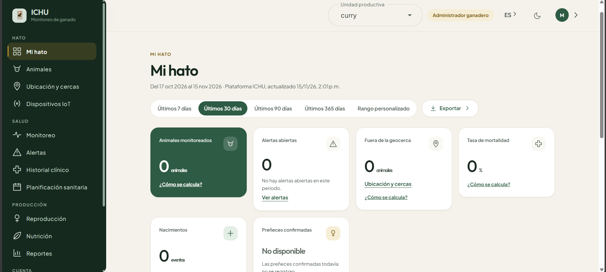</li>
  <li><strong>Animales</strong> 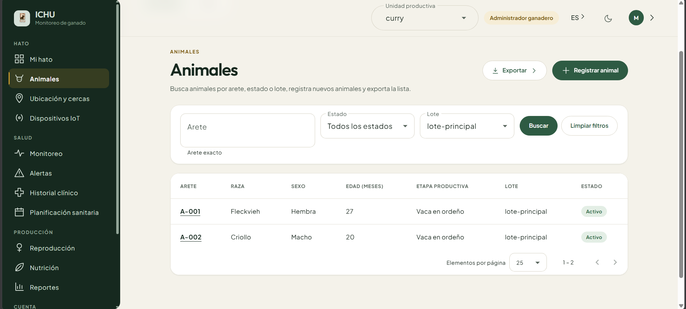</li>
  <li><strong>Alertas</strong> 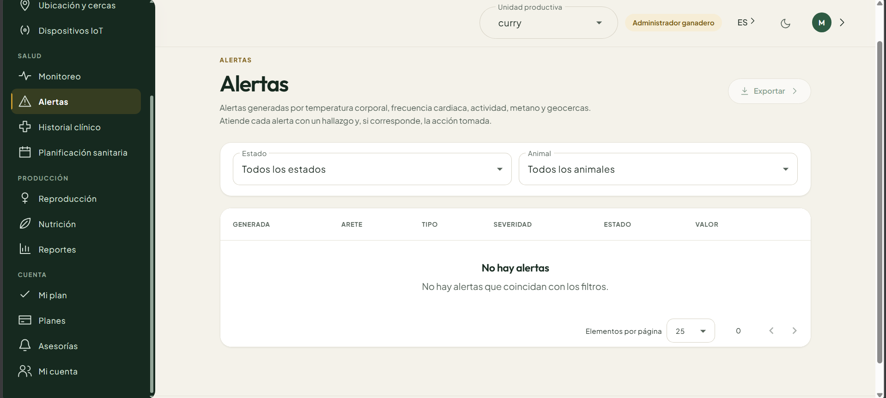</li>
  <li><strong>Monitoreo</strong> 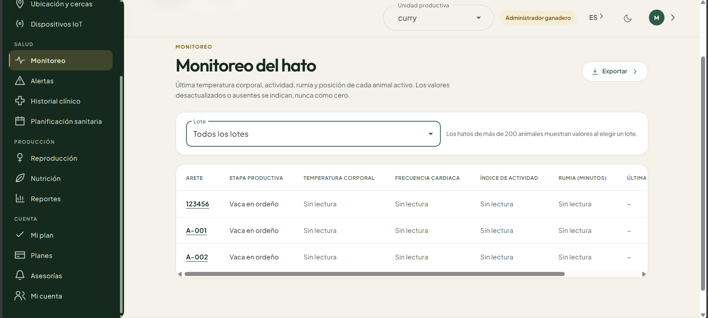</li>
  <li><strong>Collares</strong> 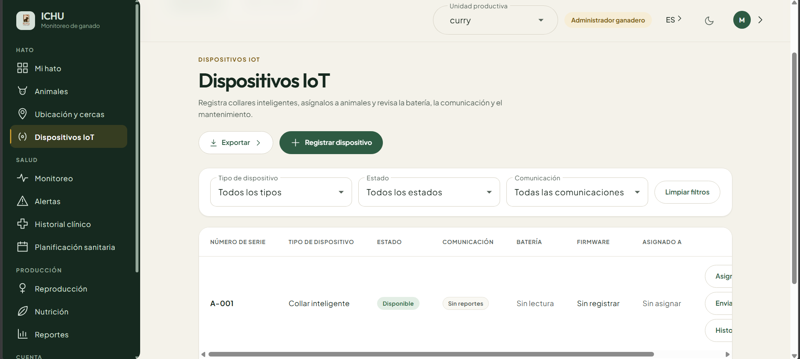</li>
  <li><strong>Lotes</strong> 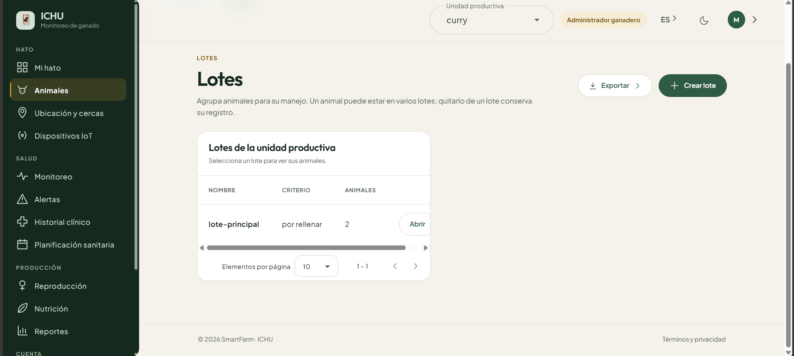</li>
  <li><strong>Ubicación</strong> 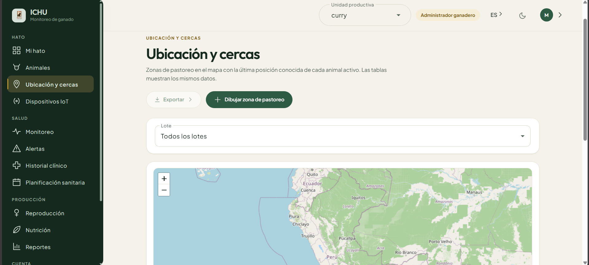</li>
</ul>

**B. Vistas de Veterinario:**

<ul>
  <li><strong>Historial Clínico</strong> 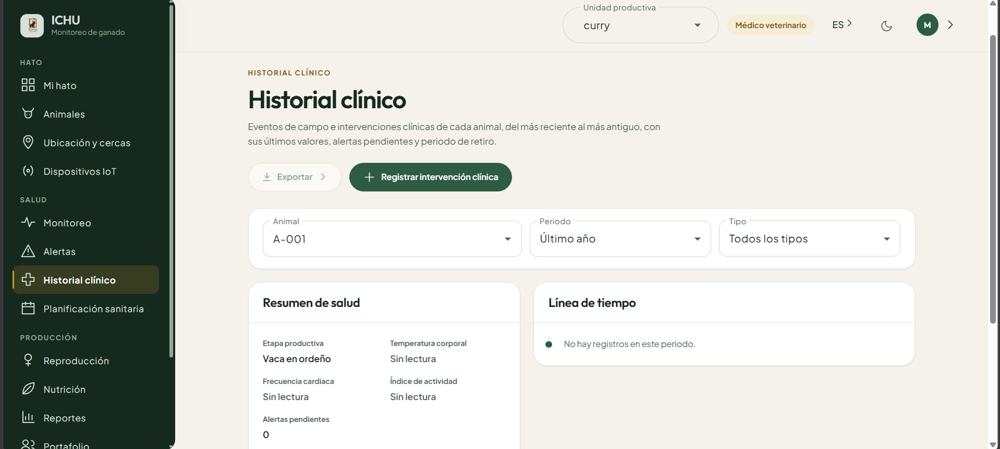</li>
  <li><strong>Reproducción</strong> 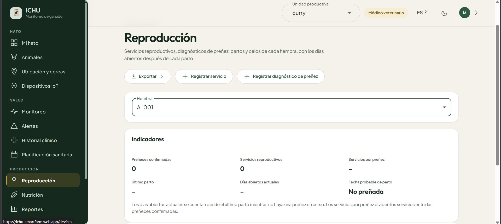</li>
</ul>

**C. Despliegue de la Aplicación Web:**

El despliegue de la aplicación web ICHU se realizó en un entorno de producción accesible a través del siguiente enlace:
<a href="https://ichu-smartfarm.web.app/">ICHU Web Application</a>

##### Demostración IoT con la API desplegada

El collar envía sus lecturas al Edge local, el Edge sincroniza con la API en Render y la aplicación web muestra la alerta; el panel consulta el mismo Edge y pasa a Urgencia.

<ul>
  <li><strong>Nodo de borde activo</strong> 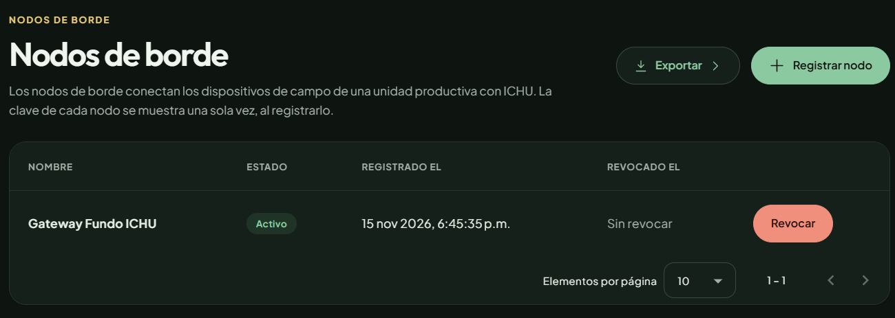</li>
  <li><strong>Collar asignado</strong> 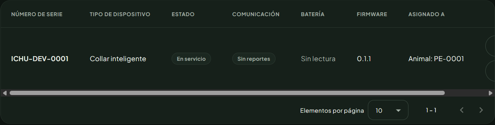</li>
  <li><strong>Alerta crítica en la web</strong> 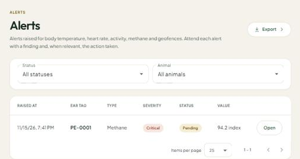</li>
  <li><strong>Panel en Urgencia (Wokwi)</strong> 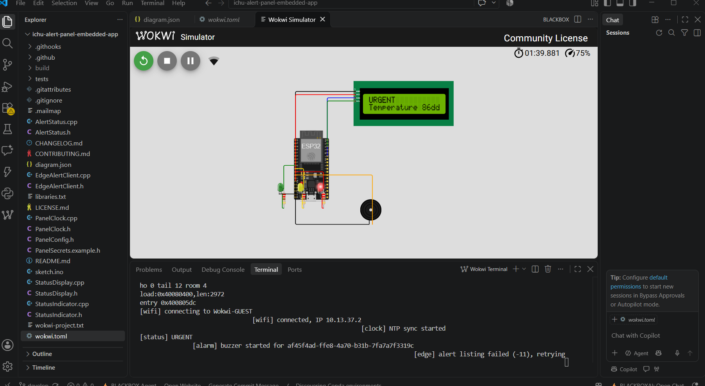</li>
</ul>

#### 6.2.2.7. Services Documentation Evidence for Sprint Review

Durante el Sprint 2, ICHU configuró la publicación del contrato OpenAPI 3.1 de la API central en Render y habilitó Swagger UI para consultar y ejecutar las operaciones. El contrato documenta el acceso con Firebase y con la clave del Edge Gateway, los resultados individuales de los lotes de sincronización y las rutas de compatibilidad en desuso. La documentación desplegada se consultó el 15 de noviembre de 2026. [Swagger UI](https://ichu-web-service.onrender.com/swagger/index.html) · [OpenAPI](https://ichu-web-service.onrender.com/openapi/v1.json)

##### Endpoints documentados con OpenAPI

Las rutas son relativas a `https://ichu-web-service.onrender.com`. Los identificadores de ruta son UUID. Las operaciones requieren un token Bearer de Firebase salvo donde se indica acceso público u otra credencial. Los cuerpos de solicitud usan JSON. Los ejemplos muestran campos de las respuestas del contrato y de los casos de prueba versionados. Las capturas del catálogo y la cotización muestran las respuestas obtenidas directamente en Swagger UI. [Pruebas de integración en v0.6.0](https://github.com/five-smart-farm-creators/ichu-web-service/tree/v0.6.0/tests/FiveSmartFarmCreators.Ichu.Platform.IntegrationTests)

**Identidad, perfil y acceso al hato**

| Historia | Verbo y sintaxis de llamada | Acción y parámetros | Ejemplo y explicación de la respuesta | Documentación |
|---|---|---|---|---|
| US-01 | `POST /api/v1/accounts` | Registra la cuenta con `role` y, para `RanchManager`, `ranchName`, `region`, `district` y `estimatedHeadCount`. La identidad de Firebase aporta el correo. | `201` con `account.status: "PendingVerification"` y `ranchId` de la unidad creada. `409` con `Iam.AccountAlreadyExists` si la cuenta ya existe. | [Swagger](https://ichu-web-service.onrender.com/swagger/index.html#operations-Accounts-post_api_v1_accounts) |
| US-02 | `POST /api/v1/accounts/sessions` | Inicia sesión con `email` y `password` en el cuerpo. Operación pública. | `200` con `tokenType: "Bearer"` e `idToken` de Firebase para las llamadas protegidas. | [Swagger](https://ichu-web-service.onrender.com/swagger/index.html#operations-Accounts-post_api_v1_accounts_sessions) |
| US-02 | `GET /api/v1/accounts/me` | Consulta la cuenta autenticada y activa la cuenta pendiente cuando el correo ya está verificado. | `200` con `role: "RanchManager"` y `status: "Active"` en el caso de una cuenta verificada. | [Swagger](https://ichu-web-service.onrender.com/swagger/index.html#operations-Accounts-get_api_v1_accounts_me) |
| US-02, US-04 | `GET /api/v1/accounts/me/ranches` | Lista las unidades a las que puede acceder la cuenta autenticada. | `200` con una lista de unidades, por ejemplo `name: "Los Andes"`, `scope: "Manage"` y `expiresAt: null` para el propietario. | [Swagger](https://ichu-web-service.onrender.com/swagger/index.html#operations-Accounts-get_api_v1_accounts_me_ranches) |
| US-03 | `GET /api/v1/profiles/me` | Consulta la cuenta y su perfil profesional. | `200` con `profile: null` para una cuenta sin perfil profesional. | [Swagger](https://ichu-web-service.onrender.com/swagger/index.html#operations-Profiles-get_api_v1_profiles_me) |
| US-03 | `PUT /api/v1/profiles/me` | Completa el perfil veterinario con `specialty`, `licenseNumber` y `yearsOfExperience`. | `200` con el perfil de la cuenta, por ejemplo `profile.specialty: "Bovine health"`. `409` si la colegiatura pertenece a otra cuenta. | [Swagger](https://ichu-web-service.onrender.com/swagger/index.html#operations-Profiles-put_api_v1_profiles_me) |
| US-04 | `POST /api/v1/ranches/{ranchId}/herd-advisories/grants` | El propietario autoriza a un veterinario con perfil completo. El cuerpo incluye `veterinarianId`, `scope` (`Read` o `ClinicalWrite`) y `expiresAt` futuro. | `201` con `status: "Granted"`, el alcance y el vencimiento. `409` si ya existe una autorización activa. | [Swagger](https://ichu-web-service.onrender.com/swagger/index.html#operations-Veterinary_Access_Requests-post_api_v1_ranches__ranchId__herd_advisories_grants) |

**Planes y suscripciones**

| Historia | Verbo y sintaxis de llamada | Acción y parámetros | Ejemplo y explicación de la respuesta | Documentación |
|---|---|---|---|---|
| TS-10, US-34 | `GET /api/v1/plans` | Lista el catálogo público. La llamada no requiere parámetros. | `200` con Basic, Standard y Pro. Basic incluye `deviceLimit: 50`, la tarifa anual y el precio unitario del collar. | [Swagger](https://ichu-web-service.onrender.com/swagger/index.html#operations-Subscription_Plans-get_api_v1_plans) |
| TS-10, US-34 | `GET /api/v1/plans/{planId}` | Consulta un plan por su identificador. Operación pública. | `200` con el plan, por ejemplo `name: "Basic"` y `features: ["Alerts", "Monitoring"]`. `404` si el plan no existe. | [Swagger](https://ichu-web-service.onrender.com/swagger/index.html#operations-Subscription_Plans-get_api_v1_plans__planId_) |
| TS-10, US-34 | `GET /api/v1/quotes?planId={planId}&headCount={headCount}` | Calcula una cotización pública. Ambos parámetros de consulta son obligatorios. `planId` es un UUID y `headCount` un entero admitido por el plan. | `200` con `headCount: 10`, `devicesCost.amount: 1200` y `total.amount: 1800` en `PEN` para Basic. Es una estimación anual. | [Swagger](https://ichu-web-service.onrender.com/swagger/index.html#operations-Subscription_Plans-get_api_v1_quotes) |
| TS-10, US-34 | `GET /api/v1/plans/{planId}/quote?headCount={headCount}` | Conserva la cotización pública anterior para clientes existentes. Recibe `planId` en la ruta y `headCount` en la consulta. OpenAPI la marca en desuso. | `200` con el mismo contrato de cotización, incluidos `annualFee`, `devicesCost`, `total` y `periodicity: "Annual"`. | [Swagger](https://ichu-web-service.onrender.com/swagger/index.html#operations-Subscription_Plans-get_api_v1_plans__planId__quote) |
| TS-10, US-34 | `POST /api/v1/ranches/{ranchId}/subscriptions` | Registra la solicitud con `planId`, `headCount`, `expectedTotal`, `termsVersion`, `operationId` y `acquisitionSource` opcional. | `201` con `status: "Pending"` y `activatedAt: null`. El escenario Standard de 10 cabezas registra `total.amount: 3000` en `PEN`. El reintento idéntico devuelve el registro guardado con `200`. | [Swagger](https://ichu-web-service.onrender.com/swagger/index.html#operations-Subscriptions-post_api_v1_ranches__ranchId__subscriptions) |
| TS-10 | `GET /api/v1/ranches/{ranchId}/subscriptions` | Consulta la suscripción de la unidad. | `200` con `status: "Pending"` tras la solicitud, además del plan, los importes y la vigencia. `404` si aún no hay suscripción. | [Swagger](https://ichu-web-service.onrender.com/swagger/index.html#operations-Subscriptions-get_api_v1_ranches__ranchId__subscriptions) |
| TS-10 | `POST /api/v1/ranches/{ranchId}/subscriptions/{subscriptionId}/checkout-sessions` | Genera una sesión de Stripe Checkout para una suscripción pendiente. Recibe los dos UUID en la ruta y no requiere cuerpo. | `201` con `sessionId: "cs_test_fake"` en la prueba con el proveedor simulado. El contrato también entrega `url` y `expiresAt`. | [Swagger](https://ichu-web-service.onrender.com/swagger/index.html#operations-Subscriptions-post_api_v1_ranches__ranchId__subscriptions__subscriptionId__checkout_sessions) |
| TS-10 | `POST /api/v1/payments/stripe/webhooks` | Recibe el JSON original del evento y valida `Stripe-Signature`. Una confirmación aplicable activa la suscripción pendiente. | `200` sin cuerpo como acuse del webhook. La prueba comprueba `status: "Active"` al consultar posteriormente la suscripción cuyo pago se confirmó. | [Swagger](https://ichu-web-service.onrender.com/swagger/index.html#operations-Payments-post_api_v1_payments_stripe_webhooks) |

**Hato, collares y reglas de monitoreo**

| Historia | Verbo y sintaxis de llamada | Acción y parámetros | Ejemplo y explicación de la respuesta | Documentación |
|---|---|---|---|---|
| US-06 | `POST /api/v1/ranches/{ranchId}/cattle` | Registra el animal con `earTag`, `breed`, `sex`, `birthDate` y `lifeStage`. | `201` con el identificador y los datos del animal, por ejemplo `earTag: "PE-0001"`, `currentStage: "Heifer"` y `status: "Active"`. | [Swagger](https://ichu-web-service.onrender.com/swagger/index.html#operations-Cattle_Information-post_api_v1_ranches__ranchId__cattle) |
| US-07, TS-18, US-22 | `GET /api/v1/ranches/{ranchId}/cattle` | Busca animales autorizados. Admite `earTag`, `status`, `lotId`, `page` y `pageSize`. | `200` con la lista de coincidencias. La prueba por arete devuelve un animal con `earTag: "PE-0011"`. | [Swagger](https://ichu-web-service.onrender.com/swagger/index.html#operations-Cattle_Information-get_api_v1_ranches__ranchId__cattle) |
| US-07, TS-18, US-22 | `GET /api/v1/ranches/{ranchId}/cattle/{cattleId}` | Obtiene la ficha de un animal y su relación con el collar. | `200` con `cattle.earTag: "PE-0002"` y `device.collarId: null` en el caso sin collar. `device.lastReadingReceivedAt` indica la última recepción cuando está disponible. | [Swagger](https://ichu-web-service.onrender.com/swagger/index.html#operations-Cattle_Information-get_api_v1_ranches__ranchId__cattle__cattleId_) |
| US-10 | `POST /api/v1/ranches/{ranchId}/devices` | Registra el collar antes de asignarlo. Recibe `serial`, `type` (`SmartCollar` para el collar) y `firmwareVersion` cuando se conoce. | `201` con `type: "SmartCollar"`, `status: "Available"` y `currentAssignment: null`. | [Swagger](https://ichu-web-service.onrender.com/swagger/index.html#operations-IoT_Devices-post_api_v1_ranches__ranchId__devices) |
| US-10 | `GET /api/v1/ranches/{ranchId}/devices` | Lista el inventario autorizado para seleccionar el collar. | `200` con la lista de dispositivos y sus estados. El caso de inventario vacío devuelve `[]`. | [Swagger](https://ichu-web-service.onrender.com/swagger/index.html#operations-IoT_Devices-get_api_v1_ranches__ranchId__devices) |
| US-10 | `GET /api/v1/ranches/{ranchId}/devices/{deviceId}` | Consulta el dispositivo y obtiene su `version` para la asignación. | `200` con el estado, la versión y `currentAssignment`, que es `null` si el collar está sin asignar. | [Swagger](https://ichu-web-service.onrender.com/swagger/index.html#operations-IoT_Devices-get_api_v1_ranches__ranchId__devices__deviceId_) |
| US-10 | `POST /api/v1/ranches/{ranchId}/devices/{deviceId}/assignments` | Asigna el collar al animal `targetId`. El cuerpo requiere `expectedVersion` del dispositivo. | `201` con `status: "InService"` y `currentAssignment.targetType: "Cattle"`. La asignación incluye su fecha de inicio y el animal de destino. | [Swagger](https://ichu-web-service.onrender.com/swagger/index.html#operations-Device_Assignments-post_api_v1_ranches__ranchId__devices__deviceId__assignments) |
| US-10 | `GET /api/v1/ranches/{ranchId}/devices/{deviceId}/assignments` | Consulta el historial de asignaciones del dispositivo. | `200` con la lista de asignaciones, sus destinos y los campos `startedAt` y `endedAt`. El ejemplo cerrado conserva `releaseReason: "Collar maintenance"`. | [Swagger](https://ichu-web-service.onrender.com/swagger/index.html#operations-Device_Assignments-get_api_v1_ranches__ranchId__devices__deviceId__assignments) |
| US-15 | `GET /api/v1/ranches/{ranchId}/lots` | Lista los lotes autorizados para seleccionar el lote de una geocerca. | `200` con una lista de lotes, por ejemplo `name: "Calving pen"` y su identificador. | [Swagger](https://ichu-web-service.onrender.com/swagger/index.html#operations-Cattle_Lots-get_api_v1_ranches__ranchId__lots) |
| US-15 | `POST /api/v1/ranches/{ranchId}/geofences` | Crea la zona para `lotId` con `name`, `toleranceMeters`, `severity` y `vertices` con `latitude` y `longitude`. | `201` con la zona y su lote, por ejemplo `name: "North boundary"`. `400` con `OperationsMonitoring.GeofenceBoundaryCrossing` si el perímetro se cruza. | [Swagger](https://ichu-web-service.onrender.com/swagger/index.html#operations-Geofences-post_api_v1_ranches__ranchId__geofences) |
| US-15 | `GET /api/v1/ranches/{ranchId}/geofences` | Lista las zonas configuradas, con sus lotes y límites. | `200` con una lista de zonas. Tras rechazar un polígono cruzado en una unidad sin geocercas, el escenario comprueba `[]`. | [Swagger](https://ichu-web-service.onrender.com/swagger/index.html#operations-Geofences-get_api_v1_ranches__ranchId__geofences) |
| US-15 | `PUT /api/v1/ranches/{ranchId}/geofences/{geofenceId}` | Reemplaza `name`, `toleranceMeters`, `severity` y `vertices` de la zona identificada. | `200` con la geocerca actualizada, incluidos `lotId`, `vertices` y la `revision` de las reglas. | [Swagger](https://ichu-web-service.onrender.com/swagger/index.html#operations-Geofences-put_api_v1_ranches__ranchId__geofences__geofenceId_) |
| TS-15, US-16 | `PUT /api/v1/ranches/{ranchId}/monitoring-thresholds` | Crea o reemplaza un umbral con `lifeStage`, `metric`, `minValue`, `maxValue` y `severity`. | `200` con `metric: "BodyTemperature"`, `minValue: 37.5`, `maxValue: 39.5` y `severity: "Warning"` en la prueba. | [Swagger](https://ichu-web-service.onrender.com/swagger/index.html#operations-Monitoring_Thresholds-put_api_v1_ranches__ranchId__monitoring_thresholds) |
| TS-15, US-16 | `GET /api/v1/ranches/{ranchId}/monitoring-thresholds` | Consulta los umbrales de la unidad autorizada. | `200` con la lista de umbrales por etapa y métrica. La prueba devuelve una regla con `lifeStage: "MilkingCow"`. | [Swagger](https://ichu-web-service.onrender.com/swagger/index.html#operations-Monitoring_Thresholds-get_api_v1_ranches__ranchId__monitoring_thresholds) |

**Edge Gateway, telemetría, alertas y sincronización móvil**

| Historia | Verbo y sintaxis de llamada | Acción y parámetros | Ejemplo y explicación de la respuesta | Documentación |
|---|---|---|---|---|
| TS-06, TS-15 | `POST /api/v1/ranches/{ranchId}/edge-gateways` | Registra el nodo con `name` para aprovisionar su clave de enlace con la API central. | `201` con `status: "Active"` y `key` en formato `{gatewayId}.{secret}`, devuelta una sola vez. | [Swagger](https://ichu-web-service.onrender.com/swagger/index.html#operations-IoT_Edge_Gateways-post_api_v1_ranches__ranchId__edge_gateways) |
| TS-15 | `GET /api/v1/edge-gateways/{gatewayId}/monitoring-rules` | Descarga umbrales y geocercas. Requiere `X-Gateway-Key` y admite `afterRevision` en la consulta. | `200` con `revision: 2`, `thresholds` y `geofences` en la prueba. `304` sin cuerpo si la revisión local sigue vigente. | [Swagger](https://ichu-web-service.onrender.com/swagger/index.html#operations-Edge_Gateways-get_api_v1_edge_gateways__gatewayId__monitoring_rules) |
| TS-15 | `GET /api/v1/edge-gateways/{gatewayId}/device-assignments` | Descarga las asignaciones de collares a animales activos. Requiere `X-Gateway-Key`. | `200` con `ranchId` y `assignments`. Cada entrada identifica dispositivo, animal, lote y etapa, por ejemplo `lifeStage: "MilkingCow"`. | [Swagger](https://ichu-web-service.onrender.com/swagger/index.html#operations-Edge_Gateways-get_api_v1_edge_gateways__gatewayId__device_assignments) |
| TS-06, TS-07, TS-05, US-16, US-17 | `POST /api/v1/telemetry/batch` | Recibe `readings`, `alerts` y `alertChanges` con `X-Gateway-Key`. La lectura usa `readingId`, `deviceId`, `recordedAt` y las mediciones capturadas. Las alertas usan `alertId` y los cambios usan `operationId`. Los reintentos conservan los identificadores. | `200` con resultados por entrada, por ejemplo `kind: "Reading"` y `status: "Accepted"`. Cada entrada puede indicar `Accepted`, `Duplicate`, `Rejected` o `Conflict`, con el motivo cuando aplica. | [Swagger](https://ichu-web-service.onrender.com/swagger/index.html#operations-Telemetry-post_api_v1_telemetry_batch) |
| TS-08, US-13 | `GET /api/v1/ranches/{ranchId}/cattle/{cattleId}/telemetry?from={from}&to={to}` | Consulta el intervalo `[from, to)` con ambos límites de fecha y hora y paginación opcional con `page` y `pageSize`. | `200` con `totalCount` e `items` que incluyen captura, recepción, origen y estado de los indicadores. La prueba incluye `bodyTemperature.value: 38.6` y `bodyTemperature.status: "Valid"`. | [Swagger](https://ichu-web-service.onrender.com/swagger/index.html#operations-Telemetry-get_api_v1_ranches__ranchId__cattle__cattleId__telemetry) |
| US-13, US-20 | `GET /api/v1/ranches/{ranchId}/cattle/{cattleId}/telemetry/latest` | Recupera los últimos valores válidos y la última posición conocida con sus tiempos de captura. | `200` con `bodyTemperature.value: 38.6` y `bodyTemperature.unit: "celsius"` en el caso con una lectura. `lastKnownPosition.status: "Unavailable"` indica ausencia de una posición utilizable. | [Swagger](https://ichu-web-service.onrender.com/swagger/index.html#operations-Telemetry-get_api_v1_ranches__ranchId__cattle__cattleId__telemetry_latest) |
| TS-09, US-16, US-17 | `GET /api/v1/ranches/{ranchId}/alerts` | Consulta las alertas del hato en orden del evento más reciente. Admite `status` (`Pending` o `Acknowledged`), `cattleId`, `page` y `pageSize`. | `200` con `items` y `totalCount`. La alerta de temperatura de la prueba incluye `status: "Pending"`, `detectedValue: 40.2` y `thresholdMaxValue: 39.5`. | [Swagger](https://ichu-web-service.onrender.com/swagger/index.html#operations-Alerts-get_api_v1_ranches__ranchId__alerts) |
| TS-09, US-19 | `PATCH /api/v1/ranches/{ranchId}/alerts/{alertId}` | Registra la atención con `status: "Acknowledged"`, `finding`, `action`, `operationId` y `expectedVersion`. | `200` con `status: "Acknowledged"`, `acknowledgedBy` y `version: 2` en la prueba. `409` devuelve la alerta vigente si la versión quedó desactualizada. | [Swagger](https://ichu-web-service.onrender.com/swagger/index.html#operations-Alerts-patch_api_v1_ranches__ranchId__alerts__alertId_) |
| US-21 | `POST /api/v1/ranches/{ranchId}/field-events` | Registra el evento con `operationId`, `cattleId`, `type`, `occurredAt` y los detalles del tipo, como `observation`. | `201` con `type: "HealthEvent"`, `observation: "Mild lameness"` y el autor. Un reintento con la misma operación devuelve el registro guardado con `200`. | [Swagger](https://ichu-web-service.onrender.com/swagger/index.html#operations-Livestock_Operations-post_api_v1_ranches__ranchId__field_events) |
| US-21, US-22 | `GET /api/v1/ranches/{ranchId}/cattle/{cattleId}/livestock-operations?from={from}&to={to}` | Consulta los eventos e intervenciones del animal entre dos fechas y horas en el intervalo `[from, to)`. | `200` con una lista de operaciones. El escenario de faena recupera el evento `type: "HealthEvent"` registrado previamente. | [Swagger](https://ichu-web-service.onrender.com/swagger/index.html#operations-Livestock_Operations-get_api_v1_ranches__ranchId__cattle__cattleId__livestock_operations) |
| TS-18, US-21, US-22 | `POST /api/v1/mobile-sync/batch` | Envía `operations` con las entradas de la cola móvil. Cada entrada conserva su `operationId`, `cattleId`, `type`, `occurredAt` y los detalles según el tipo. El servidor resuelve la unidad desde el animal y verifica permisos. | `200` con `results` por operación. La prueba devuelve una entrada `Accepted` y otra `Rejected`. Los casos de reintento devuelven `Duplicate` o `Conflict`. | [Swagger](https://ichu-web-service.onrender.com/swagger/index.html#operations-Livestock_Operations-post_api_v1_mobile_sync_batch) |

El servicio local del Edge v0.2.0 describe en su README la recepción de lecturas del collar, el listado de alertas para el panel y la sincronización. La revisión de esa versión encontró el contrato HTTP en Markdown. Los permisos locales móviles de TS-15, las operaciones móviles locales de TS-16 y TS-17 y el envío a un proveedor de TS-11 quedan fuera de la cobertura OpenAPI verificada. TS-01 y TS-03 corresponden a la captura de lecturas y a la cola de reintentos en el firmware del collar. [Contrato HTTP del Edge](https://github.com/five-smart-farm-creators/ichu-edge-service/blob/d85e43368614dadcb0013e285ece8c69a32aa67d/README.md#api-contract)

| Endpoint | Uso | Respuesta |
|---|---|---|
| `POST /api/v1/monitoring/telemetry-readings` | Recibe una lectura del collar con `X-API-Key`. | `201` si la lectura es nueva; `200` si es un reenvío idéntico; `409` si el `event_id` ya se usó con otra telemetría. |
| `GET /api/v1/monitoring/alerts?device_id=…&limit=…` | Lista las alertas recientes para el panel, con `X-API-Key`. | `200` con `alerts`; `400` si `limit` no está entre 1 y 100; `401` si las credenciales no coinciden. |
| `GET /api/v1/status` | Informa el estado del servicio, la revisión de reglas y los registros pendientes. No requiere autenticación. | `200` con `status`, `rulesRevision`, `pendingReadings` y `pendingAlerts`. |
| `POST /api/v1/synchronizations` | Sincroniza reglas, asignaciones y registros pendientes con la API central. Es una acción local sin credenciales de dispositivo. | `200` con el resultado; `502` si la nube rechaza las credenciales del gateway; `503` si no está configurada o no responde. |

##### Evidencia de interacción con Swagger UI

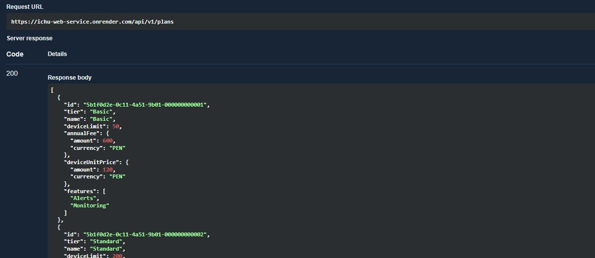

*Figura 6.9. Desde Swagger UI se ejecutó `GET /api/v1/plans`. El servidor devolvió HTTP 200. El primer elemento muestra el identificador de Basic, su límite de 50 collares, la tarifa anual de 600 PEN y el precio unitario de 120 PEN. El identificador de este resultado se usó para la consulta siguiente.*

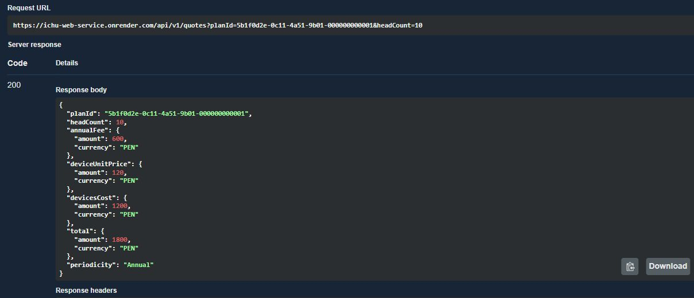

*Figura 6.10. Se ejecutó `GET /api/v1/quotes` en Swagger UI con el `planId` de Basic y `headCount=10` como dato de muestra. El servidor devolvió HTTP 200 con una tarifa anual de 600 PEN y 1 200 PEN por los diez collares, para un total de 1 800 PEN.*

##### Evidencia del Edge API

El Edge sincroniza con la API central mediante `POST /api/v1/telemetry/batch`, documentado en Swagger UI. Su estado local muestra la revisión de reglas descargada y los registros pendientes.

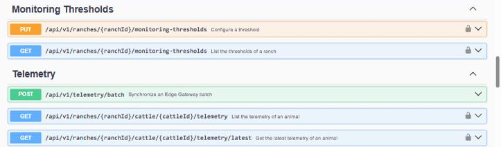

*Figura 6.11. Endpoints de umbrales y telemetría en Swagger UI, incluido el lote de sincronización del Edge.*

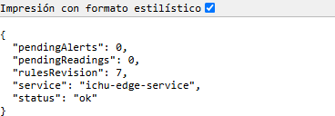

*Figura 6.12. Estado del Edge API: servicio activo, revisión de reglas 7 y sin registros pendientes.*

##### Repositorio y commits de documentación del Sprint 2

Los commits registran los cambios de documentación, publicación y verificación del contrato en el repositorio de servicios. [five-smart-farm-creators/ichu-web-service](https://github.com/five-smart-farm-creators/ichu-web-service)

| Repository | Branch | Commit Id | Commit Message | Commit Message Body | Committed on |
|---|---|---|---|---|---|
| ichu-web-service | `feature/operations-monitoring` | [a6adf29](https://github.com/five-smart-farm-creators/ichu-web-service/commit/a6adf29135b2aa93e26b0991b407fa1ada2c6796) | feat(shared): replace the Scalar API reference with Swagger UI | — | 2026-11-06 |
| ichu-web-service | `feature/operations-monitoring` | [a823ea0](https://github.com/five-smart-farm-creators/ichu-web-service/commit/a823ea07564d433cebf7913554cfc752c8f6ce46) | feat(shared): document the bearer security scheme in OpenAPI | — | 2026-11-06 |
| ichu-web-service | `feature/operations-monitoring` | [9601dd7](https://github.com/five-smart-farm-creators/ichu-web-service/commit/9601dd7db2d9e87c2717153d87096c57a6598ea8) | feat(monitoring): document the X-Gateway-Key header in OpenAPI | Add an operation transformer that declares the required gateway key header on the telemetry batch and Edge Gateway monitoring rules operations, so Swagger UI shows an input for it. | 2026-11-06 |
| ichu-web-service | `feature/operations-monitoring` | [3e84cc3](https://github.com/five-smart-farm-creators/ichu-web-service/commit/3e84cc34fe583feebade15737a8ff713c3c02978) | docs(monitoring): describe the gateway key input in Swagger UI | Note the X-Gateway-Key input in the README and record the OpenAPI header in the changelog. | 2026-11-06 |
| ichu-web-service | `feature/render-deployment` | [b8dc73f](https://github.com/five-smart-farm-creators/ichu-web-service/commit/b8dc73fd1e0c0cc0cd69af297071895937c33057) | build(shared): deploy the api to render with docker | A multi-stage Dockerfile, a Render Blueprint with a PostgreSQL database, a database health check, forwarded headers for Render's proxy and an OpenApi:Enabled switch so Swagger is public on Render. The workflow builds the image on every pull request. | 2026-11-10 |
| ichu-web-service | `feature/edge-device-assignments` | [ada0ae9](https://github.com/five-smart-farm-creators/ichu-web-service/commit/ada0ae963a0e5b4fead2d145d87bb12120d2105e) | feat(operations-monitoring): publish collar assignments to edge gateways | The edge evaluated no rule for a collar it did not know, and only the development seed told it which lot and life stage each collar serves. | 2026-11-12 |
| ichu-web-service | `fix/rest-endpoint-paths` | [eaa7d60](https://github.com/five-smart-farm-creators/ichu-web-service/commit/eaa7d60be4cb7a21ff9b509ecc3d83c8f86681f6) | fix: accept integer head counts in swagger quotes and preserve authorize - | — | 2026-11-12 |
| ichu-web-service | `fix/rest-endpoint-paths` | [67c387a](https://github.com/five-smart-farm-creators/ichu-web-service/commit/67c387a1b2de6f83d05e07d5b49a7341bde7e48b) | fix: add regression coverage for swagger quotes and bearer authorization | — | 2026-11-12 |
| ichu-web-service | `fix/rest-endpoint-paths` | [c9b5a12](https://github.com/five-smart-farm-creators/ichu-web-service/commit/c9b5a12eb3e3baa3ba53e5960faee995565a0686) | fix: clarify lot creation and listing in swagger | — | 2026-11-13 |
| ichu-web-service | `fix/rest-endpoint-paths` | [d754c50](https://github.com/five-smart-farm-creators/ichu-web-service/commit/d754c5007bc0bf9a9e6fa06af43b4dff99f93341) | fix: explain mobile synchronization inputs and entry results | — | 2026-11-13 |
| ichu-web-service | `fix/rest-endpoint-paths` | [1fa7dbc](https://github.com/five-smart-farm-creators/ichu-web-service/commit/1fa7dbc06c1f16c7192889ae057ac7f676571926) | fix: clarify edge telemetry authentication and batch results | — | 2026-11-13 |
| ichu-web-service | `fix/rest-endpoint-paths` | [57e621f](https://github.com/five-smart-farm-creators/ichu-web-service/commit/57e621f4ecb4d34e2eab8c2f8434e5728d41fe9e) | fix: remove bearer requirements from anonymous operations | — | 2026-11-13 |
| ichu-web-service | `fix/rest-endpoint-paths` | [b2a9c05](https://github.com/five-smart-farm-creators/ichu-web-service/commit/b2a9c0515bc5deea5ff88ea9a48cb4d0c80fc0b5) | fix: document stripe webhook signatures and request bodies | — | 2026-11-13 |
| ichu-web-service | `fix/rest-endpoint-paths` | [b1603d3](https://github.com/five-smart-farm-creators/ichu-web-service/commit/b1603d3a666fd39fefd307a03700ebab0dc8a0e6) | fix: expose deprecated operations in openapi | — | 2026-11-13 |
| ichu-web-service | `fix/rest-endpoint-paths` | [74cdc32](https://github.com/five-smart-farm-creators/ichu-web-service/commit/74cdc32468c3ed310a839f418d1602309af03aef) | fix: register openapi authentication and deprecation transformers | — | 2026-11-13 |
| ichu-web-service | `fix/rest-endpoint-paths` | [1420d94](https://github.com/five-smart-farm-creators/ichu-web-service/commit/1420d94fd5717f71e382ef17780983baca11b6a9) | fix: verify reviewed openapi contracts and compatibility routes | — | 2026-11-13 |

El 13 de noviembre de 2026, hora de Lima, el repositorio del servicio Edge incorporó la guía local del flujo collar, Edge y nube. [five-smart-farm-creators/ichu-edge-service](https://github.com/five-smart-farm-creators/ichu-edge-service) · [c60215f](https://github.com/five-smart-farm-creators/ichu-edge-service/commit/c60215f62384d297a4e3067667fd1ce7c3003d26)

#### 6.2.2.8. Software Deployment Evidence for Sprint Review

Durante el Sprint 2, del 4 al 14 de noviembre de 2026, el equipo publicó una actualización de la Landing Page en GitHub Pages y nuevas versiones de la aplicación web en Firebase Hosting. También configuró el despliegue de la API central en Render con PostgreSQL y automatizó el arranque del Edge en GitHub Actions para las pruebas de integración del collar y el panel de alertas.

No se encontró evidencia de una publicación de la aplicación móvil en Google Play, TestFlight u otro canal de distribución. El APK debug compilado y abierto localmente en un emulador es evidencia de ejecución para desarrollo, no una versión de producción. Tampoco acredita despliegue del servicio móvil ni acceso a funciones autenticadas.

##### Landing Page en GitHub Pages

GitHub Pages publicó los archivos estáticos desde la raíz de la rama `main` del repositorio `ichu-website`. El ajuste de publicación incorporó `.nojekyll` para que GitHub Pages sirviera los fragmentos compartidos del encabezado y pie de página. El 14 de noviembre, la ejecución n.º 6 construyó el artefacto y lo desplegó con estado **Success** desde el commit `78d2120`. El sitio publicado respondió HTTP 200 al consultarlo el 15 de noviembre. [Ajustes de publicación del sitio](https://github.com/five-smart-farm-creators/ichu-website/blob/78d21204efd8f07f699d6573396d7da1c2840ab8/README.md#deployment) · [Ejecución de GitHub Actions](https://github.com/five-smart-farm-creators/ichu-website/actions/runs/43562156744) · [Landing Page publicada](https://five-smart-farm-creators.github.io/ichu-website/)

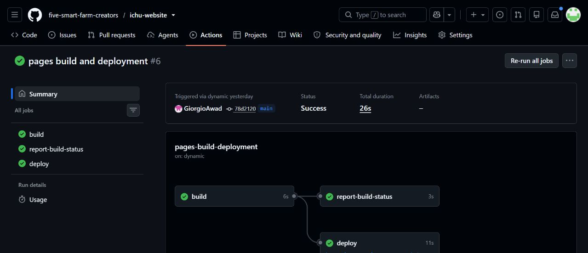

*Figura 6.13. Ejecución de GitHub Pages para el commit `78d2120`. Los trabajos `build`, `report-build-status` y `deploy` finalizaron correctamente.*

##### Aplicación web en Firebase Hosting

El 12 de noviembre se incorporaron `firebase.json` y `scripts/deploy-hosting.ps1` al repositorio `ichu-web-app`. El script compila la aplicación Angular, escribe la configuración de producción en el directorio de salida y publica `dist/ichu-web-app/browser` mediante Firebase CLI. Hosting sirve `index.html` para las rutas de la aplicación. En la verificación del 15 de noviembre, el sitio respondió HTTP 200 y su configuración publicada apuntó a la API de Render. [Commit de configuración](https://github.com/five-smart-farm-creators/ichu-web-app/commit/bf8b6ff837ffdcbef67b5ed22e9c07635be7a195) · [Aplicación web publicada](https://ichu-smartfarm.web.app/)

El historial de Firebase Hosting registra las publicaciones del **12 de noviembre** con hash `c5bbff` a las 12:21 p. m. y `536113` a las 12:33 p. m., y la del **13 de noviembre** con hash `638a24` a la 1:17 a. m. La primera fila de la captura muestra la publicación posterior al cierre del sprint, del 15 de noviembre.

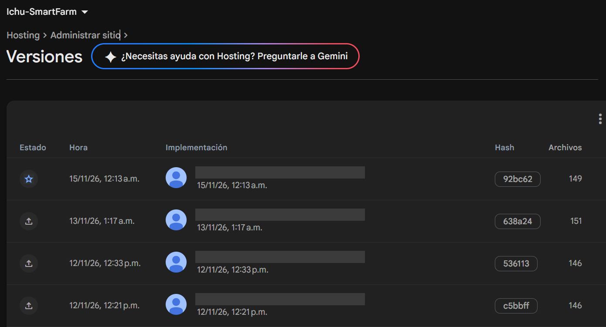

*Figura 6.14. Historial de versiones del sitio Ichu-SmartFarm en Firebase Hosting. La captura conserva las fechas, los hashes y el total de archivos de cada versión.*

##### API central y PostgreSQL en Render

El 10 de noviembre, el commit `b8dc73f` incorporó el `Dockerfile` y el Blueprint `render.yaml`. El Dockerfile compila la API en una etapa con el SDK de .NET y ejecuta el artefacto publicado en una imagen de ASP.NET Core, con un usuario sin privilegios y en el puerto `8080`. El Blueprint define el servicio web `ichu-web-service` y la base PostgreSQL 17 `ichu-db` en la región de Oregon. Render quedó configurado para desplegar los cambios de `main`, consultar `/health` y habilitar la documentación OpenAPI en el entorno de producción. El 11 de noviembre, GitHub registró como exitosa la operación asociada a `main - ichu-db`. El 15 de noviembre, `GET /health` devolvió **HTTP 200** y `Healthy`, lo que acredita que la API desplegada pudo conectarse a su base de datos en esa comprobación. [Configuración y contenedor en GitHub](https://github.com/five-smart-farm-creators/ichu-web-service/commit/b8dc73fd1e0c0cc0cd69af297071895937c33057) · [Registro de estado de la base](https://api.github.com/repos/five-smart-farm-creators/ichu-web-service/deployments/7702886599/statuses) · [Estado de la API](https://ichu-web-service.onrender.com/health)

*Figura 6.15. Blueprint versionado para construir en Render con `Dockerfile`, verificar `/health` y desplegar automáticamente desde `main`.*

##### Entorno de integración del Edge, collar y panel

El 14 de noviembre, hora de Lima, los trabajos `end-to-end` de ambos repositorios de firmware prepararon un entorno temporal en GitHub Actions. Instalaron las dependencias del Edge, cargaron las reglas y la asignación del collar para la prueba y arrancaron la API local en el ejecutor. El trabajo del collar compiló el firmware, lo ejecutó en Wokwi contra el Edge y comprobó una alerta crítica de temperatura. El trabajo del panel generó una alerta crítica con el simulador del collar y ejecutó en Wokwi el firmware del panel conectado al mismo entorno de prueba de ese trabajo. Ambos trabajos finalizaron correctamente. [Ejecución del collar](https://github.com/five-smart-farm-creators/ichu-cattle-band-embedded-app/actions/runs/43678278990/job/132703971532) · [Ejecución del panel](https://github.com/five-smart-farm-creators/ichu-alert-panel-embedded-app/actions/runs/43678289266/job/132703645150)

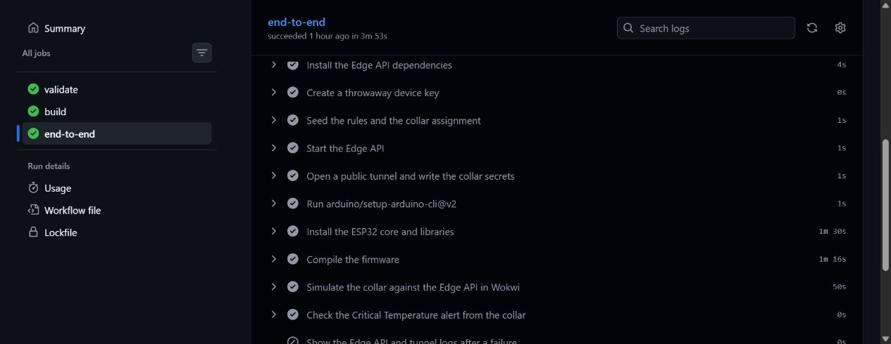

*Figura 6.16. Registro del trabajo del collar. Se observa el arranque de la API del Edge, la simulación en Wokwi y la comprobación de la alerta crítica de temperatura.*

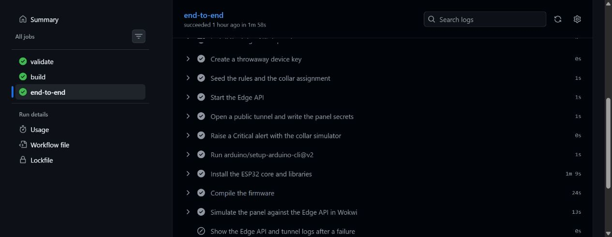

*Figura 6.17. Registro del trabajo del panel de alertas. Se observa la generación de la alerta de prueba y la ejecución del firmware en Wokwi contra el Edge.*

#### 6.2.2.9. Team Collaboration Insights during Sprint

Durante el Sprint 2, del **4 al 14 de noviembre de 2026**, los cinco integrantes trabajaron sobre ramas de funcionalidad y corrección. Los pull requests del sitio, la API y las aplicaciones muestran cómo se incorporaron los cambios a `develop` y cómo se ajustaron las aplicaciones a los contratos del backend. La publicación del sitio siguió su rama de release hacia `main`, según la evidencia de la sección 6.2.2.8. [Integración del sitio](https://github.com/five-smart-farm-creators/ichu-website/pull/17) · [Correcciones de rutas de la API](https://github.com/five-smart-farm-creators/ichu-web-service/pull/49) · [Alineación del cliente móvil](https://github.com/five-smart-farm-creators/ichu-mobile-app/pull/24)

##### Actividad por repositorio e integrante

Commits de autoría de cada integrante por repositorio, contados en `main` y `develop` sin incluir los commits de fusión. Un cero indica que no se registraron commits de ese integrante en el repositorio.

| Producto o entregable | Alison Arrieta | Diego Avalos | Flor Contreras | Giorgio Awad | Manuel Sanchez | Total |
|---|---:|---:|---:|---:|---:|---:|
| Landing Page | 4 | 2 | 9 | 4 | 0 | 19 |
| API central | 96 | 14 | 125 | 6 | 23 | 264 |
| Aplicación web | 0 | 9 | 91 | 0 | 0 | 100 |
| Aplicación móvil | 13 | 67 | 14 | 0 | 32 | 126 |
| Edge Service | 0 | 0 | 30 | 0 | 0 | 30 |
| Firmware del collar | 0 | 0 | 20 | 0 | 0 | 20 |
| Firmware del panel | 0 | 0 | 9 | 0 | 0 | 9 |
| Informe | 1 | 0 | 17 | 3 | 0 | 21 |
| **Total** | **114** | **92** | **315** | **13** | **55** | **589** |

Referencias de GitHub utilizadas para el recuento

| Repositorio | main | develop |
|---|---|---|
| [`ichu-website`](https://github.com/five-smart-farm-creators/ichu-website) | [78d2120](https://github.com/five-smart-farm-creators/ichu-website/commits/78d21204efd8f07f699d6573396d7da1c2840ab8/) | [95add4a](https://github.com/five-smart-farm-creators/ichu-website/commits/95add4abe6acc3bc6b6221ed725a4965a44d5dca/) |
| [`ichu-web-service`](https://github.com/five-smart-farm-creators/ichu-web-service) | [5633425](https://github.com/five-smart-farm-creators/ichu-web-service/commits/56334256512d342913b7edf770ac500e4fa72033/) | [e17e23a](https://github.com/five-smart-farm-creators/ichu-web-service/commits/e17e23aae7250a0053e5fe276b7abd295e1c7216/) |
| [`ichu-web-app`](https://github.com/five-smart-farm-creators/ichu-web-app) | [34ada2b](https://github.com/five-smart-farm-creators/ichu-web-app/commits/34ada2b19de6213014669e1d2fe1ec35c2f6d09d/) | [b67c4fc](https://github.com/five-smart-farm-creators/ichu-web-app/commits/b67c4fcccc03bb800b85fd760a35581ef836bd15/) |
| [`ichu-mobile-app`](https://github.com/five-smart-farm-creators/ichu-mobile-app) | [24b1520](https://github.com/five-smart-farm-creators/ichu-mobile-app/commits/24b1520105eb49c291a5b1f860c24a43e36336df/) | [abb688e](https://github.com/five-smart-farm-creators/ichu-mobile-app/commits/abb688e128217846e8aa0f73d0b43eeafb20b2ab/) |
| [`ichu-edge-service`](https://github.com/five-smart-farm-creators/ichu-edge-service) | [d85e433](https://github.com/five-smart-farm-creators/ichu-edge-service/commits/d85e43368614dadcb0013e285ece8c69a32aa67d/) | [3bc6a67](https://github.com/five-smart-farm-creators/ichu-edge-service/commits/3bc6a67d12efa85099f807b25ff94a31918664cd/) |
| [`ichu-cattle-band-embedded-app`](https://github.com/five-smart-farm-creators/ichu-cattle-band-embedded-app) | [8a9671f](https://github.com/five-smart-farm-creators/ichu-cattle-band-embedded-app/commits/8a9671f6ba5c62a7425d760d64eef6a3d7870bc2/) | [4c6031e](https://github.com/five-smart-farm-creators/ichu-cattle-band-embedded-app/commits/4c6031edc7683dbb0a2185262d51c999839964f7/) |
| [`ichu-alert-panel-embedded-app`](https://github.com/five-smart-farm-creators/ichu-alert-panel-embedded-app) | [353039b](https://github.com/five-smart-farm-creators/ichu-alert-panel-embedded-app/commits/353039bc2211a2d0b9a7c2539f864828e76574b5/) | [144393b](https://github.com/five-smart-farm-creators/ichu-alert-panel-embedded-app/commits/144393ba403744744b4b4981af5dd872f0318a3c/) |
| [`ichu-report`](https://github.com/five-smart-farm-creators/ichu-report) | [6ae1982](https://github.com/five-smart-farm-creators/ichu-report/commits/6ae1982b319224018c59c2f57938c50a6bfd334a/) | [10dee2b](https://github.com/five-smart-farm-creators/ichu-report/commits/10dee2bf7ee026d9da9fd961e24a34e93196e8ae/) |

##### Aportes verificables por integrante

- **Arrieta Quispe, Alison Jimena.** Actualizó el contenido de la página del equipo, precisó en OpenAPI la autenticación y las respuestas del lote de telemetría del Edge, y conectó la navegación de las vistas de bebederos en la aplicación móvil. [Commit del sitio](https://github.com/five-smart-farm-creators/ichu-website/commit/3197ba128f9f393df601801e47ac3e8b58268bca) · [Commit del contrato de telemetría](https://github.com/five-smart-farm-creators/ichu-web-service/commit/1fa7dbc06c1f16c7192889ae057ac7f676571926) · [Commit de navegación móvil](https://github.com/five-smart-farm-creators/ichu-mobile-app/commit/79c34409715b1de3ccab4c75a5d2c355bbb7f70d)
- **Avalos Cordova, Diego Andres.** Corrigió la carga de componentes compartidos en la Landing Page, aportó los adaptadores de persistencia e identidad Firebase de la API y desarrolló pantallas de cuenta y asesoría en la aplicación web. En la aplicación móvil integró la sincronización de registros de campo y la alineación de los clientes de alertas y telemetría con el backend. [Commit del sitio](https://github.com/five-smart-farm-creators/ichu-website/commit/d9f5b977291810c6fca013de7f7bc5772023496e) · [Commit de identidad en la API](https://github.com/five-smart-farm-creators/ichu-web-service/commit/3fe5a39a14e8b58841a367fad8b908adfce7c6d9) · [Commit de pantallas web](https://github.com/five-smart-farm-creators/ichu-web-app/commit/285667923abcfcd48f8c353aa82e5dfe6f1c5969) · [Commit de sincronización móvil](https://github.com/five-smart-farm-creators/ichu-mobile-app/commit/2a5854836a991e29d0d727d118f43b923da0a847)
- **Awad Vargas, Giorgio Marzouk.** Corrigió la publicación de los fragmentos compartidos en GitHub Pages y la carga de recursos de la página de recuperación. En la API aportó los servicios y la persistencia de Cattle Information. En el informe incorporó el diseño de las entrevistas de validación. [Commit de publicación](https://github.com/five-smart-farm-creators/ichu-website/commit/6c82be20cad7ac723e197562e01c25d926e8fc5b) · [Commit de Cattle Information](https://github.com/five-smart-farm-creators/ichu-web-service/commit/2b749597230c0545c6fc93f98606065bd6f4a1c4) · [Commit del informe](https://github.com/five-smart-farm-creators/ichu-report/commit/03ca151628df67b1d9af8210ff5b231e6cd918ed)
- **Contreras Leon, Flor de María.** Incorporó la consulta de asignaciones de collares para el Edge en la API central, conectó el dashboard web con alertas y datos del hato, y añadió las pantallas móviles de gestión de animales. En el Edge implementó la recepción y sincronización de telemetría y automatizó la integración de ambos firmwares con el servicio en Wokwi. [Commit de asignaciones](https://github.com/five-smart-farm-creators/ichu-web-service/commit/ada0ae963a0e5b4fead2d145d87bb12120d2105e) · [Commit del dashboard web](https://github.com/five-smart-farm-creators/ichu-web-app/commit/88c0cbc78a3f05615b6b4eb9e56fe12147b1c232) · [Commit de gestión móvil](https://github.com/five-smart-farm-creators/ichu-mobile-app/commit/2396358843efded6df5bce8d764685d698ac2c9b) · [Commit del Edge](https://github.com/five-smart-farm-creators/ichu-edge-service/commit/f8fba664dd03ce07812468979933617a971ec0d3) · [Integración del collar](https://github.com/five-smart-farm-creators/ichu-cattle-band-embedded-app/commit/a7830effba656d2937b4dcf46381ab095447e115) · [Integración del panel](https://github.com/five-smart-farm-creators/ichu-alert-panel-embedded-app/commit/3dc8eabe6f7b0749ca25af45ef7ae401bdf65998)
- **Sanchez Arenas, Manuel Angel.** Ajustó rutas y pruebas de integración de Planning en la API. En la aplicación móvil desarrolló el modelo y la consulta autorizada de alertas del Edge y cubrió la integración de la ruta con pruebas. [Commits de Planning](https://github.com/five-smart-farm-creators/ichu-web-service/pull/47/commits) · [Commits de alertas del Edge](https://github.com/five-smart-farm-creators/ichu-mobile-app/pull/22/commits) · [Commit de pruebas móviles](https://github.com/five-smart-farm-creators/ichu-mobile-app/commit/f195f2df12bb688ecfb7aeec254683806fd5f84a)

##### Capturas de GitHub Insights y commits

Las Figuras 6.18 y 6.19 muestran la actividad semanal que GitHub Insights presenta para `main` con el intervalo del sprint. La tabla utiliza además `develop` para incluir el trabajo de desarrollo integrado en esa rama. [Alcance del gráfico de colaboradores de GitHub](https://docs.github.com/en/repositories/viewing-activity-and-data-for-your-repository/viewing-a-projects-contributors)

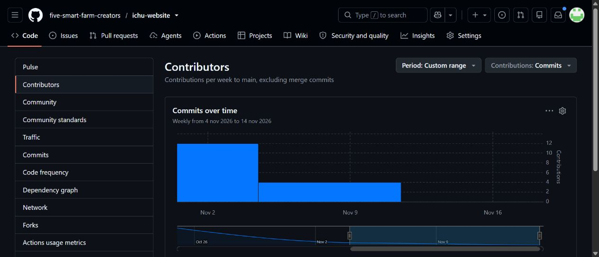

*Figura 6.18. GitHub Insights de la Landing Page. Se observa la actividad semanal de commits en `main` para el intervalo seleccionado. [Gráfico del sitio](https://github.com/five-smart-farm-creators/ichu-website/graphs/contributors?from=2026-11-04T05%3A00%3A00Z&to=2026-11-15T04%3A59%3A59Z)*

*Figura 6.19. GitHub Insights de la aplicación web. En el intervalo seleccionado, la barra de la segunda semana de noviembre concentra la mayor actividad visible. [Gráfico de la aplicación web](https://github.com/five-smart-farm-creators/ichu-web-app/graphs/contributors?from=2026-11-04T05%3A00%3A00Z&to=2026-11-15T04%3A59%3A59Z)*

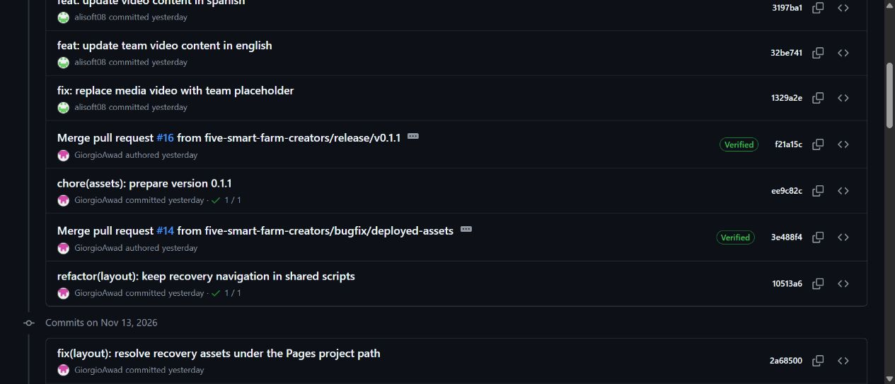

*Figura 6.20. Historial de `develop` de la Landing Page. Se identifican los cambios de Alison en contenidos y las correcciones e integraciones de Giorgio en los recursos publicados. [Historial del sitio](https://github.com/five-smart-farm-creators/ichu-website/commits/95add4abe6acc3bc6b6221ed725a4965a44d5dca/)*

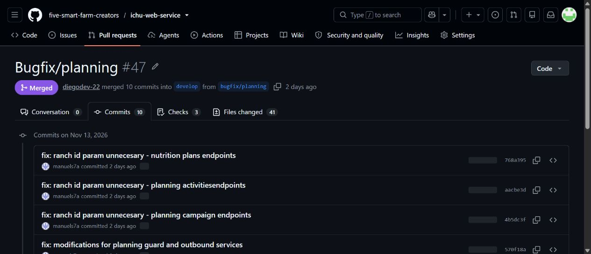

*Figura 6.21. Commits del PR 47 de la API central. GitHub muestra los ajustes de rutas realizados por Manuel y la integración a `develop` efectuada por Diego. [Historial del PR 47](https://github.com/five-smart-farm-creators/ichu-web-service/pull/47/commits)*

*Figura 6.22. Commits del PR 8 de la aplicación web. Los cambios de Flor incorporan la búsqueda de unidades por código de acceso, las traducciones y las vistas de cuenta y asesoría. [Historial del PR 8](https://github.com/five-smart-farm-creators/ichu-web-app/pull/8/commits)*

*Figura 6.23. Commits del PR 22 de la aplicación móvil. El listado muestra el modelo y la lectura autorizada de alertas desarrollados por Manuel. Diego integró la rama en `develop`. [Historial del PR 22](https://github.com/five-smart-farm-creators/ichu-mobile-app/pull/22/commits)*

##### Interpretación de la colaboración

La API central reunió commits de los cinco integrantes. Junto con las aplicaciones web y móvil sumó **490 de los 568 commits** registrados en repositorios de software. La colaboración también se observa dentro de cambios concretos. En el PR 47 de la API, Manuel ajustó las rutas de Planning y Diego actualizó las pruebas de planes de nutrición. En el PR 22 de la aplicación móvil, el modelo y la lectura autorizada de alertas del Edge se integraron en la misma rama que la vista que las presenta. El PR 24 registró después los ajustes a los contratos de telemetría, alertas y asesoría del backend. [Pruebas de Planning](https://github.com/five-smart-farm-creators/ichu-web-service/commit/2554bc8) · [Integración móvil de alertas](https://github.com/five-smart-farm-creators/ichu-mobile-app/pull/22) · [Alineación de contratos](https://github.com/five-smart-farm-creators/ichu-mobile-app/pull/24)

En el Edge, el collar y el panel, la autoría de los commits revisados se concentró en Flor. Los flujos de GitHub Actions enlazaron el trabajo de esos tres repositorios mediante ejecuciones del Edge y simulaciones de los firmwares, documentadas en la sección 6.2.2.8. Los recuentos reflejan actividad de versionado y se interpretan junto con el contenido de los cambios y las integraciones observadas.

## 6.3. Validation Interviews

### 6.3.1. Diseño de Entrevistas

**Segmento 1:** Medianos y Grandes Ganaderos (Propietarios y Administradores de Estancias)

Este segmento representa al comprador principal y responsable de la gestión del predio. El objetivo es evaluar si comprende la propuesta de ICHU, puede priorizar una alerta, consultar la información de un animal y registrar una observación en campo sin conexión, además de conocer las condiciones bajo las cuales consideraría utilizar el servicio.

#### BLOQUE 1: Datos Demográficos y de Perfil

**Objetivo:** Identificar al participante, su responsabilidad sobre el hato y los dispositivos que utiliza para trabajar.

1. ¿Cuál es su nombre completo, edad y distrito de residencia?
2. ¿Cuántos animales maneja y cuál es su rol en el predio?
3. ¿Su celular es Android o iPhone? En la computadora, ¿qué navegador utiliza habitualmente?

---

#### BLOQUE 2: Comprensión de la Landing Page y Acceso a la Plataforma

**Objetivo:** Evaluar si la propuesta para ganaderos resulta comprensible y si el participante identifica cómo acceder al producto.

1. **Tarea 1 — Landing Page:** Abra el enlace proporcionado, cambie el idioma a español y explore la información dirigida a ganaderos. Con sus propias palabras, ¿qué le ofrece ICHU?
2. Si quisiera entrar ahora a la plataforma, ¿por dónde lo haría?

---

#### BLOQUE 3: Atención de Alertas y Consulta del Animal en la Aplicación Web

**Objetivo:** Evaluar la priorización de alertas, el registro de una atención y la comprensión de los datos individuales del ganado.

1. **Tarea 2 — Atención de una alerta:** Ingrese con la cuenta de prueba proporcionada, cambie el idioma a español y atienda la alerta que considere más urgente de su hato. Deje registrado qué encontró y qué hizo.
2. ¿Por qué eligió esa alerta? Del uno al siete, donde uno es muy difícil y siete es muy fácil, ¿qué tan fácil le resultó la tarea? ¿Qué facilitó o dificultó completarla?
3. **Tarea 3 — Consulta del animal:** El capataz indica que la vaca AR-012 está decaída. Encuéntrela en la plataforma y revise cómo ha cambiado su temperatura. ¿Qué interpreta de la información que ve?
4. ¿Esta herramienta le serviría para reemplazar o complementar su cuaderno o Excel? ¿Qué información o función le faltaría?

---

#### BLOQUE 4: Registro de Campo sin Conexión en la Aplicación Móvil

**Objetivo:** Evaluar si el participante puede registrar una observación sin señal y comprende el estado de ese registro.

1. **Tarea 4 — Registro sin conexión:** Abra la aplicación móvil y, con señal, busque la vaca AR-027 de su fundo. Luego active el modo avión y registre que observó al animal en celo.
2. ¿Cómo sabe si el registro quedó guardado y dónde cree que se encuentra?
3. ¿Qué cree que ocurrirá con ese registro cuando vuelva la señal?

---

#### BLOQUE 5: Valor Percibido y Cierre

**Objetivo:** Conocer la utilidad percibida, las condiciones de adopción y la opinión final del participante.

1. ¿Qué fue lo más útil de la experiencia y qué cambiaría?
2. ¿Consideraría pagar un plan anual por ICHU? ¿Hasta qué monto y bajo qué condiciones? Si no lo contrataría, ¿por qué?
3. En una frase, ¿qué le pareció ICHU? ¿Autoriza que utilicemos esta opinión en el video del producto?

**Segmento 2:** Zootecnistas y Médicos Veterinarios

Este segmento reúne a los profesionales que asesoran fundos desde la perspectiva de la atención clínica. El objetivo es evaluar si comprenden la propuesta de ICHU para su trabajo, pueden consultar las variables de un animal, registrar una intervención y solicitar acceso a una unidad productiva desde la aplicación móvil.

#### BLOQUE 1: Datos Demográficos y Ecosistema de Trabajo

**Objetivo:** Identificar al participante, su experiencia de asesoría y las herramientas que utiliza para registrar sus atenciones.

1. ¿Cuál es su nombre completo, edad y distrito de residencia?
2. ¿Cuántos años lleva ejerciendo y cuántos fundos asesora? ¿Qué responsabilidad tiene en ellos?
3. ¿Su celular es Android o iPhone? ¿Qué navegador utiliza y dónde anota actualmente lo que realiza en cada atención?

---

#### BLOQUE 2: Comprensión de la Landing Page y Acceso Profesional

**Objetivo:** Evaluar si el profesional se reconoce en la propuesta y encuentra cómo iniciar su acceso al servicio.

1. **Tarea 1 — Landing Page:** Abra el enlace proporcionado, cambie el idioma a español y explore la información dirigida a veterinarios. Con sus propias palabras, ¿qué le ofrece ICHU para su trabajo?
2. Si quisiera registrarse ahora, ¿por dónde lo haría?

---

#### BLOQUE 3: Consulta de Parámetros y Registro Clínico en la Aplicación Web

**Objetivo:** Evaluar la selección del fundo, la interpretación de las variables disponibles y el registro de una intervención en el historial del animal.

1. **Tarea 2 — Consulta de parámetros:** Ingrese con la cuenta de prueba proporcionada, cambie el idioma a español, seleccione el Fundo Demo ICHU y revise la temperatura, actividad y rumia de la vaca AR-012 durante los últimos siete días.
2. ¿Qué interpreta de estos datos y qué necesitaría comprobar durante una visita? ¿Qué le genera confianza o desconfianza en la información presentada?
3. **Tarea 3 — Registro clínico:** En el entorno de prueba, registre la intervención que consideraría para este caso, incluyendo producto, dosis y días de retiro de leche.
4. ¿Encontró los campos que necesita para documentar una atención? ¿Qué agregaría o cambiaría?

---

#### BLOQUE 4: Solicitud de Acceso desde la Aplicación Móvil

**Objetivo:** Evaluar si el profesional puede solicitar autorización sobre un fundo y comprende cómo consultar el estado de su solicitud.

1. **Tarea 4 — Solicitud de asesoría:** Un ganadero del fundo Los Andes lo ha contratado y le ha proporcionado un código de acceso de prueba. Desde la aplicación móvil, busque esa unidad productiva y envíe una solicitud de acceso indicando el motivo.
2. ¿Cómo sabe si la solicitud fue enviada?
3. ¿Cómo comprobaría si el ganadero aceptó su solicitud?

---

#### BLOQUE 5: Valor Percibido y Cierre

**Objetivo:** Conocer la utilidad percibida para la asesoría profesional y las condiciones bajo las cuales recomendaría la herramienta.

1. ¿Qué fue lo más útil de la experiencia y qué cambiaría?
2. ¿Recomendaría ICHU a los ganaderos que asesora? ¿Por qué y bajo qué condiciones?
3. En una frase, ¿qué le pareció ICHU? ¿Autoriza que utilicemos esta opinión en el video del producto?

Con esta estructura, cada entrevista comienza con el perfil del participante, continúa con tareas sobre la Landing Page y las aplicaciones, y termina con su valoración de la experiencia. Las respuestas y dificultades se recogen tal como ocurran, sin asumir que las funciones se completarán correctamente ni que la opinión final será favorable.

### 6.3.2. Registro de Entrevistas

El registro de validación incluye cinco participantes: tres ganaderos y dos médicos veterinarios. Las sesiones documentan apreciaciones sobre la Landing Page y tareas de la aplicación web; no hay evidencia de que se hayan ejecutado las tareas móviles planteadas en 6.3.1. Por ello, el video no acredita validación de la aplicación nativa. Además, el segmento de veterinarios cuenta con dos participantes, por debajo del mínimo de tres indicado en la guía; se requiere una sesión real adicional, sin sustituirla por una simulación. El video consolidado dura **00:41:31**. Las marcas de inicio y las duraciones corresponden a los cortes del video, expresados al segundo. [Ver video consolidado en Clipchamp](https://tinyurl.com/validation-interviews-ichu)

#### Segmento 1. Medianos y grandes ganaderos

##### Entrevista a Alberto Pérez

| Edad | Distrito de residencia | Inicio en el video | Duración |
|---|---|---|---|
| 40 años | Olmos | 00:13:31 | 00:07:31 |

Al revisar la Landing Page, Alberto identificó con rapidez qué ofrece ICHU y valoró que el contenido pudiera consultarse en español e inglés. Durante la revisión de la aplicación web destacó el monitoreo de la salud del ganado y la posibilidad de obtener indicadores a partir de los dispositivos. Explicó que en su empresa cada área mantiene archivos de Excel o Word por separado y que reunirlos demora la consulta. Consideró que centralizar la información facilitaría la atención oportuna de los animales.

*Figura 6.24. Alberto Pérez durante la revisión de la aplicación web. El fotograma de 00:17:14 muestra la vista de historial clínico.*

##### Entrevista a Zahir Sánchez

| Edad | Distrito de residencia | Inicio en el video | Duración |
|---|---|---|---|
| 24 años | Lurín | 00:21:02 | 00:08:05 |

Zahir identificó en la Landing Page el seguimiento individual mediante collares y destacó la utilidad de consultar la temperatura, el movimiento y los eventos de cada animal frente a los registros manuales que usa en el predio. Para ingresar a la aplicación verificó su correo y volvió a iniciar sesión. Ya en el panel, reconoció los filtros por periodo, las alertas y la opción de exportar información. Planteó migrar sus registros de manera gradual y probar el sistema en su trabajo diario.

[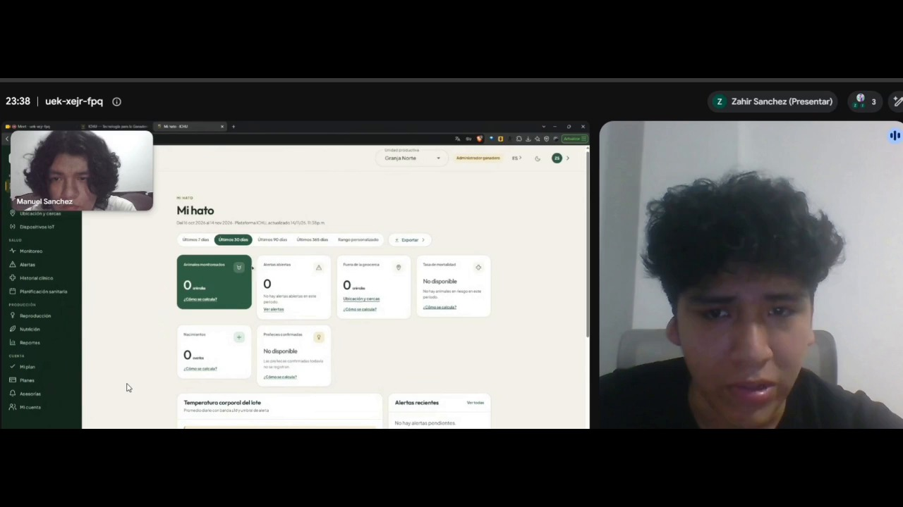](https://tinyurl.com/validation-interviews-ichu)

*Figura 6.25. Zahir Sánchez durante la revisión del panel «Mi hato» después de ingresar a la aplicación. Fotograma de 00:26:42.*

##### Entrevista a Jorge Chumpitaz

| Edad | Distrito de residencia | Inicio en el video | Duración |
|---|---|---|---|
| 24 años | Oxapampa | 00:29:07 | 00:12:24 |

Durante la demostración, Jorge valoró el seguimiento de los animales por etapa y mostró interés en las cercas virtuales. Preguntó cómo se conectaría la ubicación con los dispositivos y cómo se repartiría con el veterinario el registro de la información clínica. Consideró que la aplicación ayudaría a ordenar los procesos del predio y señaló que conversaría con los demás propietarios para evaluar su viabilidad.

[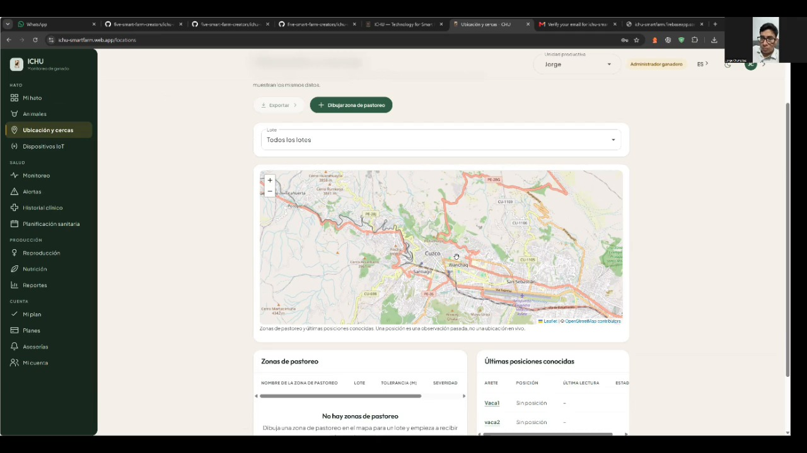](https://tinyurl.com/validation-interviews-ichu)

*Figura 6.26. Demostración de la vista «Ubicación y cercas» durante la entrevista a Jorge Chumpitaz. Fotograma de 00:32:54.*

#### Segmento 2. Médicos veterinarios

##### Entrevista a Mia Acosta

| Edad | Distrito de residencia | Inicio en el video | Duración |
|---|---|---|---|
| 26 años | Cuñumbuqui | 00:00:00 | 00:07:13 |

En la demostración se buscó un animal por arete, se abrió su ficha y se mostró cómo registrar una intervención clínica. Ante el caso de una vaca decaída, Mia indicó que primero compararía la temperatura con los días anteriores y después revisaría la actividad y la rumia. Para la siguiente visita, le sería útil recuperar qué se administró, en qué dosis y cuándo. Propuso un campo para programar el próximo control.

*Figura 6.27. Formulario de registro de una intervención clínica en la sesión con Mia Acosta. Fotograma de 00:03:55.*

##### Entrevista a Manuel Merino

| Edad | Distrito de residencia | Inicio en el video | Duración |
|---|---|---|---|
| 32 años | Ayaviri | 00:07:13 | 00:06:18 |

La demostración recorrió la ficha del animal, el historial clínico y la consulta del monitoreo por periodo para preparar una visita de seguimiento. Manuel señaló que, si otro profesional había atendido al animal, quisiera saber qué encontró, cuándo lo registró y qué dejó indicado para el siguiente control. Ante una caída hipotética de actividad, preguntaría al ganadero desde cuándo ocurre, si cambió el apetito y qué otros signos observó. Sugirió facilitar el acceso a la observación más reciente al abrir la ficha.

*Figura 6.28. Resumen de salud y línea de tiempo del historial clínico en la sesión con Manuel Merino. Fotograma de 00:10:44.*

### 6.3.3. Evaluaciones según heurísticas

En esta sección se evalúa preliminarmente la experiencia de usuario, considerando usabilidad, arquitectura de información y diseño inclusivo. La inspección de los seis hallazgos se basa en el código móvil y los contratos del servicio web. Las seis capturas corresponden a vistas de la aplicación Flutter ejecutadas en un AVD Android 17 (API 37, x86_64) y documentan los estados analizados. La inspección permite evaluar la interfaz frente a los flujos y contratos; no constituye una verificación de autenticación Firebase, integración de servicios en producción ni observación de participantes. No se realizaron entrevistas para esta inspección y el video de 6.3.2 no cubre tareas móviles. Las severidades son provisionales y requieren contraste en recorridos autorizados con personas usuarias.

#### ESCALA DE SEVERIDAD:

<table border="1" cellspacing="0" cellpadding="6">
    <thead>
        <tr align="center">
          <td><strong>Nivel</strong></td>
          <td><strong>Descripción</strong></td>
        </tr>
    </thead>
    <tbody>
        <tr>
            <td>1</td>
            <td>Problema superficial: puede ser fácilmente superado por el usuario u ocurre con muy poca frecuencia. No necesita ser arreglado a no ser que exista disponibilidad de tiempo.</td>
        </tr>
        <tr>
            <td>2</td>
            <td>Problema menor: puede ocurrir un poco más frecuentemente o es un poco más difícil de superar para el usuario. Se le debería asignar una prioridad baja resolverlo de cara al siguiente reléase</td>
        </tr>
        <tr>
            <td>3</td>
            <td>Problema mayor: ocurre frecuentemente o los usuarios no son capaces de resolverlos. Es importante que sean corregidos y se les debe asignar una prioridad alta.</td>
        </tr>
        <tr>
            <td>4</td>
            <td>Problema muy grave: un error de gran impacto que impide al usuario continuar con el uso de la herramienta. Es imperativo que sea corregido antes del lanzamiento.</td>
        </tr>
    </tbody>
</table>

#### TABLA RESUMEN:

| # | Problema | Severidad provisional | Heurística / principio | Tarea core relacionada |
|---|---|---:|---|---|
| 1 | La tarjeta de alerta identifica al animal con su UUID interno y no permite abrir directamente su ficha. | 3 | Correspondencia con el mundo real; reconocimiento antes que recuerdo. | Priorizar una alerta e identificar al animal afectado. |
| 2 | Las alertas se muestran por fecha descendente y la aplicación solo permite filtrar por estado; no hay filtro ni agrupación por severidad. | 2 | Flexibilidad y eficiencia de uso; reconocimiento antes que recuerdo. | Encontrar la alerta más urgente entre muchas alertas. |
| 3 | Los registros offline rechazados o en conflicto quedan pendientes sin una acción para corregirlos o resolverlos desde la aplicación. | 3 | Ayuda para reconocer, diagnosticar y recuperarse de errores; control y libertad del usuario. | Sincronizar y resolver registros de campo. |
| 4 | La preparación para trabajar sin conexión exige buscar cada animal por arete exacto mientras hay conexión; no se identifica un flujo de precarga por lote o hato. | 2 | Flexibilidad y eficiencia de uso. | Preparar el teléfono antes de registrar eventos en campo. |
| 5 | La concesión directa y las tarjetas sin perfil legible identifican al veterinario mediante su UUID de cuenta. | 3 | Correspondencia con el mundo real; prevención de errores. | Otorgar o revisar el acceso de un veterinario. |
| 6 | El diálogo de confirmación de revocación no identifica al veterinario, rancho ni alcance afectados. | 2 | Prevención de errores; control y libertad del usuario. | Revocar el acceso de un veterinario. |

#### DESCRIPCIÓN DE PROBLEMAS:

##### PROBLEMA #1: El animal de la alerta solo aparece como identificador técnico

* **Severidad:** 3
* **Heurística violada:** Correspondencia entre el sistema y el mundo real; reconocimiento antes que recuerdo.
* **Tarea relacionada:** Tarea 2 — Atención de una alerta; Tarea 3 — Consulta del animal.
* **Descripción del problema:** La tarjeta principal muestra `cattleId`, que es un UUID, bajo la etiqueta de identificación del animal. No muestra el arete ni un nombre reconocible, y la tarjeta no ofrece una acción directa para abrir la ficha del animal. Para decidir a quién atender, el usuario tendría que recordar o buscar por separado a qué animal corresponde el UUID. Esto añade pasos y puede retrasar la respuesta ante una alerta.
* **Recomendación:** Mostrar el arete como identificador principal, acompañarlo con el nombre o descripción disponible y permitir abrir la ficha del animal y su monitoreo desde la alerta. Conservar el UUID en los detalles técnicos.

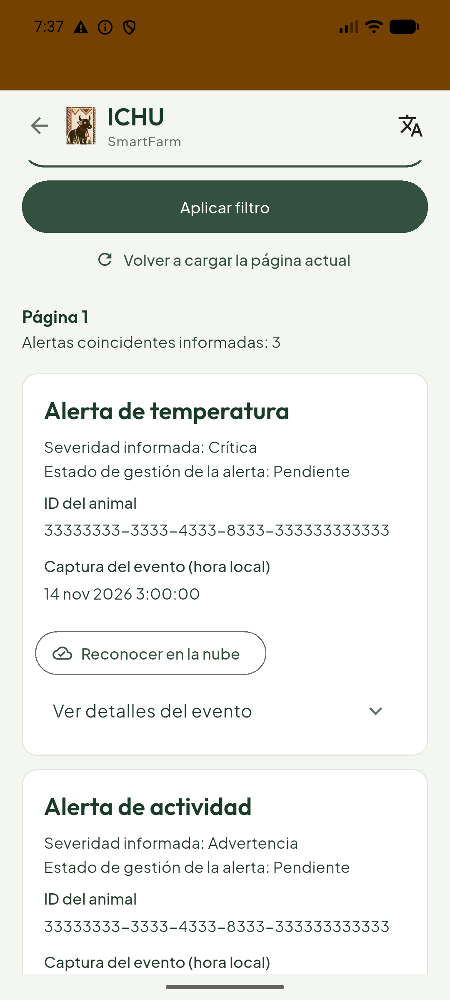

*Figura 6.27. Vista móvil de alertas que identifica al animal mediante un UUID y no muestra el arete.*

##### PROBLEMA #2: La lista no ayuda a priorizar alertas por gravedad

* **Severidad:** 2
* **Heurística violada:** Flexibilidad y eficiencia de uso; reconocimiento antes que recuerdo.
* **Tarea relacionada:** Tarea 2 — Atención de una alerta.
* **Descripción del problema:** El servicio devuelve las alertas de más reciente a más antigua. La aplicación móvil carga 20 por página y permite filtrar por estado, pero no por severidad ni por animal. La gravedad aparece en cada tarjeta, de modo que el usuario puede leerla, pero una alerta crítica más antigua puede quedar en una página posterior entre alertas menos urgentes. La tarea de elegir la alerta más urgente requiere inspeccionar y comparar la lista manualmente.
* **Recomendación:** Dar prioridad visible a las alertas pendientes críticas y permitir filtrar o agrupar por severidad. Mantener la fecha, el estado y la paginación visibles para conservar contexto.

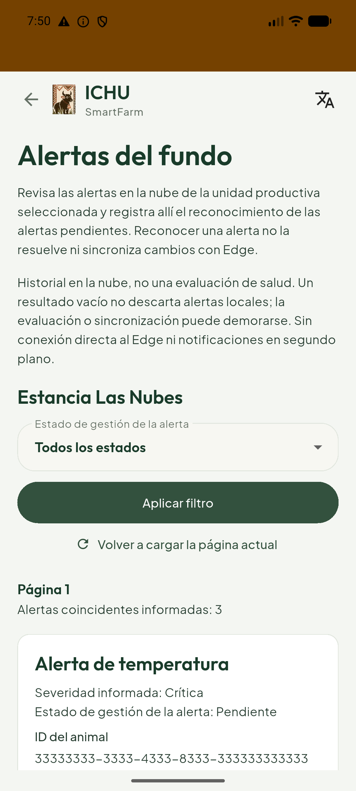

*Figura 6.28. La vista expone un filtro por estado, sin un control visible para filtrar por severidad.*

##### PROBLEMA #3: No hay una ruta de recuperación para registros rechazados o en conflicto

* **Severidad:** 3.
* **Heurística violada:** Ayuda para reconocer, diagnosticar y recuperarse de errores; control y libertad del usuario.
* **Tarea relacionada:** Tarea 4 — Registro de campo sin conexión.
* **Descripción del problema:** La sincronización conserva los registros rechazados o en conflicto, pero la lista de pendientes solo presenta un mensaje de estado. El elemento no ofrece acciones para editar, corregir, descartar o volver a crear el registro. El aviso general indica que la sincronización no los modifica, por lo que el usuario puede comprender que existe un problema sin tener una forma de resolverlo desde la aplicación.
* **Recomendación:** Explicar el motivo en términos comprensibles y ofrecer una acción segura de corrección o resolución, conservando la trazabilidad de la operación original y evitando duplicados. Si el registro no puede corregirse, explicar cómo registrar una operación nueva.

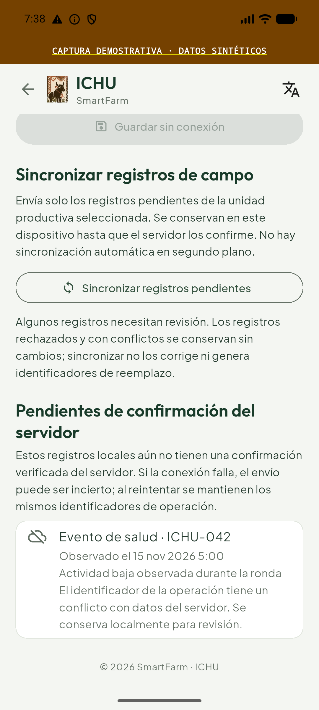

*Figura 6.29. Registro pendiente con conflicto y sin controles para corregirlo o resolverlo en esta vista.*

##### PROBLEMA #4: La preparación offline requiere precargar animales uno por uno

* **Severidad:** 2.
* **Heurística violada:** Flexibilidad y eficiencia de uso.
* **Tarea relacionada:** Tarea 4 — Registro de campo sin conexión.
* **Descripción del problema:** Para poder seleccionar un animal sin conexión, primero hay que localizarlo por su arete exacto cuando hay red; la aplicación guarda esa opción localmente. Si el animal no está en caché y el teléfono no tiene conectividad, la búsqueda depende del servicio y no puede completarse. El texto de ayuda informa esta condición, pero la preparación se realiza animal por animal y no se encontró un flujo para precargar un lote o todo el hato.
* **Recomendación:** Ofrecer una acción explícita para descargar los animales de un lote o hato antes de salir a campo, mostrar cuántos quedaron disponibles sin conexión y confirmar su vigencia.

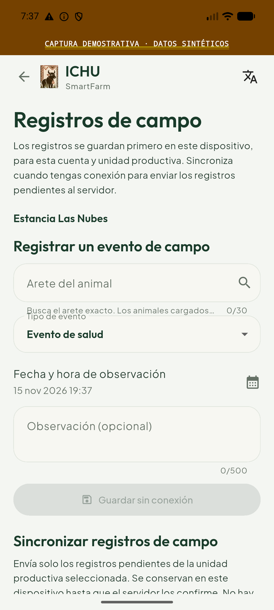

*Figura 6.30. Formulario de campo con búsqueda por arete exacto.*

##### PROBLEMA #5: Los flujos de acceso dependen de UUID difíciles de reconocer

* **Severidad:** 3.
* **Heurística violada:** Correspondencia con el mundo real; prevención de errores.
* **Tarea relacionada:** Solicitar acceso a un rancho; otorgar o revisar acceso de un veterinario.
* **Descripción del problema:** La concesión directa requiere ingresar manualmente el UUID de la cuenta veterinaria, y las tarjetas de historial muestran ese UUID cuando no hay un perfil legible disponible. Esto obliga al administrador a obtener y comparar identificadores fuera de la aplicación y deja margen para errores al elegir a la persona. El flujo de solicitud del veterinario usa un código de acceso del rancho, no el UUID del rancho.
* **Recomendación:** Permitir buscar al veterinario por correo o nombre, mostrar datos legibles para confirmar la persona elegida y conservar el UUID solo en una vista técnica o secundaria.

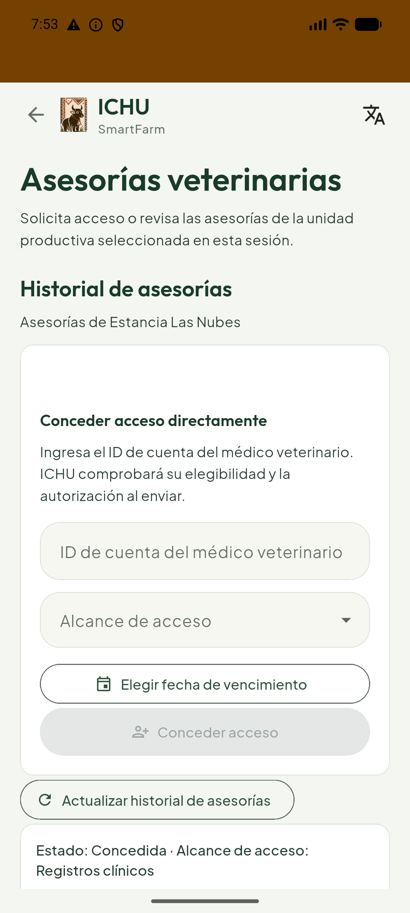

*Figura 6.31. Formulario de concesión directa que solicita el identificador de cuenta del veterinario.*

##### PROBLEMA #6: La confirmación de revocación no identifica el acceso afectado

* **Severidad:** 2.
* **Heurística violada:** Prevención de errores; control y libertad del usuario.
* **Tarea relacionada:** Revocar el acceso de un veterinario.
* **Descripción del problema:** El botón “Revoke access” sí abre un diálogo de confirmación antes de enviar la operación, pero el texto del diálogo es genérico: no identifica el veterinario, el rancho, el alcance ni la fecha de expiración. El administrador no puede verificar desde esa confirmación cuál permiso se retirará.
* **Recomendación:** Mantener la confirmación existente y añadir el nombre o identificador legible del veterinario, rancho, alcance y fecha de expiración; comunicar el resultado y facilitar la restauración del acceso autorizado.

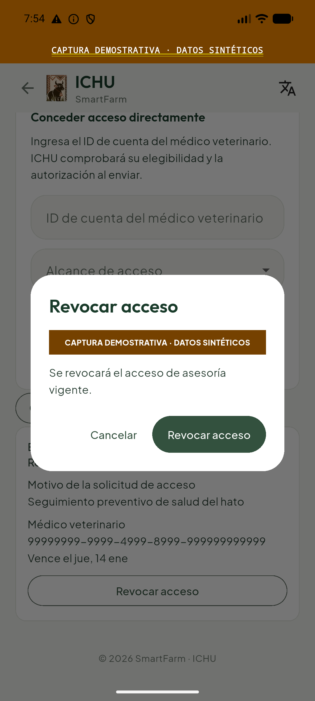

*Figura 6.32. Diálogo de confirmación presente en la app, pero sin detalles del permiso que se revocará.*

## 6.4. Video About-the-Product

Ver video del producto en SharePoint ([https://upcedupe-my.sharepoint.com/:v:/g/personal/u201817507_upc_edu_pe/IQBxp7IEcc1kQYr2_OdxZOmHAefMN2xH4C3_9ANZI5CHL5I?e=DFeH5G&nav=eyJyZWZlcnJhbEluZm8iOnsicmVmZXJyYWxBcHAiOiJTdHJlYW1XZWJBcHAiLCJyZWZlcnJhbFZpZXciOiJTaGFyZURpYWxvZy1MaW5rIiwicmVmZXJyYWxBcHBQbGF0Zm9ybSI6IldlYiIsInJlZmVycmFsTW9kZSI6InZpZXcifX0%3D](https://upcedupe-my.sharepoint.com/:v:/g/personal/u201817507_upc_edu_pe/IQBxp7IEcc1kQYr2_OdxZOmHAefMN2xH4C3_9ANZI5CHL5I?e=DFeH5G&nav=eyJyZWZlcnJhbEluZm8iOnsicmVmZXJyYWxBcHAiOiJTdHJlYW1XZWJBcHAiLCJyZWZlcnJhbFZpZXciOiJTaGFyZURpYWxvZy1MaW5rIiwicmVmZXJyYWxBcHBQbGF0Zm9ybSI6IldlYiIsInJlZmVycmFsTW9kZSI6InZpZXcifX0%3D))
