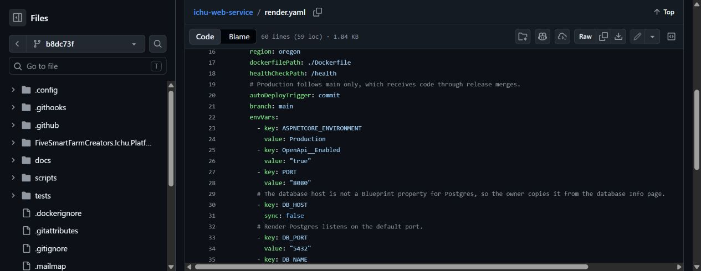
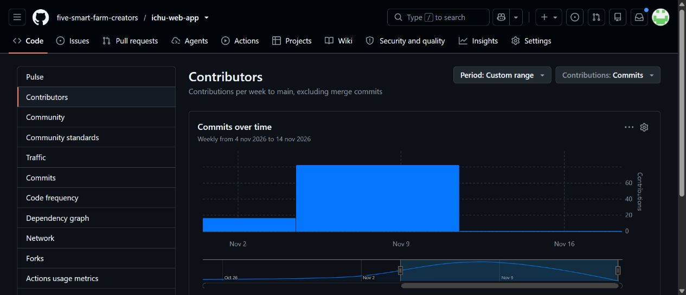
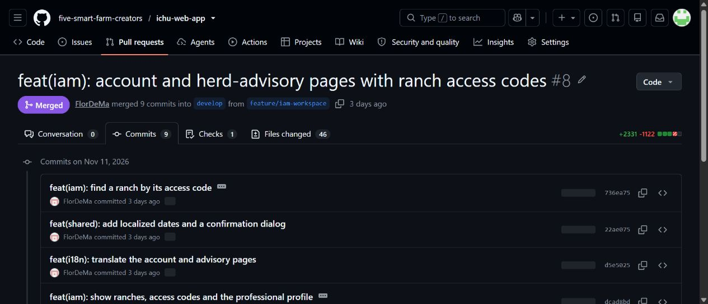
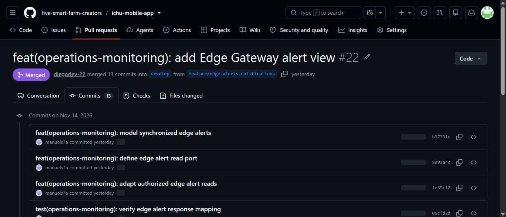
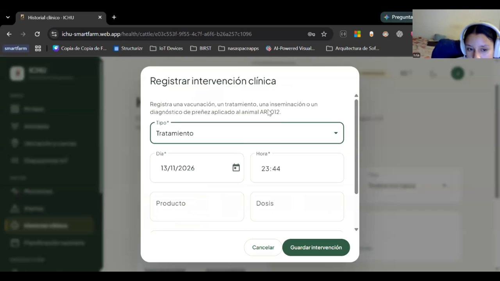
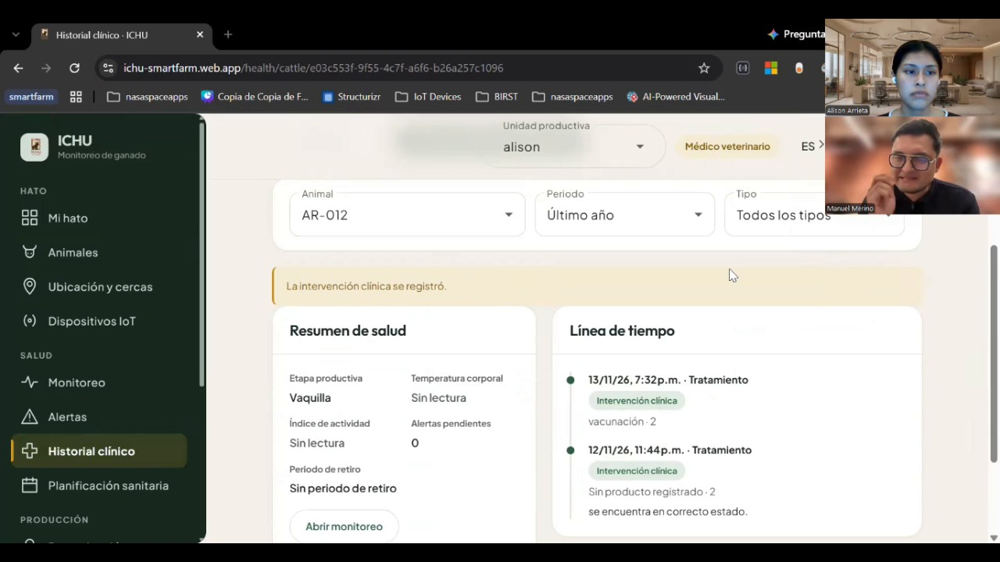

# Capítulo VI: Product Implementation, Validation & Deployment

Este capítulo registra la configuración del software y las evidencias de implementación y despliegue de ICHU. En el Sprint 1, las evidencias corresponden a la Landing Page y al frontend web con datos de muestra. En el Sprint 2, la sección 6.2.2.7 documenta el contrato OpenAPI de la API central desplegada.

## 6.1. Software Configuration Management

### 6.1.1. Software Development Environment Configuration

La Landing Page de ICHU se desarrolla como un sitio estático con **HTML, CSS y JavaScript**, sin framework ni proceso de compilación. El código está organizado en páginas HTML, una hoja de estilos compartida (`css/styles.css`) y dos módulos JavaScript: `js/i18n.js`, para idioma, y `js/main.js`, para navegación e interacciones. Los recursos gráficos y de video se mantienen en carpetas propias.

Para una revisión local, el README del repositorio permite abrir `index.html` directamente en un navegador o iniciar un servidor estático con `npx serve .` o `python -m http.server 8080`. El README también menciona una comprobación con jsdom para identificar IDs duplicados, recursos faltantes, anclas rotas y estilos inline; sin embargo, en la copia del proyecto revisada no se encontró el script ni un `package.json` que permita ejecutarla. Por tanto, esa comprobación no es reproducible con el material disponible y no se presenta como una prueba ejecutada.

El frontend web de la plataforma es un segundo artefacto, desarrollado con Angular y TypeScript, con componentes de Angular Material. Su repositorio de código ([https://tinyurl.com/26pp9tjq](https://tinyurl.com/26pp9tjq)) incluye el manifiesto de dependencias y los comandos del proyecto. En la revisión del manifiesto se observaron Angular y Angular Material 22.2.2, TypeScript 6.0.3 y Playwright 1.64.0; las versiones corresponden al estado del repositorio consultado y no implican que exista un backend conectado. Las capturas disponibles muestran la interfaz de inicio de sesión y un dashboard con datos de muestra.

| Elemento | Configuración documentada |
|---|---|
| Landing Page — lenguajes y ejecución | HTML, CSS y JavaScript; navegador web, con servidor estático opcional |
| Landing Page — organización | Páginas HTML, `css/styles.css`, `js/i18n.js` y `js/main.js`; no utiliza framework ni proceso de compilación |
| Web Application — tecnologías verificadas | Angular 22.2.2, TypeScript 6.0.3 y Angular Material 22.2.2, según el manifiesto del repositorio ([https://tinyurl.com/26pp9tjq](https://tinyurl.com/26pp9tjq)) |
| Web Application — comandos del manifiesto | `npm start`, `npm run build`, `npm run typecheck` y `npm run test:e2e`; este último ejecuta Playwright |
| Backend en el Sprint 1 | El incremento se centró en las interfaces frontend con datos de ejemplo. La documentación de la API central del Sprint 2 se presenta en 6.2.2.7. |
| Landing Page — validación automatizada | El README menciona jsdom, pero no se encontró el script ni su configuración en la copia revisada; no es reproducible desde esa copia |

Fuente: README del repositorio LandingPageSmartFarm, [https://tinyurl.com/27vbhfce](https://tinyurl.com/27vbhfce)

### 6.1.2. Source Code Management

El código de la Landing Page y el informe se mantienen en repositorios Git separados: [https://tinyurl.com/27vbhfce](https://tinyurl.com/27vbhfce) y [https://tinyurl.com/2dhmo9ou](https://tinyurl.com/2dhmo9ou). Esta separación permite revisar la evolución del producto web y la documentación de manera independiente.

Para el repositorio del informe, la guía de contribución define `main` para entregas publicadas, `develop` para integración y ramas `feature/<alcance>` o `fix/<alcance>` para cambios de trabajo. Las contribuciones se integran mediante Pull Request con revisión de otro integrante, y los commits siguen Conventional Commits. El Capítulo VI se trabaja en la rama `feature/chapter-VI`, publicada en GitHub y aún no integrada en `main`.

La captura del deployment de Vercel registra el frontend web en la rama `main`, en el commit `1d6994c`, integrado desde el Pull Request #10 de `feature/app-integration`. El código fuente se mantiene en el repositorio WebFrontend-SmartFarm ([https://tinyurl.com/26pp9tjq](https://tinyurl.com/26pp9tjq)). Las convenciones de ramas y commits de ese repositorio no se infieren de las reglas de `Report-SmartFarm`.

| Práctica | Convención del repositorio del informe |
|---|---|
| Ramas de trabajo | `feature/<alcance>` o `fix/<alcance>`, creadas desde `develop` |
| Integración | Pull Request hacia la rama correspondiente y revisión por otro integrante |
| Mensajes de commit | Conventional Commits, en minúsculas, con alcance opcional |
| Rama de entrega | `main` |

Fuente: archivo CONTRIBUTING.md del repositorio Report-SmartFarm. La convención anterior describe el repositorio del informe; cualquier diferencia en el flujo del repositorio de la Landing Page debe confirmarse con su configuración y responsables.

### 6.1.3. Source Code Style Guide & Conventions

Las convenciones identificables en la documentación del proyecto son:

- Mantener la estructura semántica de cada página en HTML y centralizar los estilos compartidos en `css/styles.css`.
- Mantener separadas las traducciones (`js/i18n.js`) y las interacciones de interfaz (`js/main.js`).
- Definir la paleta mediante variables CSS y reutilizar esos tokens para los temas claro y oscuro.
- Incluir nombres accesibles, etiquetas ARIA y alternativas textuales donde correspondan; el README señala navegación por teclado y soporte para movimiento reducido.
- Mantener imágenes optimizadas en WebP, declarar sus dimensiones y usar carga diferida cuando corresponda.

Estas convenciones resumen la guía del repositorio de la Landing Page. No se afirma que se haya ejecutado una auditoría automatizada de accesibilidad o estilo para este informe.

### 6.1.4. Software Deployment Configuration

La Landing Page se publicó como sitio estático en un preview administrado desde FPM Desk. Según la información proporcionada por el equipo, el servidor es privado, pertenece a FPM y fue creado por Flor de María Contreras. La consola muestra el proyecto `LandingPageSmartFarm`, el repositorio de GitHub conectado, la rama `main`, la receta `Static HTML` y el estado del preview como **Público**. El flujo separa el preview de Producción, que aparece como una etapa opcional; por ello, esta evidencia acredita un preview publicado, no una promoción a producción.

URL completa del preview: [https://smartfarm-ichu-preview.fpm.it.com/](https://smartfarm-ichu-preview.fpm.it.com/)

El frontend de la aplicación web se despliega por separado en Vercel, que distingue entornos locales, de preview y de producción [11]; sus evidencias del entorno de producción y de la interfaz publicada se presentan en la sección 6.2.1.8.

La consola registra seis ejecuciones de despliegue. En la captura, la más reciente figura como lista, construida desde el commit `23c4793` de `main` el 9 de septiembre de 2026, con la receta `Static HTML` y una duración de cuatro segundos. La URL respondió con HTTP 200 durante la verificación de este informe el 8 de octubre de 2026.

*Figura 6.1. Lista de proyectos en FPM Desk; se identifica LandingPageSmartFarm con un preview disponible.*

*Figura 6.2. Detalle del preview: repositorio GitHub conectado, rama `main`, receta Static HTML, URL completa visible y estado público. El panel indica Producción como una etapa opcional.*

*Figura 6.3. Historial de seis ejecuciones, con la más reciente en estado «Listo».*

*Figura 6.4. Portada en español cargada desde el preview público; la barra del navegador muestra smartfarm-ichu-preview.fpm.it.com.*

## 6.2. Landing Page, Services & Applications Implementation

### 6.2.1. Sprint 1

El Capítulo III asigna ocho historias al Sprint 1, con un total estimado de 33 puntos: siete para la Landing Page y una para la primera versión del frontend web. Esta selección es la **línea base del backlog planificado**, no trabajo aceptado ni velocidad validada del equipo. Los recorridos de acceso, perfil y ficha del animal de US-58 utilizan datos de ejemplo y validación local; no completan las historias de autenticación, autorización, persistencia ni contratación real previstas para la integración posterior.

#### 6.2.1.1. Sprint Planning 1

El Sprint 1 se orienta a presentar la propuesta de ICHU y habilitar los primeros recorridos de la plataforma web para ganaderos y médicos veterinarios.

<table>
  <colgroup>
    <col style="width: 34%;"/>
    <col style="width: 66%;"/>
  </colgroup>
  <tbody>
    <tr>
      <th align="left" scope="row" width="34%">Sprint #</th>
      <td>Sprint 1</td>
    </tr>
    <tr>
      <th align="left" colspan="2">Sprint Planning Background</th>
    </tr>
    <tr>
      <td>Date</td>
      <td>2026-10-02</td>
    </tr>
    <tr>
      <td>Time</td>
      <td>08:00 PM (hora de Lima, UTC-5)</td>
    </tr>
    <tr>
      <td>Location</td>
      <td>Lima, Perú.</td>
    </tr>
    <tr>
      <td>Prepared By</td>
      <td>Avalos Cordova, Diego Andres</td>
    </tr>
    <tr>
      <td>Attendees (to planning meeting)</td>
      <td>Arrieta Quispe, Alison Jimena Sanchez Arenas, Manuel Angel Contreras Leon, Flor de María Awad Vargas, Giorgio Marzouk Avalos Cordova, Diego Andres</td>
    </tr>
    <tr>
      <td>Sprint 0 Review Summary</td>
      <td>No aplica: es el primer Sprint del proyecto y no existe una revisión de un Sprint anterior.</td>
    </tr>
    <tr>
      <td>Sprint 0 Retrospective Summary</td>
      <td>No aplica: es el primer Sprint del proyecto y no existe una retrospectiva de un Sprint anterior.</td>
    </tr>
    <tr>
      <th align="left" colspan="2">Sprint Goal &amp; User Stories</th>
    </tr>
    <tr>
      <td>Sprint 1 Goal</td>
      <td>Publicar la primera versión de la Landing Page y del frontend web para conocer ICHU, comparar planes, solicitar una demostración y recorrer la experiencia inicial con datos de ejemplo. <strong>Métrica de cumplimiento:</strong> ambas interfaces publicadas y navegables, con verificación de los criterios de las ocho historias seleccionadas, sin requerir backend, aplicación móvil nativa ni dispositivos conectados.</td>
    </tr>
    <tr>
      <td>Sprint 1 Velocity</td>
      <td>33 Story Points propuestos para el alcance frontend. La capacidad real se contrasta con los puntos de las historias aceptadas al cierre; no se declara una velocidad observada.</td>
    </tr>
    <tr>
      <td>Sum of Story Points</td>
      <td>33 Story Points distribuidos en ocho historias del Sprint Backlog 1.</td>
    </tr>
  </tbody>
</table>

#### 6.2.1.2. Aspect Leaders and Collaborators

La siguiente distribución es una **planificación transversal simulada** agregada en Jira. Las 21 tareas seleccionadas llevan la etiqueta `simulado` y permanecen en estado **Por hacer**. Los nombres de la tabla son responsables propuestos, no evidencia de asignación ni de trabajo completado. En el proyecto, SF-96 es la única de estas tareas asignada a una cuenta de integrante; las demás siguen sin asignar. Al intentar añadir integrantes, Jira confirmó la incorporación de una cuenta existente y notificó dos solicitudes de acceso pendientes de aprobación administrativa. El aviso no identificó a quiénes corresponden esas solicitudes ni confirmó individualmente el estado de las otras dos cuentas. No se inició un sprint. Este conjunto no equivale al Sprint Backlog 1: la selección de implementación del Sprint 1 es de ocho historias y 33 SP; las tareas de APIs, Edge, integración móvil y hardware quedan fuera de ella.

Consulta del conjunto de tareas en Jira: [https://tinyurl.com/2xs98v8n](https://tinyurl.com/2xs98v8n)

| Responsable propuesto | Tareas simuladas en Jira |
|---|---|
| Contreras Leon, Flor de María | SF-96 — Capítulo V, diseño UI/UX y Landing Page; SF-106 — Dashboard & Analytics, indicadores e informes. |
| Avalos Cordova, Diego Andres | SF-97 — Capítulo VI, frontend, pruebas y despliegue; SF-102 — Operations & Monitoring; SF-109 — Portable Edge Gateway; SF-112 — integración del frontend web/móvil con las APIs. |
| Arrieta Quispe, Alison Jimena | SF-98 — correcciones editoriales; SF-103 — Cattle Information; SF-107 — Identity & Access Management; SF-116 — trazabilidad entre Bounded Contexts, APIs, Jira e informe. |
| Sanchez Arenas, Manuel Angel | SF-99 — correcciones de requisitos y trazabilidad; SF-105 — Planning; SF-113 — contratos OpenAPI/Swagger; SF-114 — pruebas de integración entre frontend, API y Edge. |
| Awad Vargas, Giorgio Marzouk | SF-100 — correcciones de pruebas y despliegue; SF-108 — Subscription Plans; SF-115 — verificación de entornos y despliegues. |
| Romero Meza, Jhimy Pool | SF-101 — correcciones de figuras; SF-104 — IoT Assets; SF-110 — prototipo conceptual del collar IoT; SF-117 — auditoría de criterios y evidencias de entrega. |

Los siete Bounded Contexts de la arquitectura se reflejan como trabajo propuesto del monolito modular; Portable Edge Gateway y los prototipos IoT se registran como tareas transversales, no como implementación del Sprint 1. El diseño conceptual de dispositivos del Capítulo V se conserva como documentación de TB1 y no acredita sensores, Edge ni APIs implementados o conectados.

#### 6.2.1.3. Sprint Backlog 1

La tabla contiene únicamente las ocho historias seleccionadas del Product Backlog del Capítulo III, con el mismo orden y estimación. El resultado esperado se limita a la Landing Page y al primer frontend; no declara las historias como completadas ni acredita integración de servicios.

| Prioridad | Historia | Resultado esperado | Puntos | Sprint asignado |
|---:|---|---|---:|---|
| 1 | US-32 — Conocer la propuesta de ICHU | Presentar la propuesta, los beneficios por segmento y los productos digitales. | 3 | Sprint 1 |
| 2 | US-33 — Acceder al destino correspondiente a mi segmento | Dirigir al registro o acceso del segmento y conservar la selección de plan, sin crear una cuenta ni activar permisos. | 2 | Sprint 1 |
| 3 | US-35 — Comparar los planes y estimar el costo | Comparar planes y calcular una estimación informativa con valores publicados y validación local; sin cobro ni contratación. | 5 | Sprint 1 |
| 4 | US-36 — Consultar los términos y condiciones del servicio | Publicar condiciones de uso, tratamiento de datos y fecha de actualización. | 2 | Sprint 1 |
| 5 | US-59 — Solicitar una demostración desde la Landing Page | Validar los datos en el navegador y preparar la solicitud en el canal de contacto; el usuario decide enviarla. | 3 | Sprint 1 |
| 6 | US-37 — Consultar la experiencia en mi idioma | Presentar el contenido en inglés o español latinoamericano y conservar la preferencia. | 5 | Sprint 1 |
| 7 | US-38 — Acceder a la experiencia con tecnología de asistencia | Permitir el recorrido por teclado y lector de pantalla, con nombres y alternativas textuales accesibles. | 5 | Sprint 1 |
| 8 | US-58 — Explorar la primera versión del frontend web | Ofrecer los recorridos iniciales del frontend web con datos de ejemplo y validación local, sin API ni dispositivos conectados. | 8 | Sprint 1 |
|  | **Total planificado** |  | **33** |  |

Fuente: Product Backlog y alcance por iteración y roadmap, Capítulo III.

#### 6.2.1.4. Development Evidence for Sprint Review

Las capturas siguientes documentan la presentación de la Landing Page en español e inglés, el tema oscuro y una vista móvil simulada. La tercera captura muestra una sección de contenido para ganaderos con una ficha visual de ejemplo; esta ficha forma parte de la presentación de la propuesta y no demuestra que exista una aplicación funcional de gestión del hato.

*Figura 6.5. Portada de la Landing Page en español vista en escritorio. Captura de navegador proporcionada por el equipo.*

*Figura 6.6. Sección «What is ICHU?» en inglés, abierta desde un archivo local en el navegador. Captura de navegador proporcionada por el equipo.*

*Figura 6.7. Vista en inglés con tema oscuro y contenido dirigido a ganaderos. La ficha del animal en la imagen es un recurso ilustrativo de la Landing Page, no evidencia de una función conectada a datos.*

*Figura 6.8. Portada en inglés en la emulación de un viewport móvil de 360 × 800 píxeles. La captura muestra una vista emulada en navegador, no una prueba en un dispositivo físico.*

La interfaz web de la plataforma también se muestra en el dashboard de la Figura 6.12. Esa captura acredita la presentación del frontend; los indicadores son datos de muestra y no evidencian conexión con un backend.

#### 6.2.1.5. Testing Suite Evidence for Sprint Review

Se realizó una comprobación manual preliminar de renderizado con Chrome DevTools en el preset **iPad Mini**, viewport de 768 × 1024 píxeles, al 75 % y sin limitación de red. La primera captura permite ver la portada, la navegación móvil y el comienzo de la sección siguiente, pero no permite evaluar los controles ni muestra la barra con la URL.

| Caso | Resultado observado | Estado |
|---|---|---|
| Renderizado del preview en viewport iPad Mini (768 × 1024) | La portada carga en Chrome incógnito; la URL del preview se ve en la barra y el contenido se adapta al viewport emulado. | Aprobado, comprobación visual |
| Consola en la primera inspección | Se vio `[Violation] Permissions policy violation: unload is not allowed in this document.`, con fuente `content.d0f3cf01.js`. | Observado una vez; origen no confirmado |
| Consola en la repetición de incógnito | No aparecen errores ni advertencias en la consola de la captura. El mensaje anterior no se reproduce; esto sugiere que pudo provenir de una extensión o estado del navegador, pero no confirma su origen. | Aprobado en esta repetición |
| Cambio de idioma, tema, menú y validación del formulario | Las capturas de desarrollo muestran los estados español, inglés y tema oscuro, pero no registran la activación de esos controles. El menú y el envío del formulario tampoco se probaron. | Estados visuales capturados; comportamiento no verificado |
| Suite automatizada descrita en el README | En la copia revisada no están el script jsdom ni su configuración, así que no fue posible ejecutar ni reproducir esa suite. | Pendiente; no ejecutada |

*Figura 6.9. La página se renderiza en un viewport móvil emulado; DevTools muestra una violación de Permissions Policy procedente de `content.d0f3cf01.js`, cuyo origen debe confirmarse.*

*Figura 6.10. Repetición de la inspección en Chrome incógnito: la dirección del preview aparece en la barra, la portada se renderiza en el viewport iPad Mini y DevTools no muestra errores ni advertencias.*

#### 6.2.1.6. Execution Evidence for Sprint Review

Las Figuras 6.6 y 6.8 muestran la Landing Page cargada localmente; la primera deja visible la ruta del archivo y la segunda la emulación de un viewport móvil. La Figura 6.4 muestra la portada abierta desde el preview de FPM Desk, cuya URL respondió con HTTP 200 durante la verificación del 8 de octubre de 2026. La Figura 6.12 muestra el dashboard del frontend web de Vercel; su URL también respondió con HTTP 200 en esa fecha. Estas evidencias acreditan renderizado y disponibilidad de las interfaces en ese momento; no demuestran una prueba en teléfono físico, la conexión con servicios backend ni el funcionamiento integral de idioma, tema o formulario.

#### 6.2.1.7. Services Documentation Evidence for Sprint Review

El alcance de este incremento comprende interfaces frontend. La Landing Page es un sitio estático que presenta ICHU; su formulario prepara una solicitud y abre WhatsApp para que la persona la envíe. No procesa ni almacena la solicitud en un backend propio. El frontend web publicado en Vercel presenta un dashboard y otras vistas de gestión, pero la captura disponible indica que no hay conexión meteorológica en vivo y sus cifras se identifican como datos de muestra.

| Interfaz o servicio | Documentación disponible | Límite comprobado |
|---|---|---|
| Landing Page | Páginas estáticas `index.html`, `media.html` y `como-funciona.html`; navegación, alternancia de idioma y tema, contenido informativo y formulario que abre WhatsApp. | Se verifican archivos y pantallas; las capturas no demuestran que se haya probado cada interacción ni que exista procesamiento en servidor. |
| Frontend web de la plataforma | Dashboard con indicadores del hato y navegación a animales, ubicación, monitoreo, alertas e historial clínico. URL publicada: [https://web-frontend-smart-farm.vercel.app/](https://web-frontend-smart-farm.vercel.app/) | La captura muestra datos de ejemplo y señala que no hay conexión meteorológica en vivo. No demuestra persistencia ni consumo de una API. |
| Backend y contratos de servicios | No se implementaron backend ni endpoints API dentro del alcance documentado; no hay contratos OpenAPI/Swagger que adjuntar para este incremento. | No se presentan servicios ni integración backend como implementados o probados. |

El preview de la Landing Page está disponible en [https://smartfarm-ichu-preview.fpm.it.com/](https://smartfarm-ichu-preview.fpm.it.com/). La aplicación frontend de Vercel está disponible en [https://web-frontend-smart-farm.vercel.app/](https://web-frontend-smart-farm.vercel.app/). Las capturas de despliegue correspondientes se encuentran en las Figuras 6.1–6.4 y 6.11–6.12.

#### 6.2.1.8. Software Deployment Evidence for Sprint Review

La aplicación web de ICHU tiene un despliegue de producción separado de la Landing Page alojada en el preview de FPM Desk. La consola de Vercel muestra el deployment como **Ready**, asociado a `main` y al commit `1d6994c` (`Merge pull request #10 from SmartFarm-8733/feature/app-integration`). El dominio de producción mostrado es [https://web-frontend-smart-farm.vercel.app/](https://web-frontend-smart-farm.vercel.app/); durante la verificación de este informe respondió con HTTP 200. La ruta de dashboard capturada en el navegador es [https://tinyurl.com/26dp62g7](https://tinyurl.com/26dp62g7) y también respondió con HTTP 200.

*Figura 6.11. Panel de Vercel: deployment de producción en estado Ready, rama `main`, commit `1d6994c` y dominio `web-frontend-smart-farm.vercel.app`.*

*Figura 6.12. Dashboard del frontend cargado desde la URL de Vercel. Las cifras del hato que aparecen en pantalla son datos de muestra de la interfaz; esta captura no demuestra su persistencia ni conexión con un backend productivo.*

#### 6.2.1.9. Team Collaboration Insights during Sprint

La evidencia disponible muestra coordinación mediante cambios versionados, despliegues y una distribución de tareas propuesta. En el historial del informe, Avalos Cordova, Diego Andres (`diegodev-22`) registró cambios de diseño para la Landing Page y los flujos de la aplicación; Contreras Leon, Flor de María (`FlorDeMa`) incorporó el diseño de dispositivos IoT y el avance de documentación. El historial se consulta en [https://tinyurl.com/2d28emyf](https://tinyurl.com/2d28emyf). La captura de Vercel registra la integración del frontend a `main` desde el Pull Request #10 de `feature/app-integration`.

El plan documentado no fija las fechas oficiales ni la duración del Sprint 1. Por ello, estos commits y el deployment se presentan como evidencia de colaboración del proyecto, sin afirmar que ocurrieron dentro de un Sprint con fechas confirmadas.

La distribución transversal de 21 tareas seleccionadas en Jira es simulada y no equivale a las ocho historias seleccionadas para Sprint 1: las tareas siguen como **Por hacer** y los responsables de la tabla de 6.2.1.2 son propuestos. Por tanto, esa planificación no prueba que las tareas hayan sido completadas por esas personas. Tampoco hay actas o registros que acrediten reuniones diarias, una Sprint Review formal o una retrospectiva; no se reportan como celebradas.

| Evidencia | Aporte a la coordinación | Alcance de lo que demuestra |
|---|---|---|
| Historial Git del informe | Cambios de Diego en wireframes, flujos y visuales de la Landing Page; cambios de Flor en diseño IoT y documentación de capítulos V y VI. | Acredita contribuciones versionadas al informe y sus artefactos; no demuestra por sí sola la implementación del frontend de la plataforma. |
| Deployment Vercel | Pull Request #10 de `feature/app-integration` integrado en `main`, commit `1d6994c`. | Acredita un artefacto frontend publicado; no acredita backend ni integración de datos. |
| Distribución de tareas en Jira | Reparto propuesto de 21 tareas para Flor, Diego y los demás integrantes. | Datos simulados, estado **Por hacer**; no son evidencia de asignación formal o finalización. |
| Registros de ceremonias | No se encontraron actas de planificación, reuniones diarias, revisión ni retrospectiva. | La colaboración se describe solo desde artefactos verificables; no se infieren ceremonias. |

### 6.2.2. Sprint 2

#### 6.2.2.1. Sprint Planning 2

El Sprint 2 tiene como objetivo integrar los recorridos del frontend con los servicios de cuenta, acceso, gestión del hato y suscripción, y habilitar el flujo de telemetría y alertas entre el collar, el Portable Edge Gateway, la API central y las aplicaciones. El equipo confirmó como alcance de esta iteración las **30 historias** agrupadas para Sprint 2 en el Product Backlog del Capítulo III, con una estimación total de **164 Story Points**.

<table>
  <colgroup>
    <col style="width: 34%;"/>
    <col style="width: 66%;"/>
  </colgroup>
  <tbody>
    <tr>
      <th align="left" scope="row" width="34%">Sprint #</th>
      <td>Sprint 2</td>
    </tr>
    <tr>
      <th align="left" colspan="2">Sprint Planning Background</th>
    </tr>
    <tr>
      <td>Date</td>
      <td>2026-11-04</td>
    </tr>
    <tr>
      <td>Time</td>
      <td>10:00 PM (hora de Lima, UTC-5)</td>
    </tr>
    <tr>
      <td>Location</td>
      <td>Virtual.</td>
    </tr>
    <tr>
      <td>Prepared By</td>
      <td>Avalos Cordova, Diego Andres</td>
    </tr>
    <tr>
      <td>Attendees (to planning meeting)</td>
      <td>Awad Vargas, Giorgio Marzouk Sanchez Arenas, Manuel Angel Contreras Leon, Flor de María Arrieta Quispe, Alison Jimena Avalos Cordova, Diego Andres</td>
    </tr>
    <tr>
      <td>Sprint Period</td>
      <td>Del 4 al 14 de noviembre de 2026.</td>
    </tr>
    <tr>
      <td>Sprint 1 Review Summary</td>
      <td>La evidencia de 6.2.1 muestra la Landing Page y el frontend web con datos de ejemplo y sus despliegues. Las comprobaciones registradas son preliminares y no acreditan autenticación, persistencia ni integración con servicios. No se dispone de un acta de Sprint Review ni de una relación de historias aceptadas.</td>
    </tr>
    <tr>
      <td>Sprint 1 Retrospective Summary</td>
      <td>No se dispone de un acta de retrospectiva. A partir de las limitaciones documentadas, se propone confirmar responsables por entregable, realizar revisiones cruzadas y vincular cada historia seleccionada con sus criterios y evidencias de prueba. Estas acciones quedan sujetas al acuerdo del equipo.</td>
    </tr>
    <tr>
      <th align="left" colspan="2">Sprint Goal &amp; User Stories</th>
    </tr>
    <tr>
      <td>Sprint 2 Goal</td>
      <td>Habilitar un recorrido integrado y autorizado de gestión del hato, desde el registro y acceso hasta la consulta de telemetría y atención de alertas, con captura local y sincronización al recuperar conectividad. <strong>Métrica de cumplimiento propuesta:</strong> verificar los criterios de aceptación del Capítulo III para las 30 historias seleccionadas, con registros persistidos, control de acceso y evidencia del recorrido entre collar, Edge, API y clientes; comprobar los reintentos y la operación sin Internet de las historias correspondientes. La cantidad de historias y puntos aceptados se registrará al cierre.</td>
    </tr>
    <tr>
      <td>Sprint 2 Velocity</td>
      <td>Se calculará a partir de los puntos de las historias aceptadas al cierre. Los 164 SP corresponden al esfuerzo estimado del alcance confirmado; los 33 SP planificados del Sprint 1 no constituyen velocidad observada.</td>
    </tr>
    <tr>
      <td>Sum of Story Points</td>
      <td>164 Story Points estimados, distribuidos en las 30 historias seleccionadas del Sprint Backlog 2.</td>
    </tr>
  </tbody>
</table>

La selección debe respetar las dependencias del Capítulo III: registro, acceso y permisos antes de consumir datos del hato; solicitud y confirmación de suscripción antes de habilitar capacidades del plan; asignaciones y configuración antes de evaluar telemetría; persistencia y confirmación antes de retirar registros pendientes. El enlace del collar al Edge se plantea por Wi-Fi local; BLE permanece como alternativa prevista.

El periodo de la iteración, la distribución de líderes y colaboradores por entregable y el alcance de 30 historias están confirmados. Los 164 SP expresan la estimación del trabajo planificado. La ejecución y la aceptación de las historias se documentarán con sus evidencias de revisión.

Fuente: [Product Backlog del Capítulo III](30-requirements-specification.md#33-product-backlog) y [evidencias del Sprint 1](#621-sprint-1).

#### 6.2.2.2. Aspect Leaders and Collaborators

Para el Sprint 2, el equipo confirmó la siguiente distribución de líderes y colaboradores por entregable. Cada líder coordina el trabajo de su aspecto con el apoyo de los colaboradores indicados.

| Aspecto | Líder | Colaboradores |
|---|---|---|
| Mobile Application | Avalos Cordova, Diego Andres | Arrieta Quispe, Alison Jimena; Sanchez Arenas, Manuel Angel; Awad Vargas, Giorgio Marzouk |
| Project Report | Sanchez Arenas, Manuel Angel | Arrieta Quispe, Alison Jimena; Awad Vargas, Giorgio Marzouk |
| Website | Awad Vargas, Giorgio Marzouk | Arrieta Quispe, Alison Jimena; Sanchez Arenas, Manuel Angel |

El Sprint 1 registraba responsables propuestos por tareas y áreas técnicas; esta distribución organiza la colaboración del Sprint 2 por entregable. Las tareas simuladas SF-96 a SF-117 se conservan como antecedente. La confirmación de estos roles no acredita estados de Jira ni la aceptación de las historias del backlog.

#### 6.2.2.3. Sprint Backlog 2

La tabla reúne las 30 historias seleccionadas y confirmadas para Sprint 2 a partir del Product Backlog del Capítulo III, conservando sus identificadores, títulos, orden de prioridad y estimaciones. Los resultados esperados resumen el alcance; la aceptación debe comprobar todos los criterios de cada historia en 3.1. El reparto de líderes y colaboradores por entregable está confirmado en 6.2.2.2.

| Prioridad | Historia | Resultado esperado | Puntos | Sprint asignado |
|---:|---|---|---:|---|
| 9 | US-01 — Registrar una cuenta de unidad productiva | Crear la cuenta pendiente de verificación y vincular al administrador propietario; rechazar correos duplicados. | 3 | Sprint 2 |
| 10 | US-02 — Acceder a la plataforma | Iniciar sesión con rol y alcance autorizados y aplicar el bloqueo temporal ante intentos fallidos. | 3 | Sprint 2 |
| 11 | US-03 — Completar el perfil profesional | Conservar especialidad, colegiatura y experiencia, con validación de duplicidad de colegiatura. | 3 | Sprint 2 |
| 12 | US-04 — Autorizar a un médico veterinario sobre el hato | Registrar el alcance y la vigencia de la autorización y rechazar consultas tras su vencimiento. | 5 | Sprint 2 |
| 13 | US-06 — Registrar un animal en el hato | Incorporar el animal activo con identificador único y datos productivos, sin duplicar el arete dentro de la unidad. | 5 | Sprint 2 |
| 14 | US-07 — Consultar la ficha de un animal | Consultar identificación, etapa, estado y collar del animal autorizado; indicar cuando no existe dispositivo asociado. | 3 | Sprint 2 |
| 15 | TS-10 — Solicitar y consultar suscripciones desde la aplicación web | Exponer catálogo, estimación y solicitud persistida e idempotente; mantener la solicitud pendiente hasta una confirmación comercial verificada. | 8 | Sprint 2 |
| 16 | US-34 — Iniciar la contratación de un plan | Conservar el plan elegido durante el acceso y registrar la solicitud con estimación y términos vigentes, sin afirmar un cobro ni una activación. | 5 | Sprint 2 |
| 17 | US-10 — Asignar un collar inteligente a un animal | Registrar la asignación y su vigencia para atribuir lecturas, respetando el límite de collares del plan. | 3 | Sprint 2 |
| 18 | US-15 — Definir las zonas de pastoreo permitidas | Guardar la zona y el lote al que aplica, rechazando polígonos abiertos o con lados cruzados. | 5 | Sprint 2 |
| 19 | TS-15 — Actualizar la configuración local del nodo de borde portátil | Obtener y conservar revisiones de reglas y asignaciones para la evaluación local; completar los permisos locales de duración acotada requeridos. | 5 | Sprint 2 |
| 20 | TS-01 — Capturar biometría y ubicación en el collar | Generar lecturas identificables con tiempo de captura, unidades y validez por campo y transmitirlas al Edge por Wi-Fi local sin depender de Internet. | 8 | Sprint 2 |
| 21 | TS-04 — Recibir telemetría del collar en el nodo de borde portátil | Validar y persistir lecturas localmente antes de confirmarlas, reconociendo reintentos idénticos y rechazando conflictos. | 8 | Sprint 2 |
| 22 | TS-03 — Conservar las lecturas no transmitidas en el collar | Mantener la cola y los identificadores durante reintentos, completar su persistencia en memoria no volátil y registrar descartes por capacidad. | 5 | Sprint 2 |
| 23 | TS-05 — Evaluar umbrales y generar alertas en el nodo de borde portátil | Evaluar lecturas y geocercas con configuración vigente, conservar la identidad de las alertas y marcar datos insuficientes como no concluyentes. | 8 | Sprint 2 |
| 24 | TS-07 — Validar y persistir los registros sincronizados del nodo de borde | Validar los registros en la API central y conservar identidad y atribución temporal, con resultados individuales sin duplicados ni sustituciones por conflicto. | 8 | Sprint 2 |
| 25 | TS-06 — Sincronizar el nodo de borde portátil con la API central | Enviar los registros pendientes y confirmar cada resultado; conservar fallos y conflictos para reintento o revisión sin detener la operación local. | 8 | Sprint 2 |
| 26 | TS-08 — Consultar telemetría autorizada desde la aplicación web | Entregar lecturas autorizadas por periodo con unidades, validez y tiempos de captura y recepción, sin inventar mediciones ausentes. | 5 | Sprint 2 |
| 27 | TS-17 — Consultar telemetría local desde la aplicación móvil | Consultar lecturas por la API local del Edge con permisos vigentes y distinguir datos actuales, antiguos o descargados. | 5 | Sprint 2 |
| 28 | US-13 — Consultar la telemetría reciente de un animal | Presentar valores, origen, antigüedad y estado de sincronización; indicar mediciones inválidas o ausentes y la última ubicación conocida. | 3 | Sprint 2 |
| 29 | TS-16 — Consultar y atender alertas locales desde la aplicación móvil | Consultar y atender alertas sin Internet mediante el Edge, con autoría, persistencia, idempotencia y control de versiones y permisos. | 5 | Sprint 2 |
| 30 | TS-09 — Consultar y atender alertas en la nube desde la aplicación móvil | Consultar alertas autorizadas y registrar su atención en la API central sin duplicar operaciones ni sobrescribir versiones vigentes. | 8 | Sprint 2 |
| 31 | TS-11 — Solicitar notificaciones externas desde el servicio central de ICHU | Solicitar y seguir notificaciones con clave estable y reintentos, diferenciando aceptación del proveedor y entrega al destinatario. | 5 | Sprint 2 |
| 32 | US-16 — Recibir una alerta por anomalía de salud | Generar alertas locales sustentadas en lecturas y umbrales válidos, relacionar eventos repetidos y conservar identidad al sincronizar. | 8 | Sprint 2 |
| 33 | US-19 — Atender una alerta | Conservar hallazgo, acción, autor y hora de atención en Edge o nube, con sincronización pendiente y resolución explícita de conflictos. | 3 | Sprint 2 |
| 34 | US-17 — Recibir una alerta por salida del área permitida | Registrar salida y retorno respecto a la geocerca con ubicación, hora y duración; descartar conclusiones cuando la precisión es insuficiente. | 5 | Sprint 2 |
| 35 | US-20 — Localizar un animal extraviado | Consultar la última ubicación registrada, su hora y la distancia al operario, indicando cuando no hay posición disponible. | 5 | Sprint 2 |
| 36 | TS-18 — Sincronizar los registros sin conexión de la aplicación móvil | Descargar fichas autorizadas y sincronizar eventos persistidos con resultados individuales, sin duplicados y conservando rechazos y conflictos. | 8 | Sprint 2 |
| 37 | US-21 — Registrar un evento de salud durante la faena | Conservar animal, tipo de evento, observación, fecha, autor y estado de sincronización, validando los datos obligatorios. | 3 | Sprint 2 |
| 38 | US-22 — Operar sin cobertura y sincronizar al recuperarla | Consultar fichas descargadas y conservar eventos sin Internet con permisos vigentes; sincronizar al recuperar conectividad sin perder conflictos. | 8 | Sprint 2 |
|  | **Total planificado** | **30 historias confirmadas.** | **164** |  |

La persistencia de la cola del collar y las autorizaciones locales acotadas se incluyen como resultados por completar según TS-03 y TS-15; no se consideran resueltas por esta planificación. El alcance no incorpora las historias de Sprint 3 ni del roadmap, y la presencia de una historia en esta tabla no acredita su aceptación.

Fuente: [Product Backlog](30-requirements-specification.md#33-product-backlog) y [criterios de aceptación](30-requirements-specification.md#31-épicas-e-historias-de-usuario) del Capítulo III.

#### 6.2.2.4. Development Evidence for Sprint Review

#### 6.2.2.5. Testing Suite Evidence for Sprint Review

#### 6.2.2.6. Execution Evidence for Sprint Review

#### 6.2.2.7. Services Documentation Evidence for Sprint Review

Durante el Sprint 2, ICHU configuró la publicación del contrato OpenAPI 3.1 de la API central en Render y habilitó Swagger UI para consultar y ejecutar las operaciones. El contrato documenta el acceso con Firebase y con la clave del Edge Gateway, los resultados individuales de los lotes de sincronización y las rutas de compatibilidad en desuso. La documentación desplegada se consultó el 15 de noviembre de 2026. [Swagger UI](https://ichu-web-service.onrender.com/swagger/index.html) · [OpenAPI](https://ichu-web-service.onrender.com/openapi/v1.json)

##### Endpoints documentados con OpenAPI

Las rutas son relativas a `https://ichu-web-service.onrender.com`. Los identificadores de ruta son UUID. Las operaciones requieren un token Bearer de Firebase salvo donde se indica acceso público u otra credencial. Los cuerpos de solicitud usan JSON. Los ejemplos muestran campos de las respuestas del contrato y de los casos de prueba versionados. Las capturas del catálogo y la cotización muestran las respuestas obtenidas directamente en Swagger UI. [Pruebas de integración en v0.6.0](https://github.com/five-smart-farm-creators/ichu-web-service/tree/v0.6.0/tests/FiveSmartFarmCreators.Ichu.Platform.IntegrationTests)

**Identidad, perfil y acceso al hato**

| Historia | Verbo y sintaxis de llamada | Acción y parámetros | Ejemplo y explicación de la respuesta | Documentación |
|---|---|---|---|---|
| US-01 | `POST /api/v1/accounts` | Registra la cuenta con `role` y, para `RanchManager`, `ranchName`, `region`, `district` y `estimatedHeadCount`. La identidad de Firebase aporta el correo. | `201` con `account.status: "PendingVerification"` y `ranchId` de la unidad creada. `409` con `Iam.AccountAlreadyExists` si la cuenta ya existe. | [Swagger](https://ichu-web-service.onrender.com/swagger/index.html#operations-Accounts-post_api_v1_accounts) |
| US-02 | `POST /api/v1/accounts/sessions` | Inicia sesión con `email` y `password` en el cuerpo. Operación pública. | `200` con `tokenType: "Bearer"` e `idToken` de Firebase para las llamadas protegidas. | [Swagger](https://ichu-web-service.onrender.com/swagger/index.html#operations-Accounts-post_api_v1_accounts_sessions) |
| US-02 | `GET /api/v1/accounts/me` | Consulta la cuenta autenticada y activa la cuenta pendiente cuando el correo ya está verificado. | `200` con `role: "RanchManager"` y `status: "Active"` en el caso de una cuenta verificada. | [Swagger](https://ichu-web-service.onrender.com/swagger/index.html#operations-Accounts-get_api_v1_accounts_me) |
| US-02, US-04 | `GET /api/v1/accounts/me/ranches` | Lista las unidades a las que puede acceder la cuenta autenticada. | `200` con una lista de unidades, por ejemplo `name: "Los Andes"`, `scope: "Manage"` y `expiresAt: null` para el propietario. | [Swagger](https://ichu-web-service.onrender.com/swagger/index.html#operations-Accounts-get_api_v1_accounts_me_ranches) |
| US-03 | `GET /api/v1/profiles/me` | Consulta la cuenta y su perfil profesional. | `200` con `profile: null` para una cuenta sin perfil profesional. | [Swagger](https://ichu-web-service.onrender.com/swagger/index.html#operations-Profiles-get_api_v1_profiles_me) |
| US-03 | `PUT /api/v1/profiles/me` | Completa el perfil veterinario con `specialty`, `licenseNumber` y `yearsOfExperience`. | `200` con el perfil de la cuenta, por ejemplo `profile.specialty: "Bovine health"`. `409` si la colegiatura pertenece a otra cuenta. | [Swagger](https://ichu-web-service.onrender.com/swagger/index.html#operations-Profiles-put_api_v1_profiles_me) |
| US-04 | `POST /api/v1/ranches/{ranchId}/herd-advisories/grants` | El propietario autoriza a un veterinario con perfil completo. El cuerpo incluye `veterinarianId`, `scope` (`Read` o `ClinicalWrite`) y `expiresAt` futuro. | `201` con `status: "Granted"`, el alcance y el vencimiento. `409` si ya existe una autorización activa. | [Swagger](https://ichu-web-service.onrender.com/swagger/index.html#operations-Veterinary_Access_Requests-post_api_v1_ranches__ranchId__herd_advisories_grants) |

**Planes y suscripciones**

| Historia | Verbo y sintaxis de llamada | Acción y parámetros | Ejemplo y explicación de la respuesta | Documentación |
|---|---|---|---|---|
| TS-10, US-34 | `GET /api/v1/plans` | Lista el catálogo público. La llamada no requiere parámetros. | `200` con Basic, Standard y Pro. Basic incluye `deviceLimit: 50`, la tarifa anual y el precio unitario del collar. | [Swagger](https://ichu-web-service.onrender.com/swagger/index.html#operations-Subscription_Plans-get_api_v1_plans) |
| TS-10, US-34 | `GET /api/v1/plans/{planId}` | Consulta un plan por su identificador. Operación pública. | `200` con el plan, por ejemplo `name: "Basic"` y `features: ["Alerts", "Monitoring"]`. `404` si el plan no existe. | [Swagger](https://ichu-web-service.onrender.com/swagger/index.html#operations-Subscription_Plans-get_api_v1_plans__planId_) |
| TS-10, US-34 | `GET /api/v1/quotes?planId={planId}&headCount={headCount}` | Calcula una cotización pública. Ambos parámetros de consulta son obligatorios. `planId` es un UUID y `headCount` un entero admitido por el plan. | `200` con `headCount: 10`, `devicesCost.amount: 1200` y `total.amount: 1800` en `PEN` para Basic. Es una estimación anual. | [Swagger](https://ichu-web-service.onrender.com/swagger/index.html#operations-Subscription_Plans-get_api_v1_quotes) |
| TS-10, US-34 | `GET /api/v1/plans/{planId}/quote?headCount={headCount}` | Conserva la cotización pública anterior para clientes existentes. Recibe `planId` en la ruta y `headCount` en la consulta. OpenAPI la marca en desuso. | `200` con el mismo contrato de cotización, incluidos `annualFee`, `devicesCost`, `total` y `periodicity: "Annual"`. | [Swagger](https://ichu-web-service.onrender.com/swagger/index.html#operations-Subscription_Plans-get_api_v1_plans__planId__quote) |
| TS-10, US-34 | `POST /api/v1/ranches/{ranchId}/subscriptions` | Registra la solicitud con `planId`, `headCount`, `expectedTotal`, `termsVersion`, `operationId` y `acquisitionSource` opcional. | `201` con `status: "Pending"` y `activatedAt: null`. El escenario Standard de 10 cabezas registra `total.amount: 3000` en `PEN`. El reintento idéntico devuelve el registro guardado con `200`. | [Swagger](https://ichu-web-service.onrender.com/swagger/index.html#operations-Subscriptions-post_api_v1_ranches__ranchId__subscriptions) |
| TS-10 | `GET /api/v1/ranches/{ranchId}/subscriptions` | Consulta la suscripción de la unidad. | `200` con `status: "Pending"` tras la solicitud, además del plan, los importes y la vigencia. `404` si aún no hay suscripción. | [Swagger](https://ichu-web-service.onrender.com/swagger/index.html#operations-Subscriptions-get_api_v1_ranches__ranchId__subscriptions) |
| TS-10 | `POST /api/v1/ranches/{ranchId}/subscriptions/{subscriptionId}/checkout-sessions` | Genera una sesión de Stripe Checkout para una suscripción pendiente. Recibe los dos UUID en la ruta y no requiere cuerpo. | `201` con `sessionId: "cs_test_fake"` en la prueba con el proveedor simulado. El contrato también entrega `url` y `expiresAt`. | [Swagger](https://ichu-web-service.onrender.com/swagger/index.html#operations-Subscriptions-post_api_v1_ranches__ranchId__subscriptions__subscriptionId__checkout_sessions) |
| TS-10 | `POST /api/v1/payments/stripe/webhooks` | Recibe el JSON original del evento y valida `Stripe-Signature`. Una confirmación aplicable activa la suscripción pendiente. | `200` sin cuerpo como acuse del webhook. La prueba comprueba `status: "Active"` al consultar posteriormente la suscripción cuyo pago se confirmó. | [Swagger](https://ichu-web-service.onrender.com/swagger/index.html#operations-Payments-post_api_v1_payments_stripe_webhooks) |

**Hato, collares y reglas de monitoreo**

| Historia | Verbo y sintaxis de llamada | Acción y parámetros | Ejemplo y explicación de la respuesta | Documentación |
|---|---|---|---|---|
| US-06 | `POST /api/v1/ranches/{ranchId}/cattle` | Registra el animal con `earTag`, `breed`, `sex`, `birthDate` y `lifeStage`. | `201` con el identificador y los datos del animal, por ejemplo `earTag: "PE-0001"`, `currentStage: "Heifer"` y `status: "Active"`. | [Swagger](https://ichu-web-service.onrender.com/swagger/index.html#operations-Cattle_Information-post_api_v1_ranches__ranchId__cattle) |
| US-07, TS-18, US-22 | `GET /api/v1/ranches/{ranchId}/cattle` | Busca animales autorizados. Admite `earTag`, `status`, `lotId`, `page` y `pageSize`. | `200` con la lista de coincidencias. La prueba por arete devuelve un animal con `earTag: "PE-0011"`. | [Swagger](https://ichu-web-service.onrender.com/swagger/index.html#operations-Cattle_Information-get_api_v1_ranches__ranchId__cattle) |
| US-07, TS-18, US-22 | `GET /api/v1/ranches/{ranchId}/cattle/{cattleId}` | Obtiene la ficha de un animal y su relación con el collar. | `200` con `cattle.earTag: "PE-0002"` y `device.collarId: null` en el caso sin collar. `device.lastReadingReceivedAt` indica la última recepción cuando está disponible. | [Swagger](https://ichu-web-service.onrender.com/swagger/index.html#operations-Cattle_Information-get_api_v1_ranches__ranchId__cattle__cattleId_) |
| US-10 | `POST /api/v1/ranches/{ranchId}/devices` | Registra el collar antes de asignarlo. Recibe `serial`, `type` (`SmartCollar` para el collar) y `firmwareVersion` cuando se conoce. | `201` con `type: "SmartCollar"`, `status: "Available"` y `currentAssignment: null`. | [Swagger](https://ichu-web-service.onrender.com/swagger/index.html#operations-IoT_Devices-post_api_v1_ranches__ranchId__devices) |
| US-10 | `GET /api/v1/ranches/{ranchId}/devices` | Lista el inventario autorizado para seleccionar el collar. | `200` con la lista de dispositivos y sus estados. El caso de inventario vacío devuelve `[]`. | [Swagger](https://ichu-web-service.onrender.com/swagger/index.html#operations-IoT_Devices-get_api_v1_ranches__ranchId__devices) |
| US-10 | `GET /api/v1/ranches/{ranchId}/devices/{deviceId}` | Consulta el dispositivo y obtiene su `version` para la asignación. | `200` con el estado, la versión y `currentAssignment`, que es `null` si el collar está sin asignar. | [Swagger](https://ichu-web-service.onrender.com/swagger/index.html#operations-IoT_Devices-get_api_v1_ranches__ranchId__devices__deviceId_) |
| US-10 | `POST /api/v1/ranches/{ranchId}/devices/{deviceId}/assignments` | Asigna el collar al animal `targetId`. El cuerpo requiere `expectedVersion` del dispositivo. | `201` con `status: "InService"` y `currentAssignment.targetType: "Cattle"`. La asignación incluye su fecha de inicio y el animal de destino. | [Swagger](https://ichu-web-service.onrender.com/swagger/index.html#operations-Device_Assignments-post_api_v1_ranches__ranchId__devices__deviceId__assignments) |
| US-10 | `GET /api/v1/ranches/{ranchId}/devices/{deviceId}/assignments` | Consulta el historial de asignaciones del dispositivo. | `200` con la lista de asignaciones, sus destinos y los campos `startedAt` y `endedAt`. El ejemplo cerrado conserva `releaseReason: "Collar maintenance"`. | [Swagger](https://ichu-web-service.onrender.com/swagger/index.html#operations-Device_Assignments-get_api_v1_ranches__ranchId__devices__deviceId__assignments) |
| US-15 | `GET /api/v1/ranches/{ranchId}/lots` | Lista los lotes autorizados para seleccionar el lote de una geocerca. | `200` con una lista de lotes, por ejemplo `name: "Calving pen"` y su identificador. | [Swagger](https://ichu-web-service.onrender.com/swagger/index.html#operations-Cattle_Lots-get_api_v1_ranches__ranchId__lots) |
| US-15 | `POST /api/v1/ranches/{ranchId}/geofences` | Crea la zona para `lotId` con `name`, `toleranceMeters`, `severity` y `vertices` con `latitude` y `longitude`. | `201` con la zona y su lote, por ejemplo `name: "North boundary"`. `400` con `OperationsMonitoring.GeofenceBoundaryCrossing` si el perímetro se cruza. | [Swagger](https://ichu-web-service.onrender.com/swagger/index.html#operations-Geofences-post_api_v1_ranches__ranchId__geofences) |
| US-15 | `GET /api/v1/ranches/{ranchId}/geofences` | Lista las zonas configuradas, con sus lotes y límites. | `200` con una lista de zonas. Tras rechazar un polígono cruzado en una unidad sin geocercas, el escenario comprueba `[]`. | [Swagger](https://ichu-web-service.onrender.com/swagger/index.html#operations-Geofences-get_api_v1_ranches__ranchId__geofences) |
| US-15 | `PUT /api/v1/ranches/{ranchId}/geofences/{geofenceId}` | Reemplaza `name`, `toleranceMeters`, `severity` y `vertices` de la zona identificada. | `200` con la geocerca actualizada, incluidos `lotId`, `vertices` y la `revision` de las reglas. | [Swagger](https://ichu-web-service.onrender.com/swagger/index.html#operations-Geofences-put_api_v1_ranches__ranchId__geofences__geofenceId_) |
| TS-15, US-16 | `PUT /api/v1/ranches/{ranchId}/monitoring-thresholds` | Crea o reemplaza un umbral con `lifeStage`, `metric`, `minValue`, `maxValue` y `severity`. | `200` con `metric: "BodyTemperature"`, `minValue: 37.5`, `maxValue: 39.5` y `severity: "Warning"` en la prueba. | [Swagger](https://ichu-web-service.onrender.com/swagger/index.html#operations-Monitoring_Thresholds-put_api_v1_ranches__ranchId__monitoring_thresholds) |
| TS-15, US-16 | `GET /api/v1/ranches/{ranchId}/monitoring-thresholds` | Consulta los umbrales de la unidad autorizada. | `200` con la lista de umbrales por etapa y métrica. La prueba devuelve una regla con `lifeStage: "MilkingCow"`. | [Swagger](https://ichu-web-service.onrender.com/swagger/index.html#operations-Monitoring_Thresholds-get_api_v1_ranches__ranchId__monitoring_thresholds) |

**Edge Gateway, telemetría, alertas y sincronización móvil**

| Historia | Verbo y sintaxis de llamada | Acción y parámetros | Ejemplo y explicación de la respuesta | Documentación |
|---|---|---|---|---|
| TS-06, TS-15 | `POST /api/v1/ranches/{ranchId}/edge-gateways` | Registra el nodo con `name` para aprovisionar su clave de enlace con la API central. | `201` con `status: "Active"` y `key` en formato `{gatewayId}.{secret}`, devuelta una sola vez. | [Swagger](https://ichu-web-service.onrender.com/swagger/index.html#operations-IoT_Edge_Gateways-post_api_v1_ranches__ranchId__edge_gateways) |
| TS-15 | `GET /api/v1/edge-gateways/{gatewayId}/monitoring-rules` | Descarga umbrales y geocercas. Requiere `X-Gateway-Key` y admite `afterRevision` en la consulta. | `200` con `revision: 2`, `thresholds` y `geofences` en la prueba. `304` sin cuerpo si la revisión local sigue vigente. | [Swagger](https://ichu-web-service.onrender.com/swagger/index.html#operations-Edge_Gateways-get_api_v1_edge_gateways__gatewayId__monitoring_rules) |
| TS-15 | `GET /api/v1/edge-gateways/{gatewayId}/device-assignments` | Descarga las asignaciones de collares a animales activos. Requiere `X-Gateway-Key`. | `200` con `ranchId` y `assignments`. Cada entrada identifica dispositivo, animal, lote y etapa, por ejemplo `lifeStage: "MilkingCow"`. | [Swagger](https://ichu-web-service.onrender.com/swagger/index.html#operations-Edge_Gateways-get_api_v1_edge_gateways__gatewayId__device_assignments) |
| TS-06, TS-07, TS-05, US-16, US-17 | `POST /api/v1/telemetry/batch` | Recibe `readings`, `alerts` y `alertChanges` con `X-Gateway-Key`. La lectura usa `readingId`, `deviceId`, `recordedAt` y las mediciones capturadas. Las alertas usan `alertId` y los cambios usan `operationId`. Los reintentos conservan los identificadores. | `200` con resultados por entrada, por ejemplo `kind: "Reading"` y `status: "Accepted"`. Cada entrada puede indicar `Accepted`, `Duplicate`, `Rejected` o `Conflict`, con el motivo cuando aplica. | [Swagger](https://ichu-web-service.onrender.com/swagger/index.html#operations-Telemetry-post_api_v1_telemetry_batch) |
| TS-08, US-13 | `GET /api/v1/ranches/{ranchId}/cattle/{cattleId}/telemetry?from={from}&to={to}` | Consulta el intervalo `[from, to)` con ambos límites de fecha y hora y paginación opcional con `page` y `pageSize`. | `200` con `totalCount` e `items` que incluyen captura, recepción, origen y estado de los indicadores. La prueba incluye `bodyTemperature.value: 38.6` y `bodyTemperature.status: "Valid"`. | [Swagger](https://ichu-web-service.onrender.com/swagger/index.html#operations-Telemetry-get_api_v1_ranches__ranchId__cattle__cattleId__telemetry) |
| US-13, US-20 | `GET /api/v1/ranches/{ranchId}/cattle/{cattleId}/telemetry/latest` | Recupera los últimos valores válidos y la última posición conocida con sus tiempos de captura. | `200` con `bodyTemperature.value: 38.6` y `bodyTemperature.unit: "celsius"` en el caso con una lectura. `lastKnownPosition.status: "Unavailable"` indica ausencia de una posición utilizable. | [Swagger](https://ichu-web-service.onrender.com/swagger/index.html#operations-Telemetry-get_api_v1_ranches__ranchId__cattle__cattleId__telemetry_latest) |
| TS-09, US-16, US-17 | `GET /api/v1/ranches/{ranchId}/alerts` | Consulta las alertas del hato en orden del evento más reciente. Admite `status` (`Pending` o `Acknowledged`), `cattleId`, `page` y `pageSize`. | `200` con `items` y `totalCount`. La alerta de temperatura de la prueba incluye `status: "Pending"`, `detectedValue: 40.2` y `thresholdMaxValue: 39.5`. | [Swagger](https://ichu-web-service.onrender.com/swagger/index.html#operations-Alerts-get_api_v1_ranches__ranchId__alerts) |
| TS-09, US-19 | `PATCH /api/v1/ranches/{ranchId}/alerts/{alertId}` | Registra la atención con `status: "Acknowledged"`, `finding`, `action`, `operationId` y `expectedVersion`. | `200` con `status: "Acknowledged"`, `acknowledgedBy` y `version: 2` en la prueba. `409` devuelve la alerta vigente si la versión quedó desactualizada. | [Swagger](https://ichu-web-service.onrender.com/swagger/index.html#operations-Alerts-patch_api_v1_ranches__ranchId__alerts__alertId_) |
| US-21 | `POST /api/v1/ranches/{ranchId}/field-events` | Registra el evento con `operationId`, `cattleId`, `type`, `occurredAt` y los detalles del tipo, como `observation`. | `201` con `type: "HealthEvent"`, `observation: "Mild lameness"` y el autor. Un reintento con la misma operación devuelve el registro guardado con `200`. | [Swagger](https://ichu-web-service.onrender.com/swagger/index.html#operations-Livestock_Operations-post_api_v1_ranches__ranchId__field_events) |
| US-21, US-22 | `GET /api/v1/ranches/{ranchId}/cattle/{cattleId}/livestock-operations?from={from}&to={to}` | Consulta los eventos e intervenciones del animal entre dos fechas y horas en el intervalo `[from, to)`. | `200` con una lista de operaciones. El escenario de faena recupera el evento `type: "HealthEvent"` registrado previamente. | [Swagger](https://ichu-web-service.onrender.com/swagger/index.html#operations-Livestock_Operations-get_api_v1_ranches__ranchId__cattle__cattleId__livestock_operations) |
| TS-18, US-21, US-22 | `POST /api/v1/mobile-sync/batch` | Envía `operations` con las entradas de la cola móvil. Cada entrada conserva su `operationId`, `cattleId`, `type`, `occurredAt` y los detalles según el tipo. El servidor resuelve la unidad desde el animal y verifica permisos. | `200` con `results` por operación. La prueba devuelve una entrada `Accepted` y otra `Rejected`. Los casos de reintento devuelven `Duplicate` o `Conflict`. | [Swagger](https://ichu-web-service.onrender.com/swagger/index.html#operations-Livestock_Operations-post_api_v1_mobile_sync_batch) |

El servicio local del Edge v0.2.0 describe en su README la recepción de lecturas del collar, el listado de alertas para el panel y la sincronización. La revisión de esa versión encontró el contrato HTTP en Markdown. Los permisos locales móviles de TS-15, las operaciones móviles locales de TS-16 y TS-17 y el envío a un proveedor de TS-11 quedan fuera de la cobertura OpenAPI verificada. TS-01 y TS-03 corresponden a la captura de lecturas y a la cola de reintentos en el firmware del collar. [Contrato HTTP del Edge](https://github.com/five-smart-farm-creators/ichu-edge-service/blob/d85e43368614dadcb0013e285ece8c69a32aa67d/README.md#api-contract)

##### Evidencia de interacción con Swagger UI

*Figura 6.13. Desde Swagger UI se ejecutó `GET /api/v1/plans`. El servidor devolvió HTTP 200. El primer elemento muestra el identificador de Basic, su límite de 50 collares, la tarifa anual de 600 PEN y el precio unitario de 120 PEN. El identificador de este resultado se usó para la consulta siguiente.*

*Figura 6.14. Se ejecutó `GET /api/v1/quotes` en Swagger UI con el `planId` de Basic y `headCount=10` como dato de muestra. El servidor devolvió HTTP 200 con una tarifa anual de 600 PEN y 1 200 PEN por los diez collares, para un total de 1 800 PEN.*

##### Repositorio y commits de documentación del Sprint 2

Los commits registran los cambios de documentación, publicación y verificación del contrato en el repositorio de servicios. [five-smart-farm-creators/ichu-web-service](https://github.com/five-smart-farm-creators/ichu-web-service)

| Commit | Fecha | Aporte a la documentación |
|---|---|---|
| [a6adf29](https://github.com/five-smart-farm-creators/ichu-web-service/commit/a6adf29135b2aa93e26b0991b407fa1ada2c6796) | 06/11/2026 | Sustituyó Scalar por Swagger UI para consultar el contrato. |
| [a823ea0](https://github.com/five-smart-farm-creators/ichu-web-service/commit/a823ea07564d433cebf7913554cfc752c8f6ce46) | 06/11/2026 | Incorporó el esquema Bearer de Firebase a OpenAPI. |
| [9601dd7](https://github.com/five-smart-farm-creators/ichu-web-service/commit/9601dd7db2d9e87c2717153d87096c57a6598ea8) | 06/11/2026 | Declaró `X-Gateway-Key` en el contrato de las operaciones del Edge. |
| [3e84cc3](https://github.com/five-smart-farm-creators/ichu-web-service/commit/3e84cc34fe583feebade15737a8ff713c3c02978) | 06/11/2026 | Explicó en el README cómo ingresar la clave del nodo en Swagger UI. |
| [b8dc73f](https://github.com/five-smart-farm-creators/ichu-web-service/commit/b8dc73fd1e0c0cc0cd69af297071895937c33057) | 10/11/2026 | Configuró la publicación del servicio y habilitó Swagger UI en Render. |
| [ada0ae9](https://github.com/five-smart-farm-creators/ichu-web-service/commit/ada0ae963a0e5b4fead2d145d87bb12120d2105e) | 12/11/2026 | Publicó el contrato de descarga de asignaciones de collares para el Edge Gateway. |
| [eaa7d60](https://github.com/five-smart-farm-creators/ichu-web-service/commit/eaa7d60be4cb7a21ff9b509ecc3d83c8f86681f6) | 12/11/2026 | Corrigió el parámetro entero de cotización en Swagger y preservó la autorización Bearer. |
| [67c387a](https://github.com/five-smart-farm-creators/ichu-web-service/commit/67c387a1b2de6f83d05e07d5b49a7341bde7e48b) | 12/11/2026 | Añadió pruebas de regresión para las cotizaciones y la autorización en Swagger. |
| [c9b5a12](https://github.com/five-smart-farm-creators/ichu-web-service/commit/c9b5a12eb3e3baa3ba53e5960faee995565a0686) | 13/11/2026 | Aclaró los contratos de creación y consulta de lotes en Swagger. |
| [d754c50](https://github.com/five-smart-farm-creators/ichu-web-service/commit/d754c5007bc0bf9a9e6fa06af43b4dff99f93341) | 13/11/2026 | Especificó los datos de entrada y los resultados por entrada de la sincronización móvil. |
| [1fa7dbc](https://github.com/five-smart-farm-creators/ichu-web-service/commit/1fa7dbc06c1f16c7192889ae057ac7f676571926) | 13/11/2026 | Detalló la autenticación del Edge y los resultados del lote de telemetría. |
| [57e621f](https://github.com/five-smart-farm-creators/ichu-web-service/commit/57e621f4ecb4d34e2eab8c2f8434e5728d41fe9e) | 13/11/2026 | Declaró las operaciones públicas sin requisito Bearer en el contrato. |
| [b2a9c05](https://github.com/five-smart-farm-creators/ichu-web-service/commit/b2a9c0515bc5deea5ff88ea9a48cb4d0c80fc0b5) | 13/11/2026 | Declaró la firma de Stripe y el cuerpo original del webhook. |
| [b1603d3](https://github.com/five-smart-farm-creators/ichu-web-service/commit/b1603d3a666fd39fefd307a03700ebab0dc8a0e6) | 13/11/2026 | Expuso en OpenAPI qué operaciones están en desuso. |
| [74cdc32](https://github.com/five-smart-farm-creators/ichu-web-service/commit/74cdc32468c3ed310a839f418d1602309af03aef) | 13/11/2026 | Registró los transformadores de autenticación y deprecación de OpenAPI. |
| [1420d94](https://github.com/five-smart-farm-creators/ichu-web-service/commit/1420d94fd5717f71e382ef17780983baca11b6a9) | 13/11/2026 | Añadió comprobaciones de los contratos revisados y las rutas de compatibilidad. |

El 13 de noviembre de 2026, hora de Lima, el repositorio del servicio Edge incorporó la guía local del flujo collar, Edge y nube. [five-smart-farm-creators/ichu-edge-service](https://github.com/five-smart-farm-creators/ichu-edge-service) · [c60215f](https://github.com/five-smart-farm-creators/ichu-edge-service/commit/c60215f62384d297a4e3067667fd1ce7c3003d26)

#### 6.2.2.8. Software Deployment Evidence for Sprint Review

Durante el Sprint 2, del 4 al 14 de noviembre de 2026, el equipo publicó una actualización de la Landing Page en GitHub Pages y nuevas versiones de la aplicación web en Firebase Hosting. También configuró el despliegue de la API central en Render con PostgreSQL y automatizó el arranque del Edge en GitHub Actions para las pruebas de integración del collar y el panel de alertas.

##### Landing Page en GitHub Pages

GitHub Pages publicó los archivos estáticos desde la raíz de la rama `main` del repositorio `ichu-website`. El ajuste de publicación incorporó `.nojekyll` para que GitHub Pages sirviera los fragmentos compartidos del encabezado y pie de página. El 14 de noviembre, la ejecución n.º 6 construyó el artefacto y lo desplegó con estado **Success** desde el commit `78d2120`. El sitio publicado respondió HTTP 200 al consultarlo el 15 de noviembre. [Ajustes de publicación del sitio](https://github.com/five-smart-farm-creators/ichu-website/blob/78d21204efd8f07f699d6573396d7da1c2840ab8/README.md#deployment) · [Ejecución de GitHub Actions](https://github.com/five-smart-farm-creators/ichu-website/actions/runs/43562156744) · [Landing Page publicada](https://five-smart-farm-creators.github.io/ichu-website/)

*Figura 6.15. Ejecución de GitHub Pages para el commit `78d2120`. Los trabajos `build`, `report-build-status` y `deploy` finalizaron correctamente.*

##### Aplicación web en Firebase Hosting

El 12 de noviembre se incorporaron `firebase.json` y `scripts/deploy-hosting.ps1` al repositorio `ichu-web-app`. El script compila la aplicación Angular, escribe la configuración de producción en el directorio de salida y publica `dist/ichu-web-app/browser` mediante Firebase CLI. Hosting sirve `index.html` para las rutas de la aplicación. En la verificación del 15 de noviembre, el sitio respondió HTTP 200 y su configuración publicada apuntó a la API de Render. [Commit de configuración](https://github.com/five-smart-farm-creators/ichu-web-app/commit/bf8b6ff837ffdcbef67b5ed22e9c07635be7a195) · [Aplicación web publicada](https://ichu-smartfarm.web.app/)

El historial de Firebase Hosting registra las publicaciones del **12 de noviembre** con hash `c5bbff` a las 12:21 p. m. y `536113` a las 12:33 p. m., y la del **13 de noviembre** con hash `638a24` a la 1:17 a. m. La primera fila de la captura muestra la publicación posterior al cierre del sprint, del 15 de noviembre.

*Figura 6.16. Historial de versiones del sitio Ichu-SmartFarm en Firebase Hosting. La captura conserva las fechas, los hashes y el total de archivos de cada versión. Se ocultó el correo de la cuenta.*

##### API central y PostgreSQL en Render

El 10 de noviembre, el commit `b8dc73f` incorporó el `Dockerfile` y el Blueprint `render.yaml`. El Dockerfile compila la API en una etapa con el SDK de .NET y ejecuta el artefacto publicado en una imagen de ASP.NET Core, con un usuario sin privilegios y en el puerto `8080`. El Blueprint define el servicio web `ichu-web-service` y la base PostgreSQL 17 `ichu-db` en la región de Oregon. Render quedó configurado para desplegar los cambios de `main`, consultar `/health` y habilitar la documentación OpenAPI en el entorno de producción. El 11 de noviembre, GitHub registró como exitosa la operación asociada a `main - ichu-db`. El 15 de noviembre, `GET /health` devolvió **HTTP 200** y `Healthy`, lo que acredita que la API desplegada pudo conectarse a su base de datos en esa comprobación. [Configuración y contenedor en GitHub](https://github.com/five-smart-farm-creators/ichu-web-service/commit/b8dc73fd1e0c0cc0cd69af297071895937c33057) · [Registro de estado de la base](https://api.github.com/repos/five-smart-farm-creators/ichu-web-service/deployments/7702886599/statuses) · [Estado de la API](https://ichu-web-service.onrender.com/health)

*Figura 6.17. Blueprint versionado para construir en Render con `Dockerfile`, verificar `/health` y desplegar automáticamente desde `main`.*

##### Entorno de integración del Edge, collar y panel

El 14 de noviembre, hora de Lima, los trabajos `end-to-end` de ambos repositorios de firmware prepararon un entorno temporal en GitHub Actions. Instalaron las dependencias del Edge, cargaron las reglas y la asignación del collar para la prueba y arrancaron la API local en el ejecutor. El trabajo del collar compiló el firmware, lo ejecutó en Wokwi contra el Edge y comprobó una alerta crítica de temperatura. El trabajo del panel generó una alerta crítica con el simulador del collar y ejecutó en Wokwi el firmware del panel conectado al mismo entorno de prueba de ese trabajo. Ambos trabajos finalizaron correctamente. [Ejecución del collar](https://github.com/five-smart-farm-creators/ichu-cattle-band-embedded-app/actions/runs/43678278990/job/132703971532) · [Ejecución del panel](https://github.com/five-smart-farm-creators/ichu-alert-panel-embedded-app/actions/runs/43678289266/job/132703645150)

*Figura 6.18. Registro del trabajo del collar. Se observa el arranque de la API del Edge, la simulación en Wokwi y la comprobación de la alerta crítica de temperatura.*

*Figura 6.19. Registro del trabajo del panel de alertas. Se observa la generación de la alerta de prueba y la ejecución del firmware en Wokwi contra el Edge.*

#### 6.2.2.9. Team Collaboration Insights during Sprint

Durante el Sprint 2, del **4 al 14 de noviembre de 2026**, los cinco integrantes trabajaron sobre ramas de funcionalidad y corrección. Los pull requests del sitio, la API y las aplicaciones muestran cómo se incorporaron los cambios a `develop` y cómo se ajustaron las aplicaciones a los contratos del backend. La publicación del sitio siguió su rama de release hacia `main`, según la evidencia de la sección 6.2.2.8. [Integración del sitio](https://github.com/five-smart-farm-creators/ichu-website/pull/17) · [Correcciones de rutas de la API](https://github.com/five-smart-farm-creators/ichu-web-service/pull/49) · [Alineación del cliente móvil](https://github.com/five-smart-farm-creators/ichu-mobile-app/pull/24)

##### Actividad por repositorio e integrante

El recuento usa la fecha de autoría entre el 4 y el 14 de noviembre, en hora de Lima (UTC−5). En cada repositorio se contaron los hashes distintos de `main` y `develop` accesibles al 15 de noviembre, con atribución al autor principal de Git y excluyendo los commits de fusión. Un cero indica que la consulta no identificó commits de autoría para esa combinación de integrante y repositorio.

| Producto o entregable | Alison Arrieta | Diego Avalos | Flor Contreras | Giorgio Awad | Manuel Sanchez | Total |
|---|---:|---:|---:|---:|---:|---:|---:|
| Landing Page | 4 | 2 | 9 | 4 | 0 | 19 |
| API central | 96 | 14 | 125 | 6 | 23 | 264 |
| Aplicación web | 0 | 9 | 91 | 0 | 0 | 100 |
| Aplicación móvil | 13 | 67 | 14 | 0 | 32 | 126 |
| Edge Service | 0 | 0 | 30 | 0 | 0 | 30 |
| Firmware del collar | 0 | 0 | 20 | 0 | 0 | 20 |
| Firmware del panel | 0 | 0 | 9 | 0 | 0 | 9 |
| Informe | 1 | 0 | 17 | 3 | 0 | 21 |
| **Total** | **114** | **92** | **315** | **13** | **55** | **589** |

Referencias de GitHub utilizadas para el recuento

| Repositorio | main | develop |
|---|---|---|
| [`ichu-website`](https://github.com/five-smart-farm-creators/ichu-website) | [78d2120](https://github.com/five-smart-farm-creators/ichu-website/commits/78d21204efd8f07f699d6573396d7da1c2840ab8/) | [95add4a](https://github.com/five-smart-farm-creators/ichu-website/commits/95add4abe6acc3bc6b6221ed725a4965a44d5dca/) |
| [`ichu-web-service`](https://github.com/five-smart-farm-creators/ichu-web-service) | [5633425](https://github.com/five-smart-farm-creators/ichu-web-service/commits/56334256512d342913b7edf770ac500e4fa72033/) | [e17e23a](https://github.com/five-smart-farm-creators/ichu-web-service/commits/e17e23aae7250a0053e5fe276b7abd295e1c7216/) |
| [`ichu-web-app`](https://github.com/five-smart-farm-creators/ichu-web-app) | [34ada2b](https://github.com/five-smart-farm-creators/ichu-web-app/commits/34ada2b19de6213014669e1d2fe1ec35c2f6d09d/) | [b67c4fc](https://github.com/five-smart-farm-creators/ichu-web-app/commits/b67c4fcccc03bb800b85fd760a35581ef836bd15/) |
| [`ichu-mobile-app`](https://github.com/five-smart-farm-creators/ichu-mobile-app) | [24b1520](https://github.com/five-smart-farm-creators/ichu-mobile-app/commits/24b1520105eb49c291a5b1f860c24a43e36336df/) | [abb688e](https://github.com/five-smart-farm-creators/ichu-mobile-app/commits/abb688e128217846e8aa0f73d0b43eeafb20b2ab/) |
| [`ichu-edge-service`](https://github.com/five-smart-farm-creators/ichu-edge-service) | [d85e433](https://github.com/five-smart-farm-creators/ichu-edge-service/commits/d85e43368614dadcb0013e285ece8c69a32aa67d/) | [3bc6a67](https://github.com/five-smart-farm-creators/ichu-edge-service/commits/3bc6a67d12efa85099f807b25ff94a31918664cd/) |
| [`ichu-cattle-band-embedded-app`](https://github.com/five-smart-farm-creators/ichu-cattle-band-embedded-app) | [8a9671f](https://github.com/five-smart-farm-creators/ichu-cattle-band-embedded-app/commits/8a9671f6ba5c62a7425d760d64eef6a3d7870bc2/) | [4c6031e](https://github.com/five-smart-farm-creators/ichu-cattle-band-embedded-app/commits/4c6031edc7683dbb0a2185262d51c999839964f7/) |
| [`ichu-alert-panel-embedded-app`](https://github.com/five-smart-farm-creators/ichu-alert-panel-embedded-app) | [353039b](https://github.com/five-smart-farm-creators/ichu-alert-panel-embedded-app/commits/353039bc2211a2d0b9a7c2539f864828e76574b5/) | [144393b](https://github.com/five-smart-farm-creators/ichu-alert-panel-embedded-app/commits/144393ba403744744b4b4981af5dd872f0318a3c/) |
| [`ichu-report`](https://github.com/five-smart-farm-creators/ichu-report) | [6ae1982](https://github.com/five-smart-farm-creators/ichu-report/commits/6ae1982b319224018c59c2f57938c50a6bfd334a/) | [10dee2b](https://github.com/five-smart-farm-creators/ichu-report/commits/10dee2bf7ee026d9da9fd961e24a34e93196e8ae/) |

##### Aportes verificables por integrante

- **Arrieta Quispe, Alison Jimena.** Actualizó el contenido de la página del equipo, precisó en OpenAPI la autenticación y las respuestas del lote de telemetría del Edge, y conectó la navegación de las vistas de bebederos en la aplicación móvil. [Commit del sitio](https://github.com/five-smart-farm-creators/ichu-website/commit/3197ba128f9f393df601801e47ac3e8b58268bca) · [Commit del contrato de telemetría](https://github.com/five-smart-farm-creators/ichu-web-service/commit/1fa7dbc06c1f16c7192889ae057ac7f676571926) · [Commit de navegación móvil](https://github.com/five-smart-farm-creators/ichu-mobile-app/commit/79c34409715b1de3ccab4c75a5d2c355bbb7f70d)
- **Avalos Cordova, Diego Andres.** Corrigió la carga de componentes compartidos en la Landing Page, aportó los adaptadores de persistencia e identidad Firebase de la API y desarrolló pantallas de cuenta y asesoría en la aplicación web. En la aplicación móvil integró la sincronización de registros de campo y la alineación de los clientes de alertas y telemetría con el backend. [Commit del sitio](https://github.com/five-smart-farm-creators/ichu-website/commit/d9f5b977291810c6fca013de7f7bc5772023496e) · [Commit de identidad en la API](https://github.com/five-smart-farm-creators/ichu-web-service/commit/3fe5a39a14e8b58841a367fad8b908adfce7c6d9) · [Commit de pantallas web](https://github.com/five-smart-farm-creators/ichu-web-app/commit/285667923abcfcd48f8c353aa82e5dfe6f1c5969) · [Commit de sincronización móvil](https://github.com/five-smart-farm-creators/ichu-mobile-app/commit/2a5854836a991e29d0d727d118f43b923da0a847)
- **Awad Vargas, Giorgio Marzouk.** Corrigió la publicación de los fragmentos compartidos en GitHub Pages y la carga de recursos de la página de recuperación. En la API aportó los servicios y la persistencia de Cattle Information. En el informe incorporó el diseño de las entrevistas de validación. [Commit de publicación](https://github.com/five-smart-farm-creators/ichu-website/commit/6c82be20cad7ac723e197562e01c25d926e8fc5b) · [Commit de Cattle Information](https://github.com/five-smart-farm-creators/ichu-web-service/commit/2b749597230c0545c6fc93f98606065bd6f4a1c4) · [Commit del informe](https://github.com/five-smart-farm-creators/ichu-report/commit/03ca151628df67b1d9af8210ff5b231e6cd918ed)
- **Contreras Leon, Flor de María.** Incorporó la consulta de asignaciones de collares para el Edge en la API central, conectó el dashboard web con alertas y datos del hato, y añadió las pantallas móviles de gestión de animales. En el Edge implementó la recepción y sincronización de telemetría y automatizó la integración de ambos firmwares con el servicio en Wokwi. [Commit de asignaciones](https://github.com/five-smart-farm-creators/ichu-web-service/commit/ada0ae963a0e5b4fead2d145d87bb12120d2105e) · [Commit del dashboard web](https://github.com/five-smart-farm-creators/ichu-web-app/commit/88c0cbc78a3f05615b6b4eb9e56fe12147b1c232) · [Commit de gestión móvil](https://github.com/five-smart-farm-creators/ichu-mobile-app/commit/2396358843efded6df5bce8d764685d698ac2c9b) · [Commit del Edge](https://github.com/five-smart-farm-creators/ichu-edge-service/commit/f8fba664dd03ce07812468979933617a971ec0d3) · [Integración del collar](https://github.com/five-smart-farm-creators/ichu-cattle-band-embedded-app/commit/a7830effba656d2937b4dcf46381ab095447e115) · [Integración del panel](https://github.com/five-smart-farm-creators/ichu-alert-panel-embedded-app/commit/3dc8eabe6f7b0749ca25af45ef7ae401bdf65998)
- **Sanchez Arenas, Manuel Angel.** Ajustó rutas y pruebas de integración de Planning en la API. En la aplicación móvil desarrolló el modelo y la consulta autorizada de alertas del Edge y cubrió la integración de la ruta con pruebas. [Commits de Planning](https://github.com/five-smart-farm-creators/ichu-web-service/pull/47/commits) · [Commits de alertas del Edge](https://github.com/five-smart-farm-creators/ichu-mobile-app/pull/22/commits) · [Commit de pruebas móviles](https://github.com/five-smart-farm-creators/ichu-mobile-app/commit/f195f2df12bb688ecfb7aeec254683806fd5f84a)

##### Capturas de GitHub Insights y commits

Las Figuras 6.20 y 6.21 muestran la actividad semanal que GitHub Insights presenta para `main` con el intervalo del sprint. La tabla utiliza además `develop` para incluir el trabajo de desarrollo integrado en esa rama. [Alcance del gráfico de colaboradores de GitHub](https://docs.github.com/en/repositories/viewing-activity-and-data-for-your-repository/viewing-a-projects-contributors)

*Figura 6.20. GitHub Insights de la Landing Page. Se observa la actividad semanal de commits en `main` para el intervalo seleccionado. [Gráfico del sitio](https://github.com/five-smart-farm-creators/ichu-website/graphs/contributors?from=2026-11-04T05%3A00%3A00Z&to=2026-11-15T04%3A59%3A59Z)*

*Figura 6.21. GitHub Insights de la aplicación web. En el intervalo seleccionado, la barra de la segunda semana de noviembre concentra la mayor actividad visible. [Gráfico de la aplicación web](https://github.com/five-smart-farm-creators/ichu-web-app/graphs/contributors?from=2026-11-04T05%3A00%3A00Z&to=2026-11-15T04%3A59%3A59Z)*

*Figura 6.22. Historial de `develop` de la Landing Page. Se identifican los cambios de Alison en contenidos y las correcciones e integraciones de Giorgio en los recursos publicados. [Historial del sitio](https://github.com/five-smart-farm-creators/ichu-website/commits/95add4abe6acc3bc6b6221ed725a4965a44d5dca/)*

*Figura 6.23. Commits del PR 47 de la API central. GitHub muestra los ajustes de rutas realizados por Manuel y la integración a `develop` efectuada por Diego. [Historial del PR 47](https://github.com/five-smart-farm-creators/ichu-web-service/pull/47/commits)*

*Figura 6.24. Commits del PR 8 de la aplicación web. Los cambios de Flor incorporan la búsqueda de unidades por código de acceso, las traducciones y las vistas de cuenta y asesoría. [Historial del PR 8](https://github.com/five-smart-farm-creators/ichu-web-app/pull/8/commits)*

*Figura 6.25. Commits del PR 22 de la aplicación móvil. El listado muestra el modelo y la lectura autorizada de alertas desarrollados por Manuel. Diego integró la rama en `develop`. [Historial del PR 22](https://github.com/five-smart-farm-creators/ichu-mobile-app/pull/22/commits)*

##### Interpretación de la colaboración

La API central reunió commits de los cinco integrantes. Junto con las aplicaciones web y móvil sumó **490 de los 568 commits** registrados en repositorios de software. La colaboración también se observa dentro de cambios concretos. En el PR 47 de la API, Manuel ajustó las rutas de Planning y Diego actualizó las pruebas de planes de nutrición. En el PR 22 de la aplicación móvil, el modelo y la lectura autorizada de alertas del Edge se integraron en la misma rama que la vista que las presenta. El PR 24 registró después los ajustes a los contratos de telemetría, alertas y asesoría del backend. [Pruebas de Planning](https://github.com/five-smart-farm-creators/ichu-web-service/commit/2554bc8) · [Integración móvil de alertas](https://github.com/five-smart-farm-creators/ichu-mobile-app/pull/22) · [Alineación de contratos](https://github.com/five-smart-farm-creators/ichu-mobile-app/pull/24)

En el Edge, el collar y el panel, la autoría de los commits revisados se concentró en Flor. Los flujos de GitHub Actions enlazaron el trabajo de esos tres repositorios mediante ejecuciones del Edge y simulaciones de los firmwares, documentadas en la sección 6.2.2.8. Los recuentos reflejan actividad de versionado y se interpretan junto con el contenido de los cambios y las integraciones observadas.

## 6.3. Validation Interviews

### 6.3.1. Diseño de Entrevistas

**Segmento 1:** Medianos y Grandes Ganaderos (Propietarios y Administradores de Estancias)

Este segmento representa al comprador principal y responsable de la gestión del predio. El objetivo es evaluar si comprende la propuesta de ICHU, puede priorizar una alerta, consultar la información de un animal y registrar una observación en campo sin conexión, además de conocer las condiciones bajo las cuales consideraría utilizar el servicio.

#### BLOQUE 1: Datos Demográficos y de Perfil

**Objetivo:** Identificar al participante, su responsabilidad sobre el hato y los dispositivos que utiliza para trabajar.

1. ¿Cuál es su nombre completo, edad y distrito de residencia?
2. ¿Cuántos animales maneja y cuál es su rol en el predio?
3. ¿Su celular es Android o iPhone? En la computadora, ¿qué navegador utiliza habitualmente?

---

#### BLOQUE 2: Comprensión de la Landing Page y Acceso a la Plataforma

**Objetivo:** Evaluar si la propuesta para ganaderos resulta comprensible y si el participante identifica cómo acceder al producto.

1. **Tarea 1 — Landing Page:** Abra el enlace proporcionado, cambie el idioma a español y explore la información dirigida a ganaderos. Con sus propias palabras, ¿qué le ofrece ICHU?
2. Si quisiera entrar ahora a la plataforma, ¿por dónde lo haría?

---

#### BLOQUE 3: Atención de Alertas y Consulta del Animal en la Aplicación Web

**Objetivo:** Evaluar la priorización de alertas, el registro de una atención y la comprensión de los datos individuales del ganado.

1. **Tarea 2 — Atención de una alerta:** Ingrese con la cuenta de prueba proporcionada, cambie el idioma a español y atienda la alerta que considere más urgente de su hato. Deje registrado qué encontró y qué hizo.
2. ¿Por qué eligió esa alerta? Del uno al siete, donde uno es muy difícil y siete es muy fácil, ¿qué tan fácil le resultó la tarea? ¿Qué facilitó o dificultó completarla?
3. **Tarea 3 — Consulta del animal:** El capataz indica que la vaca AR-012 está decaída. Encuéntrela en la plataforma y revise cómo ha cambiado su temperatura. ¿Qué interpreta de la información que ve?
4. ¿Esta herramienta le serviría para reemplazar o complementar su cuaderno o Excel? ¿Qué información o función le faltaría?

---

#### BLOQUE 4: Registro de Campo sin Conexión en la Aplicación Móvil

**Objetivo:** Evaluar si el participante puede registrar una observación sin señal y comprende el estado de ese registro.

1. **Tarea 4 — Registro sin conexión:** Abra la aplicación móvil y, con señal, busque la vaca AR-027 de su fundo. Luego active el modo avión y registre que observó al animal en celo.
2. ¿Cómo sabe si el registro quedó guardado y dónde cree que se encuentra?
3. ¿Qué cree que ocurrirá con ese registro cuando vuelva la señal?

---

#### BLOQUE 5: Valor Percibido y Cierre

**Objetivo:** Conocer la utilidad percibida, las condiciones de adopción y la opinión final del participante.

1. ¿Qué fue lo más útil de la experiencia y qué cambiaría?
2. ¿Consideraría pagar un plan anual por ICHU? ¿Hasta qué monto y bajo qué condiciones? Si no lo contrataría, ¿por qué?
3. En una frase, ¿qué le pareció ICHU? ¿Autoriza que utilicemos esta opinión en el video del producto?

**Segmento 2:** Zootecnistas y Médicos Veterinarios

Este segmento reúne a los profesionales que asesoran fundos desde la perspectiva de la atención clínica. El objetivo es evaluar si comprenden la propuesta de ICHU para su trabajo, pueden consultar las variables de un animal, registrar una intervención y solicitar acceso a una unidad productiva desde la aplicación móvil.

#### BLOQUE 1: Datos Demográficos y Ecosistema de Trabajo

**Objetivo:** Identificar al participante, su experiencia de asesoría y las herramientas que utiliza para registrar sus atenciones.

1. ¿Cuál es su nombre completo, edad y distrito de residencia?
2. ¿Cuántos años lleva ejerciendo y cuántos fundos asesora? ¿Qué responsabilidad tiene en ellos?
3. ¿Su celular es Android o iPhone? ¿Qué navegador utiliza y dónde anota actualmente lo que realiza en cada atención?

---

#### BLOQUE 2: Comprensión de la Landing Page y Acceso Profesional

**Objetivo:** Evaluar si el profesional se reconoce en la propuesta y encuentra cómo iniciar su acceso al servicio.

1. **Tarea 1 — Landing Page:** Abra el enlace proporcionado, cambie el idioma a español y explore la información dirigida a veterinarios. Con sus propias palabras, ¿qué le ofrece ICHU para su trabajo?
2. Si quisiera registrarse ahora, ¿por dónde lo haría?

---

#### BLOQUE 3: Consulta de Parámetros y Registro Clínico en la Aplicación Web

**Objetivo:** Evaluar la selección del fundo, la interpretación de las variables disponibles y el registro de una intervención en el historial del animal.

1. **Tarea 2 — Consulta de parámetros:** Ingrese con la cuenta de prueba proporcionada, cambie el idioma a español, seleccione el Fundo Demo ICHU y revise la temperatura, actividad y rumia de la vaca AR-012 durante los últimos siete días.
2. ¿Qué interpreta de estos datos y qué necesitaría comprobar durante una visita? ¿Qué le genera confianza o desconfianza en la información presentada?
3. **Tarea 3 — Registro clínico:** En el entorno de prueba, registre la intervención que consideraría para este caso, incluyendo producto, dosis y días de retiro de leche.
4. ¿Encontró los campos que necesita para documentar una atención? ¿Qué agregaría o cambiaría?

---

#### BLOQUE 4: Solicitud de Acceso desde la Aplicación Móvil

**Objetivo:** Evaluar si el profesional puede solicitar autorización sobre un fundo y comprende cómo consultar el estado de su solicitud.

1. **Tarea 4 — Solicitud de asesoría:** Un ganadero del fundo Los Andes lo ha contratado y le ha proporcionado un código de acceso de prueba. Desde la aplicación móvil, busque esa unidad productiva y envíe una solicitud de acceso indicando el motivo.
2. ¿Cómo sabe si la solicitud fue enviada?
3. ¿Cómo comprobaría si el ganadero aceptó su solicitud?

---

#### BLOQUE 5: Valor Percibido y Cierre

**Objetivo:** Conocer la utilidad percibida para la asesoría profesional y las condiciones bajo las cuales recomendaría la herramienta.

1. ¿Qué fue lo más útil de la experiencia y qué cambiaría?
2. ¿Recomendaría ICHU a los ganaderos que asesora? ¿Por qué y bajo qué condiciones?
3. En una frase, ¿qué le pareció ICHU? ¿Autoriza que utilicemos esta opinión en el video del producto?

Con esta estructura, cada entrevista comienza con el perfil del participante, continúa con tareas sobre la Landing Page y las aplicaciones, y termina con su valoración de la experiencia. Las respuestas y dificultades se recogen tal como ocurran, sin asumir que las funciones se completarán correctamente ni que la opinión final será favorable.

### 6.3.2. Registro de Entrevistas

Las sesiones de validación recogieron las apreciaciones de los ganaderos sobre la Landing Page y la aplicación web de ICHU, y de los médicos veterinarios sobre la consulta de fichas, el monitoreo y el registro de atenciones clínicas. El video consolidado dura **00:41:31**. Las marcas de inicio y las duraciones corresponden a los cortes del video, expresados al segundo. [Ver video consolidado en Clipchamp](https://tinyurl.com/validation-interviews-ichu)

#### Segmento 1. Medianos y grandes ganaderos

##### Entrevista a Alberto Pérez

| Edad | Distrito de residencia | Inicio en el video | Duración |
|---|---|---|---|
| 40 años | Olmos | 00:13:31 | 00:07:31 |

Al revisar la Landing Page, Alberto identificó con rapidez qué ofrece ICHU y valoró que el contenido pudiera consultarse en español e inglés. Durante la revisión de la aplicación web destacó el monitoreo de la salud del ganado y la posibilidad de obtener indicadores a partir de los dispositivos. Explicó que en su empresa cada área mantiene archivos de Excel o Word por separado y que reunirlos demora la consulta. Consideró que centralizar la información facilitaría la atención oportuna de los animales.

*Figura 6.26. Alberto Pérez durante la revisión de la aplicación web. El fotograma de 00:17:14 muestra la vista de historial clínico.*

##### Entrevista a Zahir Sánchez

| Edad | Distrito de residencia | Inicio en el video | Duración |
|---|---|---|---|
| 24 años | Lurín | 00:21:02 | 00:08:05 |

Zahir identificó en la Landing Page el seguimiento individual mediante collares y destacó la utilidad de consultar la temperatura, el movimiento y los eventos de cada animal frente a los registros manuales que usa en el predio. Para ingresar a la aplicación verificó su correo y volvió a iniciar sesión. Ya en el panel, reconoció los filtros por periodo, las alertas y la opción de exportar información. Planteó migrar sus registros de manera gradual y probar el sistema en su trabajo diario.

*Figura 6.27. Zahir Sánchez durante la revisión del panel «Mi hato» después de ingresar a la aplicación. Fotograma de 00:26:42.*

##### Entrevista a Jorge Chumpitaz

| Edad | Distrito de residencia | Inicio en el video | Duración |
|---|---|---|---|
| 24 años | Oxapampa | 00:29:07 | 00:12:24 |

Durante la demostración, Jorge valoró el seguimiento de los animales por etapa y mostró interés en las cercas virtuales. Preguntó cómo se conectaría la ubicación con los dispositivos y cómo se repartiría con el veterinario el registro de la información clínica. Consideró que la aplicación ayudaría a ordenar los procesos del predio y señaló que conversaría con los demás propietarios para evaluar su viabilidad.

*Figura 6.28. Demostración de la vista «Ubicación y cercas» durante la entrevista a Jorge Chumpitaz. Fotograma de 00:32:54.*

#### Segmento 2. Médicos veterinarios

##### Entrevista a Mia Acosta

| Edad | Distrito de residencia | Inicio en el video | Duración |
|---|---|---|---|
| 26 años | Cuñumbuqui | 00:00:00 | 00:07:13 |

En la demostración se buscó un animal por arete, se abrió su ficha y se mostró cómo registrar una intervención clínica. Ante el caso de una vaca decaída, Mia indicó que primero compararía la temperatura con los días anteriores y después revisaría la actividad y la rumia. Para la siguiente visita, le sería útil recuperar qué se administró, en qué dosis y cuándo. Propuso un campo para programar el próximo control.

*Figura 6.29. Formulario de registro de una intervención clínica en la sesión con Mia Acosta. Fotograma de 00:03:55.*

##### Entrevista a Manuel Merino

| Edad | Distrito de residencia | Inicio en el video | Duración |
|---|---|---|---|
| 32 años | Ayaviri | 00:07:13 | 00:06:18 |

La demostración recorrió la ficha del animal, el historial clínico y la consulta del monitoreo por periodo para preparar una visita de seguimiento. Manuel señaló que, si otro profesional había atendido al animal, quisiera saber qué encontró, cuándo lo registró y qué dejó indicado para el siguiente control. Ante una caída hipotética de actividad, preguntaría al ganadero desde cuándo ocurre, si cambió el apetito y qué otros signos observó. Sugirió facilitar el acceso a la observación más reciente al abrir la ficha.

*Figura 6.30. Resumen de salud y línea de tiempo del historial clínico en la sesión con Manuel Merino. Fotograma de 00:10:44.*

### 6.3.3. Evaluaciones según heurísticas

En esta sección se evalúa la experiencia de usuario de las versiones implementadas, considerando usabilidad, arquitectura de información y diseño inclusivo. La siguiente inspección es preliminar y estática: revisa el código de la aplicación móvil y los contratos del servicio web que condicionan sus flujos principales. No se ejecutó la aplicación en un dispositivo ni se realizaron entrevistas para esta inspección. Por ello, las severidades son provisionales y los hallazgos deben contrastarse en las sesiones de validación de 6.3.1 y 6.3.2. El servicio web no tiene interfaz visual; sus endpoints se consideran únicamente cuando afectan la comprensión, priorización o recuperación desde el cliente móvil.

#### ESCALA DE SEVERIDAD:

<table border="1" cellspacing="0" cellpadding="6">
    <thead>
        <tr align="center">
          <td><strong>Nivel</strong></td>
          <td><strong>Descripción</strong></td>
        </tr>
    </thead>
    <tbody>
        <tr>
            <td>1</td>
            <td>Problema superficial: puede ser fácilmente superado por el usuario u ocurre con muy poca frecuencia. No necesita ser arreglado a no ser que exista disponibilidad de tiempo.</td>
        </tr>
        <tr>
            <td>2</td>
            <td>Problema menor: puede ocurrir un poco más frecuentemente o es un poco más difícil de superar para el usuario. Se le debería asignar una prioridad baja resolverlo de cara al siguiente reléase</td>
        </tr>
        <tr>
            <td>3</td>
            <td>Problema mayor: ocurre frecuentemente o los usuarios no son capaces de resolverlos. Es importante que sean corregidos y se les debe asignar una prioridad alta.</td>
        </tr>
        <tr>
            <td>4</td>
            <td>Problema muy grave: un error de gran impacto que impide al usuario continuar con el uso de la herramienta. Es imperativo que sea corregido antes del lanzamiento.</td>
        </tr>
    </tbody>
</table>

#### TABLA RESUMEN:

| # | Problema | Severidad provisional | Heurística / principio | Tarea core relacionada |
|---|---|---:|---|---|
| 1 | La tarjeta de alerta identifica al animal con su UUID interno y no permite abrir directamente su ficha. | 3 | Correspondencia con el mundo real; reconocimiento antes que recuerdo. | Priorizar una alerta e identificar al animal afectado. |
| 2 | Las alertas se muestran por fecha descendente y la aplicación solo permite filtrar por estado; no hay filtro ni agrupación por severidad. | 2 | Flexibilidad y eficiencia de uso; reconocimiento antes que recuerdo. | Encontrar la alerta más urgente entre muchas alertas. |
| 3 | Los registros offline rechazados o en conflicto quedan pendientes sin una acción para corregirlos o resolverlos desde la aplicación. | 3 | Ayuda para reconocer, diagnosticar y recuperarse de errores; control y libertad del usuario. | Sincronizar y resolver registros de campo. |
| 4 | La preparación para trabajar sin conexión exige buscar cada animal por arete exacto mientras hay conexión; no se identifica un flujo de precarga por lote o hato. | 2 | Flexibilidad y eficiencia de uso. | Preparar el teléfono antes de registrar eventos en campo. |
| 5 | Las solicitudes y concesiones de acceso usan UUID de rancho y de veterinario en vez de nombres o búsqueda de personas/ranchos. | 3 | Correspondencia con el mundo real; prevención de errores. | Solicitar o conceder acceso a un rancho. |
| 6 | Revocar un permiso ejecuta la acción de inmediato, sin confirmación ni opción de deshacer en la interfaz. | 2 | Prevención de errores; control y libertad del usuario. | Revocar el acceso de un veterinario. |

#### DESCRIPCIÓN DE PROBLEMAS:

##### PROBLEMA #1: El animal de la alerta solo aparece como identificador técnico

* **Severidad:** 3
* **Heurística violada:** Correspondencia entre el sistema y el mundo real; reconocimiento antes que recuerdo.
* **Tarea relacionada:** Tarea 2 — Atención de una alerta; Tarea 3 — Consulta del animal.
* **Descripción del problema:** La tarjeta principal muestra `cattleId`, que es un UUID, bajo la etiqueta de identificación del animal. No muestra el arete ni un nombre reconocible, y la tarjeta no ofrece una acción directa para abrir la ficha del animal. Para decidir a quién atender, el usuario tendría que recordar o buscar por separado a qué animal corresponde el UUID. Esto añade pasos y puede retrasar la respuesta ante una alerta.
* **Recomendación:** Mostrar el arete como identificador principal, acompañarlo con el nombre o descripción disponible y permitir abrir la ficha del animal y su monitoreo desde la alerta. Conservar el UUID en los detalles técnicos.

##### PROBLEMA #2: La lista no ayuda a priorizar alertas por gravedad

* **Severidad:** 2
* **Heurística violada:** Flexibilidad y eficiencia de uso; reconocimiento antes que recuerdo.
* **Tarea relacionada:** Tarea 2 — Atención de una alerta.
* **Descripción del problema:** El servicio devuelve las alertas de más reciente a más antigua. La aplicación móvil carga 20 por página y permite filtrar por estado, pero no por severidad ni por animal. La gravedad aparece en cada tarjeta, de modo que el usuario puede leerla, pero una alerta crítica más antigua puede quedar en una página posterior entre alertas menos urgentes. La tarea de elegir la alerta más urgente requiere inspeccionar y comparar la lista manualmente.
* **Recomendación:** Dar prioridad visible a las alertas pendientes críticas y permitir filtrar o agrupar por severidad. Mantener la fecha, el estado y la paginación visibles para conservar contexto.

##### PROBLEMA #3: No hay una ruta de recuperación para registros rechazados o en conflicto

* **Severidad:** 3.
* **Heurística violada:** Ayuda para reconocer, diagnosticar y recuperarse de errores; control y libertad del usuario.
* **Tarea relacionada:** Tarea 4 — Registro de campo sin conexión.
* **Descripción del problema:** La sincronización conserva los registros rechazados o en conflicto, pero la lista de pendientes solo presenta un mensaje de estado. El elemento no ofrece acciones para editar, corregir, descartar o volver a crear el registro. El aviso general indica que la sincronización no los modifica, por lo que el usuario puede comprender que existe un problema sin tener una forma de resolverlo desde la aplicación.
* **Recomendación:** Explicar el motivo en términos comprensibles y ofrecer una acción segura de corrección o resolución, conservando la trazabilidad de la operación original y evitando duplicados. Si el registro no puede corregirse, explicar cómo registrar una operación nueva.

##### PROBLEMA #4: La preparación offline requiere precargar animales uno por uno

* **Severidad:** 2.
* **Heurística violada:** Flexibilidad y eficiencia de uso.
* **Tarea relacionada:** Tarea 4 — Registro de campo sin conexión.
* **Descripción del problema:** Para poder seleccionar un animal sin conexión, primero hay que localizarlo por su arete exacto cuando hay red; la aplicación guarda esa opción localmente. Si el animal no está en caché y el teléfono no tiene conectividad, la búsqueda depende del servicio y no puede completarse. El texto de ayuda informa esta condición, pero la preparación se realiza animal por animal y no se encontró un flujo para precargar un lote o todo el hato.
* **Recomendación:** Ofrecer una acción explícita para descargar los animales de un lote o hato antes de salir a campo, mostrar cuántos quedaron disponibles sin conexión y confirmar su vigencia.

##### PROBLEMA #5: Los flujos de acceso dependen de UUID difíciles de reconocer

* **Severidad:** 3.
* **Heurística violada:** Correspondencia con el mundo real; prevención de errores.
* **Tarea relacionada:** Solicitar acceso a un rancho; otorgar o revisar acceso de un veterinario.
* **Descripción del problema:** Para solicitar acceso, el veterinario debe conocer e ingresar el UUID del rancho. Para otorgar acceso directo, el administrador elige un rancho mostrado por UUID e ingresa manualmente el UUID de la cuenta veterinaria. La actividad de permisos también identifica al veterinario por ese UUID. La interfaz valida el formato, pero no ayuda a encontrar ni confirmar que se eligió la persona o el rancho correctos; esto obliga a obtener y comparar identificadores fuera de la aplicación y deja margen para errores de destino.
* **Recomendación:** Permitir buscar por nombre de rancho y por correo/nombre del veterinario, mostrar detalles legibles para confirmar la selección y conservar el UUID en una vista técnica o secundaria.

##### PROBLEMA #6: Revocar acceso no pide confirmación

* **Severidad:** 2.
* **Heurística violada:** Prevención de errores; control y libertad del usuario.
* **Tarea relacionada:** Revocar el acceso de un veterinario.
* **Descripción del problema:** El botón “Revoke access” llama directamente a la operación de revocación. En la interfaz revisada no aparece un diálogo de confirmación ni una acción para deshacer. Un clic por accidente puede retirar el permiso del veterinario y obligar al administrador a concederlo nuevamente.
* **Recomendación:** Solicitar confirmación indicando el veterinario, rancho, alcance y fecha de expiración que se revocarán; comunicar el resultado y facilitar la restauración del acceso autorizado.

## 6.4. Video About-the-Product
