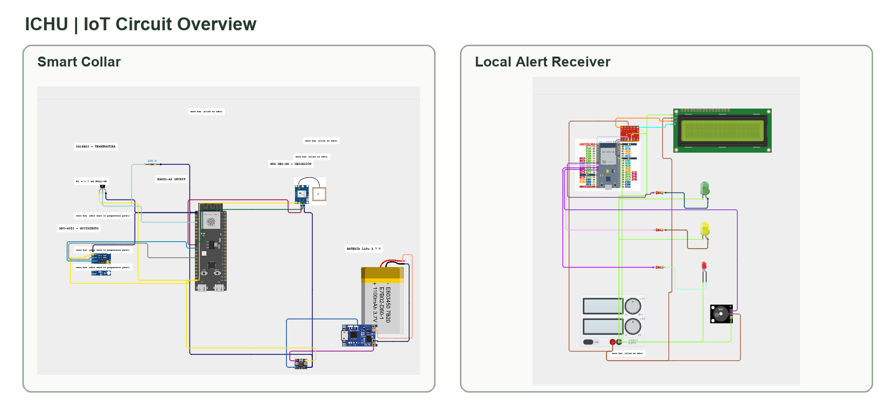

## Anexo J. Especificaciones de dispositivos IoT y sus conexiones

El primer diseño de ICHU reúne dos dispositivos de campo y el Portable Edge Gateway. El **collar** mide temperatura superficial, movimiento, ubicación del animal, frecuencia cardiaca (**SP-203**) y un índice relativo de metano (**MQ-2**). El **receptor de alertas** presenta el estado del ganado mediante texto, luces y sonido. El **Portable Edge Gateway** recibe y almacena la telemetría y evalúa las reglas de alerta cerca de los dispositivos.

*Vista general del diseño conceptual en Cirkit Designer. La captura todavía muestra un tercer bloque, el controlador del abrevadero, que queda fuera del alcance del prototipo; actualizar la captura está pendiente para el equipo. Los enlaces de datos se describen en J.4.*

Las tablas distinguen las conexiones leídas en la captura, los valores documentados por los fabricantes y las propuestas para completar el montaje. `3V3` identifica un riel de 3,3 V, `5V` uno de 5 V y `GND` el retorno común del bloque. Las flechas indican el sentido de una señal o el recorrido de la alimentación.

### J.1. Collar IoT

El ESP32-S3 DevKit concentra cinco entradas de sensor. El DS18B20 va en la cara interna de la carcasa con contacto estable con el animal, el MPU-6050 se fija a la placa para que se mueva con el collar y la antena del NEO-6M se orienta hacia el cielo. La placa, la batería y los módulos de alimentación quedan sujetos dentro de la carcasa.

#### J.1.1. Inventario y especificaciones

| Cantidad | Componente | Especificación y función |
|---|---|---|
| 1 | ESP32-S3 DevKit | Microcontrolador con lógica de 3,3 V. Lee 1-Wire, I²C y UART, compone las lecturas y las transmite al gateway por HTTP sobre Wi-Fi. La ruta por Bluetooth de baja energía (BLE) está prevista y el gateway aún no tiene receptor. La revisión física de la placa se verifica contra el pinout de Espressif. |
| 1 | DS18B20 del collar | Sensor digital 1-Wire de tres terminales. El fabricante especifica alimentación de 3,0 a 5,5 V, resolución de 9 a 12 bits y exactitud de ±0,5 °C entre −10 y +85 °C. A 12 bits la conversión tarda hasta 750 ms. En el collar se alimenta a 3,3 V y mide la superficie en el punto de contacto. |
| 1 | MPU-6050 | Unidad inercial con acelerómetro y giroscopio de tres ejes cada uno. Sus escalas configurables son ±2, ±4, ±8 y ±16 g, y ±250, ±500, ±1000 y ±2000 °/s. Admite I²C de 100 o 400 kHz. El firmware usa estas muestras para calcular el índice de actividad. |
| 1 conjunto | NEO-6M con antena GPS | El NEO-6M admite UART. Su configuración de fábrica es 9600 baudios, 8 bits, sin paridad y 1 bit de parada, con salida NMEA habilitada. El módulo u-blox admite 2,7 a 3,6 V en `VCC`. Para la placa adaptadora del dibujo se debe comprobar el voltaje de entrada y el nivel de sus señales. |
| 1 | Sensor de pulso SP-203 | Sensor fotoeléctrico de pulso (PPG) con salida analógica, leída por el ADC1. El firmware muestrea a 100 Hz. La frecuencia cardiaca es la mediana de los intervalos entre latidos en cada intervalo de reporte. Rango válido de 30 a 200 bpm. |
| 1 | Módulo de gas MQ-2 | Sensor de gas con calefactor de 5 V (unos 150 mA) y salida analógica `AO` a través de un divisor hasta 3,3 V. La salida digital `DO` no se usa. Requiere unos 60 s de calentamiento tras el encendido. Entrega un índice relativo de 0 a 100, sin calibrar y no en ppm. |
| 1 | Batería LiPo de una celda | La captura indica 3,7 V nominales y 1100 mAh. La capacidad final y la autonomía se determinan con la batería elegida y el consumo medido en captura, transmisión y reposo. |
| 1 | Módulo de carga y protección | La captura muestra entrada USB, bornes de batería `B+` y `B−` y salida a la carga `OUT+` y `OUT−`. Confirmar la referencia y la corriente de carga compatibles con la celda. |
| 1 | Módulo de alimentación de cuatro terminales | Conecta la salida del cargador al riel del collar. Quedan por identificar el módulo, el sentido de sus terminales y su capacidad para mantener 3,3 V durante los picos de consumo del ESP32 y el GPS. |
| 1 | Resistencia de pull-up | 4,7 kΩ entre `DQ` y `3V3`, según el circuito de referencia del DS18B20. La captura muestra 200 Ω y el rótulo del lienzo indica 4,7 kΩ. Se debe conciliar el valor en el esquema antes de montar. |

#### J.1.2. Conexiones pin a pin

| Terminal de origen | Terminal de destino | Señal o condición |
|---|---|---|
| DS18B20 `DQ` | ESP32-S3 `GPIO4` | Bus 1-Wire bidireccional. La resistencia de 4,7 kΩ va entre esta línea y `3V3`. |
| Riel `3V3` y tierra | DS18B20 `VDD` y `GND` | Alimentación de tres hilos. |
| MPU-6050 `SDA` | ESP32-S3 `GPIO8` | Datos I²C. Verificar que el pull-up de la placa del sensor eleve `SDA` al nivel de 3,3 V. |
| ESP32-S3 `GPIO9` | MPU-6050 `SCL` | Reloj I²C. Verificar el pull-up del módulo y su dirección de 7 bits. `AD0` bajo corresponde a `0x68` y `AD0` alto a `0x69`. |
| Riel `3V3` y tierra | Módulo MPU-6050 `VCC` y `GND` | Alimentación compartida con el ESP32-S3. Confirmar que la placa del sensor opere con ese riel. |
| ESP32-S3 `GPIO17 (TX)` | GPS `RX` | Asignación UART propuesta a partir de la captura. Confirmar la identificación del borne del GPS. |
| GPS `TX` | ESP32-S3 `GPIO18 (RX)` | Entrega las tramas de posición. Confirmar el borne y el nivel lógico con el módulo adquirido. |
| Riel compatible y tierra | Placa GPS `VCC` y `GND` | Comprobar tensión y polaridad en la placa adaptadora. La antena se conecta al puerto RF del GPS. |
| SP-203 `OUT` | ESP32-S3 `GPIO5` | Salida analógica del pulso, leída por el ADC1. |
| MQ-2 `AO` | Divisor → ESP32-S3 `GPIO6` | Salida analógica del gas. El divisor lleva la señal hasta el nivel de 3,3 V. La salida `DO` no se conecta. |
| Riel de 5 V y tierra | MQ-2 `VCC` y `GND` | Alimentación del calefactor del sensor. El riel de 5 V del collar aún no aparece en la captura. |
| Batería `+` y `−` | Cargador `B+` y `B−` | Entrada de la celda con la polaridad indicada. |
| Cargador `OUT+` y `OUT−` | Entrada positiva y negativa del módulo de alimentación | Salida protegida hacia el módulo regulador. |
| Salida regulada y retorno | ESP32-S3 `3V3` y `GND`, riel de sensores | Alimentación propuesta para uso con batería. Elegir una sola entrada de alimentación del DevKit durante las pruebas según la guía de su revisión. |

Cada ciclo entrega temperatura en °C, una medida de actividad, `heart_rate` y `methane_index` y, cuando el GPS obtiene una posición válida, latitud y longitud con su indicador de precisión. El firmware informa en `invalid_reasons` los campos no válidos: temperatura fuera de 30 a 45 °C, pulso sin contacto o fuera de rango, sensor de gas en calentamiento y sensor averiado. El calefactor del MQ-2 reduce notablemente la autonomía de la batería; mantenerlo encendido es una decisión del prototipo. La resolución del DS18B20 describe los incrementos de lectura. La precisión sobre el animal depende también del contacto y del montaje. El firmware comprueba que el sensor responda, que la conversión concluya y que el CRC de la lectura coincida antes de marcarla como válida.

`TS-01` exige un indicador de batería por lectura. El firmware lee la tensión de la celda en `GPIO1` a través de un divisor 1:2 de dos resistencias iguales y la convierte a porcentaje con una aproximación lineal entre 3,0 V y 4,2 V; en Wokwi la tensión se simula con un potenciómetro. La captura de Cirkit aún no dibuja el divisor y la conversión no se ha caracterizado con la batería real. La carcasa conceptual incluye un botón de encendido o emparejamiento y un LED de estado, ambos con pines y cableado por definir. Para despertar el collar por movimiento, `TS-02` permite una interrupción si está habilitada. El pin `INT` del MPU-6050 aparece libre en la captura y la primera prueba puede usar el temporizador.

### J.2. Reglas y límites de alerta

Este apartado reúne los límites que aplican el collar, el Portable Edge Gateway y el receptor de alertas.

#### J.2.1. Rangos aceptados por el Edge API

El Edge API rechaza con `400` una lectura fuera de estos rangos. Por eso el collar la informa en `invalid_reasons` en lugar de enviarla como medición.

| Magnitud | Rango aceptado |
|---|---|
| Temperatura corporal | 30 a 45 °C |
| Frecuencia cardiaca | 30 a 200 bpm |
| Índice de metano | 0 a 100 |
| Índice de actividad | 0 a 100 |
| Batería | 0 a 100 % |

#### J.2.2. Umbrales de demostración

Los umbrales siguientes pertenecen al perfil de demostración del backend (`DevelopmentMonitoringRulesSeeder`), para las etapas productivas *vaca en ordeño* (`MilkingCow`) y *vaquilla* (`Heifer`). El rango normal es la banda dentro de la cual no se genera alerta. Fuera de ella, la regla genera una alerta del nivel indicado. Son **valores de demostración, no rangos clínicos validados**.

| Métrica | Nivel | Rango normal |
|---|---|---|
| Temperatura corporal | Critical | 37,8–39,5 °C |
| Índice de actividad | Warning | 15–85 |
| Frecuencia cardiaca | Warning | 48–84 bpm |
| Frecuencia cardiaca | Critical | 40–90 bpm |
| Índice de metano | Warning | 0–60 |
| Índice de metano | Critical | 0–80 |
| Geocerca "Development pasture" | Warning | Tolerancia de 25 m más `accuracy_meters` |

#### J.2.3. Dos niveles por métrica

Cada combinación de etapa productiva, métrica y nivel admite como máximo un rango. El rango Critical debe contener al rango Warning. Si no lo contiene, la API responde `400` con `OperationsMonitoring.ThresholdLevelsInconsistent`. Una lectura que rompe ambos niveles genera una sola alerta, con el nivel más grave.

#### J.2.4. Deduplicación y escalada en Edge

Dentro de `ALERT_DEDUPLICATION_MINUTES` (15 min en ambos perfiles de configuración), el gateway no repite una alerta del mismo dispositivo y tipo con igual o menor nivel. Un nivel mayor, de Warning a Critical, genera una alerta nueva: es una escalada.

#### J.2.5. Cómo los ve el panel

El panel muestra Warning como **Atención** y Critical como **Urgencia**. Los estados del panel se describen en J.3.

La explotación administra estos rangos desde la aplicación web, en la sección Rangos normales. El gateway los descarga con cada sincronización y verifica la revisión vigente.

### J.3. Receptor local de alertas

El ESP32 DevKitC va en un panel seco y visible para el operario. La pantalla y los LED se orientan al frente y la salida del buzzer queda despejada.

#### J.3.1. Inventario y especificaciones

| Cantidad | Componente | Especificación y función |
|---|---|---|
| 1 | ESP32 DevKitC | Placa con lógica de 3,3 V. Consulta el estado de alertas en el gateway por la red local y gobierna el LCD, los tres LED y el buzzer. El firmware está implementado en `ichu-alert-panel-embedded-app` v0.1.0. |
| 1 | LCD de 16 × 2 con interfaz I²C | Dos líneas de 16 caracteres. El diseño lo alimenta a 5 V. Confirmar la referencia y la dirección I²C del adaptador que acompañe a la pantalla. |
| 1 | Conversor de nivel I²C | Adapta `SDA` y `SCL` entre el lado de 3,3 V del ESP32 y el lado de 5 V de la pantalla. Confirmar que sea bidireccional y verificar los pull-ups de cada lado. |
| 3 | LED verde, amarillo y rojo | Un indicador por estado. Cada LED lleva una resistencia individual de 220 Ω en serie. Verificar polaridad y corriente con los LED elegidos. |
| 1 | Buzzer activo KY-012 | Aviso sonoro para urgencias. Un buzzer activo genera el tono al activarse. Confirmar la función de cada terminal, el nivel de disparo y la corriente requerida por la variante elegida. |
| 1 | Fuente regulada de 5 V propuesta | Alimenta el LCD y el lado alto del conversor. El símbolo del buzzer recibe 5 V en el esquema. Definir y verificar la alimentación de la placa y del módulo sonoro antes de cerrar el cableado. |

#### J.3.2. Conexiones pin a pin

| Terminal de origen | Terminal de destino | Señal o condición |
|---|---|---|
| ESP32 `GPIO21 (SDA)` | Canal de datos del conversor → LCD `SDA` | Bus I²C bidireccional. |
| ESP32 `GPIO22 (SCL)` | Canal de reloj del conversor → LCD `SCL` | Reloj I²C adaptado al riel del LCD. |
| ESP32 `3V3` | Conversor `LV` | Referencia del lado del ESP32. |
| Fuente `5V` | Conversor `HV` y LCD `VCC` | Alimentación del lado del LCD. Verificar la tierra de ambos lados según el conversor. |
| ESP32 `GPIO25` | Resistencia de 220 Ω → ánodo LED verde | Cátodo a `GND`. Indica **Normal**. |
| ESP32 `GPIO26` | Resistencia de 220 Ω → ánodo LED amarillo | Cátodo a `GND`. Indica **Atención**. |
| ESP32 `GPIO27` | Resistencia de 220 Ω → ánodo LED rojo | Cátodo a `GND`. Indica **Urgencia**. |
| ESP32 `GPIO14` | Buzzer `S` | Orden sonora. Si la entrada del módulo requiere más corriente de la que admite el GPIO, definir una etapa de mando antes de conectarlo. |
| Fuente `5V` y `GND` | Buzzer `+` y `−` del símbolo | Cableado visible. Confirmar que el módulo real tenga una entrada de alimentación independiente de `S`. |
| Retorno de la fuente | `GND` del ESP32, conversor, LCD, LED y buzzer | Referencia común del panel. La entrada de alimentación del ESP32 queda libre en la captura y se debe completar con una opción admitida por la placa. |

El panel consulta `GET /api/v1/monitoring/alerts?device_id=…&limit=20` con la cabecera `X-API-Key` cada 3 s. Muestra cuatro estados:

- **Normal** (LED verde): no hay alertas activas.
- **Atención** (LED amarillo): hay una alerta activa de nivel Warning.
- **Urgencia** (LED rojo y buzzer): hay una alerta activa de nivel Critical.
- **Sin comunicación**: no hay respuesta del gateway todavía, o la última respuesta tiene más de 30 s. No enciende ningún LED.

Una alerta queda activa durante 600 s desde su `raised_at`. El cálculo requiere hora sincronizada por NTP. El buzzer suena en pulsos de 1 s durante 30 s cada vez que aparece una alerta **nueva** de nivel Critical, y se detiene al salir de Urgencia.

La primera fila del LCD muestra el estado. La segunda muestra el tipo de alerta y los primeros cuatro caracteres del `device_id`. En la simulación de Wokwi, el LCD recibe alimentación de la placa; en el prototipo se alimenta con la fuente de 5 V descrita en la tabla.

### J.4. Comunicación entre dispositivos

| Origen → destino | Medio | Datos y confirmación |
|---|---|---|
| Collar → Portable Edge Gateway | HTTP sobre Wi-Fi local (`POST /api/v1/monitoring/telemetry-readings` con `X-API-Key`), según `TS-01` a `TS-04`. BLE previsto. | Cada lectura lleva `device_id`, `event_id` y `recorded_at` en UTC, más `body_temperature`, `activity_index`, `battery_level`, `heart_rate`, `methane_index` y `position` con `accuracy_meters`; un campo sin medición puede informarse en `invalid_reasons`. El gateway valida y guarda la lectura en SQLite antes de responder `201 Created`; un reenvío idéntico recibe `200 OK` y un `event_id` reutilizado con otro contenido, `409 Conflict`. |
| Portable Edge Gateway → receptor local de alertas | Wi-Fi por la red local | Implementado. El panel consulta `GET /api/v1/monitoring/alerts` cada 3 s con `X-API-Key` y considera activa una alerta durante 600 s desde su `raised_at`. |
| Portable Edge Gateway → API central de ICHU | HTTPS cuando hay acceso a Internet, con la cabecera `X-Gateway-Key`, según `TS-06` y `TS-15` | Sincroniza telemetría y alertas en `POST /api/v1/telemetry/batch` cada 15 s, en lotes de hasta 100 lecturas y 100 alertas; tras un fallo, la espera se duplica hasta 5 min. Antes de cada lote descarga las reglas (`GET /api/v1/edge-gateways/{gatewayId}/monitoring-rules`) y las asignaciones de collares (`GET /api/v1/edge-gateways/{gatewayId}/device-assignments`). Reintenta con los mismos identificadores si se pierde la respuesta. |

El collar conserva sus lecturas en una cola de hasta 60 registros si el gateway está fuera de alcance y las retira tras la confirmación. Esa cola reside en la memoria no volátil (NVS) del ESP32-S3 y sobrevive a los reinicios. El gateway guarda cada lectura y alerta en SQLite en modo WAL, con un estado de sincronización que solo cambia cuando la API central responde, y requiere acceso a la red local. Con acceso a Internet sincroniza los pendientes con la API central. Quedan por definir la plataforma física, el alcance efectivo de la red Wi-Fi en el predio y, si se incorpora BLE, los parámetros de ese enlace.

Para el collar, este anexo adopta las historias técnicas del Capítulo III y la arquitectura actualizada del Capítulo IV. El collar entrega sus lecturas al gateway por Wi-Fi local y nunca directamente al backend; el gateway se encarga de sincronizarlas. El receptor de alertas ya consume `GET /api/v1/monitoring/alerts` del Edge API.

### J.5. Clasificación de sensores, actuadores y equipos de apoyo

| Dispositivo | Sensores o entradas | Actuadores o salidas | Control y soporte |
|---|---|---|---|
| Collar | **DS18B20** para temperatura superficial, **MPU-6050** para aceleración y velocidad angular, **NEO-6M** para posición, **SP-203** para frecuencia cardiaca y **MQ-2** para índice de metano. El nivel de batería se lee por un divisor que el firmware ya usa y que falta dibujar en la captura. El botón de la carcasa es una entrada manual propuesta. | LED de estado de la carcasa, previsto en el concepto y pendiente de cableado. | ESP32-S3, antena GPS, batería, cargador con protección, regulador y resistencia de pull-up. |
| Receptor de alertas | Estado consultado al gateway cada 3 s. | **LED verde, amarillo y rojo** como indicadores luminosos, **buzzer KY-012** como actuador acústico y **LCD** como salida visual de texto. | ESP32, conversor I²C, resistencias de los LED y fuente regulada. |
| Portable Edge Gateway | Lecturas recibidas por HTTP en la red Wi-Fi local; BLE previsto para los dispositivos embebidos. | Avisos y datos por red local, y sincronización por HTTPS. | Procesamiento, almacenamiento persistente y comunicación. |

### J.6. Capacidad del suministro de energía

Las capacidades de las fuentes de la tabla son **propuestas para el banco de pruebas**. Se dimensiona con `P = V × I` y se confirma la corriente de pico con todos los consumidores del riel activos. Como criterio de diseño inicial, la capacidad de la fuente debe superar en al menos 25 % el pico medido, sin salir de la tensión admitida por cada módulo.

| Bloque | Capacidad de partida | Base de dimensionamiento y verificación |
|---|---|---|
| Collar | Batería dibujada de **3,7 V y 1100 mAh** (aprox. **4,07 Wh nominales**). Regulador propuesto de **3,3 V y 1 A** (3,3 W). | Espressif recomienda capacidad de al menos 500 mA para alimentar el ESP32-S3. Se reserva corriente adicional para GPS, IMU, DS18B20 y transitorios. u-blox indica hasta 67 mA como referencia para dimensionar la alimentación del NEO-6M, antes de considerar el adaptador o la antena activa. Confirmar que celda, protección y regulador soporten el pico simultáneo con batería próxima al fin de descarga. El calefactor del MQ-2 consume unos 150 mA a 5 V y requiere un riel de 5 V o un elevador de tensión; su consumo está por medir. |
| Panel | Fuente propuesta de **5 V y 1 A** (5 W). El ESP32 aporta la referencia de 3,3 V al lado bajo del conversor. | Medir con la radio activa, el LCD iluminado, el LED de urgencia y el buzzer encendidos. Revisar el presupuesto si la placa o los periféricos elegidos requieren más corriente. |
| Portable Edge Gateway | Alimentación por seleccionar con la plataforma de J.10. Para el banco se reserva un presupuesto de **15 W** al nodo completo. | Verificar el consumo de CPU, almacenamiento y radios durante recepción, escrituras y sincronización simultáneas. Elegir la tensión y el adaptador según el equipo utilizado. |

Como objetivo inicial, el collar debe operar **24 h** con el perfil de muestreo de J.7. Si en el ensayo se aprovecha el 80 % de la capacidad nominal de 1100 mAh, el consumo medio permitido en los bornes de batería es `0,80 × 1100 mAh / 24 h ≈ 36,7 mA`. Registrar corriente media y picos durante adquisición GPS, transmisión Wi-Fi y reposo, y comprobar la autonomía con un ciclo de descarga del prototipo. La capacidad aprovechable depende de la celda, la temperatura, el regulador y el corte de protección. Con el calefactor del MQ-2 encendido, ese presupuesto no se alcanza con la celda de 1100 mAh, así que la configuración actual del collar es de banco o demostración. Es una observación de diseño, no una medición.

### J.7. Tiempo de respuesta objetivo (Time Delay)

Los tiempos de esta tabla distinguen la conversión del sensor, el periodo de muestreo y la latencia de entrega. Las metas son de banco y se verifican con marcas de tiempo. `p95` significa que al menos el 95 % de los ensayos debe quedar dentro del tiempo indicado. Para medir entre equipos se usan relojes sincronizados o un instrumento de tiempo común.

| Tramo | Tiempo de ficha técnica o meta propuesta | Inicio y fin de la medición |
|---|---|---|
| DS18B20 del collar | **Hasta 750 ms** por conversión a 12 bits, según ficha técnica; el firmware del collar usa 10 bits, con una conversión de unos 190 ms. El firmware del collar toma una lectura cada **10 s** (`kReadingIntervalMs`), valor de demostración; para campo se propone **60 s**, sujeto al ensayo de autonomía. | Medir desde la orden de conversión hasta que la lectura digital queda disponible. Ensayar por separado la respuesta térmica de la sonda y su montaje. |
| MPU-6050 del collar | El firmware toma una muestra cada **50 ms** (20 Hz) durante todo el intervalo de lectura y calcula el índice como la desviación media del módulo de la aceleración respecto de la gravedad, escalada a 0–100 con un fondo de escala provisional de 3,0 m/s². Índice listo **≤ 100 ms p95** después de cerrar el intervalo. | Registrar inicio y fin del intervalo y el tiempo para calcular el índice. Calibrar el fondo de escala con animales antes de comparar índices. |
| GPS NEO-6M | Ficha técnica de referencia de **27 s típicos** hasta la primera posición en arranque en frío. Meta de **≤ 60 s p95** en cielo abierto. Una posición reportada debe tener una antigüedad **≤ 10 s** al formar el registro. | Medir desde el encendido en frío hasta la primera posición válida. En cada registro guardar la hora de la posición y marcarla inválida si está ausente o supera la antigüedad admitida. |
| SP-203 del collar | Muestreo a **100 Hz**. La frecuencia cardiaca se calcula por cada intervalo de reporte de **10 s**, periodo de demostración del firmware. | Medir desde el inicio del intervalo hasta la publicación de la frecuencia en el registro. |
| MQ-2 del collar | Calentamiento de **60 s** tras el encendido. Un índice por lectura. | Medir desde el encendido hasta el fin del calentamiento. |
| Collar → Edge por HTTP sobre Wi-Fi | Confirmación de persistencia (`201 Created`) **≤ 2 s p95** desde que el registro está listo, con Wi-Fi conectado y sin cola previa. El firmware abandona el intento a los 5 s y espera 5 s antes de reintentar. | Comparar la hora de preparación del registro y la de recepción de su confirmación. Medir las reconexiones y el vaciado de cola por separado. |
| Procesamiento en Edge | **≤ 250 ms p95** desde la recepción de una trama válida hasta persistir el registro y terminar la evaluación local que corresponda. | Instrumentar recepción, confirmación de SQLite y fin de reglas en el gateway. La confirmación al emisor se habilita tras persistir. |
| Edge → panel | Meta de **≤ 4 s p95** desde que la alerta queda almacenada en Edge hasta el cambio del LED del panel. El peor caso teórico suma una consulta cada 3 s y un tiempo de espera HTTP de 5 s, con Wi-Fi local operativo. | Medir desde el almacenamiento de la alerta en Edge hasta el cambio del LED del panel. |
| Salidas locales del panel | LED y buzzer **≤ 100 ms p95** hasta encender o sonar. LCD **≤ 250 ms p95** hasta completar el texto. | Medir cada salida desde que el firmware del panel emite su orden local. |
| Edge → API central | Meta de sincronizar un lote normal **≤ 30 s p95** desde que queda listo para envío, con Internet operativo. El sincronizador corre cada 15 s (`SYNC_INTERVAL_SECONDS`), por lo que la espera hasta el siguiente ciclo cabe en la meta; la primera petición a la API desplegada en Render puede tardar cerca de un minuto si el servicio estaba en reposo. | Medir hasta la confirmación de la API. En ausencia de conectividad se conserva la cola y se mide el tiempo de recuperación por separado. |

### J.8. Incertidumbre objetivo de los sensores (Target Uncertainty)

Para temperatura, movimiento y tensión se propone una incertidumbre expandida objetivo `U = k × u_c` con factor de cobertura `k = 2`. La incertidumbre estándar combinada `u_c` reúne las contribuciones de la referencia, la resolución, la dispersión de las repeticiones y el montaje. Para GPS se usa el percentil 95 del error horizontal frente a una referencia conocida. Los **2,5 m CEP** de la ficha del NEO-6M corresponden al radio que contiene el 50 % de las posiciones en el ensayo estático del fabricante.

| Sensor y cantidad física | Incertidumbre o error objetivo propuesto | Método de verificación |
|---|---|---|
| DS18B20 del collar, temperatura superficial (°C) | **U ≤ 1,0 °C** en un ensayo de contacto entre 30 y 42 °C. | Comparar en varios puntos con un termómetro de referencia sobre una superficie estabilizada. Repetir retirando y colocando el collar para incorporar la variación por contacto. El ensayo caracteriza la superficie medida. |
| Acelerómetro del MPU-6050, aceleración en X, Y y Z | **U ≤ 0,10 g por eje** (aprox. 0,98 m/s²), tras calibración en reposo. | Colocar el sensor con cada eje orientado sucesivamente a favor y en contra de la gravedad. Comparar con las componentes esperadas y repetir el montaje. |
| Giroscopio del MPU-6050, velocidad angular en X, Y y Z | **U ≤ 5 °/s por eje** en banco, tras corregir el sesgo. | Medir el cero en reposo y velocidades de referencia de hasta ±90 °/s mediante giro controlado en ambos sentidos por eje. |
| NEO-6M, posición horizontal a partir de latitud y longitud | **Error horizontal p95 ≤ 10 m** en cielo abierto y con posición válida. | Comparar series de posiciones con un punto de coordenadas conocidas en varias sesiones. Registrar fallos de posición y estimación de precisión del receptor. Para geocercas, tratar como no concluyentes las posiciones cuya incertidumbre impida distinguir el lado del límite. |
| SP-203 del collar, frecuencia cardiaca (bpm) | **Propuesta:** error ≤ ±5 bpm frente a un conteo de referencia de 60 s. | Contar los latidos manualmente o con un monitor de referencia durante 60 s. |
| MQ-2 del collar, índice relativo de metano (0 a 100) | **Propuesta:** sin meta en ppm, porque el índice no está calibrado. Verificar respuesta monótona y calentamiento de 60 s. | Exponer el sensor a una fuente de gas de referencia. Pendiente de ejecutar. |
| Circuito propuesto de medida de batería, tensión de la celda (V) | **U ≤ 0,05 V** en el rango de operación de la celda elegida. | Tras definir el circuito, comparar con un multímetro de referencia en varios puntos y durante carga de trabajo. El porcentaje requiere caracterizar la batería bajo el perfil de uso. |

### J.9. Exactitud y precisión objetivo de los actuadores (Target Accuracy and Precision)

En una salida discreta, la exactitud se verifica por correspondencia entre la orden y el estado observado. La precisión se evalúa repitiendo la orden y midiendo la dispersión del tiempo de respuesta. Las metas siguientes se proponen para un ensayo controlado.

| Actuador o salida | Exactitud objetivo | Precisión o repetibilidad objetivo y prueba |
|---|---|---|
| LED verde, amarillo y rojo | **100 de 100 cambios de estado** muestran el color asignado y un solo LED de estado activo. | Desviación estándar de la latencia de encendido **≤ 20 ms** desde la orden local, por color. Usar fotodetector o registro de video con resolución temporal suficiente. |
| Buzzer KY-012 | **100 de 100 órdenes** de urgencia generan sonido y las órdenes de desactivación lo silencian. Para un pulso de prueba de **1,00 s**, error de duración audible **≤ 0,10 s**. | Desviación estándar de la duración audible **≤ 50 ms** en pulsos repetidos. Medir con micrófono a distancia fija y comprobar el estado silencioso fuera de urgencia. |
| LCD de 16 × 2 | **100 de 100 actualizaciones** muestran el texto correspondiente sin restos del mensaje anterior. | Desviación estándar de la latencia de refresco **≤ 50 ms** desde la orden local. Repetir los cambios entre los cuatro estados y medir hasta que el texto esté completo. |
| LED de estado del collar | Una vez asignado, **100 de 100 órdenes** muestran el estado definido por el firmware. | Desviación estándar de la latencia de encendido **≤ 20 ms** bajo las mismas condiciones de alimentación. Aplicar cuando se defina el circuito. |

### J.10. Esfuerzo computacional en Edge y Fog (Processing Power)

El ESP32-S3 calcula el índice de actividad a partir de la ventana local y entrega el resumen al **Portable Edge Gateway**. Edge recibe los registros, los valida, los guarda en SQLite, evalúa alertas con la configuración vigente y sincroniza lotes con la API. El procesamiento de Edge se dimensiona para esos registros, con el análisis de muestras crudas en el collar.

| Algoritmo o tarea en Edge | Esfuerzo y memoria esperados | Implementación de referencia |
|---|---|---|
| Validar e identificar tramas | `O(B)` por registro, donde `B` es el tamaño de la trama. Memoria proporcional a los registros en proceso. | Validar identidad, campos, unidades, tiempo y validez. Consultar por índice la identidad del registro y confirmar después de que SQLite complete la escritura. |
| Evaluar umbrales y deduplicar alertas | `O(K)` comparaciones por registro para `K` reglas aplicables, más consultas indexadas de asignaciones y alertas. | Aplicar las reglas de la revisión vigente, con las asignaciones de collar a lote y etapa de vida descargadas de la API central, y la ventana de deduplicación configurada (`ALERT_DEDUPLICATION_MINUTES`). Un campo informado en `invalid_reasons` no se evalúa. Mantener las reglas activas en caché y persistir la alerta junto con su referencia a la lectura. |
| Evaluar geocercas | `O(V)` por posición para un polígono aplicable de `V` vértices. | Verificar validez y precisión de la posición. Aplicar una prueba punto en polígono y, fuera del polígono, generar la alerta solo si la distancia al límite supera la tolerancia de la geocerca más la precisión informada (`accuracy_meters`), de modo que el error del GPS no basta para alertar (ADR-0016 del Edge API). |
| Sincronizar registros pendientes | `O(L)` por lote de `L` registros, con memoria acotada al lote. | Preparar lotes paginados por índice, serializar y transmitir por HTTPS. Procesar confirmaciones individuales y reintentar con identidades estables. |

**Escenario de ensayo propuesto.** 100 collares con un registro cada 60 s producen en promedio **1,67 lecturas/s** o **144 000 lecturas/día**. Se propone ensayar **20 registros/s** en Edge para incluir ráfagas de reenvío. Con un polígono de hasta 100 vértices por posición y una ráfaga compuesta íntegramente por posiciones, se recorren hasta **2000 segmentos/s** por pasada de geocerca. Medir los eventos, escrituras y consultas de alertas junto con esa carga. Con el periodo de demostración de 10 s del firmware, los mismos 100 collares producirían 10 lecturas/s, todavía por debajo de la ráfaga de ensayo.

**CPU, memoria y almacenamiento.** El punto de partida para el ensayo es un equipo Linux de **2 núcleos, 2 GiB de RAM y 16 GB de almacenamiento persistente**, con Wi-Fi y red local, y BLE si se incorpora ese receptor. Con una hipótesis de **1 KiB por lectura persistida**, siete días sin sincronizar ocupan unos **0,96 GiB** solo en lecturas. Reservar **al menos 4 GiB** para la base, sus índices, alertas y archivos temporales, y verificar el tamaño con la base real. La meta a 20 registros/s es mantener **CPU media ≤ 60 %** de la capacidad total y **RAM residente ≤ 512 MiB** para el servicio Edge y su proceso de sincronización, cumplir los **250 ms p95** de J.7 y conservar las confirmaciones tras un reinicio. La frecuencia del procesador y el equipo final se seleccionan a partir de esa prueba de carga.

**Aplicabilidad de Fog.** La arquitectura vigente concentra estas tareas en Edge y envía los lotes a la API central. Un nodo Fog separado queda fuera del dimensionamiento del prototipo. Si se incorpora para concentrar varios gateways, su carga se calculará con la suma de sus tasas y el volumen retenido durante la desconexión. Los umbrales locales seguirán ejecutándose en Edge.

### J.11. Verificaciones para el prototipo

| Prueba | Criterio de aceptación |
|---|---|
| Continuidad y alimentación | Verificar terminales y polaridad contra los módulos reales. Sustituir el pull-up de 200 Ω de la captura del collar por el valor especificado, completar las entradas de alimentación y medir los rieles antes de conectar periféricos. |
| Collar | Obtener una lectura térmica válida, seis ejes de movimiento, una posición GPS válida y lecturas de pulso y de metano. Al desconectar un sensor, perder la posición GPS o detectar un valor no válido, marcar el campo afectado como inválido y conservar los datos válidos de los demás sensores. El firmware ya envía `invalid_reasons`, que el Edge API acepta. |
| Panel | Probar Normal, Atención, Urgencia y Sin comunicación con el texto y LED correspondientes. Verificar el sonido en urgencia. Wokwi ya verifica Sin comunicación en CI (`tests/panel-offline.test.yaml`). La cadena completa, del simulador del collar al Edge API y de ahí al panel en Urgencia con buzzer y LED rojo, se verifica en `tests/panel-urgent.test.yaml` (job `end-to-end`). Las pruebas con el prototipo físico siguen pendientes. |
| Registros sin conexión | Detener el Edge API o cortar el Wi-Fi, reiniciar el collar y verificar que los registros siguen pendientes en la cola de NVS. Recuperar el enlace y comprobar que cada registro se confirma una vez almacenado y que un reenvío idéntico conserva su `event_id` y recibe `200 OK`. |
| Sincronización del gateway | Interrumpir Internet y comprobar que se siguen recibiendo lecturas locales. Al recuperar la conexión, verificar que se sincronizan con la API central sin crear duplicados. |
| Metas de medición, actuación y energía | Registrar instrumentos, condiciones, repeticiones y resultados de J.6 a J.9. Comparar la incertidumbre, la repetibilidad, los tiempos y la autonomía medidos con las metas propuestas. |
| Capacidad del gateway | Reproducir la carga normal y mantener la ráfaga de J.10 durante 30 min con sincronización concurrente. Registrar latencia p95, CPU, memoria, crecimiento de SQLite y recuperación de los registros tras reinicio. |

### J.12. Fuentes y enlaces

**Proyecto editable en Cirkit Designer**

<https://app.cirkitdesigner.com/project/a07ab13c-8ded-4672-a786-deecb40e13c2>

**Captura del collar**

<https://github.com/five-smart-farm-creators/ichu-report/blob/b2bc54063c73ae53ae26c98b55b0f3fddeaf01ea/report/assets/images/iot/collar-circuit.png>

**Captura del receptor de alertas**

<https://github.com/five-smart-farm-creators/ichu-report/blob/b2bc54063c73ae53ae26c98b55b0f3fddeaf01ea/report/assets/images/iot/alert-receiver-circuit.png>

**Edge API (`ichu-edge-service`): README, ADR y contratos**

<https://github.com/five-smart-farm-creators/ichu-edge-service>

**Firmware del collar (`ichu-cattle-band-embedded-app`)**

<https://github.com/five-smart-farm-creators/ichu-cattle-band-embedded-app>

**Firmware del panel (`ichu-alert-panel-embedded-app`)**

<https://github.com/five-smart-farm-creators/ichu-alert-panel-embedded-app>

**Capítulo III. Historias técnicas y criterios de aceptación**

<https://github.com/five-smart-farm-creators/ichu-report/blob/b2bc54063c73ae53ae26c98b55b0f3fddeaf01ea/report/30-requirements-specification.md#31-user-stories>

**Capítulo IV. Arquitectura de contenedores**

<https://github.com/five-smart-farm-creators/ichu-report/blob/b2bc54063c73ae53ae26c98b55b0f3fddeaf01ea/report/40-solution-software-design.md#4133-software-architecture-container-level-diagram>

**Capítulo V. Diseño de dispositivos IoT**

<https://github.com/five-smart-farm-creators/ichu-report/blob/b2bc54063c73ae53ae26c98b55b0f3fddeaf01ea/report/50-solution-ui-ux-design.md#56-iot-device-design>

**Espressif. ESP32-S3-DevKitC-1**

<https://documentation.espressif.com/esp-dev-kits/en/latest/esp32s3/esp32-s3-devkitc-1/user_guide_v1.0.html>

**Espressif. ESP32-DevKitC V4**

<https://docs.espressif.com/projects/esp-dev-kits/en/latest/esp32/esp32-devkitc/user_guide.html>

**Analog Devices. DS18B20**

<https://www.analog.com/media/en/technical-documentation/data-sheets/DS18B20.pdf>

**TDK InvenSense. MPU-6050**

<https://product.tdk.com/system/files/dam/doc/product/sensor/mortion-inertial/imu/data_sheet/mpu-6000-datasheet1.pdf>

**u-blox. NEO-6M**

<https://content.u-blox.com/sites/default/files/products/documents/NEO-6_DataSheet_%28GPS.G6-HW-09005%29.pdf>

**Joy-IT. KY-012 activo, variante de referencia**

<https://www.sensorkit.joy-it.net/en/sensors/ky-012>

**Espressif. Dimensionamiento del suministro del ESP32-S3**

<https://docs.espressif.com/projects/esp-hardware-design-guidelines/en/latest/esp32s3/schematic-checklist.html>

**JCGM. Guía para expresar la incertidumbre de medición**

<https://www.bipm.org/documents/20126/2071204/JCGM_100_2008_E.pdf>
