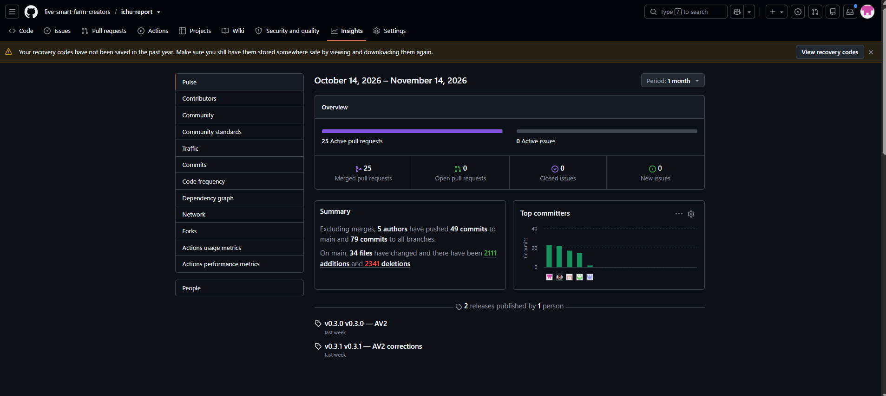

# Project Report Collaboration Insights

**Repositorio del informe:** [https://tinyurl.com/2dhmo9ou](https://tinyurl.com/2dhmo9ou)

## Organización del trabajo

El informe se elabora de forma colaborativa en un repositorio público dentro de la organización de GitHub del equipo, aplicando GitFlow como flujo de control de versiones y Conventional Commits para los mensajes.

Durante la elaboración de AV1 se utilizaron ramas de trabajo por capítulo y conclusiones; una vez integradas, esas ramas se cerraron. El flujo vigente conserva `main` para entregas publicadas y `develop` para integración. Cada cambio se desarrolla en una rama temporal `feature/<alcance>` o `fix/<alcance>`, creada desde `develop`, y se integra mediante un Pull Request revisado.

| Rama | Contenido |
|---|---|
| `main` | Versión publicada para cada entrega |
| `develop` | Integración de cambios en curso |
| `feature/<alcance>` / `fix/<alcance>` | Ramas temporales para cambios aislados; se eliminan tras integrarse |

## Actividad registrada durante AV1 (7–19 de septiembre de 2026)

| Métrica | Valor |
|---|---|
| Commits de contenido | 111 |
| Merges de integración | 17 |
| Commits totales del historial | 128 |
| Ramas de trabajo utilizadas durante la entrega | 7 |
| Periodo de trabajo | 7 al 19 de septiembre de 2026 |
| Artefactos versionados | 4 capítulos con contenido, 1 archivo de capítulo vacío, 114 imágenes rasterizadas, 8 SVG y 17 archivos fuente de diagramas |

## Evidencias de commits en GitHub

Las siguientes capturas documentan el historial visible de commits de la rama `feature/chapter-II` durante la consolidación del informe. En ellas se observan aportes de Diego Andres Avalos Cordova, Flor de María Contreras Leon, Giorgio Awad, Alison Arrieta y Manuel Angel Sanchez, además de la integración de ramas mediante GitFlow. La evidencia se mantiene alineada con las versiones 0.11.6 a 0.11.10 del Registro de Versiones.

*Figura. Historial de commits de `feature/chapter-II` durante la consolidación del informe (captura 1).*

*Figura. Historial de commits de `feature/chapter-II` durante la consolidación del informe (captura 2).*

*Figura. Historial de commits de `feature/chapter-II` durante la consolidación del informe (captura 3).*

## Interpretación de la actividad colaborativa

El historial de commits evidencia una elaboración distribuida del informe entre las ramas de capítulo. Las capturas muestran aportes de Diego Andres Avalos Cordova, Flor de María Contreras Leon, Giorgio Awad, Alison Arrieta y Manuel Angel Sanchez, junto con integraciones realizadas mediante GitFlow. El Registro de Versiones resume las modificaciones relevantes y mantiene la trazabilidad entre cada aporte, el autor y la sección actualizada.

Durante AV1, la organización inicial por ramas de capítulo permitió distribuir responsabilidades e integrar los aportes mediante GitFlow. Para los siguientes cambios, el repositorio mantiene `main` y `develop` como ramas permanentes y utiliza ramas temporales integradas mediante Pull Request, con la trazabilidad registrada en los commits y en el Registro de Versiones.

## TB1

### Organización del trabajo

Entre el 6 y el 8 de octubre de 2026 se reorganizaron las fuentes del informe en `report/`, se prepararon los apartados de TB1 y se integraron avances de diseño y correcciones de investigación. El trabajo siguió el flujo de ramas temporales y Pull Requests descrito en CONTRIBUTING.md ([https://tinyurl.com/2yusurh6](https://tinyurl.com/2yusurh6)).

La reorganización se incorporó mediante el PR #1 ([https://tinyurl.com/2ys9jf2y](https://tinyurl.com/2ys9jf2y)). Los avances del Capítulo V llegaron a `develop` mediante el PR #6 ([https://tinyurl.com/2d9hv4an](https://tinyurl.com/2d9hv4an)), las correcciones generales mediante el PR #7 ([https://tinyurl.com/29xuo2km](https://tinyurl.com/29xuo2km)) y la revisión del Big Picture EventStorming mediante el PR #8 ([https://tinyurl.com/2yvnp8lu](https://tinyurl.com/2yvnp8lu)).

### Actividad colaborativa

Las siguientes métricas corresponden al historial alcanzable desde `develop` hasta `8eb4f5d` ([https://tinyurl.com/2czhng3z](https://tinyurl.com/2czhng3z)), con corte al 8 de octubre de 2026. Para el periodo TB1 se consideran los commits con fecha desde el 6 de octubre a las 00:00 hasta ese corte, hora de Perú (UTC−5). Se excluyen los commits de esta rama de auditoría; las identidades Git alternativas se consolidan bajo el nombre del integrante.

| Métrica | Valor |
|---|---|
| Commits de contenido (sin merges) en TB1 | 71 |
| Merges de integración en TB1 | 20 |
| Commits totales del periodo TB1 | 91 |
| Commits acumulados del historial | 219 |
| Periodo observado | 6 al 8 de octubre de 2026 |
| Ramas temporales integradas en TB1 | 9 |
| Artefactos del informe al corte | 6 capítulos con contenido; 165 imágenes rasterizadas, 12 SVG y 18 fuentes de diagramas |

| Integrante | Commits sin merge en el periodo | Aporte documentado |
|---|---|---|
| Avalos Cordova, Diego Andres | 36 | Reorganización del informe y desarrollo de las secciones de diseño web 5.1–5.5. |
| Romero Meza, Jhimy Pool | 12 | Ampliación del vocabulario del dominio, términos por contexto y revisión de claridad del informe. |
| Awad Vargas, Giorgio Marzouk | 8 | Revisión de User Stories, Technical Stories, dependencias, prioridades y backlog. |
| Contreras Leon, Flor de María | 7 | Evidencias de diseño IoT, configuración, planificación y despliegue documentado del Sprint 1. |
| Arrieta Quispe, Alison Jimena | 6 | Correcciones de C4 y Big Picture EventStorming y actualización de sus referencias. |
| Sanchez Arenas, Manuel Angel | 2 | Revisión de supuestos, análisis de entrevistas, enlaces y trazabilidad de historias. |

La cantidad de commits refleja actividad versionada y no mide por sí sola el esfuerzo ni la participación total. Los merges se contabilizan por separado; el historial incluye una integración atribuida a una cuenta automatizada. Los aportes de otros integrantes fuera de este periodo y las tareas sin commit propio no se deducen de esta tabla.

El resumen anterior corresponde al corte de TB1: el Capítulo V documentó el diseño de la Landing Page y la Web Application, y no incluía una aplicación móvil nativa. La actualización de Sprint 2 incorpora al Capítulo VI evidencia de los repositorios de servicios, Edge y aplicación Flutter, además de pruebas y una ejecución móvil local. Las tareas históricas SF-96–SF-117 de Jira siguen identificadas como simuladas; no deben confundirse con la planificación confirmada del Sprint 2 ni con la aceptación de sus historias.

### Evidencias de colaboración y commits

| Evidencia | Cambios que respalda |
|---|---|
| Reorganización del informe, 1511611 ([https://tinyurl.com/2267b4wd](https://tinyurl.com/2267b4wd)) | Nueva estructura de capítulos, secciones iniciales, anexos y recursos. |
| Fotografías del equipo, 5330abc ([https://tinyurl.com/23xlojqe](https://tinyurl.com/23xlojqe)) | Actualización de los perfiles de integrantes. |
| PR #6: Capítulo V ([https://tinyurl.com/2d9hv4an](https://tinyurl.com/2d9hv4an)) | Guías visuales y arquitectura de información. |
| PR #7: correcciones generales ([https://tinyurl.com/29xuo2km](https://tinyurl.com/29xuo2km)) | Lean UX, investigación, requisitos y referencias. |
| PR #8: Big Picture EventStorming ([https://tinyurl.com/2yvnp8lu](https://tinyurl.com/2yvnp8lu)) | Modelo As-Is y capturas de FigJam. |

Las capturas de commits de la sección AV1 se conservan como evidencia histórica de esa entrega. Para TB1, las filas de contribución en Student Outcome ([https://tinyurl.com/2ycsp3br](https://tinyurl.com/2ycsp3br)) y el Registro de Versiones ([https://tinyurl.com/2aohjlzu](https://tinyurl.com/2aohjlzu)) enlazan los aportes con sus commits y Pull Requests.

### Corrección de requisitos a partir de la revisión del profesor

El 8 de octubre se creó `fix/user-and-technical-stories` a partir del estado actualizado del informe, conservando `develop` como base de integración. Giorgio Awad registró las correcciones en commits separados por alcance; la autoría corresponde a la identidad Git configurada `GiorgioAwad`. Los seis commits de contenido siguientes y el commit documental que registra estas evidencias permiten revisar qué cambió en cada aporte.

| Alcance | Commit | Cambio verificable |
|---|---|---|
| Contratación | 6f8fc2d ([https://tinyurl.com/26z8ox9a](https://tinyurl.com/26z8ox9a)) | Reformulación de US-33, US-34 y US-35 hacia registro, comparación de costos e inicio de suscripción; actualización de sus referencias en los Capítulos IV y V. |
| Collar y Edge | 0904aed ([https://tinyurl.com/2ywbwhpl](https://tinyurl.com/2ywbwhpl)) | Revisión de TS-01 a TS-06 con actores Device Maker y Portable Edge Gateway, captura identificable, recepción BLE, confirmación durable, configuración e idempotencia. |
| Cloud y abrevadero | 49e4a82 ([https://tinyurl.com/2a69t7c2](https://tinyurl.com/2a69t7c2)) | Revisión de TS-07 a TS-14 con consumidores concretos, autorización, estados de suscripción, notificaciones, contexto meteorológico y sincronización del abrevadero desde Edge. |
| Clientes y operación offline | 5c0e3e6 ([https://tinyurl.com/2xrlym4w](https://tinyurl.com/2xrlym4w)) | Incorporación de TS-15 a TS-19 para configuración Edge, alertas y telemetría locales, sincronización móvil e indicadores Web; ajuste de US-13, US-16, US-19 y US-22. |
| Impact Mapping y backlog | a10d064 ([https://tinyurl.com/28ywpnxz](https://tinyurl.com/28ywpnxz)) | Reformulación de BG-03 como reducción propuesta del CAC, mortalidad como hipótesis de beneficio del usuario y actualización del backlog a 57 US, 19 TS y 352 SP propuestos, con prioridades y dependencias revisadas. |
| Consistencia entre capítulos | eb24b01 ([https://tinyurl.com/29nsjjlk](https://tinyurl.com/29nsjjlk)) | Revisión de la evidencia de investigación, distinción de bajas por muerte en US-09 y corrección del texto arquitectónico y de las prioridades competitivas relacionadas con las historias. |

Se verificaron identificadores únicos, criterios Given–When–Then, correspondencia de títulos con el backlog, prioridades relacionadas del Capítulo II, enlaces locales y sumas por sprint. El resultado contiene 76 historias y 352 SP como propuesta para Sprint Planning; no acredita implementación ni cierre de sprints. Las capturas y tableros de Jira y UXPressia y los diagramas de arquitectura de AV1 requieren sincronización con esta especificación. El cambio se integró en `develop` mediante el PR #12, registrado en el merge `9cae532` ([https://tinyurl.com/2y6l5g8z](https://tinyurl.com/2y6l5g8z)).

## AV2

### Organización del trabajo

Durante AV2, el equipo revisó la relación entre investigación, requisitos, arquitectura, diseño IoT y planificación. Los ajustes del informe permitieron precisar el alcance del producto y mantener una descripción coherente de las aplicaciones, los servicios y los dispositivos de campo.

*Figura. Actividad del repositorio en GitHub Insights del 14 de octubre al 14 de noviembre de 2026.*

### Aportes por integrante

| Integrante | Aporte |
|---|---|
| Avalos Cordova, Diego Andres | Organizó la estructura de AV2, ajustó la carátula y la planificación del Sprint 1, revisó la User Task Matrix y el Design-Level EventStorming. Alineó los requisitos, la arquitectura, el diseño, los anexos y el índice con el alcance vigente, conservó los recursos gráficos originales e integró los aportes del equipo. |
| Awad Vargas, Giorgio Marzouk | Consolidó el vocabulario del negocio, unificó las épicas e historias y organizó su trazabilidad. Precisó la diferencia entre las actividades actuales del negocio y las automatizaciones propuestas. Preparó el guion de validación para los dos segmentos y documentó la planificación, el reparto y el backlog del Sprint 2. |
| Contreras Leon, Flor de María | Desarrolló las especificaciones del collar y del receptor de alertas, sus conexiones y límites de funcionamiento. Alineó el flujo Wi-Fi entre el collar y Edge con los requisitos y el diseño. También organizó las pautas de contribución y las validaciones para integrar el trabajo del equipo. |
| Arrieta Quispe, Alison Jimena | Revisó los modelos C4 y corrigió las relaciones entre actores, aplicaciones y servicios. Afinó las tecnologías, los nombres y los iconos, incorporó la base de datos móvil al diseño y actualizó la representación de los contenedores. |
| Sanchez Arenas, Manuel Angel | Amplió los resúmenes de entrevistas con información sobre los participantes, las tecnologías utilizadas y sus necesidades. Extendió las hipótesis Lean UX para relacionar los beneficios esperados, las funcionalidades y los objetivos del producto. |
| Romero Meza, Jhimy Pool | Sus aportes de las entregas anteriores al Needfinding, los perfiles de usuario y el vocabulario del dominio proporcionaron una base común para la investigación y la definición de requisitos. |

### Planificación y coordinación

La reunión de planificación se realizó de forma virtual el 4 de noviembre de 2026 a las 10:00 PM, hora de Lima. Diego preparó la planificación y participaron Giorgio, Manuel, Flor, Alison y Diego. El periodo del Sprint 2 se estableció del 4 al 14 de noviembre, con 30 historias y una estimación total de 164 SP.

| Entregable | Líder | Colaboradores |
|---|---|---|
| Mobile Application | Diego Avalos | Alison Arrieta, Manuel Sanchez y Giorgio Awad |
| Project Report | Manuel Sanchez | Alison Arrieta y Giorgio Awad |
| Website | Giorgio Awad | Alison Arrieta y Manuel Sanchez |

La revisión del alcance mantuvo las 30 historias del Sprint 2 y organizó el backlog completo en 72 historias y 334 SP. El trabajo conjunto permitió relacionar las necesidades de los usuarios con los requisitos, el diseño técnico y la planificación. La distribución por entregable ayudó a definir quién coordina cada área y con quién colabora para mantener alineados los avances del producto y del informe.

## TB2

### Organización del trabajo

Para la entrega final, el informe se corrigió frente al enunciado y a las rúbricas, y se alineó con los productos construidos. Las correcciones se organizaron por capítulo en commits pequeños sobre la rama `feature/tb2-report-corrections`, revisados en el PR #57 antes de integrarse en `develop`. Los diagramas de componentes, de clases y de base de datos se generan desde el código de `ichu-web-service`, de modo que el informe y la API describen lo mismo.

### Actividad registrada en el repositorio del informe

| Integrante | Commits desde AV2 (`v1.0.0`) | Aporte |
|---|---:|---|
| Contreras Leon, Flor de María | 21 | Alineación de los capítulos I a VI, regeneración del modelo C4 y de los diagramas desde el código, diseño móvil, Sprint 3, conclusiones y registro de versiones. |

El recuento cuenta los commits de autoría en la rama de la entrega, sin los commits de fusión. Los aportes de los demás integrantes a TB2 se registran al integrar sus cambios en esta misma rama.

[Gráfico de colaboradores del repositorio](https://github.com/five-smart-farm-creators/ichu-report/graphs/contributors)

